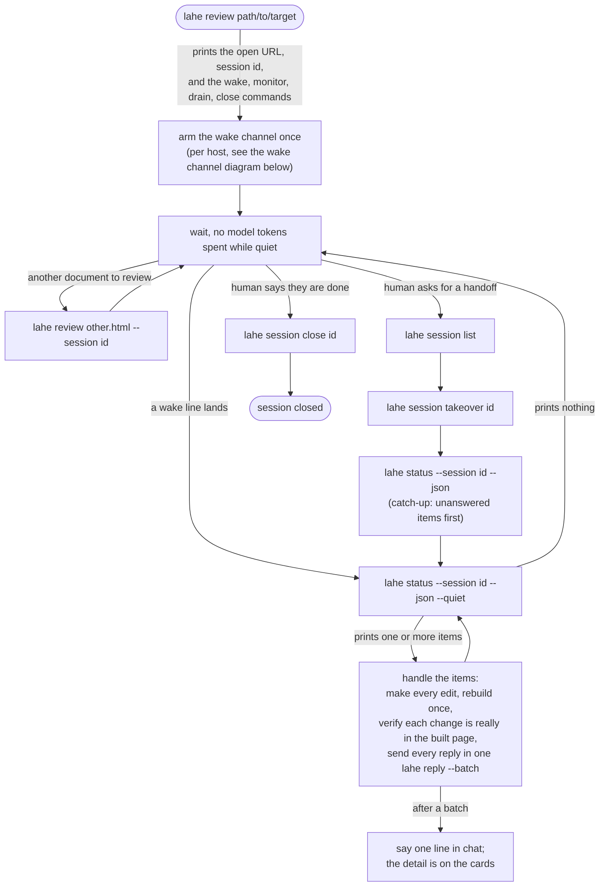
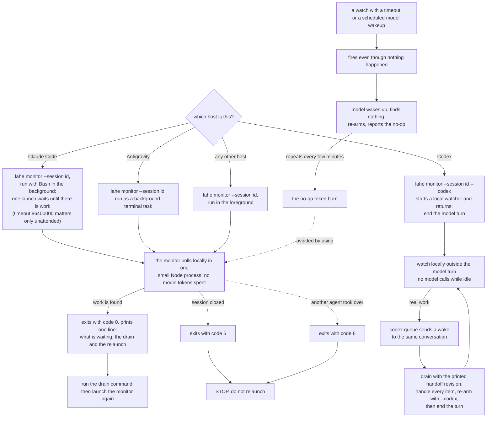
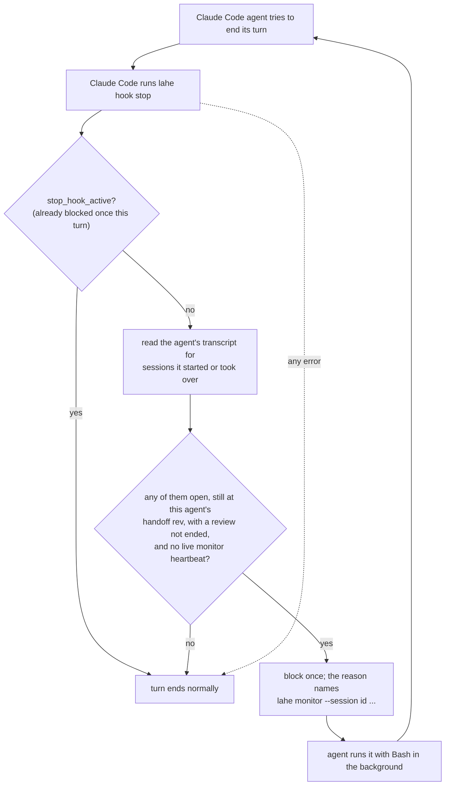

# The agent's loop

This is the loop an agent actually moves through, with the commands written
on the arrows instead of listed in prose. The second diagram below is the
wake channel in detail: how an agent hears about new work without spending
model tokens while nothing is happening, and what its three exit codes mean.

The wake channel itself differs by host, and it is the part where prose alone
has failed before: a monitor that quietly times out and relaunches is the
exact no-op token burn the wake channel exists to prevent.

On Claude Code the relaunch is not left to the agent's memory. In an
interactive session one launch waits until there is work (no time limit since
Claude Code 2.1.288), but the monitor can still be stopped by Claude Code's
memory killer, or hit its timeout in an unattended run, and an agent that
forgets to start it again leaves the session deaf. Lahe's Stop hook catches
that at the end of every turn:

## Whether one diagram could hold all of this

The spec set a hard condition: the workflow diagram may absorb the wake
channel only if it legibly carries all four of the wake feed being silent
versus a timer that is not, the per-host fan, the three exit codes, and the
timeout failure drawn as its own branch. Testing that against one drawing, the
per-host fan alone (four hosts, each with its own arming command) already
uses most of the width a flowchart can hold and stay readable, and the
failure branch needs its own lane so it reads as a warning rather than a
normal step. Cramming the main loop's five branches into the same picture
made both parts harder to read, not easier. So this file keeps two diagrams:
the loop above, and the wake channel below carrying all four required pieces.

## What to notice

- The main loop never has the agent stop and report that a wake arrived; the
  interrupt is a reason to keep working through drain, not a stopping point.
- The monitor's wake is one line, not the work. Only the drain prints items,
  so each item reaches the agent's context once. The drain leaves out the
  agent's own earlier answers in a thread, and the catch-up
  (`lahe status --json` without `--quiet`) keeps them. `lahe reply` prints back
  only the item and the status, with several items answered in one
  `lahe reply --batch` run, and after a batch the agent says one line in chat.
- Codex uses a local watcher that queues real work to the same conversation.
  The model turn ends while it waits, so idle monitoring cannot hold a graceful
  Codex restart open. Queue failures retry locally. After acceptance the worker
  exits; the agent drains to empty and re-arms it. One watcher covers the
  conversation's sessions, and guarded drains reject wakes from before a takeover.
  Other hosts keep their exit-on-work monitor. On Claude Code it runs with Bash in the background, where one
  launch waits until there is work (the 86400000 timeout matters only in an
  unattended run), and is launched again after each drain; the Stop hook
  blocks the end of a turn once when that relaunch was missed. A watch with a
  short timeout, or a scheduled wakeup, fires on nothing and looks exactly
  like new work landing, which is the no-op token burn shown in the lower
  diagram.
- Exit codes 5 and 6 both mean stop, but for different reasons: 5 is the
  reviewer ending the session on purpose, 6 is another agent explicitly
  taking it over. Either way, relaunching the monitor is wrong.
