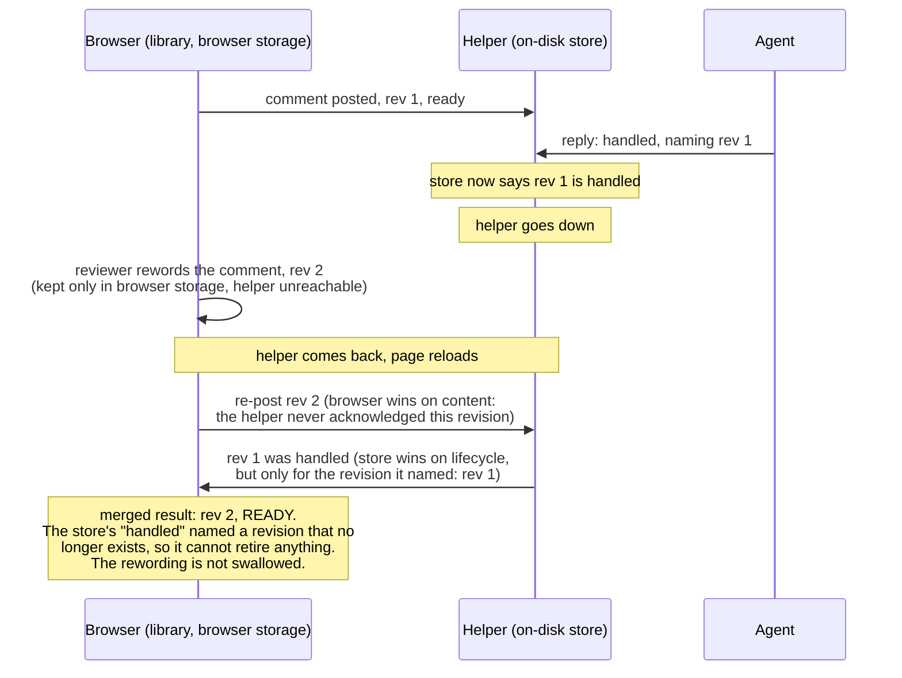
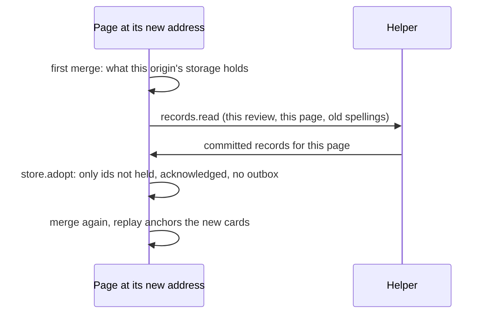

# Merge on load

When the browser and the helper's store reconnect, they can disagree about one item, and this diagram shows how that gets resolved. The rule (decision D5 in the architecture doc, and `src/shared/merge.js`) is short: the browser wins on content until the helper has acknowledged it, and the store wins on lifecycle, but only for the revision it is actually talking about. The worked case below is the one the rule exists to protect: an offline reword that must not get swallowed by a stale "handled."

## A page's old address (stable addresses)

A comment made at a page's old `127.0.0.1:<port>` address lives in that origin's browser storage, so the
rail at the page's stable address starts without it. On boot, a page whose script tag names old origins
asks the helper for its records once (`records.read`). Each one this browser does not hold comes in
through the same `mergeLists`, as `ONLY_STORE`: the store wins on content and lifecycle together. It is
written as acknowledged at its revision and never queued, so nothing goes back to the helper. An item
this browser already holds is left as it is, and a draft never comes over.

### A document whose worktree is gone

The same read brings a review's comments to a document's main-checkout copy
once its worktree is removed (spec 20261015.01). The helper maps a record made
at the worktree's address to the main copy (`fileForPageIn`), so the main
copy's script tag names the old address as a spelling, and `records.read`
returns those records, open and done, through the same `store.adopt`.

### A file that moved

The same read brings a file's comments to its new path once the agent moves it
and runs `lahe review <new path> --review <id>` (spec 20261017.01). The review
then records both paths. The helper pairs the gone page with the new file
(`pairOf`), so the new page's script tag names the old address as a spelling,
and `records.read` returns those records, open and done.

## What to notice

- **Two different fields, two different winners.** Content (the words, the region it is tied to) comes from the browser as long as the helper has not acknowledged that revision. Lifecycle (ready, handled, not_handled) comes from the store, but strictly per revision: a "handled" naming rev 1 can only ever retire rev 1.
- **The one exception: the reviewer's withdrawal.** When the reviewer starts rewording a committed item that is ready, the helper takes it to draft at the same revision. (A page from before spec 20261011.01 could also withdraw a not_handled item this way, and the helper still honors that.) It keeps the agent's state and reply, restores them when the wording comes back, and never takes the browser's claimed state. See `docs/diagrams/item_lifecycle.md`.
- **The reviewer's close stands at its revision.** "Mark as done" moves an item to `handled` in the browser before the helper hears the `item.closed` event. At the same revision, a browser copy that carries the reviewer's close keeps it, even when the store still says `ready` or `not_handled`: no reply at that revision can undo a close. A store at a newer revision still wins outright, because the close named older wording.
- **Why the reword survives.** The agent's reply named rev 1. By the time the merge runs, the item is at rev 2. `src/shared/lifecycle.js`'s revision rule refuses a reply that names an old revision, so "handled" never applies to the reviewer's new words, and the card stays outstanding.
- **This is a general merge rule, not a special case for this scenario.** `src/shared/merge.js` runs the same comparison (by revision, then by acknowledgment) for every item on every load or reconnect. The offline-reword case is simply the clearest example of why the per-revision half of the rule has to exist.
- **A full history version of this same case lives in `docs/features/20260812.01_live_agentic_html_editor/02_architecture_live_agentic_html_editor.md` under decision D5.** That copy is history and is not rewritten; this file is the current, standalone version other docs should link to.
