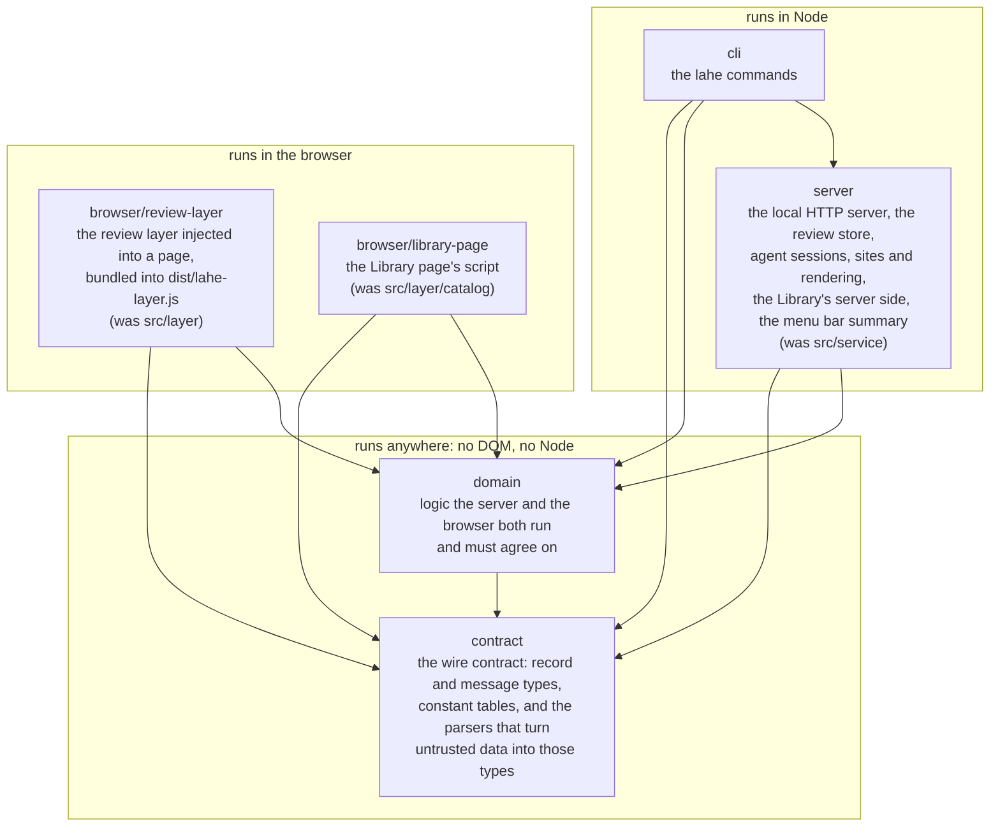

# Module map

**In progress.** This is the layout the [TypeScript migration](../features/20261112.01_typescript_migration/02_plan_typescript_migration.md) is moving `src/` to, not the layout of most of the code today. Most files are still JavaScript in `src/shared/`, `src/layer/`, `src/service/` and `src/cli/`, and move one slice at a time. [The target layout](../features/20261112.01_typescript_migration/parts/target_layout.md) says where each file goes and which slice moves it; `node scripts/import-layers.mts` prints what has moved and what may move next.

Put a new file in the folder below that matches its job. Each folder is its own TypeScript project, and the compiler refuses an import the arrows do not allow (error TS6307). See [docs/ongoing/code/README.md](../ongoing/code/README.md) for how the projects are set up.

An arrow means "may import". The two browser folders may not import each other, and nothing imports `cli`.

| Folder | Runs in | May import | Built so far |
| --- | --- | --- | --- |
| `src/contract/` | anywhere | nothing in `src/` | nothing yet |
| `src/domain/` | anywhere | `contract` | nothing yet |
| `src/server/` | Node | `contract`, `domain` | `sites/script-line.ts` |
| `src/cli/` | Node | `contract`, `domain`, `server` | nothing yet |
| `src/browser/review-layer/` | browser | `contract`, `domain` | nothing yet |
| `src/browser/library-page/` | browser | `contract`, `domain` | nothing yet |

While the move is under way, an old path that callers still use keeps a one-line forwarder to its new `.ts` file (listed in `FORWARDERS` in `src/shared/manifest.js`), and the layer bundle is still built from `src/shared/manifest.js`'s load order.
