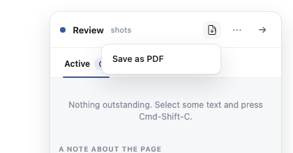
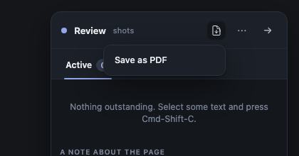
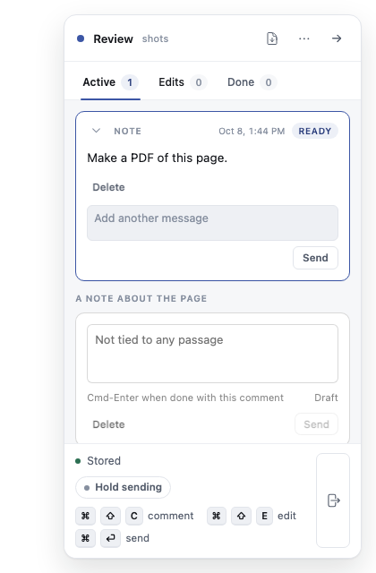
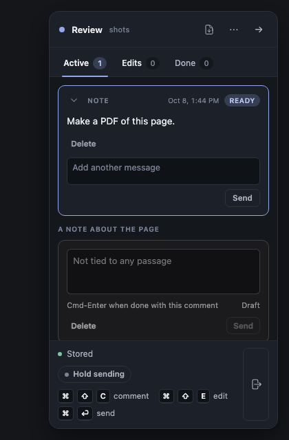

# PDF button: progress

**Documents:** [Decision](00_decision_pdf_button.md) · [Spec](01_spec_pdf_button.md) · **Progress**

**Status:** merged to main in [PR 36](https://github.com/kenxle/live-agentic-html-editor/pull/36) on 2026-10-11. The button shows up in your reviews once the main checkout is on main and the helper is restarted with `lahe serve --restart`.

## What it looks like

The button sits in the rail's top bar, between the Document style button and the ⋯ menu. Clicking it opens a tray with one item.

Choosing "Save as PDF" sends the note at once. It lands as a ready card in the Active tab, and the note box below it is left alone.

The screenshots come from the same build that passed `test/browser/pdf_button.spec.js` (4 passed).

## Checks

- `test/browser/pdf_button.spec.js`: 4 passed. It covers the tray, Esc, click-outside and Tab, a ready note sent once, the switch to the Active tab, the note box left alone, and a read-only window.
- `npm run gate` on the final code: lint and the bundle check clean, unit 2469 passed and 0 failed, Chromium 840 passed.
- After main moved (PR 37), main was merged in and `npm run gate` ran again on that commit: unit 2469 passed and 0 failed, Chromium 840 passed. GitHub's check passed before the merge.
- Tried live on a preview helper: the "Save as PDF" click reached the agent, which made the PDF.
- Code review (one independent reviewer): nothing serious. Two findings, both fixed: the tray now closes when a Turbo page swap rebuilds the page, and the test now proves the switch to the Active tab. Tab also closes the tray now, as it closes the menu.
- Leftover helpers: 1 before the test runs and 1 after (the real helper), so no leaks.

## To delete at cleanup

- `docs/features/20261008.01_pdf_button/00_decision_pdf_button.md` in the main checkout: an uncommitted copy. The committed one is on this branch.
- The `node_modules` symlink in this worktree. It is not committed.
- `.claude-pr202610081400.md` in this worktree: the PR body. It is not committed.
