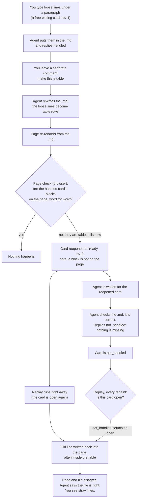

# Old words stuck on the page after a restructure

## Status

Nothing open here. You chose A plus H, without a flag: once the agent answers a card, the page shows the file. The work is in [the spec](01_spec_flag_dont_hold.md), which is where progress goes.

## The short version

Your file was correct the whole time. Your browser was re-adding words from old cards, so the page and the file disagreed.

It takes four steps, and every one of them works as designed on its own:

1. You type loose lines. The agent places them and says handled.
2. You ask the agent to reshape those lines (a file tree, a table). It does. The loose lines no longer exist as written.
3. Your browser's **page check** sees the old lines missing, decides the agent's change was lost, and reopens the old card. Reopening also tells **replay** to write the old lines back into the page right away.
4. The agent replies `not_handled` ("nothing is missing"). Our own instructions tell it to do that. But `not_handled` still counts as open work to replay, so the browser keeps writing the old lines back on every repaint.

The file never gets the old lines. Only your screen does. That is the "edit stuck on the page while the agent says the file is right" you have been seeing.

## The parts involved

| Part | Where it runs | What it does |
| --- | --- | --- |
| The card (item) | stored in the review folder | One comment or edit. States: draft, ready, handled, not_handled. See [item lifecycle](../../diagrams/item_lifecycle.md) |
| Free-writing run | a kind of card | New text you typed after a paragraph. Its words are kept as a list of blocks (`new_blocks`) |
| Replay | your browser | After every repaint, walks every open card and writes its words onto the page if they are missing. See [replay branches](../../diagrams/replay_branches.md) |
| Page check | your browser | After a repaint, looks at every *handled* card. If the card's words are gone from the page, it reopens the card with a "Reopened by the page check" note |
| Handled check | the helper | When the agent says handled, reads the built page and holds the card if the words are not there |
| The agent | its own process | Edits the source, replies handled, not_handled, or question |

The key rule in the code: replay treats both `ready` and `not_handled` as open ([record.js, isOutstanding](../../../src/shared/record.js)). Replay only skips `handled` cards.

## The whole flow

Two loops keep it going:

- The page check does not fire twice for the same card and revision ([answeredPageCheckReopen](../../../src/shared/record.js)), so this is not an endless reopen loop.
- The loop that stays is replay. It writes the refused card's words back after every repaint, for as long as the card exists.

## Why the existing safety nets miss it

- **The "handed over" rule only counts edits, not comments.** The page check already knows a block can be taken over by a later card. It only counts a later *hand edit* that starts from that block's exact words ([handedOverBlocks](../../../src/shared/record.js)). Your "make a table" was a comment, so the check doesn't treat it as a handover.
- **The helper's check and the browser's check use different rules.** The helper says: if the agent changed the passage, in any words, it did work, so don't second-guess it. The browser's page check for free-writing has no such rule. It wants every block word for word.
- **The agent's escape hatch makes things worse.** The skill and contract tell the agent to reply `not_handled` when the check is wrong. That takes the card off the agent's list. It does not stop replay, because replay counts `not_handled` as open.
- **There is no "the page is right, drop this card" button.** You asked "how do I dismiss them?" Today you can only delete the card, which erases its history. So the agent's fallback was a fresh review, which loses all your history.

## What actually happened, from the review's log

The "Competitors" card in the hackathon review (timestamps as written in the log, UTC):

| Time | What happened |
| --- | --- |
| 12:36:23 | You add the line "Competitors" under "The company you are hacking for". Card ready, rev 1 |
| 12:36:41 | Agent places it, replies handled |
| 12:36:45 | You comment "make a table" |
| 12:37:13 | Agent turns the list into a table, replies handled |
| 12:37:42 | Page check reopens the Competitors card, rev 2 ("a block landed with a different tag") |
| 12:37:52 | Agent replies not_handled: "These lines are now rows in the research table you asked for" |
| 12:44:03 | You comment "formatting is messed up in this table". Replay had put "Competitors" back inside the table |

The folder-tree cards followed the same path at 12:27 to 12:28. Five cards in that review are stuck this way.

The [bulletin row from 2026-10-08](../../BULLETIN.md) (LAHE-replayed-new-blocks-after-restructure) is the same bug. Its guess, "the layer replays handled new_blocks", is slightly off. Handled cards are not replayed. The page check reopens them first, and *then* they are replayed.

## Why does replay let the page differ from the file?

On purpose, for one reason: so your edits don't vanish while the agent is still working on them.

You type straight into the page. The file doesn't have your words until the agent puts them there. Meanwhile the page reloads for other reasons: the agent landed a different change, the Markdown re-rendered, a dev server hot-reloaded. Each reload draws the page from the file, which would wipe every edit the agent hasn't reached yet. Replay draws them back on top. That is decision D7 in the [architecture](../20260812.01_live_agentic_html_editor/02_architecture_live_agentic_html_editor.md), and it grounds two brief rules: nothing you type is lost, and the page keeps working while it changes underneath you.

So the page is meant to be "the file, plus your edits the agent hasn't answered yet." That gap is supposed to be temporary. It should close when the agent answers.

**Where the logic isn't sound:** replay doesn't use "has the agent answered?" It uses "is the card open?", and two kinds of card count as open even though the agent has answered:

- **Refused cards** (`not_handled`). The agent has answered "no", but the page keeps showing your version forever.
- **Cards the page check reopened.** The agent already said handled. The browser then decides on its own that the change is missing and redraws your old words, before the agent has said anything new.

In both cases the gap never closes, because nothing the agent does can close it. That's the bug you've been seeing.

A sounder rule would be: **the page differs from the file only by edits still waiting for the agent's first answer, at their current revision.** Once the agent answers, the page is the file, and any disagreement shows on the card, not in the page. Options A and D below are the two halves of that rule. Together they make it the principle instead of a patch.

## Is this a fingerprinting problem?

Partly. [Fingerprinting](../../ongoing/FINGERPRINTING.md) answers "which element on the page is this card about?" Here that answer mostly worked. What failed is a different question: "is this card done?"

The two kinds of stuck card in the hackathon review show the difference:

- **"Competitors" was found.** The page check found the word "Competitors" right after its anchor, now as a table cell. Identity worked. The check reopened the card anyway, because the cell's tag (`td`) is not the tag you typed (`p`). The strict part is the done-check, not the fingerprint.
- **The folder lines were not found, and could not be.** "---- ongoing" became "│ ├── ongoing/". The words themselves changed. In a Markdown source the agent can't carry a `data-lahe-id` stamp (`stamp_carriable` is false), so words are the only identity. When the agent rewrites the words on purpose, no fingerprint can follow them with certainty.

**Would HTML instead of Markdown help?** Only a little. In HTML the agent can carry the stamp, so a reshaped block can still be found. But the stamp follows one element, and a restructure merges or retypes elements. Seven loose paragraphs becoming one tree block leave seven stamps with nowhere to go. "Competitors" moved into a table cell would carry its stamp and still fail the tag check. The stuck page comes from the done-check and replay rules, and those work the same way for both formats.

So what's lost is not the work we put into identity. What's missing is a rule that uses it the right way round.

The fingerprinting doc's main rule is "two jobs, opposite temperaments". A **write** must be certain or do nothing. A **point** gives the best honest answer. The page check breaks that rule. It asks for a certain, word-for-word match before it accepts a card as done, and when it doesn't get one, it causes a write (reopen, then replay). A false "missing" is the dangerous mistake here, so the check should lean the other way: if the block is *probably* still there, leave the card alone. That is option G below.

## Ways to fix it

Each option says what you would notice and what it costs.

### A. Never write a refused card onto the page

Replay skips `not_handled` cards. Your words stay on the card, with the agent's reason beside them, but they are no longer pasted into the page.

- What you notice: after an agent refuses something, the page shows what the file says. You read your version on the card.
- Cost: this changes a design rule. Today a refused edit stays visible on the page so your words are not lost from view. With A they live only on the card.
- Size: small. One rule in replay, plus tests.
- Fixes: the stuck loop for good, for any cause, not just restructures.

### B. Don't reopen a card you later asked to restructure

The page check counts a later handled *comment* on the same passage as a handover, the way it already counts a later edit. If you asked for a table and the agent made one, the old free-writing card counts as done.

- What you notice: no "Reopened by the page check" on old cards after you ask for a restructure. No stray lines.
- Cost: "the same passage" has to be decided. A comment points at a quoted region. The check would need to match that region to the run's blocks. A comment on a nearby heading might not match, and then the old behavior comes back.
- Size: medium.
- Fixes: the most common trigger, without changing what refused cards do.

### C. Make the browser's check use the helper's rule

When the source was written after the card was handled, the page check trusts that the agent changed the passage on purpose and does not reopen. This is the rule the helper already uses for a handled reply.

- What you notice: same as B, for every kind of restructure, whether you asked by comment, by chat, or not at all.
- Cost: weakens the page check's real job. It exists to catch a rebuild that quietly dropped your words, and a rebuild is a source write too. Some real losses would go unflagged.
- Size: medium. The browser has to learn when the source last changed.

### D. A reopen flags but does not write

A page-check reopen marks the card and wakes the agent, but replay does not write the old words until the agent confirms they really are missing.

- What you notice: false alarms show as a note on the card, never as stray text in the page.
- Cost: today the immediate write is deliberate. It is how your bold or italic comes back after a rebuild dropped it. D delays that until the agent acts.
- Size: medium. A new "flagged, not replayed" status on the card.

### E. Let the agent say "restructured on request"

Add a reply the agent can give, such as `handled --superseded-by <the comment's id>`. The browser records it as a handover, retires the card, and stops replaying it.

- What you notice: the agent's reply on the card reads "turned into the table you asked for", and the card moves to Done.
- Cost: relies on every agent using it correctly. It changes the contract and the skill, which travel together with four copies.
- Size: medium.

### F. Give you a "Keep the page" button

On a refused or reopened card, a button that says the page is right. It retires the card into Done with its history kept, instead of deleting it.

- What you notice: one click to clear a stuck card, with nothing lost.
- Cost: it is a workaround. You still have to notice the stray line and click.
- Size: small to medium.
- Good alongside any other option, as the manual way out.

### G. The page check uses the pointing ladder, not the write ladder

Before reopening a handled card, the page check asks the looser question the highlight already asks: is there a *probable* match for this block near its anchor? Same words with a different tag, or the words inside a bigger block, count as present. Only a block with no probable match anywhere reopens the card.

- What you notice: "Competitors" as a table cell no longer reopens its card. A rebuild that really drops your paragraph still does.
- Cost: the folder-tree case changed the words too much for any match, so G alone does not catch it. It also loosens the tag and formatting checks, which caught real misses before (an agent that dropped your bold).
- Size: medium. The pointing ladder exists already; the check would call it.
- Fixes: the "found it, but in a different shape" half of the problem, using the fingerprinting work as it was meant to be used.

### H. Flag, don't hold (your direction)

Once a card is handled, the page check stops enforcing it. It still looks, and if your words are no longer on the page, it marks the card: "the agent reworded what you wrote", with both versions shown. Nothing is reopened and nothing is written back unless you press Reopen on the card.

- What you notice: no stray lines, no surprise reopens. A quiet note on cards where your words changed, and one click to push back.
- Cost: a rebuild that really dropped your words is flagged instead of fixed automatically. You have to notice the flag and press Reopen. Today the tool fixes it without asking. That was the reason the check reopened in the first place, for example to restore bold that a rebuild dropped.
- Size: medium. It replaces D, and makes G optional: G would only make the flag show less often.
- Fixes: both stuck cases, and any future restructure you ask for.

### How they compare

| Option | Stops stray lines | Stops false reopens | Changes a design rule | Size |
| --- | --- | --- | --- | --- |
| A. refused never written | yes, always | no | yes | small |
| B. comment counts as handover | when the match works | when the match works | no | medium |
| C. trust source writes | yes | yes | weakens the check | medium |
| D. reopen flags only | yes | no, but harmless | yes | medium |
| E. agent says superseded | when agents use it | no | contract change | medium |
| F. Keep the page button | by hand | no | no | small to medium |
| G. check uses the pointing ladder | when a probable match exists | when a probable match exists | no, applies an existing rule | medium |
| H. flag, don't hold | yes | yes, it only flags | yes | medium |

## Related

- [Bulletin row LAHE-replayed-new-blocks-after-restructure](../../BULLETIN.md). Same bug, and a second symptom: deleting the replayed lines on the page made them multiply. That is probably your deletion recorded as a new edit fighting the replayed card. I have not traced it yet.
- [Item lifecycle](../../diagrams/item_lifecycle.md), [replay branches](../../diagrams/replay_branches.md).
- Code: the page check is `runRevertCheck` in [src/layer/index.js](../../../src/layer/index.js) and `runCheckReason` in [src/layer/replay.js](../../../src/layer/replay.js).

## Right now, for the hackathon article

The five stuck cards will keep re-adding lines until they are gone. I have not touched that review, because another agent session owns it. The agent there already opened a fresh page, which works but drops the history. If you want the history kept, nothing short of a fix above keeps both.

## Decisions

- Chosen: A (refused cards are not written onto the page) and H (the page check stops reopening handled cards over your words). H ships with no flag, note or button: the page behaves like a normal document.
- Not chosen: B, C, D, E, F and G. F (a way to dismiss a card) is boarded separately as LAHE-dismiss-card.
