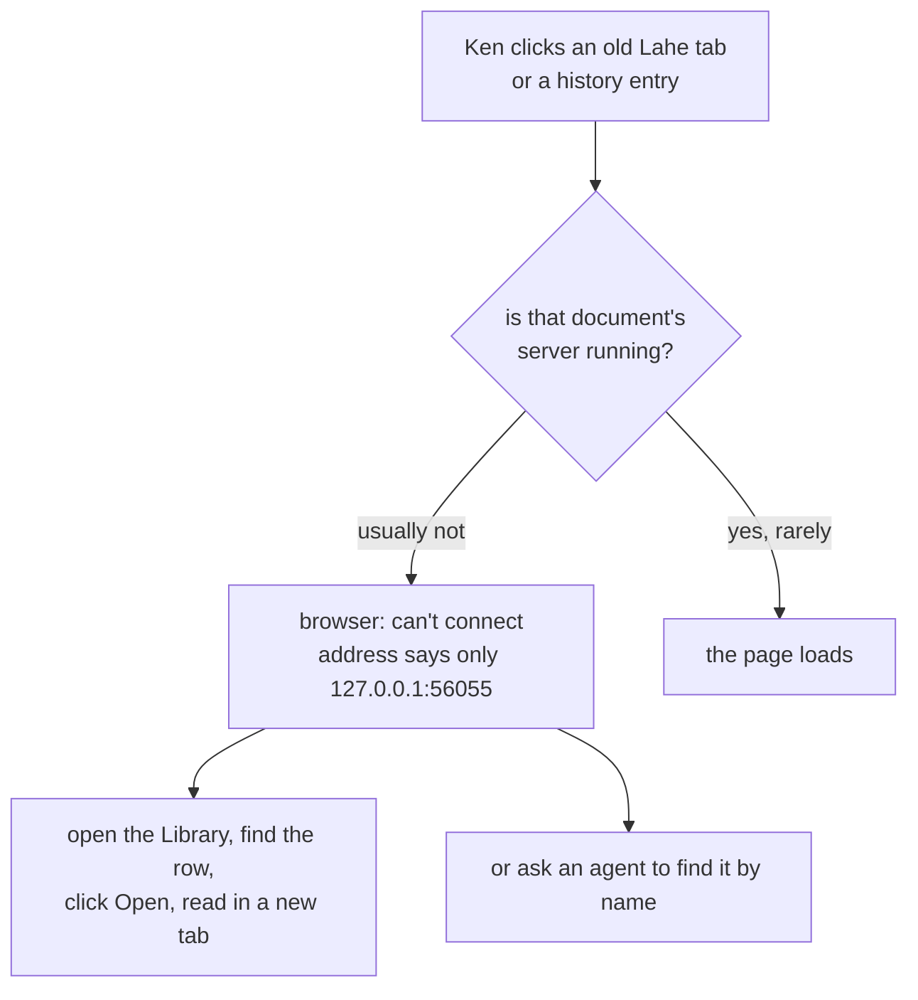
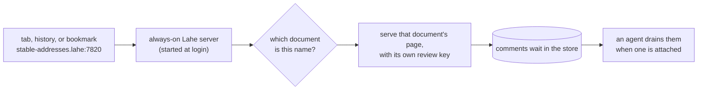

# Feature Brief: Stable addresses

## Summary

Every document Lahe serves gets an address that keeps working: `http://stable-addresses.lahe:7820/`. A tab left open overnight, a history entry, or a bookmark loads the page, with no agent running. The address names the document, so a tab says what it is. One always-on Lahe server, started at login, answers for every document on one port. Each document's name is its own browser origin, so documents stay walled off from each other as they are today.

## Problem, User, and Context

Ken reads nearly every plan, brief, and report through Lahe, and keeps many Lahe tabs open across days. Today those tabs die. Each document is served by a small server that an agent session owns. The server stops two minutes after its last window closes, or when the session closes, and the helper itself stops once nothing is open. After that, nothing answers at the address. The browser shows its own "can't connect" page, and Lahe never sees the request.

So Ken cannot use browser history or bookmarks to get back to a document. He routes through the Library or asks an agent, and he reads bare `127.0.0.1:56055` addresses trying to work out what a dead tab was. In his words: "it's the constant dead tabs that i run into and have to try and decipher what they are by the url."

The settled decisions, and the reasoning Ken reviewed, are on [the decisions page](../../ongoing/STABLE_ADDRESSES.md). Prior work: [the crucible](00_crucible_stable_addresses.md); option D on [the Library ideas page](../../ongoing/DOCUMENT_INDEX_IDEAS.md), dropped on 2026-09-22 and revisited here.

The user is Ken today, on a Mac laptop. Lahe is public, and other people run it on Mac, Linux, and Windows, so nothing here may be Mac-only in the core.

## Non-Goals

::: callout-nongoal
- Not reviving tabs opened before this feature ships. Their addresses used ports nothing will listen on again. The Library's Open moves them to a stable address.
- Not stable addresses for pages served by a server Lahe does not own, like an app's own dev server. Lahe reviews those where they run.
- Not a better story for deleted or moved files. A gone file gets a plain "this file is gone" page with a link to the Library, and no more.
- Not the Mac menu-bar companion app. It is its own follow-up.
- Not a single-file build of Lahe that runs without Node. That stays open for later.
- Not a change to agent sessions, takeover, or the monitor. Sessions still own reviews; they stop owning the page servers.
- Not new outside packages. The zero-runtime-dependency rule holds; the install step is for setup only.
:::

## Solution Outline

1. **One always-on Lahe server.** It starts when Ken logs in and restarts if it stops. It answers for every document Lahe serves, whether or not an agent is working on it.
2. **An address per document, named after it.** The first time a document is served, it gets a short name from its title or file name. The name never changes after that. The address is `http://<name>.lahe:<port>/`.
3. **One shared port.** Every document uses the same port. The server reads the name in the address to know which document was asked for.
4. **`.lahe` after a one-time setup, `.lahe.localhost` without it.** A setup step, run once with an admin password, teaches the computer that `.lahe` names mean "this computer". Until that is done, or if it fails, every address uses `.lahe.localhost` instead, which every browser already sends to this computer.
5. **Agents keep working the same way.** `lahe review` prints the stable address. Sessions, the monitor, and takeover are unchanged. A comment left on a page with no agent waits in the store, as it does after the Library's Open today.

## Requirements

::: callout-req
**R1. An old address keeps working.** A document's address loads its page after the agent session closes, after any idle time, after the server restarts, and after a reboot. Nobody has to run a command first.
:::

::: callout-req
**R2. A page loads with no agent.** Visiting an address with no agent attached shows the page and lets Ken comment. Comments wait for an agent, and the rail's "No agent watching" line says so, as it does after the Library's Open today.
:::

::: callout-req
**R3. The address names the document.** The name comes from the document's title or file name, in lowercase words joined by dashes. Two documents with the same name get a short tag to tell them apart. A document's name is fixed the first time it is served and never changes, even if its title does.
:::

::: callout-req
**R4. Documents stay walled off.** Each document's name is its own browser origin. JavaScript on one document's page cannot read another document's page, its comment key, or its drafts, and cannot use the Library's controls. This holds as strongly as separate ports do today.
:::

::: callout-req
**R5. One port for every document.** All documents share one port, picked once at install and kept away from common dev-server ports. If something else holds that port when the server starts, the server says so plainly in its log and in `lahe status`, rather than moving documents to random ports.
:::

::: callout-req
**R6. `.lahe` with a fallback.** After the one-time setup, addresses end in `.lahe`. The setup asks for an admin password once, ever. Without the setup, or when the setup is broken, addresses end in `.lahe.localhost` and everything else works the same. `lahe status` says which one is in use and why.
:::

::: callout-req
**R7. Starts at login on every system.** An install command sets the server to start at login and restart if it stops, on macOS, Linux, and Windows. An uninstall command removes that, and removes the `.lahe` setup. Running Lahe from a clone without installing still works: `lahe review` starts the server as it does today, and addresses are stable for as long as it runs.
:::

::: callout-req
**R8. Every existing document can get an address.** Any review already in the state folder, served by Lahe, gets its stable address the next time it is served: by `lahe review`, or by the Library's Open. The Library's rows link to stable addresses.
:::

::: callout-req
**R9. Drafts come back.** Unsent drafts saved on a document's page are there when that address is opened again, because the address no longer changes.
:::

::: callout-req
**R10. Only this computer can reach it.** The server answers only on this computer. A request naming a host that is not one of Lahe's own names is refused, so a website cannot reach a page by pointing its own domain at this computer.
:::

::: callout-req
**R11. Light when idle.** The always-on server uses no CPU when nothing is open and about as much memory as one helper does today. The plan measures it before and after.
:::

::: callout-req
**R12. Agents are told.** `lahe review` prints the stable address. The skill, the contract inside every review, `docs/CLI.md`, and the diagrams describe the new addresses and the always-on server, and none of them still describes per-session page servers or random ports.
:::

## UX Notes

- The address bar is the UI. A name Ken can read at a glance matters more than a short one: `stable-addresses.lahe:7820` beats `ra192291dfb29.lahe:7820`.
- The fallback is not an error. A `.lahe.localhost` address works the same way; it is only longer.
- Typing `stable-addresses.lahe` by hand without `http://` may make the browser search instead. Links from history and bookmarks work either way. The install step's output says this once.
- The Library is reachable at a stable name too (`library.lahe:<port>`), so a bookmark to it never dies.

## Analytics / Logging

The helper log records, once per start: the port, whether `.lahe` or `.lahe.localhost` is in use and why, and whether the login item is installed. It records each new name given to a document, and each refused request with an unknown host name (without the page content). `lahe status` shows the same state. No other analytics: this is a local tool.

## Rollout / Flags

No flag. The install step is the switch: until it runs, Lahe behaves as described under R7 (the server starts on first use and addresses stay stable while it runs, using `.lahe.localhost`). Pages opened before the change stay dead, and the Library's Open moves each to its stable address. Uninstall puts the system back as it was. The login item names the Node that ran the install, the same way `npm run install-cli` does today. Removing that Node means running the install again, and `lahe status` says so.

## Questions and Decisions

<!-- forge-include: parts/brief/questions.md -->

## PM Review

Not yet run.
