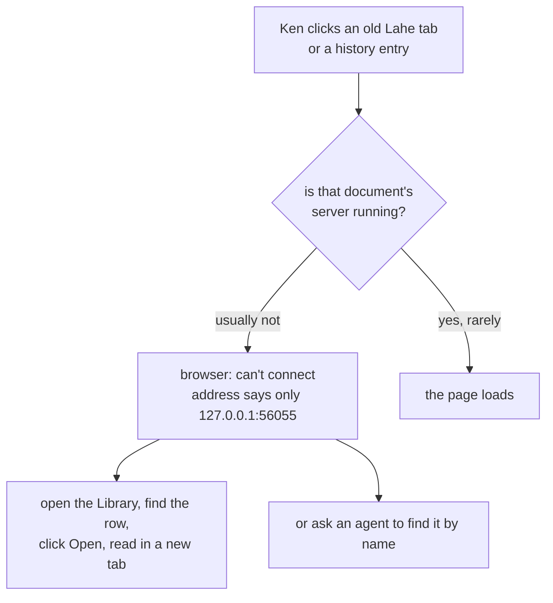
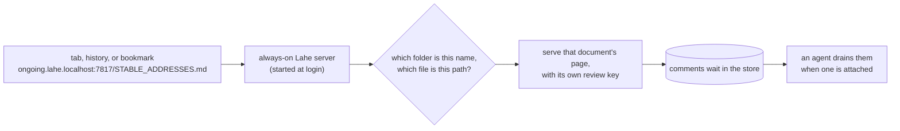

# Feature Brief: Stable addresses

## Summary

Every document Lahe serves gets an address that keeps working, like `http://20261011-02-stable-addresses.lahe.localhost:7817/01_brief_stable_addresses.md`. A tab left open overnight, a history entry, or a bookmark loads the page, with no agent running. The address names the folder and the file, so a tab says what it is. One always-on Lahe server, started at login, answers for every document on one port. Each folder's name is its own browser origin, so documents stay walled off from each other as they are today.

## Problem, User, and Context

Ken reads nearly every plan, brief, and report through Lahe, and keeps many Lahe tabs open across days. Today those tabs die. Each document is served by a small server that an agent session owns. The server stops two minutes after its last window closes, or when the session closes, and the helper itself stops once nothing is open. After that, nothing answers at the address. The browser shows its own "can't connect" page, and Lahe never sees the request.

So Ken cannot use browser history or bookmarks to get back to a document. He routes through the Library or asks an agent, and he reads bare `127.0.0.1:56055` addresses trying to work out what a dead tab was. In his words: "it's the constant dead tabs that i run into and have to try and decipher what they are by the url."

The settled decisions, and the reasoning Ken reviewed, are on [the decisions page](../../ongoing/STABLE_ADDRESSES.md). Prior work: [the crucible](00_crucible_stable_addresses.md); option D on [the Library ideas page](../../ongoing/DOCUMENT_INDEX_IDEAS.md), dropped on 2026-09-22 and revisited here.

**What "a document" means here:** one file on disk. The same file gets the same address every time it is served, in any review. The address has two parts: a name for the folder Lahe serves the file from, and the file's path in that folder.

**Related bulletin rows:** this feature closes or changes four open rows:

- LAHE-static-server-host-check (filed twice): page servers do not check the Host header. The always-on server checks it (requirement 10, only this computer can reach it).
- LAHE-idle-battery-cost: finished sessions' page servers keep running. There are no per-session page servers after this feature. Live tabs still poll, which requirement 11 (light when idle) measures.
- LAHE-library-quiet-close-no-self-stop: the helper stays up after a Library close. The server is meant to stay up now, so the row closes.
- LAHE-title-recorded-late: titles are only recorded after a comment. Names come from file names (requirement 3), so this row is not needed for addresses.

The user is Ken today, on a Mac laptop. Lahe is public, and other people run it on Mac, Linux, and Windows, so nothing here may be Mac-only in the core.

## Non-Goals

::: callout-nongoal
- Not reviving tabs opened before this feature ships. Their addresses used ports nothing will listen on again. The Library's Open moves them to a stable address.
- Not stable addresses for pages served by a server Lahe does not own, like an app's own dev server. Lahe reviews those where they run.
- Not a better story for deleted or moved files, beyond requirement 13 (worktree copies) and a plain "this file is gone" page.
- Not the Mac menu-bar companion app. It is its own follow-up.
- Not a single-file build of Lahe that runs without Node. That stays open for later.
- Not a change to how agents run a review: `lahe review`, the monitor, draining, replying, and takeover work as they do now. What changes underneath is who keeps pages served (the always-on server, not the session) and when the server stops (it does not, once installed).
- Not a change of address when a Library row is renamed. The address comes from the file name and stays put.
- Not new outside packages. The zero-runtime-dependency rule holds; the install step is for setup only.
:::

## Solution Outline

1. **One always-on Lahe server.** It starts when Ken logs in and restarts if it stops. It answers for every document Lahe serves, whether or not an agent is working on it.
2. **An address per document.** The first time Lahe serves from a folder, the folder gets a short name from its own name. The name stays the same after that. A document's address is `http://<folder name>.lahe.localhost:<port>/<file>`.
3. **One shared port.** Every document uses the same port. The server reads the name in the address to know which document was asked for.
4. **`.lahe.localhost` everywhere, with `.lahe` as a Mac option.** Every browser already sends `.localhost` names to this computer, with no setup. On a Mac, an optional setup step, run once with an admin password, also makes the shorter `.lahe` ending work. Which ending `lahe review` prints is the open decision in the questions below.
5. **Agents keep working the same way.** `lahe review` prints the stable address. Sessions, the monitor, and takeover are unchanged. A comment left on a page with no agent waits in the store, as it does after the Library's Open today.

## Requirements

::: callout-req
**R1. An old address keeps working.** Once Lahe is installed, a document's address loads its page after the agent session closes, after any idle time, after the server restarts, and after a reboot. Nobody has to run a command first. Without the install, see requirement 7 (starts at login).
:::

::: callout-req
**R2. A page loads with no agent.** Visiting an address with no agent attached shows the page and lets Ken comment. Comments wait for an agent, and the rail's "No agent watching" line says so, as it does after the Library's Open today.
:::

::: callout-req
**R3. The address names the folder and the file.** The folder's name, in lowercase words joined by dashes, comes first: `20261011.02_stable_addresses` becomes `20261011-02-stable-addresses`. The file's path in that folder comes after the port, as it does today. Two different folders with the same name get a short tag from their parent folder, like `notes-personal`. A folder keeps its name once it has one. Serving the same file again, in any review, gives the same address.
:::

::: callout-req
**R4. Documents stay walled off.** Each folder's name is its own browser origin, the same unit a page server is today. JavaScript on a page in one folder cannot read pages, comment keys, or drafts from another folder, and cannot use the Library's controls. Files in the same folder share an origin, as they do today. Hidden files are never served.
:::

::: callout-req
**R5. One port for every document.** All documents share one port: the helper's own port, 7817 unless the install picks another. It is kept away from common dev-server ports. If something else holds that port when the server starts, `lahe review`, `lahe status`, and the log say so plainly, naming the port, rather than moving documents to random ports.
:::

::: callout-req
**R6. `.lahe.localhost` works everywhere; `.lahe` is a guarded Mac option.** Every name answers at `.lahe.localhost` on every system, with no setup, so those addresses keep working through install, uninstall, and any setup failure. On macOS, an optional setup (an admin password, once at setup) makes the same names answer at `.lahe` too. Lahe answers `.lahe` only after it has checked that its own setup is the one answering `.lahe` lookups on this machine. `lahe status` says which ending `lahe review` prints, and why.
:::

::: callout-req
**R7. Starts at login on every system.** An install command sets the server to start at login and restart if it stops, on macOS, Linux, and Windows. An uninstall command removes that, and removes the `.lahe` setup. Running Lahe from a clone without installing still works: `lahe review` starts the server as it does today, and a document's address stays the same. Its old tabs load again whenever the server is running, and are dead while it is not.
:::

::: callout-req
**R8. Every existing document can get an address.** Any review already in the state folder, served by Lahe, gets its stable address the next time it is served: by `lahe review`, or by the Library's Open. The Library's rows link to stable addresses.
:::

::: callout-req
**R8a. Links between pages keep working.** A link from one Lahe page to another file opens that file, with the rail it gets today. Images, styles, and scripts a page loads by relative path keep loading, as they do today.
:::

::: callout-req
**R9. Drafts come back.** Unsent drafts saved on a document's page are there when that address is opened again, because the address no longer changes.
:::

::: callout-req
**R10. Only this computer can reach it.** The server answers only on this computer. A request naming a host that is not one of Lahe's own names is refused, so a website cannot reach a page by pointing its own domain at this computer.
:::

::: callout-req
**R11. Light when idle.** The plan measures the always-on server in two states, and sets a limit for each before building: nothing open, and Ken's usual number of Lahe tabs left open overnight. Both are compared with today's helper plus its page servers.
:::

::: callout-req
**R12. Agents are told.** `lahe review` prints the stable address. The skill, the contract inside every review, `docs/CLI.md`, `docs/ongoing/LIBRARY.md`, `docs/ongoing/SESSION_OWNERSHIP.md`, and the diagrams describe the new addresses and the always-on server. None of them still describes per-session page servers or random ports.
:::

::: callout-req
**R13. A worktree document survives its worktree.** When a file served from a worktree is gone because the worktree was removed, its address shows the same file from the main checkout, read-only, if it exists there, with a note saying it moved. Commenting on it starts from the Library, as other moved documents do.
:::

::: callout-req
**R14. Wrong or gone addresses say so.** A name Lahe does not know shows a short page saying so, with a link to the Library. A file that is gone, with no main-checkout copy, shows a page naming the file and linking to the Library.
:::

::: callout-req
**R15. The Library has a stable address.** The Library answers at `library.lahe.localhost:<port>`, and at `127.0.0.1:<port>/catalog` as today. No folder can take the name `library`.
:::

## UX Notes

- The address bar is the UI. A name Ken can read at a glance matters more than a short one: `ongoing.lahe.localhost:7817/STABLE_ADDRESSES.md` beats `127.0.0.1:56055/STABLE_ADDRESSES-bd14d360685f150a.html`.
- The fallback is not an error. A `.lahe.localhost` address works the same way; it is only longer.
- Typing an address by hand: `.lahe.localhost` addresses work typed as they are. A `.lahe` address typed without `http://` may make the browser search instead. Links from history and bookmarks work either way.

## Analytics / Logging

The helper log records, once per start: the port, whether `.lahe` or `.lahe.localhost` is in use and why, and whether the login item is installed. It records each new name given to a document, and each refused request with an unknown host name (without the page content). `lahe status` shows the same state. No other analytics: this is a local tool.

## Rollout / Flags

No flag. The install step is the switch: until it runs, Lahe behaves as requirement 7 (starts at login) describes for a clone: the server starts on first use, and addresses stay the same while it runs. Pages opened before the change stay dead, and the Library's Open moves each to its stable address. Uninstall removes the login item and the `.lahe` setup; the names and the `.lahe.localhost` addresses keep working whenever the server runs. The login item names the Node that ran the install, the same way `npm run install-cli` does today. Removing that Node means running the install again, and `lahe status` says so.

## Questions and Decisions

<!-- forge-include: parts/brief/questions.md -->

## PM Review

Full prose in [the reviews file](01_brief_stable_addresses_reviews.md).

| # | Finding | Disposition | Rationale |
|---|---------|-------------|-----------|
| RF1 | Switching endings would kill addresses made under the other | Accepted | The server answers both endings for every name (requirement 6) |
| RF2 | "Works after reboot" contradicted the no-install case | Accepted | Requirement 1 now applies once installed; requirement 7 says what a clone gets |
| RF3 | "A document" was undefined | Accepted | Defined as one file; same file, same address; links between pages added as requirement 8a |
| RF4 | Worktree documents die with their worktree | Accepted | Requirement 13 serves the main-checkout copy, reusing the Library's mapping. Chosen without Ken, for review |
| RF5 | Idle cost measured the wrong idle | Accepted | Requirement 11 measures nothing open and Ken's usual tabs overnight, with limits set first |
| RF6 | Which systems get `.lahe` was unclear | Accepted | macOS only, as an option; `.lahe.localhost` everywhere |
| RF7 | Non-goal about sessions was false; docs list incomplete | Accepted | Non-goal reworded; LIBRARY.md and SESSION_OWNERSHIP.md added to requirement 12 |
| RF8 | Library address and gone-file page lived outside requirements | Accepted | Requirements 14 and 15 |
| RF9 | Names will come from file names | Accepted | Requirement 3 uses the file name; example updated; Library rename keeps the address |
| RF10 | Related bulletin rows not named | Accepted | Listed under the problem |
| RF11 | No word on a taken port or a mistyped name | Accepted | Requirements 5 and 14 |
| RF12 | Bare requirement number, absolutes, broken link | Accepted | Fixed |
