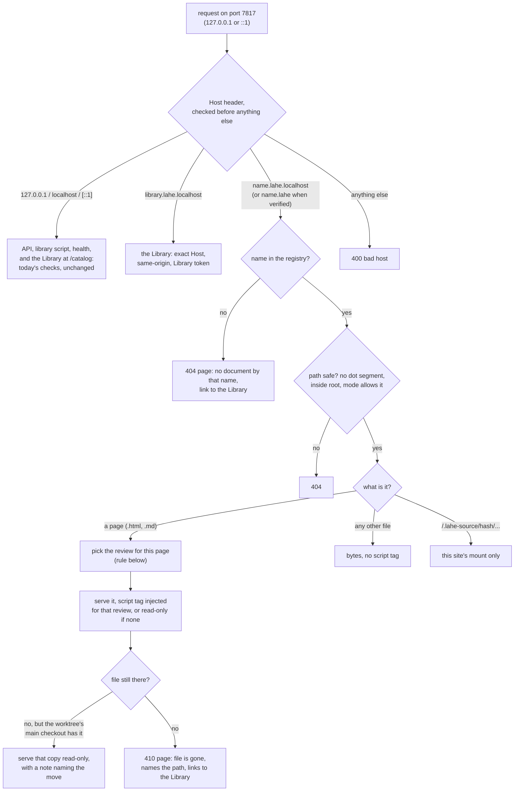
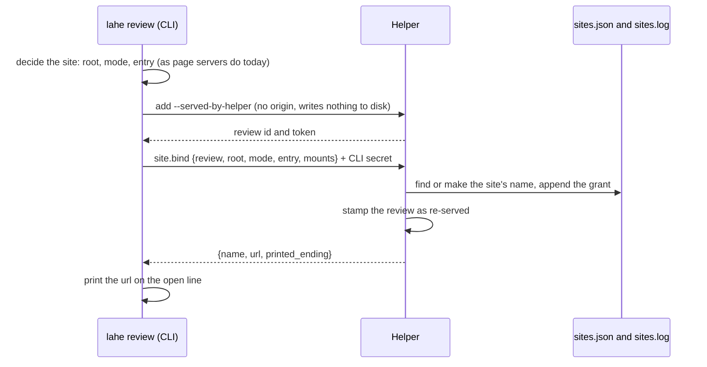
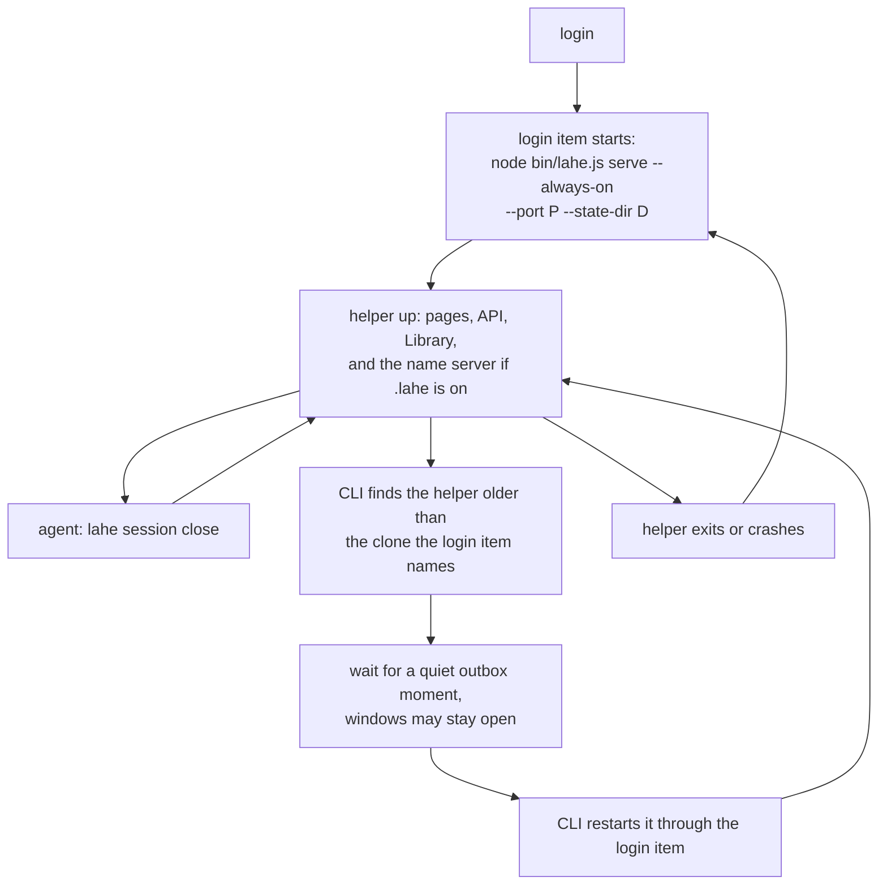

# Architecture: Stable addresses

## Summary

The helper becomes the always-on Lahe server and serves every page itself, on its own port (7817 by default). It routes by the Host header. `127.0.0.1` and `localhost` reach the API, as they do today. `library.lahe.localhost` reaches the Library. `<name>.lahe.localhost` reaches one named site. A site is what one page server serves today: one folder, or one notes page. Paths under a site are the same paths a page server uses today. Only the origin changes, from `127.0.0.1:<random port>` to `<name>.lahe.localhost:7817`. A name registry, written only by the helper, maps each name to its site. The review that answers on a page is chosen per request, by today's rule without the session filter. Per-session page-server processes are retired. An install command adds a login item on macOS, Linux, and Windows, and in that mode the helper does not stop itself. On macOS, the short `.lahe` ending is an opt-in alias that the helper answers only once it has proved it owns `.lahe` lookups on that machine.

::: callout-question
**One decision changed in review, and it is Ken's to confirm.** Ken chose `.lahe` as the printed ending. Both reviews found that a plain `http://name.lahe` page is not a "secure context" to the browser. That brings five costs:

- the address bar says "Not secure";
- copy buttons lose the clipboard API;
- the duplicate-tab guard (Web Locks) turns off;
- the browser stops sending the request headers the Library's checks and the redirect rule rely on;
- on any machine where Lahe does not own `.lahe` lookups, a hostile network could take over a name (DNS rebinding).

`.lahe.localhost` has none of these. This architecture prints `.lahe.localhost` by default, and offers `.lahe` on macOS as an opt-in, guarded alias. If Ken still wants `.lahe` printed, the plan adds the fallbacks listed under Failure Modes. See the brief's questions leaf.
:::

## Analysis of Existing Structure

Full survey with file and line citations: [recon](parts/architecture/recon.md). What matters for the design:

- **One detached process per folder per session serves pages on a random port** (`src/service/static_servers.js`). The helper serves only the API, the Library, and the library script.
- **A page server is the unit of isolation today.** Its origin is `127.0.0.1:<port>`, and it serves one root folder (or one notes page) for one session.
- **Every page-to-file mapper reads an item's `page_path` as "path under the served root"**: the healer's stand-down, the reload check, the handled check, linked documents, and the projection. Keeping paths unchanged keeps all of them working.
- **The rail follows rules Ken set** (`docs/ongoing/STATIC_SITE_FOLDER.md`): a single-page review lends its rail to its folder's pages, linked documents ride the linking review, and `--only` opts out. `findReviewForRequest` implements them, scoped to the server's session.
- **Most lifecycle code exists because processes stop and ports change:** the idle sweep, the session-close stop, port history and origin swaps, `SIGHUP` mount reloads, and Library Open's restart and rollback.

What stays: review records, tokens, the per-request checks (D11 in the original architecture), the layer's cross-origin calls to `127.0.0.1:<port>`, sessions and takeover, the monitor, and `lahe add` for `file://` and dev-server pages.

## Components / Modules Touched

| Area | Change |
|---|---|
| `src/service/sites.js` (new) | The name registry: make a name, keep it unique, resolve a Host to a site, record the worktree's main checkout, the grants log. Single writer. |
| `src/service/page_routes.js` (new) | Serves a site: path safety, hidden-file refusal, injection, Markdown render, mounts, the "unknown name" and "file is gone" pages. Takes the serving half of `static_servers.js`. |
| `src/service/name_server.js` (new) | Minimal DNS answerer for `*.lahe` on loopback UDP, macOS opt-in only. Node `dgram` only. |
| `src/service/login_item.js` (new), `src/cli/commands/install.js` (new) | `lahe install`, `lahe uninstall`, `lahe install --lahe-names`: login item per system, macOS resolver, `install.json`. |
| `src/service/index.js`, `routes.js`, `auth.js` | Host dispatch first; two listeners (`127.0.0.1`, `::1`); the `site.bind` route and its CLI secret; Library Hosts widened to `library.lahe.localhost`; Origin check against the registry; `Cross-Origin-Resource-Policy` on page responses. |
| `src/shared/protocol.js` | Host grammar per route family, name rules, `site.bind`, `PAGES` constants, the `data-lahe-aliases` attribute in `scriptTag`. |
| `src/shared/record.js`, `src/shared/review_format.js` | Page identity and grouping accept a page's aliases. |
| `src/service/reviews.js`, `heal.js`, `rebuild.js`, `handled_check.js`, `projection.js`, `markdown.js`, `markdown_links.js` | Ask the registry where they asked page-server records: `servesPath`, linked files, mounts, served roots. |
| `src/service/static_servers.js`, `idle_servers.js`, `self_stop.js` | Spawning retired. Old records stay readable for aliases and the one-time migration. Leftover processes stopped on every start. Self-stop off in always-on mode. |
| `src/service/catalog_*.js`, `src/layer/catalog/page.js` | Kinds redefined; Open binds instead of restarting; rows link to stable addresses; copy fallback. |
| `src/cli/index.js`, `commands/review.js`, `add.js`, `write.js`, `library.js`, `status.js`, `session.js` | New order for `lahe review`; status reports port, ending, install, and state folder; session close stops only the session; the CLI does not spawn a helper when installed. |
| `src/layer/index.js`, `export.js`, `overlay.js`, `store.js` | Read aliases; copy fallback; a lock fallback only if `.lahe` is printed. |
| `src/shared/manifest.js` | The four new files. |
| Docs | `skills/lahe/SKILL.md`, the contract in `review_format.js` and its copies, `docs/CLI.md`, `docs/CONTRACTS.md`, `docs/INSTALL.md`, `README.md`, `docs/ongoing/SERVING_ARCHITECTURES.md`, `STATIC_SITE_FOLDER.md`, `FREE_WRITING.md`, `LIBRARY.md`, `SESSION_OWNERSHIP.md`, and `docs/diagrams/` (`system_overview`, `session_ownership`, `review_round_trip`, `module_map`). |

## Data / State Changes

**`<state>/sites.json`** (new, mode 0600, written atomically by the helper only), plus **`<state>/sites.log`**, an append-only record of every grant. A registry that cannot be read is rebuilt from the log, never started empty; if neither reads, the helper serves known names read-only and mints no new name.

```json
{
  "version": 1,
  "sites": {
    "20261011-02-stable-addresses": {
      "root": "/Users/ken/Documents/workspace/lahe-worktrees/stable-addresses/docs/features/20261011.02_stable_addresses",
      "entry": "04_progress_stable_addresses.md",
      "mode": "folder",
      "mounts": { "9f2c1a": "/Users/ken/Documents/workspace/lahe-worktrees/stable-addresses/docs/ongoing" },
      "main_checkout": "/Users/ken/Documents/workspace/live-agentic-html-editor",
      "worktree_root": "/Users/ken/Documents/workspace/lahe-worktrees/stable-addresses",
      "created_at": "2026-10-11T16:40:00Z"
    }
  }
}
```

- **What Ken sees:** the name says the folder, and the path says the file: `http://docs-features-20261011-02-stable-addresses.lahe.localhost:7817/01_brief_stable_addresses.md`, or `http://ongoing.lahe.localhost:7817/STABLE_ADDRESSES.md`.
- **A site is a root plus a mode.** `folder` serves the root's tree, as a page server does today. `page-only` (a `lahe write` notes page) serves the one file plus Lahe's reserved files, and 404s everything else. Roots use `fs.realpathSync.native`.
- **For Markdown, the root is the source folder.** `/<file>.md` renders on request from the source, with the render cached by file time. `rebuild.js`, the reload check, and the handled check read the same render. The state folder's artifact copy is no longer the served page. Links outside the source folder use `/.lahe-source/<hash>/` mounts, stored on the site and served only under that site.
- **`entry`** is the page `lahe review` prints. It is not a binding: any review may answer on any page of the site, by the rule below.
- **Name rule.** Take the root folder and its two parents, in path order, stopping below the home folder. Lowercase each, turn each run of other characters into one dash, join with dashes, trim, and keep it to one DNS label of at most 63 characters by dropping from the outermost parent first. A name with nothing left becomes `doc`. Refuse anything starting `xn--` or with `--` in positions 3 and 4. A name that clashes with a different root takes one more parent, then a number. Reserved: `library`, `lahe`, `www`, `api`. A name is not reused for another root.
- **Worktrees.** At bind time, while the worktree exists, the helper reads its `.git` file to record `main_checkout` and `worktree_root`. The `.claude/worktrees/` pattern is the fallback for old entries.

**`<state>/install.json`** (new, written by `lahe install`): system, login item path, Node path, clone path, port, resolved state folder, `lahe_names` (on or off), resolver path.

**`<state>/cli-secret`** (new, mode 0600): a random secret the CLI sends on `site.bind`. Pages cannot read it.

**`service.json` gains** `pages: { port, printed_ending, lahe_names: { on, verified, reason } }`, `always_on`, and a state-folder id that `/health` also reports.

**Script tag gains** `data-lahe-aliases`: the old origins of this site's root, read from old page-server records, escaped as JSON and capped at 16 entries. Same paths, so an alias is only an origin.

**Review `origins` do not change.** A request whose Origin is a Lahe site name is checked against the registry: the site must exist, and the review must be the one this site's rule picks for that page. No name origins are added to reviews, so the 16-origin cap and the `service.json` rewrites are untouched.

## Key Flows

### Serving a request



- Every page response carries `Cross-Origin-Resource-Policy: same-origin`. Websites cannot embed or probe it.
- A page's path is its path under the root, as today. Links and images keep working with no redirects.
- A GET never writes. Names are only made by `site.bind`.

### Which review answers on a page

Today's `findReviewForRequest`, minus the session filter:

1. A review that recorded this exact file. The newest one wins.
2. Else the newest review whose served root is this site's root and is not `--only`.
3. Else the newest review that linked to this file.
4. Else none: the page is served read-only.

"Newest" means created or re-served most recently. `lahe review` and the Library's Open both stamp the review as re-served. So the most recent explicit act decides the rail, and a review created later still wins over an older Open.

### Binding (`lahe review`, `lahe write`, the Library's Open)



`site.bind` refuses any request carrying an `Origin` header, needs the CLI secret, and takes the root from the request, never from `meta.json`. `lahe review` on a stopped or missing helper: if installed, it asks the login item to start it; if not, it starts it detached, as today.

### The Library

| Kind | Means now | Open does |
|---|---|---|
| openable | the file is on disk, and Lahe can serve it (HTML or Markdown) | binds the site if needed, stamps the row's review as re-served, opens the address |
| worktree | the worktree is gone, and the registry recorded its main checkout | opens the read-only copy, as in the flow above |
| via-agent | a dev-server or `--origin` review | queues a pick-up, as today |
| legacy | a `lahe add` script-line review | queues a pick-up, as today |

If the row's file is the newest review's in an open session that is not this row's, Open goes to the address without re-stamping, and the row says which review holds the rail. Open no longer restarts processes or reopens sessions, so the reopened-session sweep and its rollback are removed.

### Always-on lifetime



- When installed, the CLI never spawns its own helper. It asks the login item, or reports what is wrong.
- `/health` reports the state-folder id. A CLI pointed at a different state folder says so, instead of failing on the port.
- Without the install (a plain clone), `lahe review` starts the helper detached, and self-stop works as today.
- Every start stops leftover page-server processes named in old records, until none is alive.

### Login item per system

| System | Mechanism | Restart if it stops | Unverified details for a spike |
|---|---|---|---|
| macOS | `~/Library/LaunchAgents/<label>.plist`, `RunAtLoad`, `KeepAlive`, `NumberOfFiles` raised | `launchd` | the "Background Items Added" notice names `node` |
| Linux | `~/.config/systemd/user/lahe.service`, `Restart=always` | `systemd --user` | machines without a user systemd: install says so and stays in clone mode |
| Windows | Task Scheduler task at logon, imported from XML | the task's restart-on-failure setting | a hidden window for `node.exe` |

`lahe install` refuses to run without a terminal and refuses to run as root. An agent tells the human to run it with `! lahe install`.

### `.lahe` on macOS (opt-in)

- `lahe install --lahe-names` writes `/etc/resolver/lahe` with one `sudo` call. The file content is fixed text plus the port number, with no shell interpolation, and it carries a Lahe marker.
- The helper's name server answers on `127.0.0.1` at the recorded port: `A 127.0.0.1` and `AAAA ::1` for names under `.lahe`, `REFUSED` for anything else. Malformed packets are dropped.
- **Verification before answering:** at start and every 5 minutes, the helper asks the system resolver for a fresh random name under `.lahe`. It accepts only when its own name server saw that exact query. Until then, page routes refuse `.lahe` Hosts, and `lahe review` prints `.lahe.localhost`.
- `lahe uninstall` removes the resolver file only if it carries the marker. After that, `.lahe` addresses stop resolving. The `.lahe.localhost` addresses keep working.
- The Library is never served on `library.lahe`, only on loopback and `library.lahe.localhost`.

### `.lahe` and a port-free address on Linux and Windows (written steps)

`docs/INSTALL.md` gives hand steps for each system. The same verification guards `.lahe` everywhere: the helper answers `.lahe` Hosts only after its own name server saw its random test query. The install spike confirms each step before it is written down.

| System | `.lahe` lookups | Port-free address |
|---|---|---|
| macOS | `/etc/resolver/lahe`, done by `lahe install --lahe-names` | a loopback port forward from 80 to Lahe's port, for `127.0.0.1` and `::1`, loaded at boot, done by `lahe install --lahe-names`. Approved by Ken |
| Linux | a `systemd-resolved` drop-in that sends `~lahe` to the helper's name server, where `systemd-resolved` runs. Other setups: the guide says so and stops | a one-time setting that lets normal programs use port 80, then the helper also listens on 80 |
| Windows | a name-resolution rule for `.lahe`. It cannot name a port, so the name server must also answer on port 53; the spike checks this | the helper also listens on 80 when nothing else holds it; usually no admin step |

If port 80 is taken, the helper keeps `:7817`, and `lahe status` names what holds 80. `:7817` addresses keep working in every case.

## Alternatives Considered

<!-- forge-include: parts/architecture/alternatives.md -->

## Failure Modes / Edge Cases

- **The port is taken at start.** The helper exits with a log line naming the port. The login item retries. `lahe review` and `lahe status` say so.
- **No IPv6 loopback.** A failed `::1` bind is a log line, not an exit.
- **The name server port is taken, or another process answers `.lahe`.** Verification fails, `.lahe` Hosts are refused, and `.lahe.localhost` is printed.
- **A browser skips the system resolver** (custom secure DNS). `.lahe` fails in that browser; `.lahe.localhost` works.
- **If Ken keeps `.lahe` as the printed ending:**
  - copy falls back to a hidden text field and the browser's copy command;
  - the duplicate-tab guard falls back to a lease in local storage;
  - page-type detection uses `Accept: text/html` when Fetch Metadata headers are missing;
  - the "Not secure" label stays.

  With `.lahe.localhost` printed, none of this is needed. The copy fallback ships either way for the Library page.
- **Old comments.** Same path, old origin: the alias list makes them match, in the rail and in `review.json`.
- **Old open tabs on random ports.** Dead. Leftover page servers are stopped.
- **Two reviews of one file in two sessions.** One name. The rail goes to the most recent explicit act, by the rule above.
- **A closed session's page.** Served, and comments are accepted. The rail's "No agent watching" line says so, as today.
- **A stale helper with tabs open.** Replaced at a quiet moment. The layer already survives a helper restart.
- **State folder removed.** Self-stop rule 2 still stops the helper. The login item restarts it into a fresh folder, with no names. A fresh folder means fresh names; a bookmark then says "no document by that name" rather than opening another file.
- **Per-origin preferences.** The style choice and rail preferences are per site, as they are per page server today. No change in practice.

## Security & Privacy Notes

- **Isolation is per site,** the same unit as today's page server, now without the per-session split. Two files in one folder share an origin, as they do today (brief requirement 4, documents stay walled off, now says so).
- **Host dispatch comes first.** It runs before `OPTIONS` handling and catalog matching. Each route family answers a closed set of Hosts: API on loopback; Library on loopback and `library.lahe.localhost`; pages on registered names only. The grammar is one lowercase label, the helper's own port, and no trailing dot.
- **DNS rebinding.** Browsers do not resolve `*.localhost` through DNS, so `.lahe.localhost` cannot be rebound. `.lahe` is answered only after the helper proves its own name server answers `.lahe` lookups on this machine. Everywhere else, a foreign Host is refused, as today.
- **Binding is CLI-only.** It needs the CLI secret from a 0600 file, and refuses any request carrying `Origin`. A page holding a review token cannot name a file or move a rail.
- **Origins come from the registry.** Review origins are untouched, so `review.write` still refuses non-loopback origins.
- **Hidden files and paths.** Dot segments and dotfiles are refused under every site. `page-only` sites serve one file.
- **The worktree fallback is read-only.** It never injects a token into a file nobody bound.
- **Always-on exposure.** Websites cannot reach pages: Host checks, `Cross-Origin-Resource-Policy`, and the Origin checks. Other accounts on the same computer, and sandboxed local programs with network access, can. Today they would have to find a short-lived random port first. This feature accepts that, and records it as a new residual under D11. `lahe install` warns when the machine has more than one interactive user.
- **Old origins.** When a site is bound, the old `127.0.0.1:<port>` origins of its reviews are removed, so they stop being credentials.
- Full security review: [reviews file](02_architecture_stable_addresses_reviews.md).

## Test Strategy

The plan owns the verification table: [plan](03_plan_stable_addresses.md). Each failure mode above has a row.

## Open Questions

Tracked in [the brief's questions leaf](parts/brief/questions.md).

## Architect Review

Full prose: [architect review](02_architecture_stable_addresses_reviews.md).

| # | Finding | Disposition | Rationale |
|---|---------|-------------|-----------|
| AR1 | Name origins overflow the 16-origin cap | Accepted | No origins added to reviews; Origin checked against the registry |
| AR2 | Per-file paths broke the page-to-file mappers | Accepted | A site is a root; paths unchanged |
| AR3 | File-folder roots broke Markdown and folder sites | Accepted | Site root as today; Markdown keeps mounts, stored on the site |
| AR4 | Rail-follows-reviewer rules dropped | Accepted | Today's review rule per request, without the session filter |
| AR5 | Healer would write tokens into served files | Accepted | `servesPath` asks the registry |
| AR6 | `lahe review` order undefined | Accepted | `add --served-by-helper`, then `site.bind` |
| AR7 | Notes pages would serve their folder | Accepted | `page-only` mode |
| AR8 | `.lahe` loses Web Locks | Accepted | Lock fallback only if `.lahe` is printed; `.lahe.localhost` recommended |
| AR9 | Stale helper never replaced; CLI double spawn | Accepted | Replace at a quiet moment; installed CLI never spawns; compare against the login item's clone |
| AR10 | Login item does not pin the state folder | Accepted | `--state-dir` and `--port` in the login item; state-folder id in `/health` |
| AR11 | Aliases missed `review.json` grouping | Accepted | Aliases are origins only, used by the rail and by `review_format` |
| AR12 | Worktree mapping misses sibling worktrees | Accepted | Read the `.git` file at bind time |
| AR13 | Uninstall breaks `.lahe` addresses | Accepted | `.lahe` is an opt-in alias; `.lahe.localhost` addresses survive uninstall. Ken confirms |
| AR14 | Library Open steals the rail; kinds undefined | Accepted | Library section above |
| AR15 | Registry loss can repoint a bookmark | Accepted | Grants log; no new names minted on an unreadable registry |
| AR16 | Redirect on `navigate` catches iframes | Accepted, moot | No redirects between pages in this design |
| AR17 | Leftover page servers in clone mode | Accepted | Stopped on every start |
| AR18 | Fixed name-server port; `::1` bind failure | Accepted | Port from `install.json`; `::1` failure is a log line |
| AR19 | Incomplete docs and code lists | Accepted | Components table |
| AR20 | Per-document preferences reset | Accepted, moot | Per site, as today |
| AR21 | CLI header is not an authority | Accepted | CLI secret |
| AR22 | Install details per system | Accepted | Spikes in the plan; no TTY means no install |
| AR23 | Name rule gaps | Accepted | Fallback stem, `realpathSync.native` |
| AR24 | No design note for idle cost | Accepted | Cost drivers named in the plan's measurement task |

## Security Review

Full prose: [security review](02_architecture_stable_addresses_reviews.md).

| # | Finding | Disposition | Rationale |
|---|---------|-------------|-----------|
| SR1 | `.lahe` answered where Lahe does not own lookups | Accepted | `.lahe` only after verifying our own name server; opt-in; Ken confirms the ending |
| SR2 | `address.bind` reachable from pages | Accepted | CLI secret, no Origin, root from the request |
| SR3 | Per-file origins did not wall files off | Accepted | Per-site isolation stated plainly; hidden files refused |
| SR4 | Other local users can read pages | Accepted as a residual | Recorded under D11; install warns on multi-user machines |
| SR5 | No Fetch Metadata on `http://*.lahe` | Accepted | Library never on `.lahe`; no redirects; `Accept` fallback if `.lahe` is printed |
| SR6 | Port squatting on the name server | Accepted | Verification by a fresh random query the helper must see |
| SR7 | GET minted names and origins | Accepted | GET never writes |
| SR8 | No `Cross-Origin-Resource-Policy` | Accepted | Header on every page response |
| SR9 | A name points to a path | Accepted | Worktree fallback is read-only; names are never reused for another root |
| SR10 | Old port origins stay valid | Accepted | Removed at bind |
| SR11 | Host routing order and grammar | Accepted | Security notes above |
| SR12 | `sudo`, resolver, and login item hygiene | Accepted | Fixed content, marker, no root runs, no TTY means no install |
| SR13 | Alias attribute escaping and size | Accepted | JSON-escaped, capped, helper-computed |
| SR14 | Browser behavior assumed | Accepted | Browser checks in the plan for Chrome, Firefox, and Safari |
