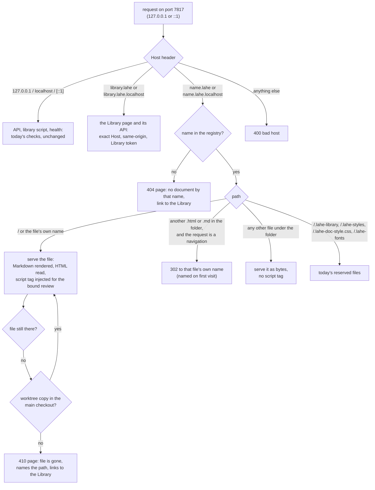
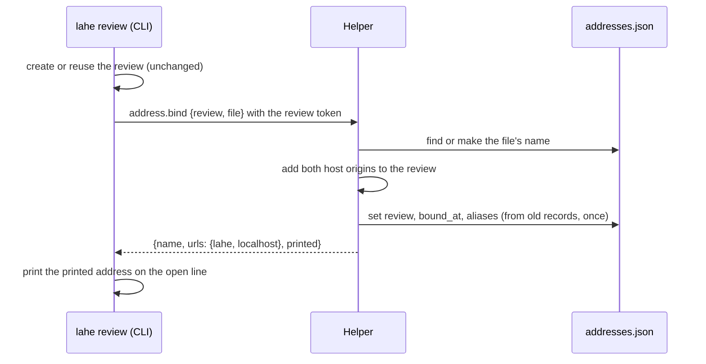
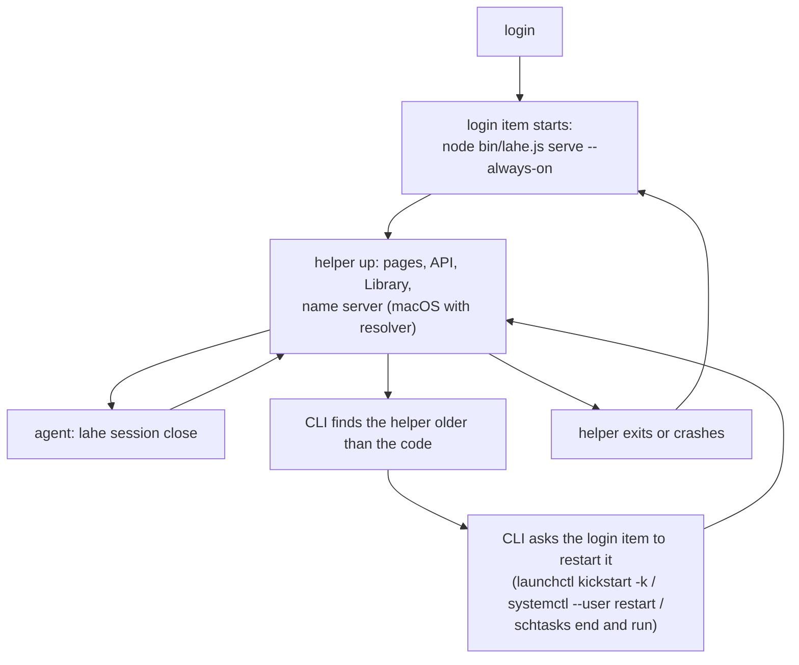

# Architecture: Stable addresses

## Summary

The helper becomes the always-on Lahe server and serves every page itself, on its own port (7817 by default). It routes by the Host header: `127.0.0.1` and `localhost` reach the API exactly as today; `library.lahe` reaches the Library; `<name>.lahe` and `<name>.lahe.localhost` reach one file each. A new name registry, written only by the helper, maps each name to one file on disk and to the review currently bound to it. Per-session page-server processes are retired for every shape Lahe serves itself. On macOS a tiny name server inside the helper answers `*.lahe` after a one-time resolver setup. An install command adds a login item on macOS, Linux, and Windows, and in that mode the helper never stops itself.

## Analysis of Existing Structure

Full survey with file and line citations: [recon](parts/architecture/recon.md). What matters for the design:

- **Today one process serves one folder for one session, on a random port.** The helper on 7817 serves only the API, the Library, and the library script. Pages come from detached page servers (`src/service/static_servers.js`), each injecting the review's script tag into HTML responses.
- **Isolation today is per folder per session,** because the browser origin is `127.0.0.1:<port>` and one port serves one folder for one session.
- **The helper checks every page request by origin.** A review's `origins` list holds `127.0.0.1:<port>` and `localhost:<port>`. The wire route that registers origins refuses anything but loopback names, so a leaked token cannot add a hostile origin.
- **Most lifecycle code exists because ports change or processes stop:** port history, origin swapping on restart, the idle sweep, the session-close stop, the `SIGHUP` mount reload, Library Open's restart and rollback.
- **Four blockers for host names** (recon "Surprises" 1 to 3 and 7): the origin rule refuses host names; old comments are matched by origin plus path, so they vanish at a new address; `http://x.lahe` is not a secure context, so the clipboard API is missing; both listeners are IPv4 only.

What stays: the review record, tokens, the per-request checks (decision D11 in the original architecture), the layer's cross-origin calls to `127.0.0.1:<port>`, sessions and takeover, the monitor, `lahe add` for `file://` and dev-server pages.

## Components / Modules Touched

| Area | Change |
|---|---|
| `src/service/addresses.js` (new) | The name registry: make a name from a file, keep it unique, bind a review, resolve a Host to a file, worktree fallback. Single writer. |
| `src/service/page_routes.js` (new) | Serves a named file: injection, Markdown render, relative assets, redirects between pages, the "unknown name" and "file is gone" pages. Takes over the serving half of `static_servers.js`. |
| `src/service/name_server.js` (new) | Minimal DNS answerer for `*.lahe` on loopback UDP. Node `dgram` only. |
| `src/service/index.js`, `routes.js`, `auth.js` | Host routing (API, Library, page), two listeners (`127.0.0.1` and `::1`), the `address.bind` route, Library Hosts widened to its two names. |
| `src/shared/protocol.js` | Host rules per route family, name rules, new route, `PAGES` constants (endings, DNS port). |
| `src/shared/record.js` | Page identity accepts the aliases a page is told about. |
| `src/service/static_servers.js`, `idle_servers.js`, `self_stop.js` | Page-server spawning retired for new serving; a one-time stop of leftover page servers; self-stop off in always-on mode. Old records stay readable for aliases. |
| `src/service/catalog_*.js` | Rows link to stable addresses; Open binds instead of restarting a process; the reopened-session sweep no longer stops servers. |
| `src/cli/commands/review.js`, `add.js`, `write.js`, `library.js`, `status.js`, `session.js` | Ask the helper to bind and print the stable address; status reports port, ending, install state; session close stops nothing but the session. |
| `src/cli/commands/install.js` (new), `src/service/login_item.js` (new) | `lahe install` and `lahe uninstall`: login item per system, resolver on macOS, install record. |
| `src/layer/export.js`, `overlay.js`, `catalog/page.js` | Copy works without the clipboard API (non-secure `.lahe` pages). |
| `src/layer/index.js` | Reads page aliases from the script tag. |
| Docs | `skills/lahe/SKILL.md`, the contract in `src/shared/review_format.js` and its copies, `docs/CLI.md`, `docs/CONTRACTS.md`, `docs/INSTALL.md`, `docs/ongoing/SERVING_ARCHITECTURES.md`, `LIBRARY.md`, `SESSION_OWNERSHIP.md`, `docs/diagrams/system_overview.md`, `session_ownership.md`, `review_round_trip.md`, `module_map.md`, `src/shared/manifest.js`. |

## Data / State Changes

**`<state>/addresses.json`** (new, mode 0600, written atomically by the helper only):

```json
{
  "version": 1,
  "names": {
    "01-brief-stable-addresses": {
      "file": "/Users/ken/.../01_brief_stable_addresses.md",
      "kind": "markdown",
      "review": "ra192291dfb29",
      "created_at": "2026-10-11T16:40:00Z",
      "bound_at": "2026-10-11T16:40:00Z",
      "aliases": [{ "origin": "http://127.0.0.1:56055", "path": "/STABLE_ADDRESSES-bd14d360685f150a.html" }]
    }
  }
}
```

- **One name per file.** `file` is the real path. The helper keeps a reverse index (file to name) in memory.
- **Name rule:** the file's base name without extension, lowercased, every run of other characters turned into one dash, trimmed, cut to 50 characters (a DNS label holds 63). `index` and `readme` take their folder's name first (`index.html` in `site/` becomes `site`). On a clash with a different file, add the parent folder's name (`readme-personal`), then a number (`readme-personal-2`). Reserved: `library`, `lahe`, `www`, `api`. A name is never reused for another file.
- **`kind`:** `html`, `markdown`, or `notes` (a `lahe write` page).
- **`review`:** the review whose rail this page carries. The latest `lahe review` of the file, in any session, or the Library's Open, sets it.
- **`aliases`:** the old `(origin, path)` pairs this file was served at, read from the old page-server records once, at bind time. They let old comments show on the new address (see page identity below).

**Review `origins`:** binding adds `http://<name>.lahe:<port>` and `http://<name>.lahe.localhost:<port>` to the review's list. The helper adds them internally (event `origin.registered` with `source: "address"`); the wire rule for `review.write` stays loopback only.

**`<state>/install.json`** (new, written by `lahe install`): system, login item path, Node path, clone path, port, resolver path (macOS), printed ending (`lahe` or `localhost`).

**`service.json` gains** `pages: { port, endings, printed, printed_reason, name_server }` and `always_on`.

**Script tag gains** `data-lahe-aliases`: the bound file's aliases plus its other ending, as JSON.

**Page identity:** an item's page matches the current page when its `(origin, path)` equals the current one, or equals one of the aliases the page was given. Comparison stays in `src/shared/record.js`; the alias list is data the helper computes.

## Key Flows

### Serving a request



- The root a name serves from is its file's folder, so relative images, styles, and scripts load as they do today.
- Only a top-level navigation (`Sec-Fetch-Mode: navigate`) to another page is redirected. A script's `fetch` of a sibling HTML file gets the bytes, never another file's token.
- The rail is injected only on the bound file's own page, for the bound review. A file with no bound review is served read-only, as pages outside any review are today.
- Folder reviews: the review records its folder. A page under it with no binding of its own is bound to the folder review on first visit.

### Binding a file (`lahe review`, `lahe write`, Library Open)



The CLI never writes the registry. `address.bind` uses the same authority as `review.write`: loopback Host, the CLI client header, the review's token, and the target must be the review's own file or a file under its folder.

### Always-on lifetime



Without the install (a plain clone), `lahe review` starts the helper detached as today, and self-stop keeps working: addresses stay the same, and they answer whenever the helper runs.

### Which ending is printed

`lahe review` prints `.lahe` when all of these hold, else `.lahe.localhost`: the system is macOS, `install.json` says the resolver is set up, the name server is listening, and a lookup of `library.lahe` through the system resolver returns a loopback address. The helper runs the check at start and every 5 minutes, and `lahe status` prints the reason. The server answers both endings for every name regardless.

### Login item per system

| System | Mechanism | Restart if it stops | Remove |
|---|---|---|---|
| macOS | `~/Library/LaunchAgents/<label>.plist`, `RunAtLoad`, `KeepAlive` | `launchd` | `launchctl bootout`, delete plist |
| Linux | `~/.config/systemd/user/lahe.service`, `Restart=always`, `WantedBy=default.target` | `systemd --user` | `systemctl --user disable --now`, delete unit |
| Windows | Task Scheduler task at logon, restart on failure, hidden window | Task Scheduler | `schtasks /Delete` |

Each names the absolute Node path and clone path, as `npm run install-cli` does. On Linux without `systemd --user`, `lahe install` says so and leaves the clone behavior in place.

### `.lahe` on macOS

`lahe install` writes `/etc/resolver/lahe` (`nameserver 127.0.0.1`, `port 7853`) with one `sudo`. The helper's name server answers on `127.0.0.1:7853`: `A 127.0.0.1` and `AAAA ::1` for `lahe` and any name under it, `REFUSED` for anything else. Linux and Windows print `.lahe.localhost` in this feature. Browsers send `*.localhost` to this computer on every system.

## Alternatives Considered

<!-- forge-include: parts/architecture/alternatives.md -->

## Failure Modes / Edge Cases

- **The port is taken at start.** The helper exits with a clear log line naming the port and the process holding it if the system can tell. The login item retries. `lahe review` and `lahe status` say so (brief requirement 5, one port).
- **The name server's port is taken.** The helper logs it and serves on; the ending check fails and `.lahe.localhost` is printed.
- **A browser skips the system resolver** (a custom secure-DNS setting in Chrome or Firefox). `.lahe` names fail in that browser; the `.lahe.localhost` address works. Documented in the install output. Unverified per browser; the browser walk checks Chrome, Firefox, and Safari.
- **`http://x.lahe` is not a secure context.** The clipboard API is missing and browsers mark the address "Not secure". Copy falls back to a selected hidden text field and the browser's copy command. The "Not secure" label cannot be removed without local HTTPS (see alternatives). `.lahe.localhost` is a secure context.
- **Old comments on a new address.** Shown through aliases. A review served before this feature, then reviewed again, keeps its items visible at the new address.
- **Old open tabs on random ports.** Dead, as the brief's non-goals say. The first start in always-on mode stops leftover page-server processes from the state folder's records, so no process holds those ports.
- **Two reviews of the same file in two sessions.** One name. The binding follows the latest `lahe review` or Open. The earlier review is still in the Library; its rail no longer appears on the page.
- **A closed session's page.** Served, with comments accepted. The rail's "No agent watching" line already says nobody is reading. Unchanged rule: closed sessions accept posts today.
- **A folder review of a real site whose JavaScript fetches sibling HTML.** Works: non-navigation requests get bytes. A site that sets `window.location` to a sibling page gets redirected to the sibling's own name, which is a different origin; the site's own storage does not follow. Accepted.
- **Stale helper under a login item.** The CLI restarts it through the login item, not by spawning a second copy, and only when no review window is open, as today.
- **The helper's state folder is removed.** Rule 2 of self-stop (state folder gone) still stops it in always-on mode; the login item then restarts it into a fresh state folder.
- **A file renamed on disk.** Its old name answers "file is gone". The new file name gets a new name on its next serve. Brief non-goal.

## Security & Privacy Notes

- **Each name is its own origin** (brief requirement 4, documents stay walled off), stronger than today's per-folder origin: two documents in one folder no longer share storage or tokens.
- **Closed set of Hosts.** Page routes answer only names in the registry (plus the friendly 404 for unknown names under the two endings). API routes answer only loopback Hosts. Library routes answer only `127.0.0.1:<port>`, `localhost:<port>`, `library.lahe:<port>`, `library.lahe.localhost:<port>`, with today's same-origin and token checks. A document Host never reaches the Library or the API.
- **Origins are added by the helper, never by the wire.** `review.write` keeps refusing non-loopback origins. A token holder cannot attach `other.lahe` to its review; only `address.bind` does, for the review's own file, with the CLI header and loopback Host.
- **The token is injected only into the bound file's own navigation response.** Sub-resource and fetch responses never carry a script tag.
- **Always-on exposure.** The helper and pages answer whenever the user is logged in. Websites cannot reach them (Host and Origin checks, DNS rebinding sends a foreign Host). A local program could load a page and read its token, as it could read the state folder.
- **The name server** listens on loopback UDP only, answers only `*.lahe` with loopback addresses, and cannot be used to answer for any other name.
- **The resolver file** is written once with `sudo`, with fixed content, and removed by `lahe uninstall`.
- **Names come from file names,** so a file name shows in browser history. Paths already do today.
- Security review dispatched on this document; findings below.

## Test Strategy

The plan owns the verification table: [plan](03_plan_stable_addresses.md). Each failure mode above has a row there.

## Open Questions

Tracked in [the brief's questions leaf](parts/brief/questions.md).

## Architect Review

Not yet run.

## Security Review

Not yet run.
