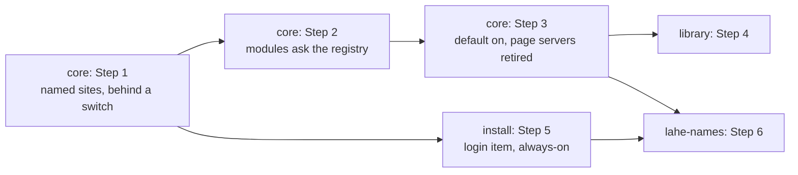

# Plan: Stable addresses

## Summary

Four workstreams, five pull requests. **core** moves page serving into the helper behind a switch, rewires every helper module to the new name registry, then makes it the default and retires per-session page servers. **library** points the Library at stable addresses. **install** adds the login item and always-on behavior on three systems. **lahe-names** adds the optional `.lahe` ending on macOS. Docs, the skill, and the contract change in the same pull request as the behavior they describe.

## Steps

<!-- forge-include: parts/plan/core.md -->

<!-- forge-include: parts/plan/library.md -->

<!-- forge-include: parts/plan/install.md -->

<!-- forge-include: parts/plan/lahe_names.md -->

## Workstreams and PRs

| Workstream | Tasks | Agent and model | Reuses | Owns | Depends on | PR |
|---|---|---|---|---|---|---|
| core | 1.0 to 3.3 | one builder, Opus | itself across Steps 1 to 3 | `sites.js`, `page_routes.js`, `index.js`, `routes.js`, `auth.js` (non-catalog), `protocol.js`, `record.js`, `review_format.js`, `reviews.js`, `heal.js`, `rebuild.js`, `handled_check.js`, `projection.js`, `markdown*.js`, `static_servers.js`, `idle_servers.js`, `commands/review.js`, `add.js` (served-by-helper), `write.js`, `status.js`, `session.js` (close) | none | PR 1 (Steps 1 and 2, switch off by default), PR 2 (Step 3) |
| install | 5.1 to 5.5 | one builder, Opus | none | `commands/install.js`, `login_item.js`, `self_stop.js`, `startHelper` in `session.js` and `add.js`, `scripts/install-cli.js`, `docs/INSTALL.md` | core Step 1 merged | PR 3 |
| library | 4.1 to 4.3 | one builder, Sonnet | none | `catalog_*.js`, `src/layer/catalog/`, `auth.js` (catalog part), `docs/ongoing/LIBRARY.md` | core Step 3 merged | PR 4 |
| lahe-names | 6.1 to 6.3 | the install builder, continued | install | `name_server.js`, resolver parts of `login_item.js` and `install.js`, layer fallbacks (6.3 only) | install, core Step 3 | PR 5 |

- **Agent reuse:** the core builder holds the serving model for all three of its steps. The install builder continues into lahe-names because both touch `install.json`, the installer, and macOS system setup.
- **Token plan:** core and install run in parallel after core Step 1 lands, because they share no files except two separate functions in `session.js`, which the orchestrator merges. Library waits for core Step 3. Packets name only the architecture sections and docs listed under each workstream's "Reads first".
- **Packet sources:** each workstream leaf above is its packet, plus the brief's Requirements section and the verification rows it names.
- **PRs:** each leaves the app working.
  - PR 1 ships the registry and the new serving behind `LAHE_PAGES=sites`, off by default.
  - PR 2 turns it on and removes the old path, with the skill and contract changes.
  - PR 3 adds install; without running `lahe install`, nothing changes for a clone.
  - PR 4 is the Library.
  - PR 5 adds the `.lahe` option.

  Each PR runs `npm run gate` locally, alone, and reads 0 failed before it is pushed. `dist/lahe-layer.js` is rebuilt and committed by the orchestrator once per PR, not by builders.

## Test List

::: callout-req
The one verification table. U is a unit test under `test/unit/`; B is a Playwright spec under `test/browser/`; M is a manual or measured check with its evidence on the progress page. Every process a test starts is stopped in teardown, and the leak check passes.

| Row | Requirement or failure | Behavior to prove | Kind |
|---|---|---|---|
| V1 | R3 name rule | Folder names become lowercase dashed names; empty becomes `doc`; `xn--` and `--` at positions 3 and 4 are refused | U |
| V2 | R3 clash | A second folder with the same name takes its parent's name, then a number; a name is not reused | U |
| V3 | R3 reserved | `library`, `lahe`, `www`, `api` are never granted | U |
| V4 | Registry loss | A corrupt `sites.json` rebuilds from `sites.log` with the same names; with neither readable, no new name is minted | U |
| V5 | R13 worktree record | Binding inside a sibling worktree records `main_checkout` from its `.git` file | U |
| V6 | Single writer | Only the helper writes `sites.json`; a CLI write attempt is not possible through any export | U |
| V7 | R10 Host closed set | API answers loopback Hosts only; pages answer registered names only; anything else is 400 | U |
| V8 | R10 grammar | Trailing dot, nested label, wrong port, uppercase are refused | U |
| V9 | Dispatch order | A document Host never gets a CORS preflight answer or a catalog route | U |
| V10 | `::1` | The helper serves on `::1`; a failed `::1` bind logs and keeps serving | U |
| V11 | R1, R2 | A bound HTML page loads at `name.lahe.localhost:<port>/<file>` with its rail, and with no agent attached shows "No agent watching" | B |
| V12 | R8a assets | Relative images, styles, and scripts load, including `../` within the root of a folder review | B |
| V13 | R8a Markdown | A Markdown page renders from source; its images load; a link to a file outside its folder opens through the site's mount | B |
| V14 | R4 hidden files | Dot segments and dotfiles return 404 under every site | U |
| V15 | Notes page-only | A `lahe write` site serves its one page and Lahe's reserved files, and 404s a sibling file | U |
| V16 | R4 isolation | A page on site A cannot read a page or token from site B (cross-origin fetch fails); same-folder pages share an origin as today | B |
| V17 | CORP | Page responses carry `Cross-Origin-Resource-Policy: same-origin` | U |
| V18 | R14 unknown name | An unknown name shows the "no document by that name" page with a Library link | U |
| V19 | R14 gone file | A gone file shows the "file is gone" page naming the path | U |
| V20 | R13 worktree copy | A gone worktree file shows the main checkout's copy read-only, with the moved note and no script tag | B |
| V21 | Rail rule | The rail follows today's rules without the session filter: exact file, then folder review, then linking review; `--only` opts out | U |
| V22 | Binding authority | `site.bind` refuses a request without the CLI secret, and any request carrying `Origin` | U |
| V23 | GET never writes | A page GET for an unbound file creates no name and changes no review | U |
| V24 | Origin check | A page request's Origin is accepted only when it is the site the rule maps to that review | U |
| V25 | Old origins | Binding removes the review's old `127.0.0.1:<port>` origins | U |
| V26 | Healer | After a poll, a served HTML file's bytes on disk are unchanged | U |
| V27 | Reload | An agent's edit to a page in a multi-page review reloads that page | B |
| V28 | Handled check | A handled claim is checked against the right file for a folder review page | U |
| V29 | Linked docs | A linked document rides the linking review's rail | B |
| V30 | Rebuild | A newer Markdown source re-renders on the next poll | U |
| V31 | Old comments | A review created on a random port shows its comments at its new address | B |
| V32 | Grouping | `review.json` groups old-origin and new-origin items of one page together | U |
| V33 | R1 session close | After `lahe session close`, the page still loads | B |
| V34 | R1 idle | After the old idle grace with no window, the page still loads | U |
| V35 | Leftovers | Every helper start stops page-server processes named in old records | U |
| V36 | Retired paths | No code path spawns `static_servers.js --serve`; the leak check finds none | U |
| V37 | R5, R6 status | `lahe status` prints the port, the printed ending and why, and each review's site; a taken port is named | U |
| V38 | R12 docs | The skill, contract and its copies, CLI doc, ongoing docs, diagrams, and manifest describe sites and the always-on server; a grep finds no "random port" or per-session page-server wording | M |
| V39 | R8 Open | Open on an old row binds and opens its stable address | B |
| V40 | Open and the live rail | Open on an older row whose file a newer open review holds does not move the rail, and says which review holds it | U |
| V41 | Kinds | `openable`, `worktree`, `via-agent`, `legacy` follow the architecture's table | U |
| V42 | Sweep removed | No Open restarts a process or reopens a session | U |
| V43 | R15 Library address | The Library loads at `library.lahe.localhost` with today's checks; a document Host never reaches it | B |
| V44 | Copy | The Library's copy button works with the clipboard API removed | B |
| V45 | R7 install macOS | Install, login, kill, restart, uninstall on macOS | M |
| V46 | R7 install Linux | Same on Linux, CI job that never fails the run | M |
| V47 | R7 install Windows | Same on Windows, CI job that never fails the run | M |
| V48 | Install hygiene | No terminal or running as root: refused; more than one user: warned; login item carries port and state folder | U |
| V49 | Always-on | `--always-on` does not self-stop when quiet, and still stops when the state folder is removed | U |
| V50 | No double spawn | With `install.json`, the CLI does not spawn a helper | U |
| V51 | Stale replace | A stale always-on helper is replaced at a quiet moment with a window open, and the layer keeps working | B |
| V52 | State folder | A CLI with a different state folder says so instead of failing on the port | U |
| V53 | R11 idle cost | Both measured states are under the limits written before building | M |
| V54 | Name server | Answers names under `.lahe` with loopback; refuses others; malformed packets do not crash | U |
| V55 | Name server start | Starts only when `install.json` records the resolver | U |
| V56 | Resolver write | Fixed content, marker, one `sudo` call, no interpolation | U |
| V57 | Verification | `.lahe` Hosts are refused until a fresh random query is seen by our own name server | U |
| V58 | Squatter | Another process answering `.lahe` fails verification | U |
| V59 | Uninstall | Removes the resolver only when it carries the marker; `.lahe.localhost` addresses keep working | U |
| V60 | 6.3 copy | Copy review works on a non-secure origin (only if `.lahe` is printed) | B |
| V61 | 6.3 tab guard | Two tabs of one page on a non-secure origin do not both hold the window (only if `.lahe` is printed) | B |
| V62 | 6.3 page type | Page detection works with no Fetch Metadata headers (only if `.lahe` is printed) | U |
| V63 | R9 drafts | An unsent draft on a page is there after the helper restarts and the tab reloads | B |
| V64 | Browsers | V11, V13, V16, and V43 pass in Chromium, Firefox, and WebKit on `gate:all` | B |
:::

## Acceptance Criteria

::: callout-metric
**Standard (every feature inherits these; keep them verbatim):**

- [ ] Full test suite green, not just the new tests.
- [ ] Design and lint gates green (the project's gate command).
- [ ] Every requirement in the brief walked end to end in the browser, on the running app.
- [ ] Nothing punted: no TODOs, no stubbed tests, no "out of scope" that was in scope.
- [ ] Implementation matches brief and architecture; any deviation is deliberate and written down under Changes from plan on the progress page.
- [ ] **It looks like a staff designer built it.** The whole surface holds up at that level, and includes at least:
  - Clear visual hierarchy and information architecture. You know where to look, and the page's organization makes sense.
  - Consistency with the rest of the app. Buttons look like our other buttons, hover states follow the same convention, primary and secondary carry the same color meaning they carry elsewhere.
  - Honest feedback. Toasts and status messages report what actually happened. Never an optimistic "done" for something still in flight, or something that failed.
  - Micro-animations that mean something. Motion signals state or direction; it isn't decoration.
  - Copy in the brand voice (the project's brand or voice doc).
  - Existing components reused and the style guide followed. Nothing reads as a stock framework default.
- [ ] It reads as one feature, not several agents' work stitched together: consistent components, spacing, and interaction patterns across every surface it touches.

**This feature:**

- [ ] Old addresses keep working (brief requirement 1): V33, V34, plus V45 after a reboot on this Mac.
- [ ] Pages load with no agent (requirement 2): V11.
- [ ] Addresses name the folder and file (requirement 3): V1 to V3, and the walk reads every printed address.
- [ ] Documents stay walled off (requirement 4): V14 to V17.
- [ ] One port (requirement 5): V7, V37.
- [ ] Endings (requirement 6): V37, V54 to V59, and Ken's answer on the printed ending applied.
- [ ] Starts at login on three systems (requirement 7): V45 to V52.
- [ ] Existing documents get addresses, and links keep working (requirements 8 and 8a): V12, V13, V29, V31, V39.
- [ ] Drafts come back (requirement 9): V63.
- [ ] Only this computer, and only Lahe's names (requirement 10): V7 to V9, V22 to V24.
- [ ] Light when idle (requirement 11): V53.
- [ ] Agents are told (requirement 12): V38.
- [ ] Worktree documents survive (requirement 13): V5, V20.
- [ ] Wrong or gone addresses say so (requirement 14): V18, V19.
- [ ] The Library has a stable address (requirement 15): V43.
- [ ] Every helper module agrees on page-to-file mapping: V26 to V30, V32.
- [ ] Human has reviewed and approved (single consolidated gate after Plan)
:::

## Plan Review

Not yet run.
