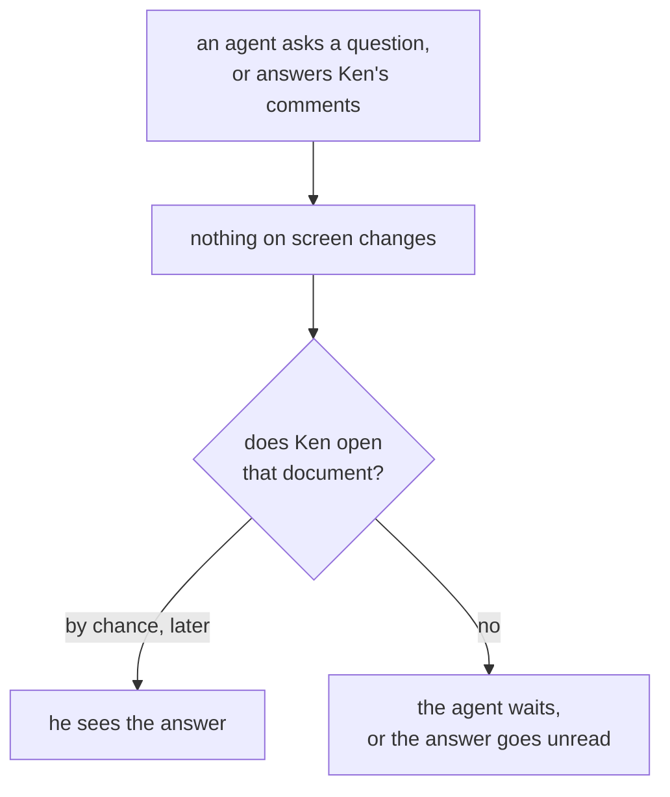
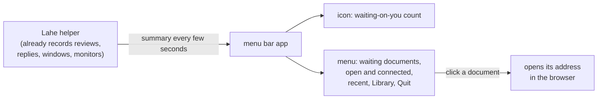

# Feature Brief: Menu bar app

## Summary

A Lahe icon in the Mac menu bar. It shows a number when something is waiting on Ken: the cards the rail already tags "1 new", counted across every document. Clicking it opens a menu with those documents, what is open and who is connected, recent documents, the Library, and Quit. It is an optional Mac extra on top of the cross-platform helper. Agents do not change how they work.

## Problem, User, and Context

Ken runs several coding agents at once and reviews their work in Lahe. When an agent asks him a question on a card, or finishes answering his comments, nothing tells him. He finds out only when he happens to open that document. The board shows it happening: on review r03fdeebe1fb6, comments sat unanswered while the agent worked elsewhere, and the page could not tell him.

He also cannot see what is running. Open documents and listening agents pile up across a day. A stray session or a forgotten agent stays invisible until he runs `lahe status` or opens the Library.

Ken works at his desk with terminal windows and many browser tabs open, and keeps review tabs open for days. He keeps the Dock hidden. The menu bar is the one place he can see without switching windows.

The user is Ken today, on a Mac. Later, other developers who run coding agents on a Mac. For some of them, seeing how much is open is a satisfying sign of how much they have going on.

Prior work: [the crucible](00_crucible_menu_bar_app.md), and the stable addresses work, which deferred this icon as its own follow-up ([decisions page](../../ongoing/STABLE_ADDRESSES.md)). Since stable addresses, `lahe install` starts the helper at login, and the Library has its own address, `library.lahe.localhost`.

## Non-Goals

::: callout-nongoal
- Not a menu bar icon on Linux or Windows. The helper's new summary is plain cross-platform code, so a tray icon there could come later.
- Not macOS notifications, sounds, or pop-ups. The icon changes; it does not interrupt.
- Not a way to act on a card from the menu. Answering, dismissing, or reopening still happens on the page.
- Not a ready-built, signed app download. The icon is built on the user's Mac.
- Not a Dock icon or a Dock badge.
- Not a change to how agents work. No new command for an agent, and nothing new in the contract.
- Not naming agents ("Claude", "Codex"). Lahe does not record an agent's name today (board row LAHE-agent-name-default). The menu names each session by what it is working on.
- Not a replacement for the Library. The menu is a short list; the Library stays the full one.
- Not a new way to close a card. Mark as done, on the card's state chip, already does that, and it reads the card too (R5).
:::

## Solution Outline

1. **The helper gets one new answer: a summary of what needs Ken and what is running.** It holds the "waiting on you" documents, the documents waiting on agents, the open documents, the connected sessions, and the recent documents. Only Ken's own programs can read it.
2. **The page tells the helper which replies Ken has read.** The rail already keeps that mark: a reply shows "1 new" on its card until Ken opens the card. Today the mark stays in his browser. The page now also sends it to the helper, so the icon and the rail agree.
3. **A small Mac app draws the icon and menu.** It asks the helper for the summary every few seconds and shows it. It is Swift with no outside packages.
4. **`lahe install` offers the icon on a Mac.** It builds the app with Apple's compiler, which comes with the Xcode command line tools, and starts it at login next to the helper. When Lahe is updated, the app is rebuilt.

## Requirements

### The icon

::: callout-req
**R1. The icon shows how many documents are waiting on Ken, and nothing else.** It counts documents, not cards, because each one is one click. With nothing waiting it is the plain Lahe mark. Above 99 it shows "99+". It looks right in a light and a dark menu bar.
:::

::: callout-req
**R2. The icon never shows a number it is not sure of.** It has three looks besides the count: nothing waiting (the plain mark), the helper is not running (the menu offers Start Lahe), and "can't tell" (the helper did not answer, refused, is a different version, or the Mac just woke). "Can't tell" never shows the plain mark or the last number.
:::

::: callout-req
**R3. The count is quick and right.** A new question or reply shows within 10 seconds. A reply clears within 10 seconds of Ken opening its card. A count that never clears, or counts something already handled, is a bug.
:::

### What "waiting on you" means

This is not a new flag, and it has no logic of its own. It is the rail's "1 new" mark, counted across every document instead of only on the page you have open (R5). What counts as unread, and what counts as read, is the rail's one rule, written once and shared by the page and the helper, so the icon and the rail never disagree. If that rule needs revisiting, it is revisited in one place. The Library's "N waiting" is the other direction: your comments waiting on an agent. In the menu that is R9.

::: callout-req
**R4. Only replies from after the icon was installed count.** On day one the count is zero. Today 45 documents have an old unanswered question; none of them count.
:::

::: callout-req
**R5. A document counts while it has a reply Ken has not read.** By the rail's own rule: a reply is unread when the rail would tag its card "1 new" (a question, a refusal, or an answer the agent marked as worth reading; routine replies arrive already read). It is read when Ken opens the card, or marks it done. The icon has no rule of its own, and a question is not a special case: an unanswered question he has opened is read, and the rail still shows it as asking.
:::

::: callout-req
**R6. Reading it anywhere clears it everywhere.** A card opened in one browser is read in every browser and on the icon. A review's retired, ended or missing-file documents never count (R7).
:::

::: callout-req
**R7. Retired reviews, ended reviews, and documents whose file is gone never count** as waiting on Ken. They cannot be acted on from a page.
:::

### The menu

::: callout-req
**R8. Waiting on you comes first.** Every waiting document is listed by its name, with a short reason ("1 question", "3 unread"). Clicking one opens it in the browser at its address.
:::

::: callout-req
**R9. Waiting on agents is shown separately.** The number of Ken's comments no agent has answered yet, labeled apart from "waiting on you" so the two are never confused, with its documents listed.
:::

::: callout-req
**R10. What is open and who is connected.** An open document is a review page open in a browser window right now, focused or not. A connected session is one whose agent has a live monitor or ran a `lahe` command in the last few minutes, the same test the Library uses. Each shows its count and its list. A session is named by its Library name, else the document it is working on, and shows when it was last heard from. Clicking a document opens it. Clicking a session opens its most recent document.
:::

::: callout-req
**R11. Recent documents.** The documents Ken worked on most recently, newest first, as the Library orders them. Clicking one opens it at the address the Library's Open would use. Opening from the menu never asks an agent to pick a document up; a document only an agent can serve opens the Library instead.
:::

::: callout-req
**R12. Long lists stay short.** The open, connected and recent sections show up to 8 rows and say how many more there are. Recent ends with "Open the Library". Waiting on you is never cut short.
:::

::: callout-req
**R13. Open the Library.** One item opens the Library in the browser.
:::

::: callout-req
**R14. Quit has two items.** "Hide the icon" closes the menu bar app only; the helper keeps running. "Stop Lahe until next login" stops the helper. A line under it says plainly that a connected agent will start it again, usually within seconds. Whether Stop should hold instead is a question for Ken.
:::

### Installing and keeping it working

::: callout-req
**R15. The icon is optional and Mac-only.** On a Mac, `lahe install` asks whether to add it; a flag answers without asking. Saying no, or a Linux or Windows computer, changes nothing else about Lahe. Someone already installed adds just the icon by running `lahe install` again.
:::

::: callout-req
**R16. A Mac without Apple's command line tools gets a clear message,** naming the one command that installs them, and no icon. The rest of `lahe install` still completes.
:::

::: callout-req
**R17. The icon starts at login. After Hide, it stays hidden until the next login or until Ken runs one named command** to show it. No other command, and nothing an agent runs, brings it back.
:::

::: callout-req
**R18. Updating Lahe keeps the icon working.** When a `git pull` changes the app, the helper rebuilds and restarts it on its own. If the rebuild fails, the old app keeps running and `lahe status` says why. An app and a helper that do not match show "can't tell" (R2), never wrong numbers.
:::

::: callout-req
**R19. `lahe uninstall` removes the icon** and its login item, along with everything else it already removes.
:::

::: callout-req
**R20. `lahe status` says whether the icon is installed and running,** and names a failed rebuild.
:::

### Cost and safety

::: callout-req
**R21. Light when idle.** With nothing changing, the app and the helper's new answer add no more battery and processor cost than one open review tab does today. Measured on a copy of Ken's real state folder, not assumed.
:::

::: callout-req
**R22. Only Ken's own programs can read the summary.** A web page open in the browser cannot read it, from any address, including Lahe's own pages. It names documents and paths, so it gets the same protection as the rest of the helper's private data.
:::

::: callout-req
**R23. The core stays cross-platform.** The helper's summary and the read marks it keeps are plain helper code that runs on Mac, Linux and Windows and passes the unit suite there. Only the app itself is Mac code. The tool still runs from a `git clone` with no packages to install.
:::

## How we know it worked

::: callout-metric
- On the day it is installed, the icon shows no number.
- In a week of Ken's normal use, he never clicks the icon and finds nothing waiting, and never finds an agent's question the icon missed. He reports either one on the progress page as a bug.
- Finding a stray session takes one click instead of `lahe status` or the Library.
:::

## UX Notes

- The menu reads top to bottom in order of urgency: waiting on you, waiting on agents, open and connected, recent, then the Library and Quit.
- The icon is a template image, so macOS colors it for a light or dark menu bar and for a highlighted state.
- Long names are cut short with an ellipsis; the full name and path show on hover.
- The menu uses the Lahe mark, not a generic symbol, so it is recognizable at a glance.

## Analytics / Logging

No new analytics: Lahe is a local tool and sends nothing anywhere. The app writes its own errors (cannot reach the helper, cannot read its permission, rejected address) to a log file in the Lahe state folder. A failed rebuild is logged there too, so `lahe status` can name it. The helper logs nothing per summary request, because the app asks every few seconds and that would flood the log.

## Rollout / Flags

No feature flag. The icon is opt-in at `lahe install`, which already needs a terminal. Ken already ran `lahe install` for stable addresses, so he gets the icon by running it again. Nothing changes for anyone who does not opt in. The helper's summary ships to everyone and costs nothing until something asks for it. The helper starts keeping read marks the first time the new helper runs. The day-one cutoff (R4) is set the first time the app asks. This is a minor version bump.

## Questions and Decisions

<!-- forge-include: parts/brief/questions.md -->

## PM Review

Full prose in [01_brief_menu_bar_app_reviews.md](01_brief_menu_bar_app_reviews.md).

| # | Finding | Disposition | Rationale |
|---|---------|-------------|-----------|
| RF1 | A background tab counted as looking | Accepted, then superseded | The focused-tab rule is gone. R5: read means the card was opened, the rail's own mark, in any browser. |
| RF2 | Day one would count every old reply | Accepted | R4 (cutoff at install) and R7 (retired, ended, gone never count). |
| RF3 | No "can't tell" look | Accepted | R2 now has a distinct "can't tell" look. |
| RF4 | A question had no way to clear | Accepted, then superseded | A question clears like any reply: opening its card, or Mark as done, which has since shipped. Ken: one rule for read, not two. |
| RF5 | Documents or cards? | Accepted | R1: documents. |
| RF6 | Permission design leaked into the brief | Accepted | Removed from the outline; the architecture owns it. |
| RF7 | "Show all in the Library" pointed nowhere useful | Accepted | R12: only Recent links to the Library; waiting on you is never cut. |
| RF8 | Open could ask an agent to pick a document up | Accepted | R11: the menu's open never does. |
| RF9 | Any command could undo Hide | Accepted | R17: one named command a person runs. |
| RF10 | Rebuild had no trigger or failure story | Accepted | R18: the helper rebuilds on change; a failure keeps the old app. |
| RF11 | Stop does not hold while agents are connected | Accepted | R14: a line under Stop says so. |
| RF12 | No success criteria | Accepted | New "How we know it worked" section. |
| RF13 | "Connected" and "open" undefined | Accepted | R10 defines both. |
| RF14 | "A few seconds" needs a number; measure on real data | Accepted | R3 (10 s and 15 s) and R21. |
| RF15 | Leftovers: icon-only install, design review, an unsupported claim | Accepted | R15 settles the install; the design review is in the plan; the claim is removed. |
