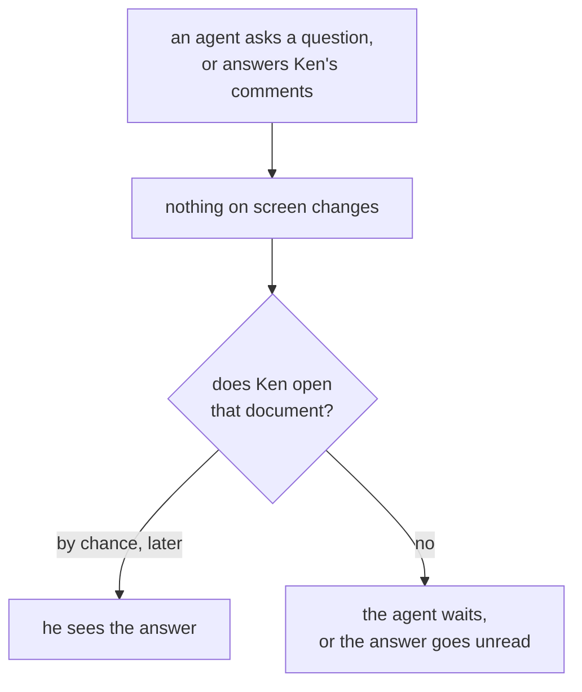
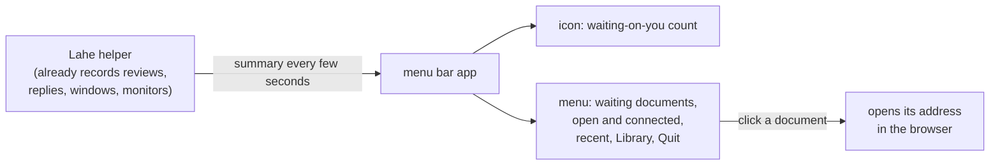

# Feature Brief: Menu bar app

## Summary

A Lahe icon in the Mac menu bar. It shows a number when something is waiting on Ken: an agent asked him a question, or an agent answered comments he has not looked at yet. Clicking it opens a menu with those documents, what is open and who is connected, recent documents, the Library, and Quit. It is an optional Mac extra on top of the cross-platform helper. Agents do not change how they work.

## Problem, User, and Context

Ken runs several coding agents at once and reviews their work in Lahe. When an agent asks him a question on a card, or finishes answering his comments, nothing tells him. He finds out only when he happens to open that document. The board shows it happening: comments sat unanswered while an agent worked elsewhere (review r03fdeebe1fb6), and he missed an agent's answer once (review r5c67aef9754a).

He also cannot see what is running. Open documents and listening agents pile up across a day. A stray session or a forgotten agent stays invisible until he runs `lahe status` or opens the Library.

Ken works at his desk with terminal windows and many browser tabs open. He keeps the Dock hidden. The menu bar is the one place he can see without switching windows.

The user is Ken today, on a Mac. Later, other developers who run coding agents on a Mac. For some of them, seeing how much is open is a satisfying sign of how much they have going on.

Prior work: [the crucible](00_crucible_menu_bar_app.md), and the stable addresses work, which deferred this icon as its own follow-up ([decisions page](../../ongoing/STABLE_ADDRESSES.md)). Since stable addresses, `lahe install` starts the helper at login, and the Library has its own address, `library.lahe.localhost`.

## Non-Goals

::: callout-nongoal
- Not a menu bar icon on Linux or Windows. The helper answer the icon reads works for any system, so a tray icon there could come later.
- Not macOS notifications, sounds, or pop-ups. The icon changes; it does not interrupt.
- Not a way to act on a card from the menu. Answering, dismissing, or reopening still happens on the page.
- Not a ready-built, signed app download. The icon is built on the user's Mac.
- Not a Dock icon or a Dock badge.
- Not a change to how agents work. No new command for an agent, and nothing new in the contract.
- Not naming agents ("Claude", "Codex"). Lahe does not record an agent's name today (board row LAHE-agent-name-default). The menu names each session by what it is working on.
- Not a replacement for the Library. The menu is a short list; the Library stays the full one.
:::

## Solution Outline

1. **The helper gets one new answer: a summary of what needs Ken and what is running.** It holds the "waiting on you" count and its documents, the comments waiting on agents, the open documents, the listening sessions, and the recent documents. Any program on the computer could read it, with the same proof of permission the `lahe` command already uses.
2. **The helper notes when Ken has looked at a document.** When a review page is open in his browser after an agent's answer arrived, that answer counts as seen. This is what lets "answered since you looked" be certain.
3. **A small Mac app draws the icon and menu.** It asks the helper for the summary every few seconds and shows it. It is a few hundred lines of Swift with no outside packages.
4. **`lahe install` offers the icon on a Mac.** It builds the app with Apple's compiler, which comes with the Xcode command line tools, and starts it at login next to the helper. `lahe uninstall` removes it. When Lahe is updated, the app is rebuilt.

## Requirements

### The icon

::: callout-req
**R1. The icon shows the "waiting on you" count, and nothing else.** With nothing waiting it is the plain Lahe mark. With something waiting it shows the number. It looks right in a light and a dark menu bar.
:::

::: callout-req
**R2. The icon shows when the helper is not running.** It looks different (dimmed or struck through), and the menu says Lahe is not running and offers to start it.
:::

::: callout-req
**R3. The count is right, and stays right.** A document counts as waiting on Ken only when Lahe knows it for certain. A count that never clears, or counts something already handled, is a bug. The count updates within a few seconds of an agent's answer, and clears within a few seconds of Ken looking.
:::

### What "waiting on you" means

::: callout-req
**R4. An agent asked Ken a question on a card, and he has not answered it.** That document counts until he answers or the card moves on.
:::

::: callout-req
**R5. An agent answered comments Ken has not looked at since.** The document counts until a page of that review has been open in his browser after the answer arrived. Opening the document is enough; he does not have to read each card.
:::

### The menu

::: callout-req
**R6. Waiting on you comes first.** Each waiting document is listed by its name, with a short reason ("1 question", "3 answered"). Clicking one opens it in the browser at its address.
:::

::: callout-req
**R7. Waiting on agents is shown separately.** The count of Ken's comments that no agent has answered yet, labeled apart from "waiting on you" so the two are never confused. Its documents are listed too, and open on click.
:::

::: callout-req
**R8. What is open and who is connected.** The number of open documents and of listening agent sessions. Under each count, the documents and sessions themselves. A session is named by the document it is working on and shows when it was last heard from. Clicking a document opens it. Clicking a session opens its most recent document.
:::

::: callout-req
**R9. Recent documents.** The documents Ken worked on most recently, newest first, as the Library orders them. Clicking one opens it the same way the Library's Open does: same address, same rules.
:::

::: callout-req
**R10. Open the Library.** One item opens the Library in the browser.
:::

::: callout-req
**R11. Quit has two items.** "Hide the icon" closes the menu bar app only; the helper keeps running. "Stop Lahe until next login" stops the helper. macOS does not restart it until the next login, or until an agent's `lahe` command needs it.
:::

### Installing and keeping it working

::: callout-req
**R12. The icon is optional and Mac-only.** On a Mac, `lahe install` offers it. Saying no, or a Linux or Windows computer, changes nothing else about Lahe.
:::

::: callout-req
**R13. A Mac without Apple's command line tools gets a clear message,** naming the one command that installs them, and no icon. The rest of `lahe install` still completes.
:::

::: callout-req
**R14. The icon starts at login and comes back after Hide.** Running `lahe install` again, or one `lahe` command, brings a hidden icon back.
:::

::: callout-req
**R15. Updating Lahe keeps the icon working.** After a `git pull` that changes the app, the app is rebuilt and restarted without Ken having to remember. An app older than the helper never shows wrong numbers; it says it needs a rebuild instead.
:::

::: callout-req
**R16. `lahe uninstall` removes the icon** and its login item, along with everything else it already removes.
:::

::: callout-req
**R17. `lahe status` says whether the icon is installed and running.**
:::

### Cost and safety

::: callout-req
**R18. Light when idle.** With nothing changing, the app and the helper's new answer add no more battery and processor cost than one open review tab does today. Measured, not assumed.
:::

::: callout-req
**R19. Only Ken's own programs can read the summary.** A web page open in the browser cannot read it, from any address, including Lahe's own pages. It names documents and paths, so it gets the same protection as the rest of the helper's private data.
:::

::: callout-req
**R20. The core stays cross-platform.** The helper's new answer and the "looked at" note are plain helper code that runs on Mac, Linux and Windows and passes the unit suite there. Only the app itself is Mac code. The tool still runs from a `git clone` with no packages to install.
:::

## UX Notes

- The menu reads top to bottom in order of urgency: waiting on you, waiting on agents, open and connected, recent, then the Library and Quit.
- The icon is a template image, so macOS colors it for a light or dark menu bar and for a highlighted state.
- Long names are cut short in the menu with an ellipsis; the full name and path show on hover.
- Lists are short. Each section shows a handful of rows and a "Show all in the Library" item when there are more.
- The menu uses the Lahe mark, not a generic symbol, so it is recognizable at a glance.
- The staff design eye reviews screenshots of the icon (each state, light and dark) and the open menu.

## Analytics / Logging

No new analytics: Lahe is a local tool and sends nothing anywhere. The app writes its own errors (cannot reach the helper, cannot read the permission secret, build failed) to a log file in the Lahe state folder, so `lahe status` and an agent debugging it can see what went wrong. The helper logs nothing new per summary request, because the app asks every few seconds and that would flood the log.

## Rollout / Flags

No flag. The icon is opt-in at `lahe install`, which already asks for a terminal. Ken already ran `lahe install` for stable addresses, so he gets the icon by running `lahe install` again (or a flag that adds only the icon). Nothing changes for anyone who does not opt in. The helper's new answer ships to everyone; it costs nothing until something asks for it. This is a minor version bump.

## Questions and Decisions

<!-- forge-include: parts/brief/questions.md -->

## PM Review

Not run yet.
