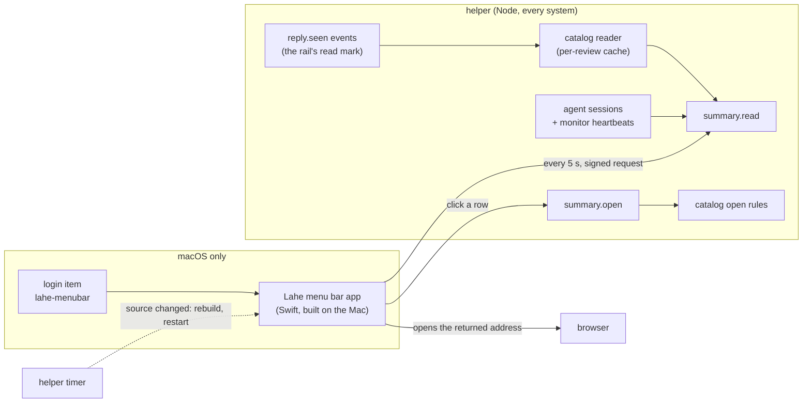
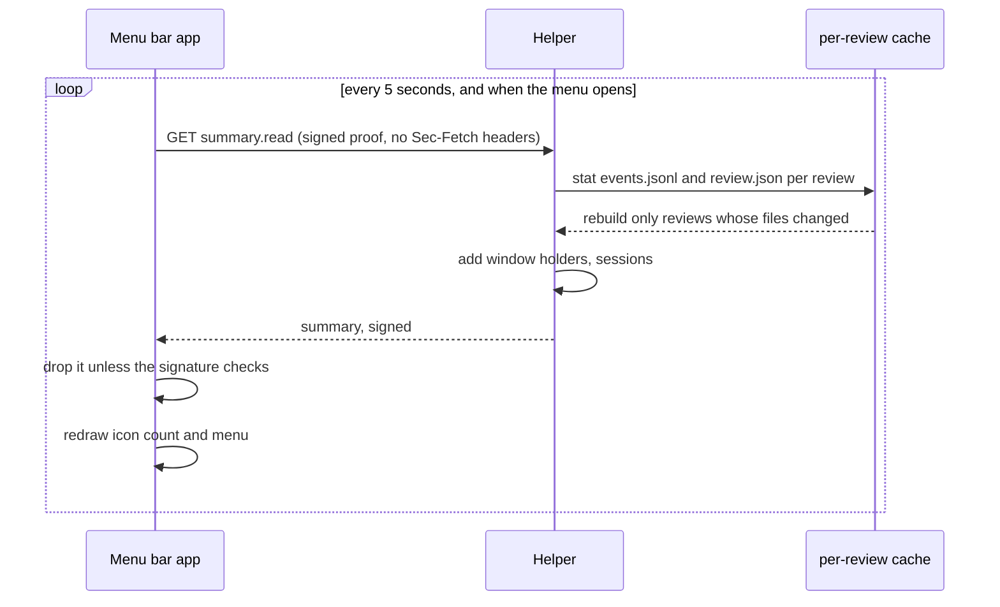
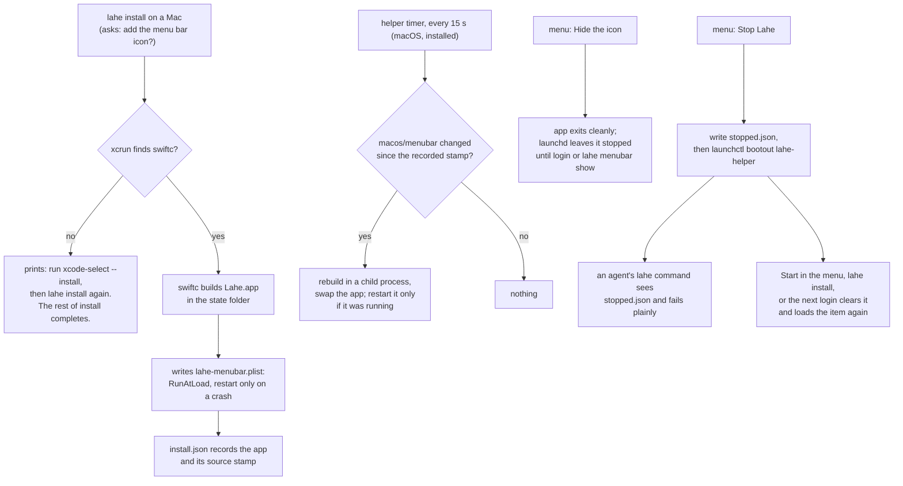

# Architecture: Menu bar app

## Summary

The helper gains one read-only answer, the **summary**, plain Node in `src/service/` that runs on every system. The rail's own read mark, the one behind a card's "1 new" tag, is posted to the review's store as an event, so the helper knows what Ken has read without a rule of its own. A Swift program in a new top-level `macos/` folder draws the icon and menu from the summary. `lahe install` builds that program on the Mac with `swiftc`, puts it in the state folder as a small app, and starts it at login with its own login item. The helper rebuilds the app when its source changes. The app proves its permission with a signed request keyed by the CLI secret, so the secret itself never travels, and it trusts only answers the helper signs back. No agent-facing behavior changes.



## Analysis of Existing Structure

- **The catalog reader** (`src/service/catalog_reader.js`) already builds, per review, the title, pages, address, last-worked time, waiting count, and its session's liveness. It is read-only and never returns comment text. Building the whole list takes about 150 ms warm and 870 ms cold on Ken's 690 reviews, measured with [scripts/time_catalog.js](scripts/time_catalog.js) on 2026-10-12. Too slow to rebuild every few seconds; fine to rebuild one review at a time.
- **The rail's read mark** (`src/layer/tab_done.js`, `src/layer/store.js`): a card shows "1 new" until Ken opens it. The rule for which replies need reading (`needsToSeeReply`: a question, a refusal, or an answer the agent flagged with words behind it; never a tool round or a card he closed) and the mark itself (item id to `record.replyStamp`, the reply's time plus the revision it answered) live in the browser's storage only. The helper never hears about them.
- **Mark as done** (`item.closed`) shows the shape to copy: an explicit event the page posts through its outbox, naming an item and a revision, that the projection folds onto the item in `review.json` and the merge rule treats as the store's.
- **Window holders** (`src/service/reviews.js`): every review page claims and heartbeats every 10 seconds. The helper persists holders to `windows.json`. That is what "open documents" stands on.
- **Replies** carry an `at` time once folded. The helper is the single reader of reply files and the single writer of `events.jsonl`, so every change to a review moves that file.
- **Agent sessions and monitor heartbeats** (`src/service/agent_sessions.js`) already answer "is this session's agent listening".
- **The CLI secret** (`<state>/cli-secret`, owner-only) and the `AUTH.CLI_SECRET` mode already exist for `site.bind` and `review.retire`. Those routes refuse any request with an `Origin` header.
- **The login item** (`src/service/login_item.js`, `src/cli/commands/install.js`) writes `~/Library/LaunchAgents/lahe-helper.plist` and records `install.json`. The CLI starts an installed helper with `launchctl kickstart`.
- **Catalog Open** (`src/service/catalog_actions.js`) binds a document's site and returns its address.

What stays the same: every existing route, the Library page and its token, the agent contract, the review layer bundle.

## Components / Modules Touched

| Where | What | New or changed |
|---|---|---|
| `src/service/summary.js` | Builds the summary from the reader, window holders and sessions, with a per-review cache; owns `summary.json` (the day-one cutoff) | new |
| `src/service/catalog_reader.js` | Exposes a one-review summary, and adds the unread count to it by the shared rule, with how many of those are questions | changed |
| `src/shared/record.js` | The unread rule, moved here from `tab_done.js` so the page and the helper run the same code | changed |
| `src/service/projection.js` | Folds a `reply.seen` event onto its item as `reply_seen` | changed |
| `src/layer/tab_done.js`, `src/layer/sync.js` | When the rail marks a reply read, the page posts `reply.seen`; a `reply_seen` on a polled record is adopted into the local marks | changed |
| `src/service/routes.js`, `src/shared/protocol.js`, `src/service/auth.js` | Two routes, `summary.read` and `summary.open`, and a new auth mode, `AUTH.CLI_PROOF` (signed requests and answers) | changed |
| `src/service/index.js` | Wires the summary into the routes, and the menu bar tick into the 15-second timer | changed |
| `src/service/menubar.js` | macOS only: the one build recipe, the app's login item, `tick` (rebuild on change) | new |
| `docs/CONTRACTS.md` | The `reply.seen` event, the `reply_seen` field, the summary's fields and the signed-request wire | changed |
| `src/cli/commands/install.js` | Offers the icon, `--menu-bar` and `--no-menu-bar`; uninstall removes it | changed |
| `src/cli/commands/menubar.js` | `lahe menubar show` brings a hidden icon back; `lahe menubar rebuild` | new |
| `src/service/login_item.js` | `startThroughItem` refuses while `stopped.json` stands, and bootstraps before kickstart when the item is unloaded for any other reason | changed |
| `src/cli/commands/status.js` | One line on the menu bar app (R20) | changed |
| `macos/menubar/` | `LaheMenuBar.swift`, `Info.plist`, `README.md` | new |
| `src/shared/manifest.js` | The new `src/` files | changed |
| `docs/ongoing/MENU_BAR.md`, `docs/CLI.md`, `docs/INSTALL.md`, `CLAUDE.md` (directory layout) | How it works now | new and changed |

The Swift source lives outside `src/` on purpose. `src/` is Node, and lint and the manifest check every file there as JavaScript. `macos/` is the place for code that only one system builds, the way `vendor/` is the place for code we did not write.

## Data / State Changes

### Read marks: the `reply.seen` event

The page already decides when a reply is read: the card is opened, and the rail drops its "1 new" tag. At that moment it also posts one event through its outbox, the same path Mark as done uses:

`reply.seen`, `{item, stamp}`, no record. `stamp` is `record.replyStamp(item)`, the reply's time plus the revision it answered, at most 64 characters. The projection records it on the item as `reply_seen` only when it names the item's current reply; a stamp for an older reply is dropped and reported, like a stale reply. review.json carries `reply_seen` on the item (absent when nothing was read). Nothing else about the item moves: it is not a lifecycle transition, and the agent never sees it.

Both sides run one rule, moved from `src/layer/tab_done.js` into `src/shared/record.js`: a reply is unread when `needsToSeeReply` says it needs reading (a question, a refusal, or an answer the agent flagged and put words behind), it is not a tool round, the reviewer has not closed the card, and the recorded stamp is not the current reply's. The rail's "1 new" and the icon's count are that one function over the same records.

The page adopts marks too: a `reply_seen` on a polled record that matches the current reply is written into the browser's own marks. So a reply read in one browser stops saying "1 new" in another, which it does not today. A page from an older bundle posts nothing, so its count holds until the page reloads, and never clears early.

### `summary.json` (state folder, helper-only writer)

`{ "version": 1, "seeded_at": "2026-10-20T14:02:11.000Z" }`. `seeded_at` is written on the first `summary.read`, which is the first time the installed app asks. Any agent reply older than it counts as read. Seeding on helper start would count everything between PR 1 landing and the install. A missing or unreadable file starts fresh with `seeded_at = now`, which can only make the count smaller.

One document reviewed by several reviews (one folded Library row) counts once: the summary folds with the Library's own rule after building each review.

### What counts as waiting on you

A document waits on you when it holds an item the shared unread rule names (R5), whose reply arrived after `seeded_at`. There is no second rule: a question is unread until its card is opened, like any other reply the rail tags "1 new", and the rail's "question" tag on an opened card is the rail's business.

Neither counts for a retired review, a review with `ended_at`, or a document the reader marks missing (R7).

The icon counts **documents**, not cards: each one is one click. Today 45 documents have an old open question (64 questions; 34 from the last month), counted by [scripts/count_questions.py](scripts/count_questions.py) on 2026-10-12. The `seeded_at` rule keeps all of them out.

### `summary.read` response

```json
{
  "summary_version": 1,
  "helper": { "version": "0.4.0", "started_at": "...", "always_on": true },
  "waiting_on_you": {
    "count": 2,
    "documents": [
      { "review": "r183d18583a43", "title": "Crucible: Menu bar app", "path_hint": "~/Documents/...",
        "questions": 1, "unread": 3, "newest_at": "..." }
    ]
  },
  "waiting_on_agents": { "count": 4, "documents": [ { "review": "...", "title": "...", "path_hint": "...", "waiting": 4 } ] },
  "open_documents": { "count": 3, "more": 0, "items": [ { "review": "...", "title": "...", "path_hint": "...", "focused": true } ] },
  "sessions": {
    "open": 5,
    "connected": { "count": 2, "more": 0, "items": [ { "session": "s_...", "name": "...", "presence": "listening", "last_heard_at": "...", "review": "..." } ] }
  },
  "recent": { "more": 12, "items": [ { "review": "...", "title": "...", "path_hint": "...", "last": "..." } ] },
  "library_url": "http://library.lahe.localhost:1483"
}
```

- Open, connected and recent lists are capped at 8 in `items`, with `more` for the rest (R12). Waiting on you is not capped. `sessions.open` counts sessions not closed. `library_url` is the Library's printed address, with the pages port when the port-80 forward is not proved.
- The exact field list, types, and the signed-request wire below are written into `docs/CONTRACTS.md` before any builder starts, and a fixture and proof vectors are committed beside them (plan, Step 0).
- No comment text, no tokens, no absolute paths, the same rules as the Library list. Titles have control characters removed.
- A session is connected when `agent_sessions` liveness says its agent is listening (a live monitor) or working (a `lahe` command in the last few minutes), the same test the Library shows (R10).
- An open document is a review whose window holder is current, focused or not.
- A session's `name` is its Library rename if Ken gave one, else the title of its most recent review.

### The signed-request wire (`AUTH.CLI_PROOF`)

- **Key:** the text of `<state>/cli-secret` with surrounding whitespace removed (64 hex characters), used as its UTF-8 bytes.
- **Request headers:** `x-lahe-proof-ts` (Unix time in milliseconds, decimal), `x-lahe-proof-nonce` (16 random bytes as 32 lowercase hex characters), `x-lahe-proof` (lowercase hex HMAC-SHA256).
- **What is signed:** the lines `lahe-proof-v1`, the method, the path with its query string exactly as sent, the timestamp, the nonce, and the lowercase hex SHA-256 of the body (of the empty string for a GET), joined by `\n` with no trailing newline.
- **The version** travels as `?v=1` on `summary.read`, so the signature covers it, and as `summary_version` in `summary.open`'s JSON body.
- **The answer** carries `x-lahe-proof-reply`: HMAC-SHA256 with the same key over the lines `lahe-proof-reply-v1`, the request's nonce, the status code, and the hex SHA-256 of the response body. Error answers are signed too, so the app can tell the helper's 409 from a squatter's.
- **The helper** accepts a timestamp within 30 seconds of its clock, refuses a nonce it has seen in that window, and compares signatures in constant time.

### `summary.open` request

`{ "review": "r..." }` returns `{ "url": "http://<name>.lahe.localhost/<path>" }`. It runs catalog Open with `handoff: false`, so it opens at the address the Library would use and never queues a pick-up for an agent (R11). A row that only an agent could serve (`PROTO_NOT_OPENABLE`) returns `{ "url": null }`, and the app opens the Library instead.

### `install.json` gains a `menubar` block

`{ "app": "<state>/menubar/Lahe.app", "label": "lahe-menubar", "login_item": "...", "source_stamp": "<sha256 of macos/menubar/*>", "built_at": "..." }`. Absent when the icon is not installed.

## Key Flows

### The menu stays current



The per-review cache keeps a request to a few stat calls per review: the review's `events.jsonl`, `review.json` and `meta.json`, plus the reviewed document itself (so a deleted file drops out) and `catalog.json` once per request (so a Library rename shows). A same-size rewrite inside one millisecond is caught by comparing size, modified time and inode together. The plan sets the budget (R21) and measures it on Ken's state folder.

### Ken reads a reply

```mermaid
sequenceDiagram
    participant Rail as Rail (in the page)
    participant H as Helper
    participant St as Store (events.jsonl, review.json)
    participant App as Menu bar app
    Rail->>Rail: card opened: "1 new" drops, local mark written
    Rail->>H: reply.seen {item, stamp} through the outbox
    H->>St: append; project reply_seen onto the item
    App->>H: summary.read (within 5 s)
    H->>St: that review's files changed: rebuild its summary
    H-->>App: the document's unread count is one lower
```

The outbox posts at once, and the next summary comes within 5 seconds, so the count drops inside R3's 10 seconds. A question opened and not yet answered is read; the rail still shows it as asking.

### Install, rebuild, and Quit



- **Hide** exits with status 0. The login item restarts the app only on a crash (`KeepAlive` with `SuccessfulExit: false`), so Hide holds until the next login or `lahe menubar show`.
- **Stop Lahe holds (R14).** The app writes `<state>/stopped.json` (`{"by": "menu bar", "at": "..."}`) and then unloads the helper's login item, because a plain kill would be restarted at once. The marker is the hold: `startThroughItem`, the path every `lahe` command takes to start an installed helper, refuses while the file exists, with "Ken stopped Lahe from the menu bar at <time>. Click Start in the menu, or run `lahe install`." and a non-zero exit, so an agent's `lahe review` fails in one line and starts nothing. Without the marker (an item unloaded by hand, or a stale install), `startThroughItem` bootstraps the plist and then kickstarts, which today's code cannot do.
- **Start Lahe**, shown while stopped with "Stopped by you at <time>", removes the marker, bootstraps and kickstarts. `lahe install` removes it too. The helper removes it on its own start, so the login item loading at the next login ends the hold; since nothing else can start the helper while the marker stands, a running helper always means Ken started it.
- **Bootstrap checks the plist first.** Before loading `lahe-helper.plist`, the CLI checks its contents are what `login_item.js` would write for the recorded install, and refuses with a message to run `lahe install` if not (SR6).
- **The labels are constants.** The app and the CLI use the fixed labels `lahe-helper` and `lahe-menubar` and their fixed plist paths; nothing reads a label from `install.json` to run `launchctl` (SR6). Tests get their own labels through a seam that stays a constant: the CLI's existing `label` and `home` options, and a compile-time `-D` flag for the app. No test ever loads, stops, rewrites or removes the real labels.
- **A rebuild respects Hide.** After swapping in a rebuilt app, the helper restarts it only if `launchctl print` says it was running. A hidden icon stays hidden through a `git pull` (R17).
- **The app's Start does not check the plist's contents.** It bootstraps only the fixed path in Ken's own `~/Library/LaunchAgents`; anything that can write there can already run code at his login, so the check adds nothing for the app. The CLI keeps its check because it also covers a stale install.
- **One build recipe.** `src/service/menubar.js` holds the only build function, the fixed file list and the pinned compiler flags (`-swift-version 5`, the host architecture, a macOS 13 floor). The build check script calls it.
- **What a rebuild compiles.** Only the clone named in `install.json`, never a worktree; a fixed list of files in `macos/menubar/`, copied into a fresh temp folder, hashed there, built there with `/usr/bin/xcrun swiftc`, and renamed into place only on success (SR5).

## Alternatives Considered

<!-- forge-include: parts/architecture/alternatives.md -->

## Failure Modes / Edge Cases

- **Helper down.** Nothing answers on the port. The app shows the not-running look and a Start item (R2). It keeps asking every 5 s, so it recovers on its own.
- **Can't tell (R2).** A refused request, a timeout, an answer the app cannot parse, a version mismatch, or the first seconds after the Mac wakes: the app shows the "can't tell" look, never the plain mark and never the last number. After a wake it shows "can't tell" until its first fresh answer.
- **App older than the helper.** The app sends the `summary_version` it was built for. The helper answers a mismatch with `409 SUMMARY_VERSION`, and the app shows "can't tell" with "Lahe was updated; rebuilding" (R18). The rebuild timer usually gets there first.
- **App newer than the helper** (pulled, helper not yet restarted). The route does not exist, so the request gets a 400 and the app shows "can't tell". The helper's own staleness check replaces it at a quiet moment, as today.
- **Rebuild fails** (tools removed, compile error). The helper keeps the old app, records the error in `menubar.log`, and `lahe status` names it. It retries only when the source stamp changes again, so a broken build does not compile every 15 s.
- **CLI secret missing or changed.** The app rereads the file on each 401. A missing file shows "can't tell" with the reason in the log.
- **An answer the app cannot verify.** A missing or wrong signature, from a squatter or a bug, is dropped: "can't tell", logged once per minute at most.
- **Clock skew.** The helper and the app read the same Mac clock, so the 30-second window only matters across a sleep. A refused proof after a wake is retried with a fresh timestamp on the next poll.
- **A review whose file is gone, or an unreadable review.** Never waiting on you (R7). It can still appear under recent, and Open goes wherever catalog Open sends it, which for a gone file is the plain "file is gone" page.
- **A worktree review.** Open follows catalog Open, which already serves a gone worktree file from the main checkout.
- **Many documents waiting.** The icon shows the number up to 99, then "99+". The waiting list is not cut (R12); in practice the install cutoff (R4) keeps it short.
- **Two browsers on one review.** A mark posted from either lands in the store, and the other adopts it on its next poll, so "1 new" clears in both. A second window refused the rail has no cards to open, so it marks nothing.
- **The page is offline when the card is opened.** The mark sits in the outbox like any other record and posts when the helper is back. The count stays up until then, which is the honest answer.
- **An agent while Lahe is stopped.** Its `lahe` command fails with the stop message and exit code 1; a `lahe monitor` already running sees the helper down and reports it as it does today. The agent tells its human, and only Ken's Start, `lahe install` or login brings the helper back.
- **Another user on the Mac.** Their app reads their own state folder and their own helper port. The secret file is owner-only.
- **Ken renames or retires a review.** Retired reviews are dropped from every section. A rename shows on the next summary.

## Security & Privacy Notes

- **Signed requests, so the secret never travels (SR1).** The app does not send the CLI secret. It sends a proof: a timestamp, a random nonce, and HMAC-SHA256 keyed with the secret over the route name, timestamp, nonce, and a hash of the body. The helper accepts a proof within 30 seconds of its own clock and refuses a nonce it has seen in that window. The helper signs its answer the same way, over the nonce and a hash of the response body, and the app drops any answer whose signature does not check and shows "can't tell". A program squatting on the port while the helper is stopped learns one used proof for one route, nothing it can replay or use on `site.bind`. Node has HMAC in `node:crypto` and Swift in CryptoKit, so no packages are added. The app connects to `127.0.0.1` at the port in `service.json`, never `localhost`.
- **Who can reach the routes.** The proof is the control: a web page cannot read the secret file. Two more checks stand behind it. Both routes refuse any request carrying a `Sec-Fetch-Site`, `Sec-Fetch-Mode` or `Sec-Fetch-Dest` header, which current browsers send on every request to a loopback address and the app never sends (SR2). `summary.open` is a POST with a JSON body, so it also refuses any `Origin` header. Neither route is a catalog route, the Library host never routes to them, and the Library token is never accepted. The helper's Host check still applies, which stops DNS rebinding.
- **The `reply.seen` event (SR3).** `item` must be an item of the review the token names, `stamp` a string of at most 64 characters naming that item's current reply; anything else is dropped and reported, and nothing is stored. It carries no reviewer text. Accepted risk: a page holding a review's token can mark that review's replies read, and only that review's. A page's token already lets it close the item outright with `item.closed`.
- **What it holds.** Titles, `~` paths, counts, times, session names. No comment text, no review tokens, no absolute paths. Same exposure as `lahe status`, which any process running as Ken can already run.
- **`summary.open` opens nothing itself (SR4).** It returns an address. The app opens it only when it parses as `http`, with no user or password part, a host of `library.lahe.localhost` or a valid site name followed by `.lahe.localhost`, and a port that is absent or equal to the pages port in `service.json`. It opens the URL rebuilt from those parsed parts, not the original string. The same check applies to `library_url`. Anything else is dropped and logged. Titles are page-derived: the helper strips control characters and Unicode format characters (such as bidirectional overrides) and caps the length, and the app sets them as plain menu text.
- **Building code on the user's machine.** `swiftc` compiles only the fixed file list from the installed clone, in a fresh temp folder, invoked as an argument array, never through a shell (SR5). The app is not signed. A program built locally carries no quarantine flag, so Gatekeeper does not block it.
- **launchctl calls from the app and CLI** use the fixed labels and paths, never values read from a file (SR6).
- **Follow-up, not in this feature:** the CLI's two existing secret routes (`site.bind`, `review.retire`) still send the raw secret after an unauthenticated `/health` probe. They should move to the same signed proof. Filed on the board.

## Test Strategy

The plan owns the one verification table: [03_plan_menu_bar_app.md](03_plan_menu_bar_app.md). Every failure mode above is a row there. In short: unit tests cover the summary rules, the read mark's round trip, the routes' auth, and the install and rebuild logic on every system; a Mac-only check builds the Swift app; screenshots and a walkthrough cover the icon and menu.

## Open Questions

In the brief's [questions leaf](parts/brief/questions.md).

## Architect Review

Not run. The orchestrator chose the security review for this design (a new reader of private data) and judged the rest an established pattern: a new read route on the existing auth mode, and a second login item beside the first.

## Security Review

Full prose in [02_architecture_menu_bar_app_reviews.md](02_architecture_menu_bar_app_reviews.md).

| # | Finding | Disposition | Rationale |
|---|---------|-------------|-----------|
| SR1 | The app would send the secret to anything on the helper's port, open for hours after Stop | Accepted | Signed requests and signed answers; the secret never travels. The CLI's routes move later (board). |
| SR2 | Browsers send no Origin on a GET | Accepted | Corrected text; Sec-Fetch headers refused; `summary.open` is a POST; never a catalog route. |
| SR3 | The `page` field was unbounded | Accepted, then superseded | The `page` field is gone with the focused-tab rule (Ken, in review: use the rail's existing read mark). The `reply.seen` event is bounded the same way: a known item, a capped stamp naming its current reply. |
| SR4 | The URL allowlist was wider than needed | Accepted | Only `*.lahe.localhost` at the pages port or none; URL rebuilt from parsed parts; titles cleaned. |
| SR5 | Which clone and which files a rebuild compiles | Accepted | Installed clone only, fixed file list, temp folder, rename on success, full path to `xcrun`. |
| SR6 | launchctl labels read from a file | Accepted | Fixed labels and paths; bootstrap checks the plist's contents. |
| SR7 | Agents restart a stopped helper within seconds | Accepted | Ken chose a Stop that holds: `stopped.json` blocks every `lahe` command from starting the helper until he starts it, logs in, or reinstalls. |
