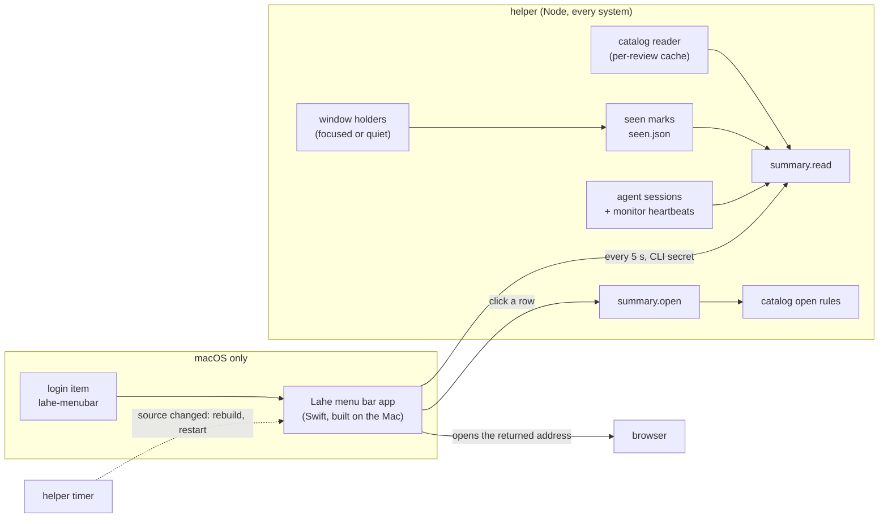
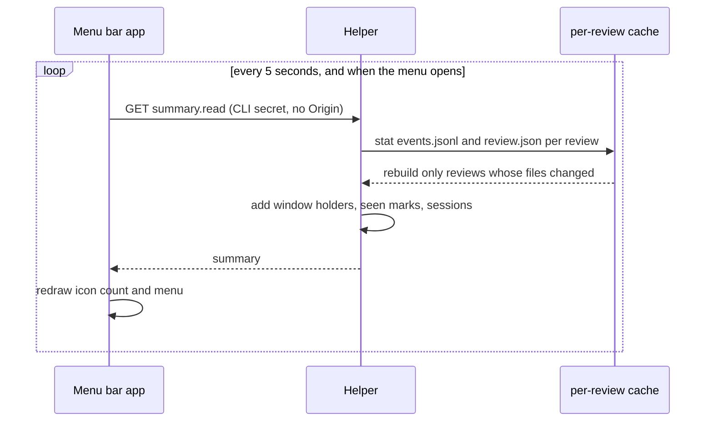
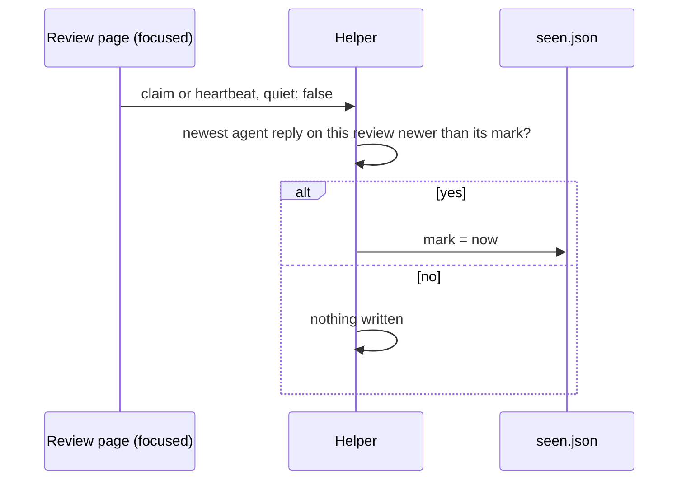
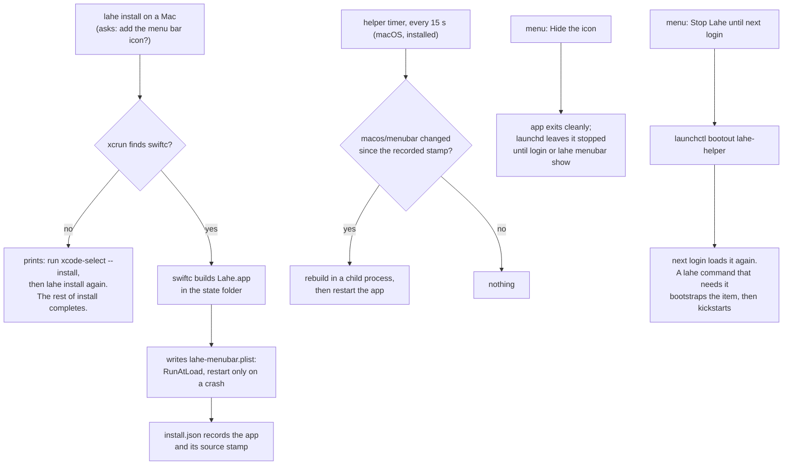

# Architecture: Menu bar app

## Summary

The helper gains one read-only answer, the **summary**, and one small record, the **seen marks**. Both are plain Node in `src/service/` and run on every system. A Swift program in a new top-level `macos/` folder draws the icon and menu from the summary. `lahe install` builds that program on the Mac with `swiftc`, puts it in the state folder as a small app, and starts it at login with its own login item. The helper rebuilds the app when its source changes. The app proves its permission with the CLI secret the `lahe` command already uses. No agent-facing behavior changes.



## Analysis of Existing Structure

- **The catalog reader** (`src/service/catalog_reader.js`) already builds, per review, the title, pages, address, last-worked time, waiting count, and its session's liveness. It is read-only and never returns comment text. Building the whole list takes about 150 ms warm and 870 ms cold on Ken's 690 reviews, measured with [scripts/time_catalog.js](scripts/time_catalog.js) on 2026-10-12. Too slow to rebuild every few seconds; fine to rebuild one review at a time.
- **Window holders** (`src/service/reviews.js`): every review page claims and heartbeats every 10 seconds, and says `quiet: true` when its window loses focus. The helper persists holders to `windows.json`. This is the fact "Ken looked" stands on.
- **Replies** carry an `at` time once folded. The helper is the single reader of reply files and the single writer of `events.jsonl`, so every change to a review moves that file.
- **Agent sessions and monitor heartbeats** (`src/service/agent_sessions.js`) already answer "is this session's agent listening".
- **The CLI secret** (`<state>/cli-secret`, owner-only) and the `AUTH.CLI_SECRET` mode already exist for `site.bind` and `review.retire`. Those routes refuse any request with an `Origin` header.
- **The login item** (`src/service/login_item.js`, `src/cli/commands/install.js`) writes `~/Library/LaunchAgents/lahe-helper.plist` and records `install.json`. The CLI starts an installed helper with `launchctl kickstart`.
- **Catalog Open** (`src/service/catalog_actions.js`) binds a document's site and returns its address.

What stays the same: every existing route, the Library page and its token, the agent contract, the review layer bundle.

## Components / Modules Touched

| Where | What | New or changed |
|---|---|---|
| `src/service/summary.js` | Builds the summary from the reader, window holders, seen marks and sessions, with a per-review cache | new |
| `src/service/seen_store.js` | The only writer of `seen.json` | new |
| `src/service/catalog_reader.js` | Exposes a one-review summary, and adds two counts to it: open questions and the newest agent reply time | changed |
| `src/service/reviews.js` | Tells the seen store when a focused window claims or heartbeats, naming its page | changed |
| `src/layer/sync.js` | Adds the page's path to its claim and heartbeat (one optional field) | changed |
| `src/service/routes.js`, `src/shared/protocol.js` | Two routes, `summary.read` and `summary.open` | changed |
| `src/service/menubar.js` | macOS only: build the app, write its login item, rebuild on change | new |
| `src/cli/commands/install.js` | Offers the icon, `--menu-bar` and `--no-menu-bar`; uninstall removes it | changed |
| `src/cli/commands/menubar.js` | `lahe menubar show` brings a hidden icon back; `lahe menubar rebuild` | new |
| `src/service/login_item.js` | Starting a helper that the app stopped: bootstrap before kickstart | changed |
| `src/cli/commands/status.js` | One line on the menu bar app (R20) | changed |
| `macos/menubar/` | `LaheMenuBar.swift`, `Info.plist`, `README.md` | new |
| `src/shared/manifest.js` | The new `src/` files | changed |
| `docs/ongoing/MENU_BAR.md`, `docs/CLI.md`, `docs/INSTALL.md`, `CLAUDE.md` (directory layout) | How it works now | new and changed |

The Swift source lives outside `src/` on purpose. `src/` is Node, and lint and the manifest check every file there as JavaScript. `macos/` is the place for code that only one system builds, the way `vendor/` is the place for code we did not write.

## Data / State Changes

### `seen.json` (state folder, helper-only writer)

```json
{
  "version": 1,
  "seeded_at": "2026-10-20T14:02:11.000Z",
  "reviews": { "r183d18583a43": { "/00_crucible_menu_bar_app.md": "2026-10-20T15:40:03.120Z" } }
}
```

- `seeded_at` is written the first time the helper runs with this feature. Any agent reply older than it counts as seen. This is what keeps day one from showing every old reply.
- `reviews[id][page]` is the last time a **focused** window on that page claimed or heartbeat. The page sends `quiet: false` only when it is the focused tab of a focused window; a background tab or an unfocused window sends `quiet: true` (`src/layer/sync.js`, attention). Claims and heartbeats gain an optional `page` field. A page from an older bundle sends none, and the helper then marks every page of that review, which can only clear a count early, never hold one.
- The helper writes only when the write would change a count: when a focused window's time passes the newest agent reply on that page and the stored mark is older than that reply. So a focused tab costs one write per new answer, not one per heartbeat.
- A missing or unreadable file: the helper starts a new one with `seeded_at = now`. Losing marks can only make the count smaller, never larger.

### What counts as waiting on you

A document waits on you when either holds:

1. **An open question (R5):** an item in `ready` whose reply, for its current revision, is a `question`, and whose reply arrived after `seeded_at`. It stops counting when the item no longer carries that reply (Ken answers, which moves the revision; an agent replies again; the card is deleted).
2. **An unseen answer (R6):** an agent reply of any status, on page P, whose time is after both `seeded_at` and the seen mark for P.

Neither counts for a retired review, a review with `ended_at`, or a document the reader marks missing (R7).

The icon counts **documents**, not cards: each one is one click. Today 45 documents have an old open question (64 questions; 34 from the last month), counted by [scripts/count_questions.py](scripts/count_questions.py) on 2026-10-12. The `seeded_at` rule keeps all of them out. Whether an open question should stop counting once Ken has looked at it is a question for Ken (see the questions leaf).

### `summary.read` response

```json
{
  "summary_version": 1,
  "helper": { "version": "0.4.0", "started_at": "...", "always_on": true },
  "waiting_on_you": {
    "count": 2,
    "documents": [
      { "review": "r183d18583a43", "title": "Crucible: Menu bar app", "path_hint": "~/Documents/...",
        "questions": 1, "unseen_answers": 3, "newest_at": "..." }
    ]
  },
  "waiting_on_agents": { "count": 4, "documents": [ { "review": "...", "title": "...", "path_hint": "...", "waiting": 4 } ] },
  "open_documents": [ { "review": "...", "title": "...", "path_hint": "...", "focused": true } ],
  "sessions": { "open": 5, "connected": [ { "session": "s_...", "name": "...", "presence": "listening", "last_heard_at": "...", "review": "..." } ] },
  "recent": [ { "review": "...", "title": "...", "path_hint": "...", "last": "..." } ],
  "library_url": "http://library.lahe.localhost"
}
```

- Open, connected and recent lists are capped at 8, with a `more` count (R12). Waiting on you is not capped.
- No comment text, no tokens, no absolute paths, the same rules as the Library list. Titles have control characters removed.
- A session is connected when `agent_sessions` liveness says its agent is listening (a live monitor) or working (a `lahe` command in the last few minutes), the same test the Library shows (R10).
- An open document is a review whose window holder is current, focused or not.
- A session's `name` is its Library rename if Ken gave one, else the title of its most recent review.

### `summary.open` request

`{ "review": "r..." }` returns `{ "url": "http://<name>.lahe.localhost/<path>" }`. It runs catalog Open with `handoff: false`, so it opens at the address the Library would use and never queues a pick-up for an agent (R11). A row that only an agent could serve (`PROTO_NOT_OPENABLE`) returns `{ "url": null }`, and the app opens the Library instead.

### `install.json` gains a `menubar` block

`{ "app": "<state>/menubar/Lahe.app", "label": "lahe-menubar", "login_item": "...", "source_stamp": "<sha256 of macos/menubar/*>", "built_at": "..." }`. Absent when the icon is not installed.

## Key Flows

### The menu stays current



The per-review cache keeps a request to a few stat calls per review. The plan sets the budget (R21) and measures it on Ken's state folder.

### Ken looks at a document



Focusing a tab sends a claim at once, and focused tabs heartbeat every 10 s, so the next summary (within 5 s) drops that page's unseen answers: inside R3's 15 seconds. An open question stays until it is answered (rule 1).

### Install, rebuild, and Quit



- **Hide** exits with status 0. The login item restarts the app only on a crash (`KeepAlive` with `SuccessfulExit: false`), so Hide holds until the next login or `lahe menubar show`.
- **Stop Lahe** unloads the helper's login item, because a plain kill would be restarted at once. Today a `lahe` command asks an unloaded item to kickstart and fails. `startThroughItem` gains one step: when kickstart reports the job is not loaded, bootstrap the plist first. That keeps agents working after Ken stops Lahe.
- **Start Lahe**, shown when the helper is down, does the same bootstrap and kickstart.

## Alternatives Considered

<!-- forge-include: parts/architecture/alternatives.md -->

## Failure Modes / Edge Cases

- **Helper down.** Nothing answers on the port. The app shows the not-running look and a Start item (R2). It keeps asking every 5 s, so it recovers on its own.
- **Can't tell (R2).** A refused request, a timeout, an answer the app cannot parse, a version mismatch, or the first seconds after the Mac wakes: the app shows the "can't tell" look, never the plain mark and never the last number. After a wake it shows "can't tell" until its first fresh answer.
- **App older than the helper.** The app sends the `summary_version` it was built for. The helper answers a mismatch with `409 SUMMARY_VERSION`, and the app shows "can't tell" with "Lahe was updated; rebuilding" (R18). The rebuild timer usually gets there first.
- **App newer than the helper** (pulled, helper not yet restarted). The route does not exist, so the request gets a 400 and the app shows "can't tell". The helper's own staleness check replaces it at a quiet moment, as today.
- **Rebuild fails** (tools removed, compile error). The helper keeps the old app, records the error in `menubar.log`, and `lahe status` names it. It retries only when the source stamp changes again, so a broken build does not compile every 15 s.
- **CLI secret missing or changed.** The app rereads the file on each 401. A missing file shows "not running" with the reason in the log.
- **A review whose file is gone, or an unreadable review.** Never waiting on you (R7). It can still appear under recent, and Open goes wherever catalog Open sends it, which for a gone file is the plain "file is gone" page.
- **A worktree review.** Open follows catalog Open, which already serves a gone worktree file from the main checkout.
- **Many documents waiting.** The icon shows the number up to 99, then "99+". The waiting list is not cut (R12); in practice the install cutoff (R4) keeps it short.
- **Two windows on one review.** Either focused window counts as looking at its own page. Seen marks do not care which one holds the rail, so the helper records the claim attempt even when the window does not get the rail.
- **Clock jumps** (sleep, time change). Marks and reply times are both helper clock readings or reply `at` stamps; a jump backward can only make a document look seen early, never stuck.
- **Another user on the Mac.** Their app reads their own state folder and their own helper port. The secret file is owner-only.
- **Ken renames or retires a review.** Retired reviews are dropped from every section. A rename shows on the next summary.

## Security & Privacy Notes

- **Who can read the summary.** `summary.read` and `summary.open` take `AUTH.CLI_SECRET` and refuse any request with an `Origin` header, like `site.bind`. A web page cannot read the secret file, and a browser always sends `Origin` on a cross-origin request, so a page at any address, Lahe's own included, is refused. The helper's Host check still applies, which stops DNS rebinding.
- **What it holds.** Titles, `~` paths, counts, times, session names. No comment text, no review tokens, no absolute paths. Same exposure as `lahe status`, which any process running as Ken can already run.
- **`summary.open` opens nothing itself.** It returns an address. The app opens it only when it is an `http` URL whose host is `library.lahe.localhost`, `<name>.lahe.localhost`, `<name>.lahe`, `127.0.0.1` or `localhost`. Anything else is dropped and logged. Titles are page-derived, so the app sets them as plain menu text, never as markup.
- **Building code on the user's machine.** `swiftc` compiles only files in the clone's `macos/menubar/`, invoked as an argument array, never through a shell. The app is not signed. A program built locally carries no quarantine flag, so Gatekeeper does not block it.
- **launchctl calls from the app** use fixed labels read from `install.json` and checked against the same safe-label rule `login_item.js` uses.
- A security review of this design is required before the plan (see below).

## Test Strategy

The plan owns the one verification table: [03_plan_menu_bar_app.md](03_plan_menu_bar_app.md). Every failure mode above is a row there. In short: unit tests cover the summary rules, seen marks, the routes' auth, and the install and rebuild logic on every system; a Mac-only check builds the Swift app; screenshots and a walkthrough cover the icon and menu.

## Open Questions

In the brief's [questions leaf](parts/brief/questions.md).

## Architect Review

Not run. The orchestrator chose the security review for this design (a new reader of private data) and judged the rest an established pattern: a new read route on the existing auth mode, and a second login item beside the first.

## Security Review

Not run yet.
