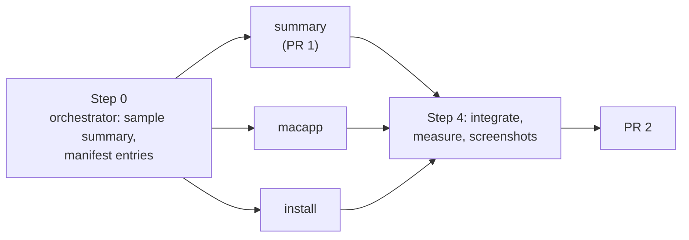

# Plan: Menu bar app

## Summary

Three workstreams, run side by side, landing as two PRs.

- **summary** builds the helper's summary and the seen marks (plain Node, every system). It lands first, on its own, as PR 1. Nothing on screen changes yet.
- **macapp** builds the Swift app against a fixed sample summary, so it does not wait for the helper.
- **install** builds, installs, rebuilds and removes the app, and teaches the CLI to start a stopped helper.

macapp and install land together as PR 2, the change Ken sees.

## Step 0: Orchestrator setup

- Commit `test/fixtures/menubar/summary.json`: one sample summary in the architecture's shape ("`summary.read` response"), with every section filled, plus `summary_empty.json` and `summary_many.json` (120 waiting documents, long titles). macapp codes against these; summary's unit tests check its real output has the same keys.
- Add every new `src/` file to `src/shared/manifest.js` (a frozen file, so the orchestrator owns it): `src/service/summary.js`, `src/service/seen_store.js`, `src/service/menubar.js`, `src/cli/commands/menubar.js`.
- Record the starting helper count (`ps -axo command | grep -c "[l]ahe.js serve"`) on the progress page.

## Every builder's contract

Every packet carries this block, near the top:

- **Never remove a file.** No `rm`, no `git clean`, no deleting temp specs, screenshots, `.bak` files or `test-results/`. Put a rebuilt `dist/lahe-layer.js` back with `git checkout -- dist/lahe-layer.js`. List anything you would remove under "To delete at cleanup" in your progress file.
- Work in your own worktree on your own branch. Never commit `dist/`.
- Run `npm run gate:unit`. Run one named browser spec only when your change is browser behavior. Never the whole browser suite.
- Every process a test starts is stopped in teardown. Report the helper count before and after your test runs.
- Read first: the brief's requirements named in your leaf, the architecture sections named in your leaf, `CLAUDE.md`, and `docs/CONTRACTS.md` where your leaf says so.
- Write `progress/phase6_workstream_<name>.md`: what you built, the tests, anything that differs from this plan, and screenshots for anything on screen.
- Hit a limit or find the plan wrong: ask the orchestrator in one line. Do not document around it.
- No em dashes anywhere.

## Steps

<!-- forge-include: parts/plan/summary.md -->

<!-- forge-include: parts/plan/macapp.md -->

<!-- forge-include: parts/plan/install.md -->

## Step 4: Integrate and prove

### Task 4.1: Integrate

**Spec:** Merge install and macapp into the feature branch over PR 1. Rebuild `dist/lahe-layer.js` and commit it once. Run `lahe install --menu-bar` on a copy of Ken's state folder (pids neutralized, other ports) and walk V32.
**Acceptance:** V28 to V33 green; screenshots of every icon look and the open menu, light and dark, on the progress page.

### Task 4.2: Measure

**Spec:** Run V18 on a copy of Ken's state folder and record the numbers on the progress page beside one open review tab's cost, measured the same way.
**Acceptance:** V18 within budget, numbers and method on the progress page.

### Task 4.3: Docs

**Spec:** Write `docs/ongoing/MENU_BAR.md` (how it works now). Update `docs/CLI.md` (`lahe install --menu-bar`, `lahe menubar`), `docs/INSTALL.md`, `CLAUDE.md` (directory layout: `macos/`), and `docs/diagrams/system_overview.md` (the app as a reader of the helper). The agent contract and the skill do not change: agents work as before.
**Acceptance:** Each doc says what the code does; a reader at zero can install the icon from `docs/INSTALL.md` alone.

## Workstreams and PRs

| Workstream | Tasks | Agent and model | Reuses | Owns | Depends on | PR |
|---|---|---|---|---|---|---|
| summary | 1.1 to 1.4 | new agent, Opus | none | `src/service/summary.js`, `seen_store.js`, `catalog_reader.js`, `reviews.js` (claim and heartbeat only), `routes.js`, `src/shared/protocol.js`, `src/layer/sync.js` (claim body only), their tests | Step 0 | 1 |
| macapp | 2.1 to 2.3 | new agent, Opus | none | `macos/menubar/`, `scripts/check_menubar.js`, `test/fixtures/menubar/fake_helper.js` | Step 0 | 2 |
| install | 3.1 to 3.4 | new agent, Sonnet | none | `src/service/menubar.js`, `src/service/login_item.js`, `src/cli/commands/install.js`, `src/cli/commands/menubar.js`, `src/cli/commands/status.js`, `src/cli/index.js`, `package.json` scripts, their tests | Step 0 | 2 |

- **Models.** summary is Opus because the counting rules are the feature: a wrong count is the failure Ken named. macapp is Opus because it is the repo's first native code and has no pattern to copy. install is Sonnet: it extends `login_item.js` and `install.js` along their existing lines, against a complete contract.
- **Agent reuse.** Fix rounds go back to the builder that owns the file. The summary builder takes any later change to the summary's shape, so the app and the helper never disagree about it.
- **Token plan.** Three agents in parallel is worth it: they share no files, and each packet is small. Packets do not include the alternatives leaf, the reviews, or the crucible. Each packet reads only its own leaf, the brief requirements and architecture sections it names, and `CLAUDE.md`.
- **Packet sources.** summary: brief R1 to R13, R21 to R23; architecture "Data / State Changes", "Key Flows" (first two), "Failure Modes", "Security & Privacy Notes". macapp: brief R1 to R14, R17, R18; architecture "`summary.read` response", "`summary.open` request", "Install, rebuild, and Quit", "Failure Modes", "Security & Privacy Notes"; UX Notes. install: brief R14 to R20; architecture "`install.json` gains a `menubar` block", "Install, rebuild, and Quit", "Failure Modes", "Security & Privacy Notes"; `docs/ongoing/STABLE_ADDRESSES.md` for the existing login item.
- **PR 1** (summary): the summary routes and their signed auth mode, seen marks, the claim's `page` field, and the rebuilt bundle. Proof: V1 to V17, V19, V20, V34 (helper half). Leaves every surface as it was; nothing reads the summary yet.
- **PR 2** (macapp and install): the app, `lahe install --menu-bar`, `lahe menubar`, Stop and Start, status, docs. Proof: V18, V21 to V33. Merges after PR 1.

## Test List

::: callout-req
The one verification table. U is a unit test under `test/unit/` (runs on every system). B is a Playwright spec under `test/browser/`. M is a Mac-only check or a measured or walked check, with its evidence on the progress page. Every process a test starts is stopped in teardown, and the leak check passes.

| Row | Requirement or failure | Behavior to prove | Kind |
|---|---|---|---|
| V1 | R4 cutoff | The first run writes `seeded_at`; replies older than it count neither as questions nor as answers | U |
| V2 | R5 question | A ready item whose current reply is a question counts; it stops counting when Ken answers (revision moves), an agent replies again, the card is deleted, the review is retired or ended, or the file is gone | U |
| V3 | R6 answer | An agent reply on page P counts until a focused claim or heartbeat on P after it; a quiet one does not clear it; a focused one on page Q of the same review does not clear P | U |
| V4 | R6 old bundle | A claim with no `page` marks every page of that review | U |
| V5 | Seen writes | A hundred focused heartbeats with no new reply write `seen.json` zero times; one new reply then one focused heartbeat writes it once | U |
| V6 | Seen loss | A corrupt or missing `seen.json` starts fresh with `seeded_at = now`; no count goes up | U |
| V7 | Page field (SR3) | A `page` the review does not know, one with no agent reply, one past 1024 characters, and `__proto__` each mark nothing and store nothing | U |
| V8 | R7 | Retired, ended, and missing-file reviews never appear under waiting on you | U |
| V9 | R1 | Three answered cards on one document count as one document; `count` equals the number of listed documents | U |
| V10 | R9 | `waiting_on_agents.count` equals the Library's waiting total for the same state folder | U |
| V11 | R10 | Open documents are the current window holders, focused or not; connected sessions are those the liveness test calls listening or working; a session's name is its Library rename, else its newest review's title | U |
| V12 | R11, R12 | Recent follows the Library's order; open, connected and recent cap at 8 with a correct `more`; waiting on you is never capped | U |
| V13 | Privacy | The summary of a fixture state folder holds no comment text, no token, no absolute path, no control or Unicode format character, and no title past the cap | U |
| V14 | R22 auth (SR2) | No proof: 401. A wrong key: 401. A proof older than 30 s: 401. A good proof with any `Sec-Fetch-*` header: refused, including a GET with no `Origin`. `summary.open` with an `Origin` header: refused. A non-loopback Host, or the path at `library.lahe.localhost`: refused. The raw CLI secret header or the Library token: refused | U |
| V15 | R11 open | `summary.open` returns the address catalog Open returns, never writes to the request queue, and returns `url: null` for a row only an agent can serve | U |
| V16 | Version | A request naming another `summary_version` gets `409 SUMMARY_VERSION` | U |
| V17 | R21 cache | A second summary with nothing changed rebuilds no review; touching one review's `events.jsonl` rebuilds only that review | U |
| V18 | R21 measured | On a copy of Ken's state folder: the summary's warm median request time is 10 ms or less, and the app plus the helper's summary work use no more processor time over 10 idle minutes than one open review tab does, measured the same way | M |
| V19 | R3 timing | With a real page: an agent reply shows in the summary within 10 s; focusing the page clears it within 15 s; a background tab does not clear it | B |
| V20 | R23 | The unit suite passes on Linux in CI with the new modules loaded | U |
| V21 | R15 install | On macOS (runner mocked): `--menu-bar` builds, writes `lahe-menubar.plist`, and records the `menubar` block; `--no-menu-bar` skips it; with neither, a terminal is asked once. On Linux and Windows the flag says it is macOS only and the install goes on | U |
| V22 | R16 | No `swiftc`: the message names `xcode-select --install`, no plist is written, and the rest of the install completes | U |
| V23 | R17 | The plist restarts the app only on a crash; `lahe menubar show` starts it; `lahe review`, `lahe status` and `lahe monitor` never touch the app's item | U |
| V24 | R18 rebuild (SR5) | A changed source stamp in the installed clone rebuilds once in a fresh temp folder and renames into place; a failed build keeps the old app, logs, and does not retry until the stamp changes again; a worktree's copy is never compiled | U |
| V25 | R19 | `lahe uninstall` removes the app's plist, the built app, and the `menubar` block, and leaves nothing loaded | U |
| V26 | R20 | `lahe status` says installed and running, installed and not running, not installed, or names the failed rebuild | U |
| V27 | R14 Start (SR6) | When kickstart reports the helper's job is not loaded, the CLI checks the plist's contents, bootstraps it, then kickstarts, and an agent's `lahe review` works after Stop; a plist that differs is refused with a message to run `lahe install` | U |
| V28 | Build | `npm run check:menubar` compiles the app with `swiftc` on a Mac and says it skipped elsewhere | M |
| V29 | R1, R2 looks | Against the fake helper: nothing waiting, 3 waiting, 99+, not running, can't tell (refused, timeout, version mismatch, just after wake). Screenshots in a light and a dark menu bar | M |
| V30 | Allowlist (SR4) | The app's self-test rejects `javascript:`, `file:`, `https://`, a user part, `localhost`, `127.0.0.1`, `<name>.lahe`, and a wrong port; it accepts `library.lahe.localhost` and `<name>.lahe.localhost` with no port or the pages port | M |
| V31 | R14, R17 Quit | Hide exits and stays hidden through a crash test of the helper; Stop unloads the helper; Start brings it back; the menu shows the line about agents | M |
| V32 | Walkthrough | On a copy of Ken's state folder: install, day one shows no number, an agent asks a question and the icon shows 1, clicking opens the page at its address, answering clears it, a stray session shows under connected | M |
| V33 | Leaks | The helper count after the full run equals the count before it | M |
| V34 | Squatter (SR1) | A fake server on the helper's port receives only proofs, never the secret; replaying a captured proof to the real helper is refused; the app drops the fake server's unsigned answer and shows can't tell | U and M |
:::

## Acceptance Criteria

::: callout-metric
**Standard (every feature inherits these; keep them verbatim):**

- [ ] Full test suite green, not just the new tests.
- [ ] Design and lint gates green (the project's gate command).
- [ ] Every requirement in the brief walked end to end in the browser, on the running app.
- [ ] Nothing punted: no TODOs, no stubbed tests, no "out of scope" that was in scope.
- [ ] Implementation matches brief and architecture; any deviation is deliberate and written down under Changes from plan on the progress page.
- [ ] **It looks like a staff designer built it.** The whole surface holds up at that level, and includes at least:
  - Clear visual hierarchy and information architecture. You know where to look, and the page's organization makes sense.
  - Consistency with the rest of the app. Buttons look like our other buttons, hover states follow the same convention, primary and secondary carry the same color meaning they carry elsewhere.
  - Honest feedback. Toasts and status messages report what actually happened. Never an optimistic "done" for something still in flight, or something that failed.
  - Micro-animations that mean something. Motion signals state or direction; it isn't decoration.
  - Copy in the brand voice (the project's brand or voice doc).
  - Existing components reused and the style guide followed. Nothing reads as a stock framework default.
- [ ] It reads as one feature, not several agents' work stitched together: consistent components, spacing, and interaction patterns across every surface it touches.

**This feature:**

- [ ] The count is right: V1 to V9, V19 green.
- [ ] The menu shows what the brief lists, in its order: V10 to V12, V29 green.
- [ ] Only Ken's programs can read the summary, the secret never travels, and the app opens only Lahe addresses: V13 to V15, V30, V34 green, and the security review of the code has no open blocker.
- [ ] Installing, updating, hiding, stopping and removing work: V21 to V28, V31 green.
- [ ] Light when idle: V17, V18 within budget.
- [ ] The core stays cross-platform: V20 green; `dependencies` in `package.json` is still `{}`.
- [ ] Walked on a copy of Ken's real state folder: V32, with screenshots light and dark.
- [ ] Nothing left running: V33.

- [ ] Human has reviewed and approved (single consolidated gate after Plan)
:::

## Plan Review

Not run yet.
