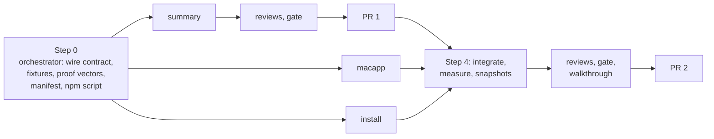

# Plan: Menu bar app

## Summary

Three workstreams, run side by side, landing as two PRs.

- **summary** builds the helper's summary, its signed auth mode, and the read mark's round trip (plain Node, plus the page's post of a mark it already keeps). It lands first, on its own, as PR 1. Nothing on screen changes yet.
- **macapp** builds the Swift app against a committed sample summary and proof vectors, so it does not wait for the helper.
- **install** builds, installs, rebuilds and removes the app, and teaches the CLI to start a stopped helper.

macapp and install land together as PR 2, the change Ken sees.

## Step 0: Orchestrator setup

Done by the orchestrator before any builder starts, and committed to the feature branch.

- **The wire, written once.** Add to `docs/CONTRACTS.md`: the `reply.seen` event row and the `reply_seen` field (the architecture's "Read marks"), the routes' paths, the summary's every field and type (the architecture's "`summary.read` response" made exact), and the signed-request wire (the architecture's "The signed-request wire").
- **Fixtures.** `test/fixtures/menubar/summary.json` (every section filled), `summary_empty.json`, `summary_many.json` (120 waiting documents, long titles, a bidirectional-override title). After Step 0 the summary workstream owns these files and every change to them.
- **Proof vectors.** `test/fixtures/menubar/proof_vectors.json`: a secret, and for a GET with an empty body, a POST with a JSON body, and a signed 409 answer, every input and the expected signature in hex. Node, the fake helper, and the Swift self-test each assert them.
- **Manifest.** Add `src/service/summary.js`, `src/service/menubar.js`, `src/cli/commands/menubar.js` to `src/shared/manifest.js` with `planned: true`, so lint passes before the files exist.
- **npm script.** Add `check:menubar` (`node scripts/check_menubar.js`) to `package.json`, and add it to `npm run gate`. It skips with a line on systems other than macOS. No builder edits `package.json`.
- **Capture probe.** Try one small `screencapture` region and record on the progress page whether it is blank. That decides whether V29 and V32 screenshots come from an agent or from Ken.
- **Starting counts.** Record the counts V33 uses: helpers, menu bar app processes, `fake_helper.js` processes, `launchctl list | grep lahe-test`, and `lahe-test*` plists in `~/Library/LaunchAgents`.

## Every builder's contract

Every packet carries this block, near the top:

- **Never remove a file.** No `rm`, no `git clean`, no deleting temp specs, screenshots, `.bak` files or `test-results/`. Put a rebuilt `dist/lahe-layer.js` back with `git checkout -- dist/lahe-layer.js`. List anything you would remove under "To delete at cleanup" in your progress file.
- **Never touch Ken's real login items.** No command you run loads, stops, rewrites or removes `lahe-helper` or `lahe-menubar`, or anything in `~/.local/state/lahe`. Tests use `lahe-test-<pid>` labels, a temp `home`, and a temp state folder.
- Work in your own worktree on your own branch. Never commit `dist/`. Never edit `package.json` or `src/shared/manifest.js`; ask the orchestrator.
- Run `npm run gate:unit`. Run one named browser spec only when your change is browser behavior. Never the whole browser suite.
- Every process and launchd job a test starts is stopped in teardown. Report the V33 counts before and after your test runs.
- Read first: your leaf, the brief requirements and architecture sections it names, `docs/CONTRACTS.md` (the summary and the wire), and `CLAUDE.md`.
- Write `progress/phase6_workstream_<name>.md`: what you built, the tests, anything that differs from this plan, and screenshots for anything on screen. Screenshots there use fixture data only, never Ken's real documents.
- Hit a limit or find the plan wrong: ask the orchestrator in one line. Do not document around it.
- No em dashes anywhere.

## Steps

<!-- forge-include: parts/plan/summary.md -->

<!-- forge-include: parts/plan/macapp.md -->

<!-- forge-include: parts/plan/install.md -->

## Step 4: Integrate and prove

### Task 4.1: Integrate

**Spec:** Merge macapp and install into the feature branch over PR 1. Wire `menubar.tick` into the helper's 15-second timer in `src/service/index.js`. Clear `planned: true` on the two install files. Check macapp's file list and flags against the build recipe's constant. Build the app with the real recipe and run it against a real helper on a temp state folder with test labels (not only the fake helper), and decode a summary captured from the real `summary.js` (`--self-test --decode`).
**Acceptance:** V28 to V31, V34 green; snapshot images of every look on the progress page.

### Task 4.2: Measure

**Spec:** Run V18 by its written method on a copy of Ken's state folder, and record the numbers and method on the progress page.
**Acceptance:** V18 passes its rule.

### Task 4.3: Walk on real data

**Spec:** On a copy of Ken's state folder (pids neutralized, other ports, test labels), where PR 1's helper has already run, walk V32 and time it at the icon. Real-data screenshots go in `~/Documents/lahe-menubar-review/`, outside the repo, and are linked from the review page, never committed.
**Acceptance:** V32 green.

### Task 4.4: Docs

**Spec:** Write `docs/ongoing/MENU_BAR.md` (how it works now). Update `docs/CLI.md` (`lahe install --menu-bar`, `lahe menubar`), `docs/INSTALL.md`, `CLAUDE.md` (directory layout: `macos/`; `check:menubar` in the gate), and `docs/diagrams/system_overview.md` (the app as a reader of the helper). The agent contract and the skill do not change: agents work as before.
**Acceptance:** Each doc says what the code does; a reader at zero can install the icon from `docs/INSTALL.md` alone.

### Task 4.5: Ken's real install

**Spec:** With Ken's go-ahead, he runs `lahe install --menu-bar` on his real setup. The orchestrator checks the result against V32's steps and screenshots outside the repo.
**Acceptance:** The icon runs on Ken's Mac under the real labels, and his helper was never interrupted by a test.

## Workstreams and PRs

| Workstream | Tasks | Agent and model | Reuses | Owns | Depends on | PR |
|---|---|---|---|---|---|---|
| summary | 1.1 to 1.4 | new agent, Opus | none | `src/service/summary.js`, `catalog_reader.js`, `projection.js`, `routes.js`, `auth.js`, `index.js`, `src/shared/protocol.js`, `src/shared/record.js` (the unread rule), `src/layer/tab_done.js` and `sync.js` (the mark's post and adoption only), the menubar fixtures after Step 0, their tests | Step 0 | 1 |
| macapp | 2.1 to 2.3 | new agent, Opus | none | `macos/menubar/`, `test/fixtures/menubar/fake_helper.js` | Step 0 | 2 |
| install | 3.1 to 3.4 | new agent, Opus | none | `src/service/menubar.js`, `src/service/login_item.js`, `src/cli/commands/install.js`, `src/cli/commands/menubar.js`, `src/cli/commands/status.js`, `src/cli/index.js`, `scripts/check_menubar.js`, their tests | Step 0 | 2 |

- **Models.** All three are Opus. summary carries the counting rules, which are the feature. macapp is the repo's first native code. install carries real launchd behavior with no pattern in this repo, the build recipe, and the hide-respecting restart.
- **Agent reuse.** Fix rounds go back to the builder that owns the file. The summary builder takes any later change to the summary's shape or the wire, so the app and the helper never disagree.
- **Token plan.** Three agents in parallel is worth it: they share no files, and each packet is small. Packets do not include the alternatives leaf, the reviews, or the crucible.
- **Packet sources.** summary: brief R1 to R13, R21 to R23; architecture "Data / State Changes", "Key Flows" (first two), "Failure Modes", "Security & Privacy Notes"; `docs/CONTRACTS.md`. macapp: brief R1 to R14, R17, R18, UX Notes; architecture "`summary.read` response", "The signed-request wire", "`summary.open` request", "Install, rebuild, and Quit", "Failure Modes", "Security & Privacy Notes"; `docs/CONTRACTS.md`. install: brief R14 to R20; architecture "`install.json` gains a `menubar` block", "Install, rebuild, and Quit", "Failure Modes", "Security & Privacy Notes"; `docs/ongoing/STABLE_ADDRESSES.md` for the existing login item.
- **PR 1** (summary): the summary routes and their signed auth mode, the `reply.seen` event and the shared unread rule, and the rebuilt bundle. Before opening: a code review (`feature-dev:code-reviewer`) and a security review (`review-security`) of the integrated diff, both owned by the orchestrator, then `npm run gate` locally with "0 failed" in the PR body. After merge: `npm run gate` on main. Proof: V1 to V17, V19, V20, V34 (helper half). Every surface stays as it was; nothing reads the summary yet.
- **PR 2** (macapp and install): the app, `lahe install --menu-bar`, `lahe menubar`, Stop and Start, status, docs. Before opening: a code review, an independent check of the brief's requirements on the integrated code (a fresh `general-purpose` agent), a design review of the snapshot images and the menu dump (a `general-purpose` agent prompted as a staff designer), the walkthrough, then `npm run gate` locally. After merge: `npm run gate` on main. Proof: V18, V21 to V34.

## Test List

::: callout-req
The one verification table. U is a unit test under `test/unit/` (runs on every system). B is a Playwright spec under `test/browser/`. M is a Mac-only check or a measured or walked check, with its evidence on the progress page. Times in unit tests use an injected clock, never real waiting. Every process and launchd job a test starts is stopped in teardown.

| Row | Requirement or failure | Behavior to prove | Kind |
|---|---|---|---|
| V1 | R4 cutoff | `seeded_at` is written on the first `summary.read`, not on helper start; replies older than it count neither as questions nor as unread | U |
| V2 | R5 one rule | A question counts exactly as any other unread reply: it stops counting when its card is opened, Ken answers (revision moves), an agent replies again, Ken marks it done, or the card is deleted; the icon's count for a fixture review equals the rail's badge total for the same records | U |
| V3 | R6 unread | The helper and the rail call one function in `src/shared/record.js`; a reply it names counts until a `reply.seen` naming its stamp is projected; a routine handled reply, a tool round, and a card the reviewer closed never count; a mark for an older reply does not clear a newer one | U |
| V4 | R6 old bundle | A review with no `reply.seen` events counts every reply the rule names, so an old page holds the count and never clears it early | U |
| V5 | Mark round trip | Opening a card posts one `reply.seen` per stamp, not one per paint; a `reply_seen` on a polled record clears that card's "1 new" in a second browser context | B |
| V6 | Seed loss | A corrupt or missing `summary.json` starts fresh with `seeded_at = now`; no count goes up | U |
| V7 | `reply.seen` bounds (SR3) | An item the review does not hold, a stamp over 64 characters, a stamp that is not the item's current reply, and a non-string each are dropped and reported, and store nothing | U |
| V8 | R7 | Retired, ended, and missing-file reviews never appear under waiting on you | U |
| V9 | R1 | Three answered cards on one document count as one; two reviews folded into one Library row count as one; `count` equals the number of listed documents | U |
| V10 | R9 | `waiting_on_agents.count` equals the Library's waiting total for the same state folder | U |
| V11 | R10 | Open documents are the current window holders, focused or not; connected sessions are those the liveness test calls listening or working; a session's name is its Library rename, else its newest review's title; a session row's review is its most recent document | U |
| V12 | R11, R12 | Recent follows the Library's order; open, connected and recent cap at 8 items with a correct `more`; waiting on you is never capped | U |
| V13 | Privacy | The summary of a fixture state folder holds no comment text, no token, no absolute path, no control or Unicode format character, and no title past the cap | U |
| V14 | R22 auth (SR2) | No proof: 401. A wrong key: 401. A proof older than 30 s: 401. A repeated nonce: 401. A good proof with any `Sec-Fetch-*` header: refused, including a GET with no `Origin`. `summary.open` with an `Origin` header: refused. A non-loopback Host, or the path at `library.lahe.localhost`: refused. The raw CLI secret header or the Library token: refused. `auth.js` matches `proof_vectors.json` | U |
| V15 | R11 open | `summary.open` returns the address catalog Open returns, never writes to the request queue, and returns `url: null` for a row only an agent can serve | U |
| V16 | Version | A request naming another version gets a signed `409 SUMMARY_VERSION` | U |
| V17 | R21 cache | A second summary with nothing changed rebuilds no review; touching one review's `events.jsonl` rebuilds only that review; a same-size rewrite in the same millisecond still rebuilds; deleting the reviewed document drops it from waiting on you on the next summary; a Library rename shows on the next summary | U |
| V18 | R21 measured | On a copy of Ken's state folder, over 10 idle minutes each: the helper's processor time (`ps -o time=`) with the app running minus with it stopped; the app's own processor time; one review tab's renderer processor time in a Playwright Chromium with only that page open. Pass: the first two together are no more than the third, and the summary's warm median request time is 10 ms or less. Battery from `top -stats pid,power` samples is recorded beside them | M |
| V19 | R3 timing | With a real page, at the summary: an agent question shows within 5 s; opening its card clears it within 10 s; a routine handled reply never shows; a page left open without its card opened holds the count. Run on a Markdown review and on a multi-page site review | B |
| V20 | R23 | The unit suite passes on Linux in CI with the new modules loaded | U |
| V21 | R15 install | On macOS (runner mocked, test labels): `--menu-bar` builds, writes the app's plist, and records the `menubar` block; `--no-menu-bar` skips it; with neither, a terminal is asked once; an existing install plus `--menu-bar` leaves the helper's plist, its process and the rest of `install.json` untouched. On Linux and Windows the flag says it is macOS only and the install goes on | U |
| V22 | R16 | No `swiftc`: the message names `xcode-select --install`, no plist is written, and the rest of the install completes | U |
| V23 | R17 | The plist restarts the app only on a crash; `lahe menubar show` starts it; `lahe review`, `lahe status` and `lahe monitor` never touch the app's item | U |
| V24 | R18 rebuild (SR5) | A changed source stamp in the installed clone rebuilds once in a fresh temp folder and renames into place; it restarts the app only if it was running, so a hidden app stays hidden; a failed build keeps the old app, logs, and does not retry until the stamp changes again; a worktree's copy is never compiled | U |
| V25 | R19 | `lahe uninstall` removes the app's plist, the built app, and the `menubar` block, and leaves nothing loaded | U |
| V26 | R20 | `lahe status` says installed and running, installed and not running, not installed, or names the failed rebuild | U |
| V27 | R14 Start (SR6) | When kickstart reports the helper's job is not loaded, the CLI checks the plist's contents, bootstraps it, then kickstarts, and an agent's `lahe review` works after Stop; a plist that differs is refused with a message to run `lahe install` | U |
| V28 | Build | `npm run check:menubar` builds the app through the one recipe and runs its self-test on a Mac, and says it skipped elsewhere | M |
| V29 | R1, R2, R8 to R14 | Against the fake helper: `--snapshot` renders every look (nothing waiting, 3, 99+, not running, can't tell) on a light and a dark background; `--dump-menu` prints the menu's titles, order, enabled state and tooltips for each fixture, matching the brief's order. In sequence: from 3 to a timeout, a 401, a 409, and an unsigned answer, the icon leaves "3" within one poll; a simulated wake shows can't tell until a fresh answer; a replaced secret file recovers on the next poll. Real menu-bar screenshots when the Step 0 probe allows, else Ken's at the walkthrough | M |
| V30 | Allowlist (SR4) | The app's self-test rejects `javascript:`, `file:`, `https://`, a user part, `localhost`, `127.0.0.1`, `<name>.lahe`, and a wrong port; accepts `library.lahe.localhost` and `<name>.lahe.localhost` with no port or the pages port; and passes `proof_vectors.json` | M |
| V31 | R14, R17 Quit | With test labels: Hide exits and stays hidden through a crash test of the helper; Stop unloads the helper; Start bootstraps and kickstarts it without a contents check; the menu shows the line about agents | M |
| V32 | Walkthrough | On a copy of Ken's state folder where PR 1's helper already ran, timed at the icon: install, day one shows no number, an agent asks a question and the icon shows 1 within 10 s, clicking opens the page at its address, answering clears it within 15 s, a stray session shows under connected | M |
| V33 | Leaks | After the full run, the five Step 0 counts (helpers, app processes, fake helpers, `lahe-test` launchd jobs, `lahe-test` plists) equal their starting values | M |
| V34 | Squatter (SR1) | A fake server on the helper's port receives only proofs, never the secret; replaying a captured proof to the real helper is refused; the app drops the fake server's unsigned answer and shows can't tell | U and M |
:::

## Acceptance Criteria

::: callout-metric
**Standard (every feature inherits these; keep them verbatim):**

- [ ] Full test suite green, not just the new tests.
- [ ] Design and lint gates green (the project's gate command).
- [ ] Every requirement in the brief walked end to end in the browser, on the running app.
- [ ] Nothing punted: no TODOs, no stubbed tests, no "out of scope" that was in scope.
- [ ] Implementation matches brief and architecture; any deviation is deliberate and written down under Changes from plan on the progress page.
- [ ] **It looks like a staff designer built it.** The whole surface holds up at that level, and includes at least:
  - Clear visual hierarchy and information architecture. You know where to look, and the page's organization makes sense.
  - Consistency with the rest of the app. Buttons look like our other buttons, hover states follow the same convention, primary and secondary carry the same color meaning they carry elsewhere.
  - Honest feedback. Toasts and status messages report what actually happened. Never an optimistic "done" for something still in flight, or something that failed.
  - Micro-animations that mean something. Motion signals state or direction; it isn't decoration.
  - Copy in the brand voice (the project's brand or voice doc).
  - Existing components reused and the style guide followed. Nothing reads as a stock framework default.
- [ ] It reads as one feature, not several agents' work stitched together: consistent components, spacing, and interaction patterns across every surface it touches.

**This feature:**

- [ ] The count is right: V1 to V9, V17, V19 green.
- [ ] The menu shows what the brief lists, in its order: V10 to V12, V29 green.
- [ ] Only Ken's programs can read the summary, the secret never travels, and the app opens only Lahe addresses: V13 to V15, V30, V34 green, and the security review of PR 1 has no open blocker.
- [ ] Installing, updating, hiding, stopping and removing work, and no test touched Ken's real login items: V21 to V28, V31 green.
- [ ] Light when idle: V18 passes its rule.
- [ ] The core stays cross-platform: V20 green; `dependencies` in `package.json` is still `{}`.
- [ ] Walked on a copy of Ken's real state folder, timed at the icon: V32, screenshots outside the repo.
- [ ] Design review of the snapshots and the menu dump has no open finding.
- [ ] Nothing left running: V33.

- [ ] Human has reviewed and approved (single consolidated gate after Plan)
:::

## Plan Review

Full prose in [03_plan_menu_bar_app_reviews.md](03_plan_menu_bar_app_reviews.md). All findings accepted.

| # | Finding | Disposition | Rationale |
|---|---------|-------------|-----------|
| RF1 | A background tab's first claim says not quiet | Accepted, then superseded | The focused-tab rule is gone (Ken, in review: use the rail's existing read mark). V3 to V7 and V19 now prove the `reply.seen` round trip instead. |
| RF2 | The cache misses a deleted document and a rename | Accepted | The document's stat and `catalog.json` join the cache key; V17 cases. |
| RF3 | PR 1 would seed before the install | Accepted | Seed on the first `summary.read`; V1, V32. |
| RF4 | A rebuild brings a hidden icon back | Accepted | Restart only if it was running; V24. |
| RF5 | Tests would hit Ken's real login items | Accepted | Test-label seam; builder contract rule; Ken's real install is its own task (4.5). |
| RF6 | The proof written three times from prose | Accepted | Exact wire in `docs/CONTRACTS.md` and proof vectors in Step 0; three checks assert them. |
| RF7 | The summary shape had gaps | Accepted | Every field decided in the architecture and `docs/CONTRACTS.md`; real output decoded by the app in Task 4.1. |
| RF8 | Two builders wrote the build recipe | Accepted | One recipe in `src/service/menubar.js`; the check script calls it; install owns both. |
| RF9 | Shared files with no owner | Accepted | `index.js` and `auth.js` to summary; `menubar.tick` wired at integration; `package.json` by the orchestrator. |
| RF10 | Manifest entries need `planned: true` | Accepted | Step 0 and Task 4.1. |
| RF11 | Screenshots need permissions | Accepted | `--snapshot`, `--dump-menu`, a capture probe, and Ken's screenshot as the fallback. |
| RF12 | Real-data screenshots in a public repo | Accepted | Kept in `~/Documents/lahe-menubar-review/`, never committed. |
| RF13 | No transitions tested | Accepted | V29 sequence: timeout, 401, 409, unsigned, wake, replaced secret. |
| RF14 | Timing left no room for the poll | Accepted | V19 at 5 s and 10 s; V32 timed at the icon. |
| RF15 | One document reviewed twice counted twice | Accepted | Fold with the Library's rule; V9. |
| RF16 | Page key mismatch | Accepted | The layer sends the path it stamps on records; V19 on encoded paths. |
| RF17 | V18 had no method | Accepted | Method and pass rule written into V18. |
| RF18 | No review owners or gate runs per PR | Accepted | Named per PR; `check:menubar` in `npm run gate`. |
| RF19 | The leak check counted only helpers | Accepted | Five counts in V33. |
| RF20 | install on Sonnet with gaps | Accepted | Gaps closed and install moved to Opus. |
| RF21 | The app's Start skipped the plist check | Accepted | Recorded in the architecture with the reason; V31 tests it. |
| RF22 | No design review | Accepted | Before PR 2, owned by a staff-designer agent. |
| RF23 | Small gaps | Accepted | Cases added to V3, V11, V14, V17, V21. |
