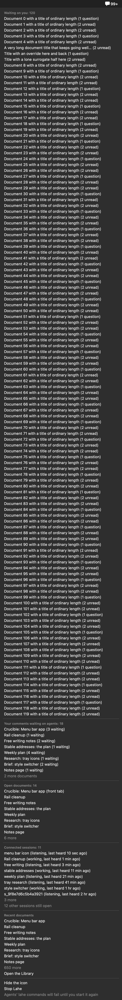

# Progress: Menu bar app

**Where things are at 11:55 on October 13.** PR 1 ([#61](https://github.com/kenxle/live-agentic-html-editor/pull/61), the helper's half, invisible on its own) is merged and green on main. Both idle-cost fix rounds are merged: a poll now costs the helper 5 to 8 ms (was 52) and the app about 1.5 ms (was 10), and a question on a document no page has open now reaches the icon. Four reviews of PR 2's diff came back with fixes worth making before it opens (a crash from a port squatter, a way for an agent's command to end your Stop, the live menu missing its section headers); one fix round is out as two builders. **Three small design calls are yours, under Needs your attention**; they do not hold up the PR. After the fix round: the full gate alone, the timed walkthrough again, and PR 2.

**Docs:** [Crucible](00_crucible_menu_bar_app.html) · [Brief](01_brief_menu_bar_app.html) · [Architecture](02_architecture_menu_bar_app.html) · [Plan](03_plan_menu_bar_app.html) (each page carries its reviews at the bottom) · [PR 2 reviews](05_pr2_reviews_menu_bar_app.md)

## Needs your attention

Three calls from the design review of the app's menu and icon (full review in [PR 2 reviews](05_pr2_reviews_menu_bar_app.md)). None of them blocks the fix round or PR 2; each is a small change the app builder can make after your answer, and the current behavior is what the brief says.

1. **Should "Waiting on you" get a row cap?** The brief says that section is never cut short. The designer points out that with 120 waiting documents the menu is taller than the screen and Hide and Stop end up below a scroll arrow. Suggested: about 15 rows, then one row "N more: open the Library". Leave it uncapped, or cap it?
2. **Should Stop Lahe ask before it stops?** Stop sits one row under Hide with no confirmation, and it breaks every agent's lahe commands. Suggested: an alert "Stop Lahe? Agents' lahe commands will fail until you start it again." with Stop and Cancel; the brief's sentence under the Stop row could move into the alert, which also removes a grey line from every menu. Keep it as a one-click row with the line under it, or add the alert?
3. **Which mark on the icon?** It is the speech bubble, the tab icon's old shape; the tab icon is now a document with an L. The designer calls the bubble the most generic shape in a menu bar (Messages and Slack use one) against the brief's "the Lahe mark, not a generic symbol", and suggests an outlined document with a folded corner, drawn outline at rest and filled when it carries a count. Keep the bubble, or switch to the document?

Still coming later: one real picture of the icon and its open menu from you, once the app is installed on your Mac (an agent cannot take it on this machine).

## What it looks like

Drawn by the app itself (`--snapshot`), on made-up data, since an agent cannot capture the real menu bar on this Mac. The real picture comes at the end, from you.

 

The icon keeps the review layer's speech bubble. Main changed the browser tab's icon to a document mark on 2026-10-12 (`e5397fda`); the bubble stays here because the count is about replies. Say so on this page if you want the document mark instead. Every look and every menu dump is under [screenshots/](screenshots/).

## Currently working on

| Agent or task | Doing | Started | Branch |
|---|---|---|---|
| Orchestrator | Fix round 3 merged; the full gate is running alone on the final commit; then the timed walkthrough and PR 2 | 2026-10-12 20:44 | `feat/menu-bar-pr2` |
| Builder: summary (Opus) | Done: fix round 2 (the helper's idle cost, unwatched replies) returned at 2026-10-13 11:36 and is merged into `feat/menu-bar-pr2` | 2026-10-12 22:46 | `feat/menu-bar-summary` |
| Code review (Opus) | Done at 11:51: one important bug, one coverage gap, one rare bug; findings in the fix round | 2026-10-13 11:50 | `feat/menu-bar-pr2` |
| Security review (Opus) | Done at 11:48: two important, three minor; all in the fix round | 2026-10-13 11:50 | `feat/menu-bar-pr2` |
| Spec check (Opus, independent) | Done at 11:49: five gaps, all in the fix round or on this page | 2026-10-13 11:50 | `feat/menu-bar-pr2` |
| Design eye (Opus) | Done at 11:47: seven must-fixes in the fix round, three calls for Ken above | 2026-10-13 11:50 | `feat/menu-bar-pr2` |
| Builder: macapp (Opus) | Done: fix round 3 returned at 2026-10-13 12:13 (`397e0a42`, all 16 items, red then green) and is merged into `feat/menu-bar-pr2` | 2026-10-13 11:52 | `feat/menu-bar-macapp` |
| Builder: install and summary (Opus) | Done: fix round 3 returned at 2026-10-13 12:12 (`f6248a60`, nine fixes, each red then green) and is merged into `feat/menu-bar-pr2` | 2026-10-13 11:53 | `feat/menu-bar-install` |
| Builder: install (Opus) | Done: returned at 2026-10-12 21:06. Waiting for the other two before the merge | 2026-10-12 20:44 | `feat/menu-bar-install` |

## Phases

| Phase | Status | Changed |
|---|---|---|
| 0 Setup | done | 2026-10-12 |
| 1 Crucible | done | 2026-10-12 |
| 2 Brief | done | 2026-10-12 |
| 3 Architecture | done | 2026-10-12 |
| 4 Plan | done | 2026-10-12 |
| 5 Human review | done | 2026-10-12 |
| 6 Implement | in progress | 2026-10-12 |
| 7 Verify | in progress (PR 1 verified; PR 2 next) | 2026-10-12 |
| 8 Ship and land | in progress (PR 1 open) | 2026-10-12 |
| 9 Cleanup | not started | |

## The record

### Task index

| Workstream | Tasks | Branch | Status |
|---|---|---|---|
| summary | 1.1 to 1.4 | `feat/menu-bar-summary` | built, `14997075`; merged into `feat/menu-bar` for PR 1 |
| macapp | 2.1 to 2.3 | `feat/menu-bar-macapp` | built, `02503610`; waits for integration |
| install | 3.1 to 3.4 | `feat/menu-bar-install` | built, `efe79a40`; waits for integration |

### Passes

No passes yet.

### Changes from plan

- **summary:** the per-review cache is keyed on `review.json`, `meta.json` and `events.jsonl` (size, time and inode each), as the plan named. The builder first keyed it on the review folder, which was faster (8 to 9 ms against 37 ms for 700 made-up reviews), but the code review showed a folder's time is too coarse on Linux to catch two rewrites in one tick, so the files are the key and the no-symlink walk is cached instead; the reviewed document is checked only while the review has an unread reply. The warm median is still to be measured on a quiet machine (V18). Read marks post through a Hold on the rail, since they are not agent work. `reply_seen` is not in `review.json`, which agents read; it travels on the page's own reads and the summary folds `events.jsonl`. `library_url` ends in `/catalog` because the Library host refuses `/`. Retired reviews appear in no section. A path outside the home folder shows only the file name. Every refusal on the two routes is a signed 401 `AUTH_REFUSED` whose detail names the check. `summary_many.json` had 40 documents with more questions than unread, which the contract rules out; fixed, and a test guards it.
- **macapp:** the executable inside the bundle is `LaheMenuBar` (what Activity Monitor shows), while the install recipe wrote `Lahe`; reconciled at integration to `LaheMenuBar`. The app rereads the secret after a bad signature as well as after a 401, because a replaced secret makes the helper sign its 401 with the new key. Waiting on you is never cut short (brief R12), where the builder's prompt had said otherwise.
- **summary, fix round 2:** a question an agent leaves on a document no page has open shows within one 15-second beat plus the app's 5-second poll, not within the brief's 10 seconds (R3). Folding every review's reply files on every poll is what the idle cost came from, so the beat is the trade. A write the helper did not make (a command run while no helper held the review) can take up to 10 minutes to show, because the beat stats a fortieth of the reviews in turn; with the always-on helper that write does not happen.
- **install, fix round 2 and later:** `--no-menu-bar` also removes an icon that is already installed (an addition to R15: the flag answers the question either way). The rebuild check on the 15-second beat runs only on an always-on helper, since a helper started by hand for one session has no icon to keep current. A review with no page title whose document heading changes keeps its old title until the review changes (accepted; the summary rebuilds a review only when the helper wrote to it).
- **install:** the app is built under `<state>/menubar/.build-*` rather than the system temp folder, so the final rename stays on one volume. The source stamp also hashes the compiler flags, so a recipe change rebuilds too. The stop message reads "the person using this computer stopped it from the menu bar at <time>" rather than naming Ken, because the repo is public; `lahe status` says "stopped by you". SR6 (labels are constants) is met for the icon and for the new bootstrap path, but kickstart still reads the helper's label from `install.json` as it did before this feature, now limited to the four known label shapes; the three callers are outside this workstream. Noted for the integration review.

### Follow-ups

- **Reuse one connection between polls.** The app opens a new connection every 5 s, which alone costs the helper about 0.36 s of processor time per 10 minutes (a bare `/health` poll). Keeping one open needs the helper's keep-alive timeout above 5 s (it is Node's default 5 s now, which is why the app builder left it) and retry logic in the app for a socket the helper closed. Not done in this feature; the two sides measured within the one-tab budget without it.
- **The Library's sweep.** Every 15 s the helper reads every `session.json` (171 on the copy of your state folder) whether or not anything is installed, about 1.2 s per 10 minutes, more than the app and its polls together now cost. Predates this feature; worth its own small change.

### Cleanup queue

To delete at cleanup, in one batch with your go:

- Worktrees and branches: `lahe-worktrees/menu-bar-summary`, `menu-bar-macapp`, `menu-bar-install`, `menu-bar-pr2`, `main-gate`, and their branches once PR 2 is merged.
- `node_modules` symlinks in the `menu-bar`, `menu-bar-summary`, `menu-bar-pr2` and `main-gate` worktrees.
- `~/Documents/lahe-menubar-review/`: the 331 MB copy of your state folder, the test app build, the walk scripts and numbers, and the notes once they are no longer needed.
- `.claude-commit2026101220*` files in the `menu-bar` worktree (gitignored).
- Session scratchpad files under `/private/tmp/claude-501/` (the OS clears these; nothing to do).

### Test results

- **V18 on a copy of your state folder (690 reviews, 93 sessions), 10 idle minutes each, machine load 3.5 to 6.2 from other agents:** helper with the app polling 6.31 s of processor time; helper alone 0.67 s; the app 1.18 s; one review tab's renderer (headless Chromium, rail mounted) 1.02 s. Verdict: fails. The app's share (5.64 + 1.18 = 6.82 s) is 6.7 times the tab. Warm median of 50 back-to-back `summary.read` requests 13.2 ms (p90 14.2 ms); spaced 5 s apart, median 27.5 ms; first read after start 384 ms. The copy's helper ran without `--always-on`. Raw numbers in `~/Documents/lahe-menubar-review/`, outside the repo.
- **The summary on real data:** first read 200, signed, 4,760 bytes; `waiting_on_you.count` 0 on the first read with `summary.json` seeded; waiting on agents 13; open documents 6 falling to 2 as copied window holders went stale; 93 open sessions, 1 connected; 466 more recent; 45 titles, path hints and names clean, no nulls. The app's `--dump-menu` order matches the brief; the test build ran 11 minutes against the copy with no error logged and a count equal to the summary's.
- Checkpoint 1 (PR 1, `cc04e6a1`): `npm run gate:unit` 2769 passed, 0 failed; the browser suite alone, Chromium: 884 passed, 0 failed, 7 skipped, in 7.3 minutes; helpers 1 before and 1 after.
- Main after PR 1 (`85c8be9d`), full gate in its own worktree: unit 2783 passed, 0 failed; browser 884 passed, 0 failed, 7 skipped; one helper before and after.
- PR 2 integration (`feat/menu-bar-pr2`, `10067c50`): `npm run gate:unit` 2831 passed, 0 failed; `npm run check:menubar` built `Lahe.app` through the real recipe in 7.4 seconds and the app's self-test passed 84 of 84; no helper or launchd job left behind. The app's own four tests against a test build and the fake helper: 4 passed, 0 failed, including Stop and Start on a `lahe-test` launchd job; no job or plist left behind.
- Checkpoint 1 after the fix round (`77ad1ed4`): the browser suite alone, Chromium: 884 passed, 0 failed, 7 skipped, in 7.2 minutes.
- **V18, the app's side, after its fix round (`538ecc0b`), 300 idle seconds of the test build per run, each before-and-after pair run side by side under load from other agents:** on the plain fixture, 0.33 s of processor time before and 0.09 s after (1.5 ms per poll, 0.18 s per 10 minutes); on a made-up state folder shaped like yours (`service.json` at 187 KB with 700 reviews, answer times changing on every poll) 0.58 s before and 0.11 s after (1.83 ms per poll, 0.22 s per 10 minutes). The before figure on the realistic folder matches the walk's 1.18 s per 10 minutes. What changed: `service.json` is parsed only when its size, time or inode changes; an unchanged answer is not decoded, drawn or rebuilt; the icon redraws only when its look changes; the menu is built just before it opens; each request is one plain HTTP/1.0 exchange over a socket instead of URLSession; hex encoding and the signing key are no longer rebuilt per poll. The builder kept a new connection per poll on purpose: the helper closes an idle socket after 5 s, the same as the poll interval, so a kept connection would need retry logic for nothing. Self-test 92 of 92 with the vectors (89 of 89 through `check:menubar` on the merged branch); the app's four tests 4 passed against the new test build; gate:unit on its branch 2845 passed, 0 failed.
- **V18, the helper's side, after its fix round (`ff65b100`), on the builder's own copy of the state copy, a signed `summary.read` every 5 s for 5 minutes with idle windows before and after to take out the helper's own idle rate, machine load 2 to 3 from other agents:** extra processor time per 10 minutes 6.25 s before (52 ms per poll, median 45 ms) and 0.62 to 0.91 s after (5.2 to 7.6 ms per poll, median 4.1 to 5.8 ms, p90 11.6 to 15.5 ms). The same helper polled on `/health`, which does nothing, costs 0.36 s per 10 minutes, so about 0.27 s of what is left is the summary's own work and the rest is the cost of a new connection every 5 s. The builder's 0.5 s target is missed by that connection cost; the warm median target (10 ms) is met. Where the 41 ms went: folding each review listed every session's old page-server folder (about 10 ms), keying 700 reviews was 2,100 stats (about 9 ms), and a poll 5 s after the last one ran on a cold processor, which back-to-back benchmarks hid. What changed: the answer stays in memory and the event log tells the summary which review the helper wrote to; an idle poll stats one file (`catalog.json`); a 15-second beat reads open sessions' agents, checks waiting documents, folds reply files for reviews with a ready item, and stats a fortieth of the reviews and closed sessions in turn as insurance against writes made while no helper ran. The Library's own 15-second sweep (every session file, about 1.2 s per 10 minutes) is in everyone's idle rate and was not touched. gate:unit on its branch 2789 passed, 0 failed.
- **Replies on documents no page has open (the walk's second finding):** fixed. On each beat the summary folds, once, any review with a ready item whose reply file moved, without putting it on the projector's every-second watch list; on a helper's first beat a reply file newer than the review's log is folded too, which covers a reply written while no helper ran. Three red-first tests in `summary_routes.test.js` and `menubar_summary.test.js`. Such a question shows within one beat plus the app's poll (up to about 20 s), not the brief's 10 s; recorded under Changes from plan.
- **V18 on the final code, both fix rounds merged (`34d5d6be`), by the plan's written method on the copy of your state folder (690 reviews, 171 sessions), the helper always-on on its own port and the test build of the app polling it every 5 s, machine load 2.8 to 4.6 from other agents:** 10 idle minutes with the app: helper 1.36 s of processor time, app 0.20 s; 10 idle minutes with the app stopped: helper 0.83 s. So the app costs the helper 0.53 s (4.4 ms per poll) and itself 0.20 s (1.7 ms per poll), 0.73 s together against the one review tab's renderer at 1.02 s from the first walk: 0.72 of the budget, **passes** (it was 6.7 times the budget before the fix rounds). The warm median is the builder's 4.1 to 5.8 ms at the 5-second rhythm, under the 10 ms limit. Not in this run: the rebuild check on the beat (the copy's install.json names no icon), which the fix round makes a stat instead of a hash, and the fix round's per-poll lstat of the reply files of reviews with a ready item; both are small and the timed walkthrough after the fix round re-checks a short window. Numbers and script in `~/Documents/lahe-menubar-review/final/`, outside the repo.
- Merged PR 2 branch (`34d5d6be`): `npm run gate:unit` 2851 passed, 0 failed, 4 skipped (the app's tests, by design), 2 todo; `check:layer` current; `check:menubar` built the app and its self-test passed 89 of 89; the app's four tests against a fresh test build, with the launchd Stop and Start case: 4 passed, 0 failed; helpers 1 before and 1 after, no `lahe-test` job left.

**Capture probe (Step 0, 2026-10-12 20:36):** `screencapture -x -R 0,0,600,30` from the agent's terminal fails with "could not create image from rect" (no screen recording permission). So V29's icon looks come from the app's own `--snapshot` (drawn in code, no permission needed), and the real menu bar picture in V32 is yours to take.

**Starting counts (V33, 2026-10-12 20:36):** helpers 1 (the real one), menu bar apps 0, fake helpers 0, `launchctl list` lahe-test 0, lahe-test plists 0.

### Ship

- PR 1: [#61](https://github.com/kenxle/live-agentic-html-editor/pull/61), merged 2026-10-12 22:52 (gate on `e3816757`: lint, unit 2783 passed, browser 884 passed, 0 failed). Opened 2026-10-12 22:02 from `feat/menu-bar` at `2697c4c9`. Full gate on that commit: lint, unit 2783 passed, browser 884 passed, 0 failed.
- PR 2: not opened yet.

## Log

- 2026-10-13 12:20: the app half of fix round 3 is back and merged (`397e0a42`): a Content-Length that is not plain digits fails the answer instead of trapping the process (the old code crashed the self-test with that case); the app sends nothing while the Stop hold stands and shows the stopped look from the marker (a plain listener on the port sees zero connections); every menu row is built by one function and the section headers are real ones (the system's on macOS 14, small semibold grey on 13), with the snapshots and dumps read back from those items so a picture cannot show what the live menu does not; the waiting rows say "1 question, 2 more unread"; connected sessions get a note row for the others still open; the Hide tooltip is true in every menu and carries no backticks; the 409 look says "Lahe was updated. This icon is out of date."; the many-documents fixture adds up and is drawn for the first time; a poll while the menu is open only updates rows in place. Self-test 362 passed with the vectors; the app's five tests against a fresh test build 5 passed. The pictures on this page are regenerated. One known effect: a menu open when the first answer arrives keeps the "can't tell" rows until it is reopened.
- 2026-10-13 12:12: the install and summary half of fix round 3 is back and merged (`f6248a60`). Serve, add and session all refuse while Stop holds, and only the login item's own start at login clears the marker (faked launchd in the tests, checked read-only against the real helper's environment); every launchctl call first checks the plist belongs to this state folder; reply files are lstat'ed on every poll for reviews with a ready item, so an agent's question on a closed document shows within one poll (R3 met); a failed rebuild records the stamp it compiled; `check:menubar` builds a test-label app and runs its live tests in the gate (3 passed, 1 skipped: Stop and Start needs launchd); the tick stats before it hashes. gate:unit 2864 passed, 0 failed. Two things to know, both accepted: the plist check is byte for byte, so a future change to the plist's wording leaves an old icon's job in place until `lahe install --menu-bar` rewrites it; on Linux and Windows a stray `stopped.json` blocks every start until `lahe install`, though only the Mac app writes one.
- 2026-10-13 12:00: V18 passes on the final code: 0.73 s per 10 idle minutes for the app and its polls together, against the one-tab budget of 1.02 s (numbers under Test results). The orchestrator row above now waits on the fix round.
- 2026-10-13 11:55: the four reviews of PR 2's diff are back; the full prose is in [PR 2 reviews](05_pr2_reviews_menu_bar_app.md). Code review: a negative Content-Length from a port squatter crashes the app before the signature check (and the login item relaunches it, a crash loop); the app's live socket tests never run in the gate; a failed rebuild can record the wrong source as failed. Security: an ordinary `lahe serve --always-on` or `lahe add --port` ends the Stop hold (SR7); the same crash; the app keeps handing fresh proofs to the port while stopped; the menu bar commands reach the real job from a copied state folder; the reply check follows symlinks. Spec check: a question on a closed document shows in about 20 s against R3's 10; V18 not yet shown passing; V32 and V33 to redo after the fixes; five departures missing from this page (now added); the four app tests skip in every gate run. Design: seven must-fixes (the live menu has no real section headers while the snapshots show them; ambiguous wording; a false tooltip; a permanent "rebuilding" claim; a self-contradicting fixture) and three calls for Ken, under Needs your attention. One fix round went out as two builders at 11:52; everything else from the reviews is in it.
- 2026-10-13 11:50: the helper's fix round is back and merged (`eaba96dc`): an idle poll costs the helper 5 to 8 ms instead of 52, the warm median is 4 to 6 ms, and a reply on a document no page has open now counts within a beat. The merged branch is green on the unit gate, the app's build check and the app's four tests. Running now: V18 on the final code with the helper and app together on the copy of your state folder, and four read-only reviews of the integrated diff (code, security, spec check, design eye). Then the full gate alone and PR 2. Ken's card this morning ("one of your agents may have gotten stuck") was answered: the builder was measuring, and the Mac slept overnight between its runs.
- 2026-10-13 00:00: the app's fix round is back and merged into PR 2's branch (`fa0600e7`): an idle poll now costs the app about 1.5 ms instead of 10 ms, under the V18 target; numbers under Test results. The helper's fix round is still measuring. Then: the full gate alone on the integrated branch, V18 re-measured on the copy of your state folder, and PR 2.
- 2026-10-12 23:00: the local post-merge gate on main is green. PR 1 is fully landed. Waiting on the two fix rounds (the helper's idle cost and unwatched replies; the app's idle cost) before PR 2.
- 2026-10-12 22:53: main's CI run on the PR 1 merge (`85c8be9d`) passed: lint, the bundle check and the unit suite on a clean Linux machine. That is V20 (the new code runs on Linux) proven. The local post-merge gate on main is still running.
- 2026-10-12 22:52: PR 1 merged into main (#61). The post-merge gate runs on main in its own worktree, and main's CI run is watched. Main carried into the PR 2 branch.
- 2026-10-12 22:46: the flow walk returned (full notes outside the repo). Two findings: V18 fails on both sides (helper about 47 ms of processor time per poll, app about 10 ms), and a reply to a document no page is polling is never folded, so it never counts (the helper reads reply files only for reviews something has asked about since it started; one `review.read` fixed it). Fix rounds sent to the summary builder (profile the poll, keep the answer in memory and rebuild only what the helper itself wrote; fold unwatched replies within one liveness beat) and to the app builder (skip decoding, menu and icon work when the answer is unchanged). Main merged into PR 1 twice as other work landed; its gate on the latest merge commit is running.
- 2026-10-12 22:02: PR 1 opened (#61) after the full gate on its final commit: unit 2783 passed, 0 failed; browser 884 passed, 0 failed, 7 skipped; one helper before and after. The follow-up from the spec check is in: no string field is ever null (a session's `review` is the one that may be), and the two missing tests are written.
- 2026-10-12 21:53: the browser suite on the merged fix round: 884 passed, 0 failed, 7 skipped. The spec check of PR 1 found no blocking gap; its follow-ups (no nulls where the app expects strings, two missing tests, three stale doc lines) are with the summary builder and done in the docs. PR 1 opens after that follow-up and one last full gate on the final commit.
- 2026-10-12 21:44: the fix round came back (`f80c73ae`) with all ten findings fixed, each test written red first, and is merged. gate:unit on the merge: 2780 passed, 0 failed. One number still open: the summary's warm median on a 700-review made-up state folder measured 8.7 to 13.4 ms with the machine at a load of about 9 from other agents; V18's 10 ms limit is measured on a quiet machine at Step 4. The browser suite runs again once another agent's run on this machine finishes; the independent spec check of PR 1 started.
- 2026-10-12 21:32: code review of PR 1 returned three findings, all taken: a Hold on the rail would also hold back read marks, so the icon would keep counting what you had read (read marks now post through a Hold); the cache key stats the review folder, whose time is too coarse on Linux to catch two rewrites in one tick (back to the files the plan named); `reply_seen` was on every item in `review.json`, which agents read, so it moves out of that file and stays on the page's own reads. One fix round sent to the summary builder with the seven security findings.
- 2026-10-12 21:31: PR 2's integrated branch is green on the unit gate (2831 passed, 0 failed) and the real build check (the app compiles through `src/service/menubar.js` and passes its self-test). Its browser suite runs after PR 1's fix round.
- 2026-10-12 21:29: checkpoint 1's browser suite, run alone: 884 passed, 0 failed, 7 skipped. PR 2's unit gate and the real Swift build check run next in the scratch worktree.
- 2026-10-12 21:27: security review of PR 1's code returned: SR1 to SR4 met. One important finding: a page title holding a lone UTF-16 surrogate would reach the summary and make the app refuse the whole answer, so the icon would stick on "can't tell" until that review is retired. Six minor: a proof captured just before a helper restart replays once (refuse proofs older than the helper's start); C1 controls and the line separators are not stripped; `summary.open` buffers 8 MB before any check; one unreadable review darkens the whole count and the 500's text can carry a path; a session file swapped for a symlink after first read is followed; a dropped `reply.seen` still lands in the log in full. All go to the summary builder in one fix round with the code review's findings.
- 2026-10-12 21:23: PR 2 prepared on `feat/menu-bar-pr2` while checkpoint 1 runs: the Mac app and install branches merged with no conflicts; `index.js` now runs the rebuild check on the 15-second beat and clears the stop marker once the helper is up; the executable is `LaheMenuBar` on both sides; the Library fallback address ends in `/catalog`; `docs/ongoing/MENU_BAR.md`, the `macos/` line in CLAUDE.md and the install section written. Its gate runs after checkpoint 1's browser suite finishes, never two at once.
- 2026-10-12 21:20: summary builder returned and merged (`14997075`, merge `67cfcd77`): the `reply.seen` round trip (the rail's read mark now reaches the store and comes back to every browser), the one unread rule in `src/shared/record.js`, the one-review reader, `src/service/summary.js` with its cache and `summary.json`, the two routes on the signed auth mode. gate:unit 2769 passed, 0 failed; the V19 browser spec 4 of 4, twice. On the merge: 2769 passed, 0 failed, bundle rebuilt. Code review and security review of the integrated diff started; the browser suite runs next, alone.
- 2026-10-12 21:10: Mac app builder returned: one Swift file (AppKit, Foundation, CryptoKit), `Info.plist`, a README with the exact build command, the fake helper and its unit test. Self-test 87 passed, 0 failed; gate:unit 2727 passed, 0 failed, 4 skipped on purpose (the app tests run only against a test build); no helper, fake helper or launchd job left behind. Ten icon snapshots and seven menu dumps in the feature folder; three are shown above.
- 2026-10-12 21:06: install builder returned: `src/service/menubar.js` (the one build recipe, the app's login item, rebuild on change), `lahe install --menu-bar` and `--no-menu-bar`, `lahe menubar show` and `rebuild`, Stop holds through `stopped.json`, the status line, `docs/CLI.md`. 59 new unit tests; gate:unit 2783 passed, 0 failed; no helper leaked. A throwaway Swift file compiled through the real recipe and ran. Two wiring points left for integration (`tick` in the 15-second timer, the stop-marker clear after the listener binds).
- 2026-10-12 20:44: Step 0 committed (`13833038`). Three builders dispatched, one per workstream, each in its own worktree cut from that commit.
- 2026-10-12 20:40: Plan approved. Your review changed three rules: "read" is the rail's own "1 new" mark, posted to the store, with no logic of its own and a question treated like any reply; Stop Lahe holds until you start it, and agents' commands fail plainly meanwhile; every document counts, open or not, with open ones marked in the menu. Main merged into the branch (Mark as done and the read mark are what the design now builds on). Step 0 started.
- 2026-10-12 10:37: Plan review returned 23 findings (6 high), all accepted. The most important: a background tab could have marked answers as seen when it reloaded; a test step would have stopped your live helper (tests now use their own labels and never touch your login items); the signed-request format is now written down exactly, with test vectors, so the Node and Swift halves cannot drift. Full set built and ready for you.
- 2026-10-12 10:26: Security review returned 7 findings. The one real hole: the app would have sent its secret to any program sitting on the helper's port, which Stop leaves free. Fixed in the design: the app signs requests instead of sending the secret, and trusts only signed answers. The other five fixes are accepted too. One (whether Stop should hold while agents are connected) is now a question for you. The CLI has the same secret weakness today; filed on the board. Plan drafted (3 parallel workstreams, 2 PRs, 34 checks) and sent to the plan reviewer.
- 2026-10-12 10:17: PM review returned 15 findings (4 high). All accepted: only a focused tab counts as looking, per page; replies before install never count, so day one shows zero; a distinct "can't tell" look; every way a question clears is listed. One question for you came out of it (when an open question stops counting); it waits for the full review. Architecture drafted; security review started.
- 2026-10-12 10:17: Measured on your real data: building the Library's whole list takes about 150 ms (870 ms cold) over 690 reviews, so the menu reads a per-review cache instead. 45 documents have an old unanswered agent question today.
- 2026-10-12 10:10: Brief written: 20 requirements across the icon, what waiting on you means, the menu, installing, and cost and safety. Sent to the PM reviewer.
- 2026-10-12 10:09: You agreed all five premises. Crucible summary written and marked accepted. Brief started.
- 2026-10-12 10:02: Eleven comments answered. Requirements moved out of the premises into their own list; the job moved to Jobs to be done. A (SwiftBar) and C (Dock badge) ruled out, so the approach is B. Five new premises posted.
- 2026-10-12 09:35: You chose option B (waiting-on-you count) and added recent documents and a busy signal. Six comments answered. Premises, the case against, and approaches A (SwiftBar script), B (native Mac app), C (Library badge in the Dock) added to the crucible page.
- 2026-10-12 09:31: Crucible page written. The other crucible answers are drafted from the stable addresses discussion, for you to correct.
- 2026-10-12 09:29: Feature started. Worktree at `../lahe-worktrees/menu-bar`, branch `feat/menu-bar`, cut from main at `761d226d`. The idea comes from the stable addresses work, which settled that the menu bar app would be its own follow-up.
