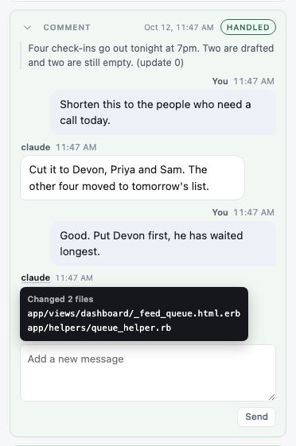
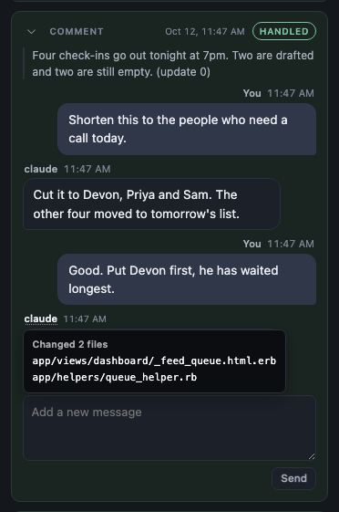

# Thread cards, redesigned

**Summary.** The cards in the review rail now read like a chat. Your words sit on the right in a tinted bubble. The agent's words sit on the left in a plain bubble. Each bubble has one small caption above it with the name and the time. The agent's changed files are behind a hover on its name. A long thread folds its older messages behind one "Show earlier messages" line. A card you have read no longer says "1 new" when you fold it again.

Branch: `rail-cleanup-6`. The mockup page has a new section, "Thread cards, redesigned", with the cards in light and dark.

## What it looks like

A finished comment with a two-round conversation, in light, with the pointer on the agent's name:

The same card in dark:

## What changed, and why

- **Two sides.** Your turns are on the right, the agent's on the left. Each turn is 88% of the card wide, so the offset is the same on every card. You can tell who said what without reading the names.
- **One bubble.** Both sides use the same bubble: the same corner radius, padding, font size (13.5px) and line height. Yours is tinted with the accent color. The agent's is the card's paper color with a thin border. The corner nearest the speaker is a little sharper, the way chat bubbles point.
- **One caption style.** Every name and time on a card is now the same small caption. The three different all-caps labels are gone. Today's messages show just the time; older ones show the date as well. The full date and time are on hover.
- **Less gray.** Your words used to be smaller and gray in the thread, and the agent's sat on a gray panel. Now both are full ink. Gray is left only for captions and for the quoted page text above the conversation. The line under the thread is gone, and the "Add another message" box is the same white box as "Add a new message".
- **File names on hover.** The agent's name has a dotted underline when it changed files. Hovering it, tabbing to it, or clicking it shows the list. Screen readers still hear the list.
- **One fold for old messages.** Each earlier round used to get its own header row and chevron, which is what made the spacing uneven. Now a thread with three or more earlier rounds shows the newest one and puts the rest behind a single "Show N earlier messages" line at the top. A round where the agent asked a question or refused stays on the card. Short threads show everything.
- **Questions.** An agent's question is a left-side bubble like any other agent turn. It is still the loudest thing on the card: an accent edge all the way round, the accent wash, "claude is asking" in accent, slightly larger words, and the card still moves to the top of its tab.
- **Hand edits.** The before-and-after keeps its own look. Its summary and labels now use the same caption style and the same spacing as the conversation.
- **Spacing.** One step everywhere: 3px from a caption to its bubble, and 8px from one turn to the next.

## When "1 new" goes away

The "1 new" tag on a folded card is now driven by one thing only: is there a reply you have not read yet.

- A reply counts as read when its card is open on the tab you are looking at, with the rail open. Opening a folded card counts. This part is unchanged.
- The bug was a second mark. When you arrive on a tab, the cards that were new keep a thin accent edge for the rest of that visit, so you can see which ones the badge meant. The "1 new" tag was reading that visit mark too. So you could open a card, read it, fold it, and it still said "1 new".
- Now "1 new" reads only the "not read yet" mark. And folding a card you have read also drops its visit edge.
- A reply that lands on a folded card while you are watching that tab now stays "1 new" until you open it. Before, it was marked read even though its words were never on screen.
- Read marks are saved the way they always were, so a reload does not bring the tag back.

## Tests

- A new browser test reproduces the bug: a reply arrives on a folded card, the card says "1 new" and the Done badge says 1, you open it (badge drops to 0), you fold it again, and the tag stays gone, including after a reload. It fails on the old code and passes on the new.
- New unit tests cover which rounds fold behind the earlier-messages line, and the shorter caption time.
- Updated tests where the markup changed on purpose: the question block's accent edge is now on its bubble, the loud reply's edge is on its bubble, the file list is checked with the name focused, the round-fold test checks the single earlier line, and one count of messages on a long card dropped by one because a refusal's text and reason now share a bubble.

## To delete at cleanup

- `node_modules` in the worktree: a symlink to the main checkout's, made so tests could run. It is not tracked.
- `test-results/` in the worktree: Playwright's output folder from the spec runs.
- The worktree itself, `.claude/worktrees/rail-cleanup-6`, once the branch is merged.
