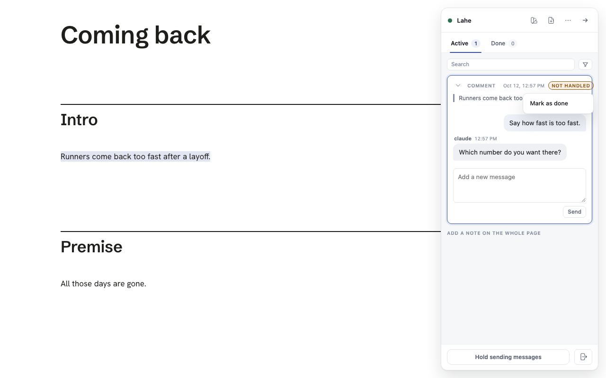
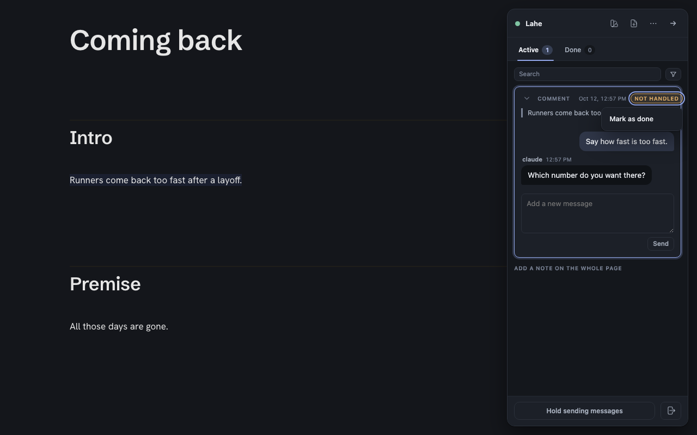

# Mark as done

**Summary.** You can now close any card yourself. On an Active card, the state chip ("Ready" or "Not handled") is a button. Click it and choose "Mark as done". The card moves to Done and says "You marked this done." The agent stops seeing it, and any late reply from the agent is refused.

Branch: `rail-cleanup-8`.

## Why

Ken, on a card he could not get rid of: "cards not being able to be cleared from the active section is an issue. you should always be able to move a card to done when i request it, or i should be able to click the "ready" or "unhandled" and change it to done, or something. it's annoying to have leftover comments i can't get rid of".

That card was a hand edit. The agent said handled, but the helper held it open because the edit's words are not on the page (a different wording was chosen later). Hand edit cards have no delete, and comment cards hide their × once an agent replies. So neither Ken nor the agent could retire it.

## What it looks like

The menu open on a refused comment, light:

The same, dark:

Both come from `test/browser/mark_done.spec.js`, in the run that proves the change.

## What changed

- **The chip is a button** on any outstanding card: a comment, a hand edit, a free-writing run, ready or not handled, including one the page check is holding. It shows a tip on hover: "Mark this card as done without waiting for the agent". It takes the keyboard: Tab to it, Enter or Space opens the menu, Escape closes it and puts focus back on the chip. Everywhere else (a draft, a held card, a card that was not sent, a Done card) the chip is the plain label it was, and a click on it folds the card as before.
- **The menu has one item**, "Mark as done". Delete is not in it: the cards that can be deleted already have their ×, and the ones Ken was stuck with cannot be deleted by design.
- **In Done** the card says "You marked this done." and its chip reads "Done", not "Handled", so it never looks like the agent's work. It never counts as "1 new". The agent's last answer stays on the card as history.
- **The record** moves to `handled` and carries `closed_by: "reviewer"` and `closed_at`. The revision does not change. A new revision (a follow-up from Done) drops the mark, because that is new work.
- **The helper** gets an explicit `item.closed` event that names the item and its current revision, and nothing else. It is not a state claim: the helper applies it only if the item is still ready or not handled at exactly that revision. A close at an older revision is dropped and reported, the way a stale reply is. The close clears `handled_not_on_page`, and the page check never runs on it. Any agent reply after the close is refused. A record the browser posts cannot claim a close by itself.
- **The agent** sees the item as `handled` with `closed_by_reviewer: true` in review.json. `lahe status --json` stops listing it. The contract, the skill and `docs/CONTRACTS.md` each gained one sentence saying such an item takes no reply.
- **The page.** A closed item is no longer replayed, and its highlight comes off. Words replay had already written into the page stay until the next reload, the same as when an agent answers not handled.

## Files

- Shared rules: `src/shared/lifecycle.js` (the two reviewer arrows, `canClose`, `closeItem`, replies refused after a close), `src/shared/record.js` (the two fields, `isClosedByReviewer`), `src/shared/merge.js` (a close at the same revision stands), `src/shared/protocol.js` (`item.closed`), `src/shared/review_format.js` (`closed_by_reviewer`, one contract sentence).
- Helper: `src/service/projection.js` (folds `item.closed`), `src/service/replies.js` (no page check, no rival rule on a closed card).
- Page: `src/layer/overlay.js` (the chip, its menu and tip), `src/layer/sync.js` (`closeItem` posts the event), `src/layer/index.js` (the close itself), `src/layer/tab_done.js` (the Done card's sentence, never unread, folded replies leave it alone).
- Docs: `docs/diagrams/item_lifecycle.md`, `docs/diagrams/merge_on_load.md`, `docs/CONTRACTS.md`, `skills/lahe/SKILL.md`.

The helper changes only take effect once Ken's real helper is restarted.

## Tests

- `test/unit/mark_done.test.js`, 19 tests: the lifecycle arrows, closing and its refusals, the merge rule, the projection (current, stale, claimed, re-posted, reworded, folded in pieces), reply folding after a close, and the "1 new" rule.
- `test/browser/mark_done.spec.js`, 2 tests on the real `lahe review` walk: a refused comment closed with the mouse, and a held hand edit closed from the keyboard. Each checks the card in Done, the sentence, no "1 new", review.json, `lahe status --json`, and a reload. The first also checks that a late agent reply is refused.
- `test/browser/card_collapse.spec.js`: the "press the head strip" check now presses the strip's empty middle. Its right end is the chip, which is a control on an outstanding card now.

## To delete at cleanup

- `test-results/` in the worktree, left by the Playwright runs.
