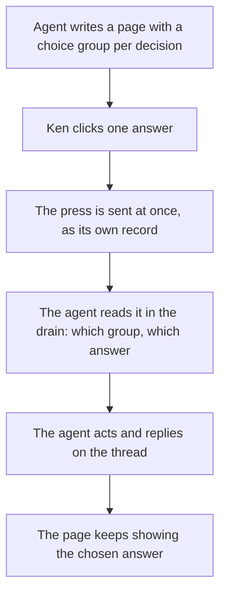

# Feature Brief: Choice buttons on a document

## Summary

An agent writing a page for Ken can put a choice on it: a short question with two or more answers drawn as buttons. Ken clicks one. The click reaches the agent at once as its own record, naming which choice and which answer, so two groups that both offer "Promote" can never be confused. The page shows what was chosen and keeps showing it after the agent has acted. This works on documents only: pages Lahe renders from Markdown or serves as an agent-written HTML page. A page on someone else's dev server gets nothing new.

## Problem, User, and Context

Ken, in his words: the job is to **answer a question from the agent quickly and easily**, and the user who matters most is **the agent writing the page: instructions must be clear and communication must be good.**

Today an agent that needs nineteen verdicts writes a page with nineteen recommendations and Ken answers each one by selecting text, pressing Cmd-Shift-C, typing, and pressing Cmd-Enter. The lesson-queue agent invented a shortcut on its own, "one comment saying all as recommended is enough", because the real thing was missing. Every exception to that shortcut arrives as prose the agent can misread.

The scene is a laptop, the page in a browser tab, amid eighteen other things.

Prior work: [the crucible summary](00_crucible_choice_buttons.md) and [the questions page](00_crucible_questions.md) with Ken's edits folded in. The standard docs that bear on this: [the product brief](../../ongoing/PRODUCT_BRIEF.md) (the record is the truth; don't waste tokens), [the style guide](../../ongoing/STYLE_GUIDE.md) (option cards with a Recommended badge are the component for a choice), [the brand doc](../../ongoing/BRAND.md) (which promises interactive modules), and [the architecture doc](../../ongoing/ARCHITECTURE.md), which says a new kind of record changes that doc first.

## Non-Goals

::: callout-nongoal
- Not on live sites. A page served from someone else's dev server (the `lahe add` path) is untouched: no click is claimed there, and a choice group on such a page is inert content.
- Not a general form. No free-text field, slider, ranking or multi-select in this cut. A question with a free answer stays a comment.
- Not a page-level "all as recommended" switch. Open question Q2.
- Not a change to how comments, edits or free writing work.
- Not an agent pressing a button on the reviewer's behalf.
- Not mobile. Lahe has no mobile story and this feature does not start one.
:::

## Solution Outline

The agent writes a choice group into the page the way it writes any other house component: a question, two or more answers, and the one it recommends marked. On a document page the group draws as buttons grown out of the option-card component. Ken clicks an answer. There is no draft and no confirm: the click is the commit, and the press is sent the moment it is made. It is a record like any other, so it survives a reload, a closed tab and a helper that is down. In the agent's drain it arrives as data that names the group and the answer, with nothing to parse. The agent acts and replies on the thread, as it does for a comment. Once handled, the page keeps showing the chosen answer, so a reader coming back later sees what was decided without opening the rail.

## Requirements

### Authoring

::: callout-req
**R1:** An agent can put a choice group on a document page in a few lines, written into the page's Markdown or HTML: a question, two or more answers, and which one it recommends. The lahe skill and the component catalog teach the block, and an agent gets it right from that text alone.
:::

::: callout-req
**R2:** A choice group is a house component, grown out of option cards: the recommended answer carries the Recommended badge, and nothing has a colored edge. It reads as part of the document, in the document's style.
:::

::: callout-req
**R3:** A page with no choice groups renders and behaves exactly as it does today.
:::

### Pressing

::: callout-req
**R4:** A click on an answer sends the press at once. No draft state, no Cmd-Enter. The page shows which answer was pressed and that it was sent.
:::

::: callout-req
**R5:** One answer per group. Pressing a different answer before the agent has replied changes the choice, and the agent sees only the latest.
:::

::: callout-req
**R6:** After the agent has handled a press, pressing again on the same group starts a new thread rather than reopening the old one. Open question Q1.
:::

::: callout-req
**R7:** A press is a record like any comment or edit: kept in the browser as it is made, sent to the helper, shown as a thread in the rail, and preserved across a reload, a closed tab and a helper restart. The pressed state on the page survives a reload and the agent's rebuild.
:::

::: callout-req
**R8:** Only a page Lahe renders or serves as a document carries live choice groups. On any other page the library claims no click, and every link, form, button and script on the page behaves as it did before.
:::

### Reaching the agent

::: callout-req
**R9:** A press reaches the agent in the drain as data: which group, which answer, the group's question and the heading it sits under. The agent reads fields and parses nothing. Two groups that offer the same answers are never confused, however the identity is carried (architecture decides).
:::

::: callout-req
**R10:** The agent answers a press the way it answers a comment: handled, not handled with a reason, or a question. The reply shows on the thread, and Mark as done works on it.
:::

::: callout-req
**R11:** A press costs fewer tokens in the drain than a comment on the same block. It carries no page quote or region text beyond what names the group. Measured against a comment, the way earlier features measured the drain.
:::

::: callout-req
**R12:** The handled check never holds a press for words that were never typed on the page. A handled reply on a press retires it.
:::

### Keeping the decision

::: callout-req
**R13:** Once the agent has handled a press, the page keeps showing the chosen answer, including on a fresh load with no rail open. How the document carries it is for the architecture.
:::

### Agents learning it

::: callout-req
**R14:** The lahe skill's components table and the component catalog gain the choice group, and the contract text in review.json says how a press appears in the drain and how to answer it. The skill edit is made with the skill-creator skill, and the skill, the contract and its copies ship together, as CLAUDE.md requires.
:::

::: callout-req
**R15:** The first working page shown to Ken, before any PR gate, is the lesson queue rebuilt with a real choice group per lesson, with the rail live.
:::

## AI Behavior

- An agent offers a choice group whenever it can name every answer in advance: promote or discard, approve or hold, A or B. When the answer is free text, it asks in prose and expects a comment.
- On a press, the agent does what the answer says, then replies handled in one sentence about the document, the way the skill already asks for comments. A press that needs more from the reviewer gets a question on its thread, not a new page.
- An agent never presses a button itself and never writes a press into the store by hand.

## UX Notes

- The pressed answer is visible on the page: which one, and that it is sent. The rail's thread for it shows the question, the answer and the state chip like a comment card.
- Buttons are real buttons: keyboard reachable, with the house focus ring.
- Documents are light only, so the component needs no dark twin on the page. The rail card follows the rail's own scheme as every card does.
- A visual change ships with a screenshot from the built page, after the test that proves it.

## Analytics / Logging

No new analytics. A press is an item in the review's event log and in review.json like every other record, which is the whole audit trail. One measurement script, for R11, records the drain size of a press against a comment on the same block, the way the lean-agent-output feature measured one comment.

## Rollout / Flags

No flag. A page without a choice group is unchanged (R3). A new record kind reaches review.json, so an agent on an older copy of the skill sees a kind it was not told about; the contract text ships in the same change and `npm run install-skills` brings the skill up to date. The architecture doc is changed first, as its own rule requires.

## Questions and Decisions

<!-- forge-include: parts/brief/questions.md -->

## PM Review

Pending. Full prose will live in `01_brief_choice_buttons_reviews.md`.

| # | Finding | Disposition | Rationale |
|---|---------|-------------|-----------|
