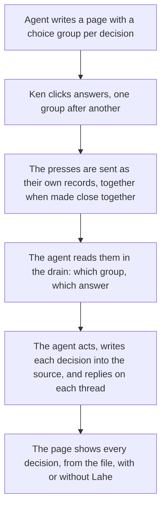

# Feature Brief: Choice buttons on a document

## Summary

An agent writing a page for Ken can put a choice on it: a short question with two or more answers drawn as buttons. Ken clicks one. The click reaches the agent as its own record, naming which choice and which answer, so two groups that both offer "Promote" can never be confused. Presses made close together reach the agent together. The page shows what was chosen, and once the agent has acted the decision lives in the document's own source, so the page shows it with no Lahe running. This works on documents only: pages the Lahe program serves itself, rendered from Markdown or written as HTML by an agent. A page on someone else's dev server gets nothing new.

## Problem, User, and Context

Ken, in his words: the job is to **answer a question from the agent quickly and easily**, and the user who matters most is **the agent writing the page: instructions must be clear and communication must be good.**

Today an agent that needs nineteen verdicts writes a page with nineteen recommendations and Ken answers each one by selecting text, pressing Cmd-Shift-C, typing, and pressing Cmd-Enter. The lesson-queue agent invented a shortcut on its own, "one comment saying all as recommended is enough", because the real thing was missing. Every exception to that shortcut arrives as prose the agent can misread.

The scene is a laptop, the page in a browser tab, amid eighteen other things.

Prior work: [the crucible summary](00_crucible_choice_buttons.md) and [the questions page](00_crucible_questions.md) with Ken's edits folded in. The standard docs that bear on this: [the product brief](../../ongoing/PRODUCT_BRIEF.md) (the record is the truth; don't waste tokens; don't cause no-ops), [the style guide](../../ongoing/STYLE_GUIDE.md) (option cards with a Recommended badge are the component for a choice), [the brand doc](../../ongoing/BRAND.md) (which promises interactive modules), and [the architecture doc](../../ongoing/ARCHITECTURE.md), which says a new kind of record changes that doc first.

## Non-Goals

::: callout-nongoal
- Not on live sites. A page served from someone else's dev server (the `lahe add` path) is untouched: no click is claimed there, and a choice group on such a page is inert content.
- Not a general form. No free-text field, slider, ranking or multi-select in this cut. A question with a free answer stays a comment.
- Not a page-level "all as recommended" switch. An agent that wants one writes one more choice group and says in its question what it covers.
- Not a change to how comments, edits or free writing work. A comment left on a choice group is an ordinary comment.
- Not an agent pressing a button on the reviewer's behalf.
- Not an automatic report to the agent when it wrote a broken group. The reviewer sees the problem in the rail and says so. Deferred; see the questions leaf.
- Not mobile. Lahe has no mobile story and this feature does not start one.
:::

## Solution Outline

The agent writes a choice group into the page the way it writes any other house component: a question, two or more answers, and the one it recommends marked. On a document page the group draws as buttons grown out of the option-card component. Ken clicks an answer. There is no draft and no confirm: the click is the commit. The press is a record like any other, so it survives a reload, a closed tab and a Lahe program that is down. Presses made within a few seconds of each other travel to the Lahe program together and wake the agent once. In the agent's drain each arrives as data that names the group and the answer, with nothing to parse. The agent acts, writes the decision into the page's source, and replies on the thread as it does for a comment. From then on the document itself carries the decision.

## Requirements

### Authoring

::: callout-req
**R1:** An agent can put a choice group on a document page in a few lines, written into the page's Markdown or HTML: a question, two or more answers, and optionally which one it recommends. The lahe skill and the component catalog teach the block. Checked by the skill eval: a fresh agent given only the skill text and the catalog writes a group that arms on its first try.
:::

::: callout-req
**R2:** A choice group is a house component, grown out of option cards: the recommended answer, when there is one, carries the Recommended badge, and nothing has a colored edge. It reads as part of the document, in the document's style.
:::

::: callout-req
**R3:** A page with no choice groups renders and behaves exactly as it does today.
:::

::: callout-req
**R4:** A group an agent got wrong (no id, a malformed id or answer, two groups with the same id) draws as plain content, not live buttons, and the rail says which group and why before anything can be pressed.
:::

### Pressing

::: callout-req
**R5:** A click on an answer sends the press at once. No draft state, no Cmd-Enter. The page shows which answer was pressed.
:::

::: callout-req
**R6:** One answer per group. Pressing a different answer before the agent has replied changes the choice, and the agent sees only the latest.
:::

::: callout-req
**R7:** After the agent has handled a press, pressing again on the same group starts a new thread. The agent undoes what the earlier answer asked for, does what the new one asks, and says both on the thread.
:::

::: callout-req
**R8:** A press is a record like any comment or edit: kept in the browser as it is made, sent to the Lahe program, shown as a thread in the rail, and preserved across a reload, a closed tab and a program restart.
:::

::: callout-req
**R9:** The group shows its state on the page in the rail's own words. Kept in this browser (the Lahe program has not stored it yet). Open (stored, waiting on the agent). Question (the agent asked something on the thread). Not handled (the agent said no, with a reason on the thread). Done (the agent acted, or the reviewer marked it done). The state survives a reload and the agent's rebuild.
:::

::: callout-req
**R10:** When a rebuild moves a group, its state follows it. When a rebuild removes a group while its press is open, the press stays on its rail thread and the thread says the group is gone. A press never attaches to a different group.
:::

::: callout-req
**R11:** On every page, Lahe responds only to clicks on a choice group's own buttons. Only a page the Lahe program serves itself (rendered Markdown, an HTML page in a served folder, a `lahe write` page) carries live groups. On a page from another dev server the layer claims no click, and every link, form, button and script behaves as before.
:::

### Reaching the agent

::: callout-req
**R12:** A press reaches the agent in the drain as data: which group, which answer, the group's question and the heading it sits under. The agent reads fields and parses nothing. Two groups that offer the same answers are never confused.
:::

::: callout-req
**R13:** Presses made within a few seconds of each other reach the Lahe program together. The agent wakes once per batch of work that landed since it last looked, never once per press, so clearing the nineteen-lesson queue by clicking costs a handful of wakes at most, one per stretch the agent spends working. The count is measured with R15.
:::

::: callout-req
**R14:** The agent answers a press the way it answers a comment: handled, not handled with a reason, or a question. The reply shows on the thread, and Mark as done works on it.
:::

::: callout-req
**R15:** Clearing the lesson queue with presses costs fewer tokens on the agent's side than clearing it with one comment per lesson. Measured on the real page, the way the lean-agent-output feature measured one comment.
:::

::: callout-req
**R16:** The page check never holds a press for words that were never typed on the page. A handled reply on a press retires it.
:::

### Keeping the decision

::: callout-req
**R17:** Handling a press includes writing the decision into the page's source. After that, the page shows the chosen answer on a fresh load with no rail and no Lahe program. Until then, the layer shows it from the record.
:::

### Agents learning it

::: callout-req
**R18:** The lahe skill's components table and the component catalog gain the choice group, and the contract text in review.json says how a press appears in the drain, how to answer it and that handling includes the source write-back. The skill edit is made with the skill-creator skill, and the skill, the contract and its copies ship together, as CLAUDE.md requires.
:::

::: callout-req
**R19:** The first working page shown to Ken, before any PR gate, is the lesson queue rebuilt with a real choice group per lesson, with the rail live.
:::

## AI Behavior

- **When to use which component.** Option cards describe alternatives: a name, a line or two, the costs, a Recommended badge. A choice group collects the answer. A page that asks a question uses a choice group for the answer and, when the alternatives need explaining, option cards above it. A page that only records a decision already made uses neither.
- **When a group fits.** An agent offers a choice group whenever it can name every answer in advance and will act on the answer: promote or discard, approve or hold, A or B. When the answer is free text, it asks in prose and expects a comment. A group needs no recommendation when the agent has none.
- **On a press.** The agent does what the answer says, writes the decision into the source, and replies handled in one sentence about the document, the way the skill already asks for comments. A press that needs more from the reviewer gets a question on its thread, not a new page.
- **A changed mind.** A new press on a group the agent already handled is a new thread. The agent undoes what the earlier answer asked for where that is possible, does the new one, and says both. A press that arrives while the agent is mid-task is handled on the next drain, never dropped.
- **A comment on a group** is an ordinary comment and is answered as one.
- An agent never presses a button itself and never writes a press into the store by hand.

## How we know it worked

- Ken clears a lesson queue by clicking, with no comment typed, and every lesson ends up where he clicked it.
- A week of decision pages with no wrong answer reaching an agent and no "which one did you mean" question back.
- The token comparison in R15 shows presses cheaper than comments on the same page.

## UX Notes

- The group's state is visible on the page (R9), and the rail's thread for it shows the question, the answer and the state chip like a comment card. The answer on the card is not editable; changing it is a new press.
- Buttons are real buttons: keyboard reachable, with the house focus ring.
- Documents are light only, so the component needs no dark twin on the page. The rail card follows the rail's own scheme as every card does.
- The brand doc's word list gains the term for this component so the rail, the skill and the docs call it one thing.
- A visual change ships with a screenshot from the built page, after the test that proves it.

## Analytics / Logging

No new analytics. A press is an item in the review's event log and in review.json like every other record, which is the whole audit trail. One measurement script, for R15, records the drain cost of clearing the lesson queue by presses against clearing it by comments.

## Rollout / Flags

No flag. A page without a choice group is unchanged (R3). A new record kind reaches review.json, so an agent on an older copy of the skill sees a kind it was not told about; the contract text ships in the same change and `npm run install-skills` brings the skill up to date. The architecture doc was changed first, as its own rule requires.

## Questions and Decisions

<!-- forge-include: parts/brief/questions.md -->

The questions leaf is [parts/brief/questions.md](parts/brief/questions.md).

## PM Review

Full prose: [01_brief_choice_buttons_reviews.md](01_brief_choice_buttons_reviews.md).

| # | Finding | Disposition | Rationale |
|---|---------|-------------|-----------|
| RF1 | Nineteen presses could wake the agent nineteen times; the token requirement measured one press | Accepted | R13 (presses close together travel and wake together) and R15 now measured on the whole lesson queue |
| RF2 | Nothing said what happens to a changed mind after the agent acted | Accepted | R7 and AI Behavior: new thread, undo the old, do the new, say both; a mid-task press is handled next drain |
| RF3 | The page's states were only "sent" and "handled" | Accepted | R9 lists every state in the rail's words, including the program-down case; the brand word list gains the term |
| RF4 | A rebuild that moves, renames or removes a group was not covered | Accepted | R10 |
| RF5 | A broken or duplicate group was found only by pressing it | Accepted in part | R4 draws it inert and names it in the rail before a press; telling the agent automatically is deferred (Non-Goals, questions leaf) |
| RF6 | No rule for option cards versus a choice group, a comment on a group, or a group with no recommendation | Accepted | AI Behavior, first two bullets and the comment bullet; R1 says the recommendation is optional |
| RF7 | Where the decision lives after the review was unclear | Accepted | R17: handling includes writing it into the source; the file carries it from then on |
| RF8 | Q1 and Q2 were still open though Ken said not to ask him | Accepted | Both moved to "chosen by the brief" in the questions leaf |
| RF9 | The questions leaf cited the wrong requirement numbers | Accepted | Renumbered against this version |
| RF10 | No "How we know it worked" section | Accepted | Added |
| RF11 | Whether a served folder is a document or a site was unclear | Accepted | R11: served by the Lahe program means document; only a group's own buttons are ever claimed, on any page |
| RF12 | R1 was not testable as written | Accepted | R1 names the skill eval check |
| AR2 | From the architect review: the helper writes one wake line per press, and the monitor's poll is what bounds wakes | Accepted | R13 reworded: one wake per batch of landed work, counted in R15, never a promise of one wake total |
