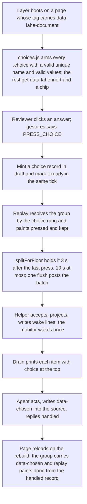
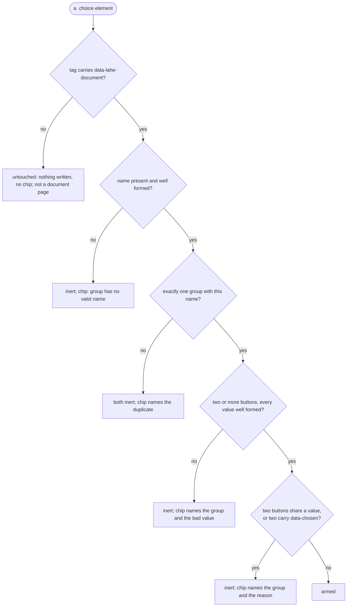

# Architecture: Choice buttons on a document

## Summary

A choice group is a house component an agent writes into a page as an HTML block: a question, two or more real buttons, and a group name the agent chooses in `data-choice`. On a page the helper serves itself as a document, the review layer arms those buttons and nothing else. A click mints a record of a new kind, `choice`, carrying the group name and the answer, draft and ready in the same tick. The anchor engine gains one rung that finds a choice group by its name, so replay, lost-marking and "show me where" work on a choice unchanged. The helper projects it like any item, the drain prints the choice at the top level with only the question and heading under `page`, and the agent answers with the reply command it already uses. The layer paints the group's state from the record; the agent writes the decision into the source as `data-chosen` when it handles the item, so the document keeps the decision with no Lahe running. No new routes, tokens, lifecycle states or processes.

## Analysis of Existing Structure

- **Records.** `src/shared/record.js` holds the closed list of kinds and `newItem`, plus `validateItem`, the checker the helper's door runs. Free writing added `note` and optional fields; this adds `choice` the same way. The lifecycle table is untouched.
- **Minting and sending.** `src/layer/comments.js` mints a draft and marks it ready; `src/layer/sync.js` queues `item.created` and `item.ready` and flushes the outbox, holding drafts back in `splitForFloor`. A press uses the same two events and a new hold in that same function.
- **Finding the region.** `src/layer/anchor.js` `resolve` has one rung keyed on the record (the empty-container rung, keyed on `placement`). The choice rung is keyed on `kind` and sits beside it.
- **Waking the agent.** The helper writes one wake line per accepted `item.ready`. Every supported host waits with `lahe monitor`, which polls `lahe status` every 15 seconds and exits once on the first poll that finds undelivered work. So a post carrying several presses is one wake, and the wake count during a clicking session is one per agent work cycle, whatever the layer does.
- **The drain.** `src/cli/commands/status.js` moves `review_format.DATA_FIELDS` under `page` and leaves intent at the top. A choice adds one top-level field.
- **The rail.** `src/layer/tab_active.js` draws comment and note rows and refuses other kinds. A choice row joins it with a fixed answer and the ordinary reply box.
- **Clicks.** `src/shared/gestures.js` decides every click on the page; today it names two click rules (the overlay's, and element pick). A press is a third.
- **Serving.** `src/service/page_routes.js` builds the script tag for every page the helper serves itself, and sends a file that already carries this review's tag as it is. `lahe add` and `heal.js` use the same tag builder but write into files.
- **The house style and the catalog.** `vendor/stclair-doc-style/document.css` and `COMPONENTS.md` are the official copies; `scripts/install-skills.js` ships the catalog beside the skill.

What stays the same: every route, token and check; the lifecycle table; the events.jsonl envelope; the Markdown renderer; the Edits tab; the Library; the menu bar.

## Components / Modules Touched

| Area | Files | Change |
| --- | --- | --- |
| Standing docs | `docs/ongoing/ARCHITECTURE.md` (done), `docs/ongoing/BRAND.md`, `docs/ongoing/STYLE_GUIDE.md` (its "a choice for the reader is option cards" line), `docs/CONTRACTS.md`, `docs/diagrams/module_map.md`, `finding_the_region.md`, `item_lifecycle.md` | The sixth kind, D3's exception, the word for the component, the record row and the drain line, the new rung, the one new load-order entry |
| Test harness | `test/browser/support/with_layer.js`, `test/helpers/` | The tag builder takes the document opt-in so a spec can mount the layer as on a served page |
| Shared kernel | `record.js` (kind, field, `validateItem`, `isReplayable` unchanged), `review_format.js` (field class, `projectItem`, the copy-and-export text for the kind, the contract paragraph), `merge.js` (`choice` in the browser-owned fields), `gestures.js` (the press outcome, no hint row), `protocol.js` (`SCRIPT_ATTR.DOCUMENT` and the tag builder's opt-in) | |
| Layer | new `choices.js`, `anchor.js` (the rung), `sync.js` (the press hold in `splitForFloor`), `replay.js` (paint state for the kind), `tab_active.js` (the row), `tab_done.js` (the Done row's text for the kind), `overlay.js` (the kind label and the card summary, which shows the answer), `index.js` (boot and the chip) | |
| Service | `page_routes.js` (the attribute, at response time), `log.js` (the door runs the checker for the new field) | |
| CLI | `status.js` (the drain line) | |
| House style and catalog | `document.css`, `COMPONENTS.md` | The `.choice` component and its states |
| Agent instructions | `skills/lahe/SKILL.md` (with the skill-creator skill), the contract array and its copies in `test/unit/review_format.test.js` and `docs/CONTRACTS.md`, `dist/` | |
| Manifest | `src/shared/manifest.js` | `choices.js` in load order |

## Data / State Changes

### The component, as the agent writes it

```html
<div class="choice" data-choice="lesson-css-counter">
  <p class="choice-q">Promote this lesson?</p>
  <button type="button" value="promote" data-recommended>Promote</button>
  <button type="button" value="discard">Discard</button>
  <button type="button" value="merge">Merge</button>
</div>
```

- `data-choice` is the group name: lowercase letters, digits and hyphens, 1 to 32 characters, starting with a letter or digit. Unique on the page. It is not under the `data-lahe-` prefix on purpose: the tool strips that prefix from captured markup and from the element descriptions agents get, and the group name must survive both.
- Each `button` has a `value` with the same grammar. The button's text is the label the reviewer reads. `type="button"` keeps it out of any form. `data-recommended` marks at most one.
- Once the agent has handled a press, it writes `data-chosen` (no value) onto the chosen `button` in the source. At most one button in a group carries it. The stylesheet draws that button as the decision with no Lahe present. It sits on the button, not the group, because CSS cannot match a button whose `value` equals an attribute on its parent.
- Look: square-cornered outlined buttons in the document's type, the pressed one filled with ink, the Recommended badge (`badge--purple`) drawn by the stylesheet from `data-recommended`. No pills, no colored edges, no shadows.

In Markdown the block is written as HTML with a blank line before and after, like every other component.

### The record

One new kind, `choice`, and one new optional field:

```json
{
  "kind": "choice",
  "state": "ready",
  "note": null,
  "change": null,
  "choice": { "group": "lesson-css-counter", "answer": "promote" },
  "context": { "quote": "Promote this lesson?", "heading": "A CSS counter ignores an ol start attribute" },
  "region": { "ref": { "kind": "choice", "group": "lesson-css-counter" }, "label": "choice", "lost": null }
}
```

- `choice.group` and `choice.answer` are the reviewer's act and the only intent the record carries. Both are bounded by the grammar above, so neither can hold prose. `validateItem` refuses a record whose kind is `choice` without both, with a value off the grammar, or with any other key inside `choice`; the helper's door (`log.js`) runs that checker on every posted record, and the projection runs it again when it builds review.json.
- The pressed label is not stored. The agent knows its own labels, and the rail draws the answer from the group on the page.
- `context.quote` carries the question and `context.heading` the nearest heading, both data. `context.prefix`, `suffix`, `element` and `subject` are left null.
- The region's ref is the choice rung's reference: kind and group name, nothing else. No stamp is minted for a choice, so no stamp round ever asks the agent for a `data-lahe-id`, and the drain line carries no region facts.
- Everything else is the ordinary record: id, rev, page fields, thread, reply.

### The anchor engine's choice rung

`anchor.resolve` gains one rung, keyed on the ref's kind, beside the empty-container rung. For a choice ref it looks for elements matching `.choice[data-choice="<group>"]`. Exactly one binds. Zero or two is a refusal with its own reason ("no group named X", "two groups named X") and the rung stops there: no text search, no tie-breakers. Everything downstream (`applyRecord`, `markLost`, `clearLost`, "show me where", the settle recheck) works unchanged, and a moved group is found wherever it is.

### State on the page

`replay.js` writes nothing for a choice (the kind is not in its writing kinds). After it resolves the group it paints two attributes, inside a write epoch, from the group's current record:

| Attribute | On | Values | Meaning |
| --- | --- | --- | --- |
| `data-lahe-pressed` | the pressed `button` | present | Which button the reviewer pressed |
| `data-lahe-choice-state` | the group | `kept`, `open`, `question`, `not_handled`, `done` | The rail's own states (brief R9). The stylesheet draws `not_handled` with the word Open, the brand's word for a thread the agent has answered no to, since the card says the same; the attribute keeps the finer value for tests and for a later look |

The current record for a group is the one with the latest `created_at` among this page's choice records naming it. A newer press wins over `data-chosen` in the source: when a group holds both a `data-chosen` button and a `data-lahe-pressed` one, the stylesheet draws the pressed one as the answer and the chosen one quiet. `data-chosen` alone draws the same as `done`. These are DOM only and a rebuild clears them; replay's next pass paints them again. A refused group gets `data-lahe-inert` from `choices.js` at arming time.

### Lifecycle

No new states. A press mints the item in `draft` and marks it `ready` in the same tick, queueing `item.created` and `item.ready` together; the helper's door does no state check on these events and the merge on load handles a record that was never a typed draft. Pressing another answer while the item is `ready` with no reply is a reword: one `ready` write at the next revision, the way a committed comment's rewording lands (the browser never shows a draft in between, since there is nothing to type). After a `not_handled` reply, a new press on the same group reopens the same record (`not_handled` to `ready`, a reviewer move the table already allows) at a new revision. After `handled`, a new press mints a new item. Mark as done, reopen and delete work as for a comment. `merge.js` lists `choice` among the browser-owned content fields.

### Presses travel together, and what bounds the wakes

`choices.js` records a press with no immediate flush. `splitForFloor` holds every queued event of a choice item until 3 seconds have passed since the page's last press, with a cap of 10 seconds from the first held press so steady clicking cannot hold work back for minutes. Hiding the tab or leaving the page flushes at once, as the draft floor does. Hold's gate stays in force.

The helper still writes one wake line per accepted `item.ready`. That does not matter on any supported host: `lahe monitor` polls every 15 seconds and exits once on the first poll that finds undelivered work, so one post of several presses is one wake, and a clicking session costs about one wake per agent work cycle. R13's bound is this monitor behaviour plus the 3 second hold; the R15 measurement runs at a realistic reading pace and reports the wake count. Making the monitor itself wait for a quiet spell would cover comments too and is a change to a shared loop, so it goes on the board for Ken rather than into this feature.

While a press is held it is `kept` on the page. The rail's own not-stored warning is driven by the helper being unreachable, not by the hold, so a held press does not read as a program-down warning; the plan checks that.

### The drain line

```json
{"review":"r…","id":"itm_…","rev":1,"kind":"choice","state":"ready",
 "choice":{"group":"lesson-css-counter","answer":"promote"},
 "page":{"path":"/02_lesson_queue.md","quote":"Promote this lesson?",
         "context":{"heading":"A CSS counter ignores an ol start attribute"}}}
```

`choice` is classed as intent by key: `choice.group` and `choice.answer` each get `CLASS_INSTRUCTION` in `PROJECTED_FIELD_CLASS`. No `before`, `after_full`, `region`, `region_label`, `subject` or html fields appear; `projectItem` leaves them null for the kind and the drain's lean pass drops them.

### The script tag

One new attribute, `data-lahe-document`, is added by `page_routes.js` when it builds the response for a page it serves itself: rendered Markdown, an HTML page under a site root, a `lahe write` page, and a file that already carries this review's tag (the attribute is added to the served copy, never written to disk). It is an opt-in on the tag builder that `add.js` and `heal.js` never pass. The layer arms choice groups only when its tag carries it.

### The gesture

`gestures.js` gains `PRESS_CHOICE` in the gesture vocabulary and in the deciding function: a click on a `button` inside an armed `.choice`, on a document page, in browse mode, outside element-pick mode, with no block open for editing, in a window that may write, and not in present mode. It calls `preventDefault` so no form is submitted. It gets no row in the hint table: every table row becomes a hint line on every page's rail, and a page with no groups must stay unchanged (brief R3). The hint-count tests change on purpose to say so. In every other case the click is the page's, and on a document page a plain button does nothing anyway.

## Key Flows

### A press



### Refusing a group



## Alternatives Considered

<!-- forge-include: parts/architecture/alternatives.md -->

The leaf is [parts/architecture/alternatives.md](parts/architecture/alternatives.md).

## Failure Modes / Edge Cases

- **Helper down at the press.** The record is in browser storage and the outbox like any item. The group shows `kept`; the card shows the rail's not-stored mark because the helper is unreachable, which is true. It sends when the helper is back.
- **A group moved by a rebuild.** The rung finds it by name wherever it is, so its state follows it.
- **The group is gone while the item is ready.** The rung refuses, `markLost` runs as for any record, and the card says the group is gone. The item stays on the drain.
- **The group is gone after the item is handled.** A handled item is never stamped lost; nothing is painted.
- **The agent handles the item but forgets `data-chosen`.** The page shows `done` while the record exists. A reader with no Lahe sees an undecided group. The skill names the write-back as part of handling, and the contract says a handled reply without it is incomplete, as it does for a missing `data-lahe-id`.
- **A press on a decided group.** A new item at rev 1; the newer press paints over `data-chosen` until the agent answers.
- **Two quick presses on one group.** A reword at rev 2 inside the same hold; one flush, the drain shows only the latest. Pressing the same answer again while the press waits, or while the agent has asked a question, does nothing.
- **A reviewer's words on a choice thread.** The card keeps the ordinary reply box. Words typed there go in `note` on the same record as a follow-up turn; the choice itself does not change.
- **A group inside a `lahe add` page, or any page without the attribute.** Untouched: no attribute is written on it and no chip is raised; the page's own scripts see the click. D3 holds in full.
- **Element-pick mode, an open edit, a read-only window, present mode.** The click is not a press; the gesture table says so.
- **Keyboard.** Real buttons: Enter and Space press them; the house focus ring applies.
- **Print.** A decided group prints its decision because the stylesheet draws `data-chosen`.
- **Old skill, new helper.** An agent on a stale skill sees `kind: choice` with a `choice` field it was not told about. The contract paragraph ships in the same change, and review.json's contract is what it reads first.

## Security & Privacy Notes

- **What the layer claims.** Only a `PRESS_CHOICE` gesture: a click on a `button` inside an armed `.choice` on a page whose tag carries `data-lahe-document`, in browse mode. The helper alone writes that attribute, onto responses for pages it serves itself. A dev-server page never gets it.
- **What reaches the agent as intent.** `choice.group` and `choice.answer`: bounded tokens, checked at the helper's door and again at projection, so a page cannot smuggle prose through the intent field. The question and heading are page text under `page` (D12).
- **The source write-back.** The agent edits its own source, as it does for `data-lahe-id`. No new path, token or route.
- **No new trust boundary.** No route, no token, no header, no process. events.jsonl gains a kind, not a shape.

## Showing it before the PR

The lesson-queue preview (brief R19) cannot work by copying the bundle into main's `dist/`, because this feature changes the helper too (the tag attribute, the door check, the drain line). The preview runs the branch's own helper from the feature worktree on another port, with its own state folder copied from Ken's with the recorded pids neutralized, serving the rebuilt lesson queue; a press on it must appear in that helper's drain as a choice item. That is the pass bar, with a screenshot beside it.

## Test Strategy

The plan owns the verification table. The failure modes above, the refusal flow and the architect review's requirement sweep are its inputs. The R15 measurement is a script in the feature folder after `docs/features/20261014.02_lean_agent_output/measure_one_comment.js`, run at a reading pace, reporting drain size and wake count.

## Open Questions

None. The brief's questions leaf is [parts/brief/questions.md](parts/brief/questions.md). The one call this review handed to Ken (a quiet spell in the monitor) goes on the board as a follow-up, not into this feature.

## Architect Review

Full prose: [02_architecture_choice_buttons_reviews.md](02_architecture_choice_buttons_reviews.md).

| # | Finding | Disposition | Rationale |
|---|---------|-------------|-----------|
| RF1 | The group attribute sat in the `data-lahe` namespace the tool strips from captured markup | Accepted | Renamed `data-choice`; only the layer's state attributes stay under `data-lahe-` |
| RF2 | The helper writes one wake line per press; the monitor's 15 s poll is what bounds wakes; the poll loop would defeat a timer window | Accepted | Mechanism restated; the hold lives in `splitForFloor` with a 10 s cap; wakes measured in R15; a monitor quiet spell goes to the board for Ken |
| RF3 | A served file already carrying the tag never got the attribute | Accepted | Added at response time as an opt-in `add.js` and `heal.js` never pass |
| RF4 | A choice would be stamped and its drain line would carry region facts | Accepted | No stamp; region ref is the rung's own; drain carries only the question and heading |
| RF5 | `choice.label` was page text classed as intent; grammar checked only in the browser | Accepted | Label dropped; `group` and `answer` classed by key; checked at the door and at projection; limit 32 |
| RF6 | A separate re-mark pass would rebuild lost-marking by hand | Accepted | One rung in `anchor.resolve`; replay paints state and writes nothing |
| RF7 | Only duplicates raised the chip | Accepted | Every refusal on a document page raises the chip with its reason |
| RF8 | A read-only card blocked answering an agent's question | Accepted | Only the answer is fixed; the reply box stays and its words go in `note` |
| RF9 | The click bypassed the gesture table | Accepted | `PRESS_CHOICE` in `gestures.js`, off in pick, edit, read-only and present |
| RF10 | "Newest revision first" picked the wrong record; a press after `not_handled` left the old card open | Accepted | Latest `created_at`; a press after `not_handled` reopens the same record |
| RF11 | `choice` missing from the merge rule's browser-owned fields | Accepted | Added |
| RF12 | The load-order note named the wrong dependency | Accepted | After the shared files, listeners, store, anchor, overlay and sync; before `index.js` |
| RF13 | Look and the newer-press-wins rule were unstated | Accepted | Stated under the component and the state table |
| RF14 | The files table missed ten files and listed `markdown.js` | Accepted | Table corrected |
| PR3 | From the plan review: CSS cannot match a button from a value on its group | Accepted | `data-chosen` and `data-lahe-pressed` live on the button; the state stays on the group |
| PR4 | From the plan review: a bundle-only preview cannot show a feature that changes the helper | Accepted | "Showing it before the PR": the branch's helper on another port against a copied state folder |
| PR10 | From the plan review: `tab_done.js`, `overlay.js` labels, the export text, the style guide line and the harness were unowned | Accepted | Added to the files table |
| PR11 | From the plan review: a hint-table row would put a new hint on every page | Accepted | `PRESS_CHOICE` is in the vocabulary and the deciding function, with no table row |

## Security Review

Not run separately. The diff touches no route, token, path or serving rule; the one serving change is an attribute on a tag the helper already writes. The code review covers the click gate and the field grammar at both checkpoints.
