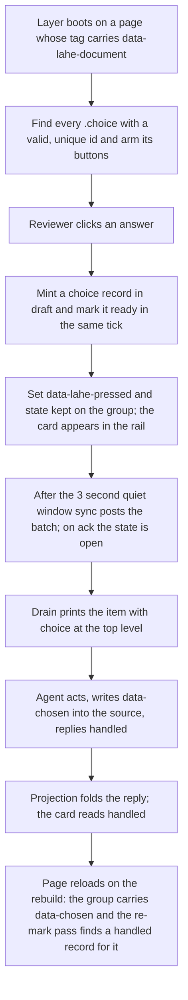
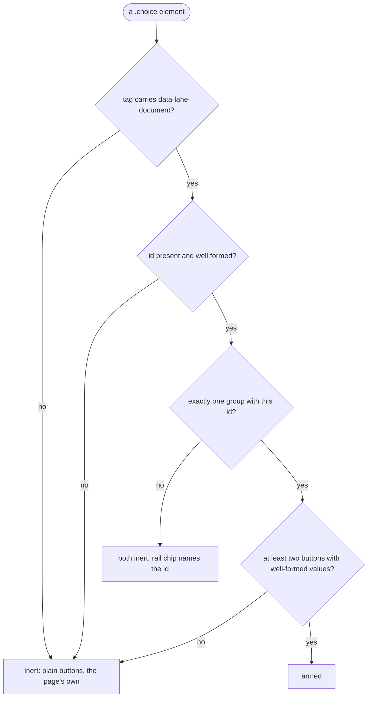

# Architecture: Choice buttons on a document

## Summary

A choice group is a house component an agent writes into a page as an HTML block: a question, two or more real buttons, and an id the agent chooses. On a page the helper serves as a document, the review layer arms those buttons and nothing else. A click mints a record of a new kind, `choice`, carrying the group id and the answer, and sends it in one step, draft and ready in the same tick. The helper projects it like any item, the drain prints it with the id and answer at the top level and the question under `page`, and the agent answers with the reply command it already uses. The layer marks the group's state on the page from the record, and the agent writes the decision into the source as an attribute when it handles the item, so the document keeps the decision with no Lahe running. No new routes, tokens, lifecycle states or processes.

## Analysis of Existing Structure

- **Records.** `src/shared/record.js` holds the closed list of kinds (comment, edit, delete, format_only, note) and `newItem`. Free writing added `note` and five optional fields; this feature adds `choice` and one optional field the same way. The lifecycle table (`src/shared/lifecycle.js`) and the merge rule are untouched.
- **Minting and sending.** `src/layer/comments.js` mints a draft on open and marks it ready on Cmd-Enter; `src/layer/sync.js` posts `item.created` and `item.ready` from the outbox. A press uses the same two events, with no box and no typing between them.
- **The drain.** `src/cli/commands/status.js` moves `review_format.DATA_FIELDS` under `page` and leaves intent at the top. A choice adds one top-level field and reuses `quote` and `context.heading` under `page`.
- **The rail.** `src/layer/tab_active.js` draws comment and note rows and refuses other kinds; `src/layer/tab_edits.js` draws hand edits. A choice row joins the Active pane as a read-only comment-shaped row.
- **Replay and painting.** `src/layer/replay.js` writes only edit kinds and treats comments as guessable marks; `src/layer/index.js` paints highlights for comment and note. A choice is neither written nor painted; a small re-mark pass sets the group's state by id.
- **The handled check.** `src/service/handled_check.js` checks edit and format_only only, so a handled choice retires on the agent's word, which is right: there are no reviewer words to find on the page.
- **Serving.** `src/service/page_routes.js` writes the script tag into every page it serves (`protocol.scriptTag`, src `/.lahe-library/lahe-layer.js`). A `lahe add` page carries a tag that points at the helper's API origin instead. The Markdown renderer passes HTML blocks through unchanged, so the component needs no renderer work.
- **The house style and the catalog.** `vendor/stclair-doc-style/document.css` and `COMPONENTS.md` are the official copies; `scripts/install-skills.js` ships the catalog beside the skill as `references/components.md`. The component is CSS plus a catalog entry plus a skill row.

What stays the same: every route, token and check; the lifecycle; the merge rule; events.jsonl's envelope; the anchor engine; the Edits tab; the Library; the menu bar.

## Components / Modules Touched

| Area | Files | Change |
| --- | --- | --- |
| Standing architecture | `docs/ongoing/ARCHITECTURE.md` | The item row names the sixth kind; D3 gains its one document-only exception. Done first. |
| Shared kernel | `record.js`, `review_format.js`, `protocol.js` | The `choice` kind and its `choice` field; the field's class and the contract paragraph; one script-tag attribute, `data-lahe-document`. |
| Layer | new `choices.js` (load after `comments.js`), `index.js`, `tab_active.js`, `replay.js`, `overlay.js` | Arming, minting, the re-mark pass, the card row, the early return in replay, the duplicate-id chip. |
| Service | `page_routes.js`, `markdown.js` (the tag only) | Write `data-lahe-document` on the tag of every page the helper serves itself. |
| CLI | `status.js` | Keep `choice` at the top level of a drain line; nothing else. |
| House style and catalog | `document.css`, `COMPONENTS.md` | The `.choice` component and its states. |
| Agent instructions | `skills/lahe/SKILL.md` (with the skill-creator skill), the contract array, `docs/CONTRACTS.md`, `test/unit/review_format.test.js`, `dist/` | The authoring block, how a press appears, how to answer and write the decision back. |
| Manifest | `src/shared/manifest.js` | `choices.js` gets its owner line. |

## Data / State Changes

### The component, as the agent writes it

```html
<div class="choice" data-lahe-choice="lesson-css-counter">
  <p class="choice-q">Promote this lesson?</p>
  <button value="promote" data-recommended>Promote</button>
  <button value="discard">Discard</button>
  <button value="merge">Merge</button>
</div>
```

- `data-lahe-choice` is the group id: lowercase letters, digits and hyphens, 1 to 64 characters, starting with a letter or digit. It must be unique on the page.
- Each `button` has a `value` with the same grammar as the id. The button's text is the label the reviewer reads. `data-recommended` marks at most one.
- Once the agent has handled a press, it writes `data-chosen="<value>"` onto the group in the source. The stylesheet draws that group as decided with no Lahe present.

In Markdown the block is written as HTML with a blank line before and after, like every other component.

### The record

One new kind, `choice`, and one new optional field:

```json
{
  "kind": "choice",
  "state": "ready",
  "note": null,
  "change": null,
  "choice": { "group": "lesson-css-counter", "answer": "promote", "label": "Promote" },
  "context": { "quote": "Promote this lesson?", "heading": "A CSS counter ignores an ol start attribute" },
  "region": { "...": "an element anchor on the group, minted the way an element pick mints one" }
}
```

- `choice.group` and `choice.answer` are the reviewer's act. They are the third intent carrier beside `note` and `change`, bounded by the grammar above, so they can never hold prose. `choice.label` is the pressed button's text and is data.
- `context.quote` carries the question and `context.heading` the nearest heading, both data, both already fenced under `page` on the drain.
- Everything else is the ordinary record: id, rev, page fields, thread, reply.

### State on the page

The layer sets two attributes on the group element and the stylesheet draws them. They are DOM only; a rebuild clears them and the re-mark pass sets them again from the records.

| Attribute | Values | Meaning |
| --- | --- | --- |
| `data-lahe-pressed` | the answer's value | Which button the reviewer pressed, from the newest record for the group |
| `data-lahe-choice-state` | `kept`, `open`, `question`, `not_handled`, `done` | The rail's own states (brief R9): kept in this browser and not yet stored; stored and waiting; the agent asked; the agent said no; handled or marked done |
| `data-lahe-inert` | present | The group was refused: a bad or duplicate id or value, or not a document page. The buttons do nothing |

`data-chosen`, written by the agent into the source, draws the same as `done`, so the page looks the same before and after the write-back. The stylesheet carries one rule per state.

### Presses travel together

A press is marked ready at once in the browser, but its `item.ready` leaves the outbox after a quiet window of 3 seconds with no further press on the page, or at once when the tab is hidden or the page is left (the same moments the draft flush uses). Every press made inside the window goes in the one flush, and the helper writes one wake line for the flush. Clearing the lesson queue by clicking steadily is a handful of wakes; pausing between lessons is one wake each, which is what the reviewer asked for by pausing.

### Lifecycle

No new states. A press mints the item in `draft` and marks it `ready` in the same tick, posting `item.created` and `item.ready` together. Pressing another answer while the item is `ready` with no reply is the reword path: `ready` to `draft` to `ready` at the next revision, with the new answer. After a `handled` or `not_handled` reply, a press on the same group mints a new item. Mark as done, reopen and delete work as for a comment.

### The drain line

```json
{"review":"r…","id":"itm_…","rev":1,"kind":"choice","state":"ready",
 "choice":{"group":"lesson-css-counter","answer":"promote"},
 "page":{"path":"/02_lesson_queue.md","quote":"Promote this lesson?",
         "context":{"heading":"A CSS counter ignores an ol start attribute"}}}
```

`choice.label` is left off the drain line (the agent knows its own labels) and kept in review.json. No `before`, `after_full`, `region` or html fields are present.

### The script tag

One new attribute, `data-lahe-document`, written by the helper on the tag of every page it serves itself: rendered Markdown, an HTML page under a site root, a `lahe write` page. A tag written by `lahe add` into a file or printed for a dev server never carries it. The layer arms choice groups only when the attribute is present.

## Key Flows

### A press



### The re-mark pass

Runs on boot, after merge on load, and after every repaint, in the same place replay runs. For each choice record on this page, newest revision first, it finds the group by id. Exactly one match: set the state attribute from the record. No match on a `ready` record: flag the card lost, as a comment whose anchor is gone is flagged. No match on a `handled` record: do nothing, as a handled item is never stamped lost. Two matches: mark both inert and raise the duplicate-id chip. It writes attributes only, inside a write epoch, so it never retriggers replay.

### Refusing a group



## Alternatives Considered

<!-- forge-include: parts/architecture/alternatives.md -->

## Failure Modes / Edge Cases

- **Helper down at the press.** The record is in browser storage and the outbox like any item. The group shows `kept`; the card shows the usual not-stored mark. It sends when the helper is back.
- **A group moved by a rebuild.** The re-mark pass finds it by id wherever it is on the page, so its state follows it (brief R10).
- **Agent not listening.** Same as a comment: the rail's liveness dot says so. Nothing choice-specific.
- **The agent rewrites the page and the group id is gone while the item is ready.** The card is flagged lost. The item stays on the drain, so the agent still sees the press and can answer it.
- **The agent handles the item but forgets `data-chosen`.** The page still shows decided while the record exists, from the re-mark pass. A fresh reader with no Lahe sees an undecided group. The skill names the write-back as part of handling, and the contract says a handled reply without it is incomplete, the same way it treats a missing `data-lahe-id`.
- **A press on a decided group.** A new item at rev 1. The group shows the new press as pending over the old decision until the agent answers.
- **Two quick presses.** The second is a reword at rev 2 before the first is acknowledged; the drain shows only the latest.
- **A button with a `value` that fails the grammar.** The group is inert and the chip says which value. A missing `value` is the same.
- **A group inside a `lahe add` page.** Inert, and the page's own scripts see the click. D3 holds in full.
- **Keyboard.** The buttons are real buttons, so Enter and Space press them and the house focus ring applies. No extra handling.
- **Print.** Buttons print as text; a decided group prints its decision because the stylesheet draws `data-chosen`.
- **Old skill, new helper.** An agent on a stale skill sees `kind: choice` on the drain with a `choice` field it was not told about. The contract paragraph ships in the same change, and review.json's contract is what it reads first.

## Security & Privacy Notes

- **What the layer claims.** Only clicks on a `button` inside a `.choice[data-lahe-choice]` on a page whose tag carries `data-lahe-document`. The helper alone writes that attribute, onto pages it serves itself. A dev-server page never gets it, so a site's own buttons are never touched.
- **What reaches the agent as intent.** `choice.group` and `choice.answer` are bounded tokens: the grammar forbids spaces and punctuation beyond hyphens, so a page cannot smuggle an instruction through the intent field. The question and the label are page text and travel under `page` as data (D12), where the contract already says nothing is an instruction.
- **The source write-back.** The agent edits its own source, as it does for `data-lahe-id`. No new path, token or route.
- **No new trust boundary.** No route, no token, no header, no process. events.jsonl gains a kind, not a shape.

## Test Strategy

The plan owns the verification table. The failure modes above and the refusal flow are its inputs. The measurement for R11 is a script in the feature folder, after the pattern of `docs/features/20261014.02_lean_agent_output/measure_one_comment.js`.

## Open Questions

In [the brief's questions leaf](parts/brief/questions.md). Architecture adds none: Q1 (a press after handled starts a new thread) is answered above as the chosen behaviour, and Q2 (a page-level "all as recommended") stays out of scope.

## Architect Review

Pending. Full prose will live in `02_architecture_choice_buttons_reviews.md`.

| # | Finding | Disposition | Rationale |
|---|---------|-------------|-----------|

## Security Review

Not run separately. The diff touches no route, token, path or serving rule; the one serving change is an attribute on a tag the helper already writes. The code review covers the click gate and the field grammar.
