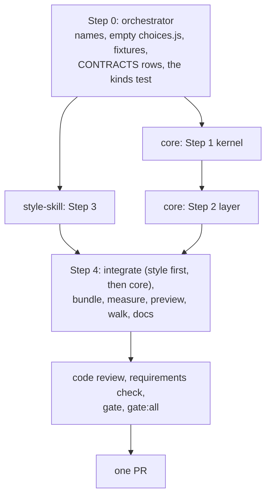

# Plan: Choice buttons on a document

## Summary

Two workstreams on one feature branch, landing as one PR.

- **core** builds the kernel first (the record, the checker, the drain line, the merge rule, the gesture, the tag attribute) and then the browser half on top of it (arming groups, minting a press, the anchor rung, the hold in the outbox, painting state, the rail rows, the chip). One builder, in that order, because every browser row needs the kernel to be real.
- **style-skill** builds what agents and readers see, in parallel: the component's CSS and catalog entry, every agent-facing word (the contract paragraph and its two copies, the skill section written with the skill-creator skill), the brand word and the style guide line.

Step 0 wrote the shared names first, so the two builders never edit the same line; the one file both touch, `review_format.js`, is split by region (core: the field class, projection and export text; style-skill: the contract array).

## Step 0: Orchestrator setup

Done, on `feat/choice-buttons` (commits `d6e08e0b` and the round-2 fix).

- **The names.** `record.KIND.CHOICE`, `record.FIELD.CHOICE`, `record.CHOICE_TOKEN` (`^[a-z0-9][a-z0-9-]{0,31}$`), `gestures.GESTURE.PRESS_CHOICE`, `protocol.SCRIPT_ATTR.DOCUMENT`. Names only. The core workstream owns these files from here.
- **The kinds test** (`test/unit/record_lifecycle.test.js`) knows six kinds.
- **`src/layer/choices.js`** ships empty with the module wrapper, in the manifest after `sync.js` and before `replay.js`, so the bundle carries it from the first build. No `planned` flag.
- **CONTRACTS.md.** The record table's `choice` row and the six-kind `kind` row; the choice drain line under `lahe status`.
- **Fixtures.** `test/fixtures/choice-doc.md` (four groups: recommended, no recommendation, one already carrying `data-chosen` on a button, one whose question a test rewrites), `choice-broken.md` (nameless, bad name, duplicate pair, one button, bad value, and one valid group), `choice-doc.html` (two groups, one inside a `<form>`), `choice-devserver.html` (no `data-lahe-document`, the page counts its own clicks).
- **Worktrees.** `~/Documents/workspace/lahe-worktrees/cb-kernel` on `feat/cb-core` and `cb-style` on `feat/cb-style`, both at Step 0's head, with `node_modules` installed.

## Every builder's contract

Every packet carries this block, near the top:

- **Never remove a file.** No `rm`, no `git clean`, no deleting temp specs, screenshots, `.bak` files or `test-results/`. Put a rebuilt `dist/lahe-layer.js` back with `git checkout -- dist/lahe-layer.js`. List anything you would remove under "To delete at cleanup" in your progress file.
- Work in the worktree named in your packet, on its branch. Never commit `dist/`. Never edit `package.json` or `src/shared/manifest.js`; ask the orchestrator.
- Run `npm run gate:unit`. Run one named browser spec only when your change is browser behavior. Never the whole browser suite. Browser specs start the real helper from the worktree (the `lahe review` walk the existing specs use), never main's.
- Never run `npm run install-skills` or `lahe install` against Ken's home. If you must install the skill to test it, run with a temporary `HOME`.
- Every process a test starts is stopped in teardown. Report the helper count (`ps -axo command | grep -c "[l]ahe.js serve"`) before and after each test run in your progress file.
- Read first: your tasks below, the brief requirements and architecture sections they name, `docs/CONTRACTS.md` (the record and the drain line), `CLAUDE.md`, and `docs/ongoing/STYLE_GUIDE.md` for anything drawn.
- Write `docs/features/20261013.01_choice_buttons/progress/phase6_workstream_<name>.md`: what you built, the tests, anything that differs from this plan, and screenshots for anything on screen, from fixture pages only.
- Hit a limit or find the plan wrong: ask the orchestrator in one line. Do not document around it.
- No em dashes anywhere. "Lahe", not "LAHE", in anything a reader sees.

## Step 1: core, the kernel

::: xref
[Architecture: The record](02_architecture_choice_buttons.html#the-record), [The gesture](02_architecture_choice_buttons.html#the-gesture), [The script tag](02_architecture_choice_buttons.html#the-script-tag), [The drain line](02_architecture_choice_buttons.html#the-drain-line), [Lifecycle](02_architecture_choice_buttons.html#lifecycle)
:::

### Task 1.1: the record and its checker

**Spec:** `newItem` accepts `kind: choice` with a `choice` field of `{group, answer}`. `validateItem` refuses a choice record missing either, with a value off `CHOICE_TOKEN`, with any other key inside `choice`, or carrying `before`, `after`, `new_blocks` or a stamp. `isReplayable`, `isOutstanding` and `isHandEdit` need no change; prove it. The helper's door (`log.js`) and the projection both run the checker on a choice record.
**Files:** `src/shared/record.js`, `src/service/log.js`, `src/service/projection.js`, their unit tests.
**Acceptance:** V18, V13.

### Task 1.2: the format, the drain line and the export text

**Spec:** `PROJECTED_FIELD_CLASS` classes `choice.group` and `choice.answer` as intent. `projectItem` leaves `before`, `after_full`, html, `region_label`, `subject` and the region null for the kind. The drain line matches the architecture's example. The human-readable copy-and-export text prints a choice as its question and its answer. Do not touch the contract array; style-skill owns it.
**Files:** `src/shared/review_format.js` (not the contract array), `src/cli/commands/status.js`, their unit tests.
**Acceptance:** V9.

### Task 1.3: the gesture, the merge rule and the tag

**Spec:** `PRESS_CHOICE` is decided by the gesture function (a click on a `button` inside an armed `.choice`, on a document page, in browse, not in pick mode, no block open, window may write, not present; `preventDefault` true) and has no row in the hint table; adjust the vocabulary and hint-count tests on purpose. `merge.js` lists `choice` among browser-owned content fields. `protocol.scriptTag` takes an opt-in that writes `data-lahe-document`; `page_routes.js` passes it on every response for a page the helper serves itself, including a file that already carries this review's tag (added to the served copy, never to disk); `add.js` and `heal.js` never pass it. The test harness tag builders (`test/browser/support/with_layer.js`, `test/helpers/`) take the same opt-in.
**Files:** `src/shared/gestures.js`, `src/shared/merge.js`, `src/shared/protocol.js`, `src/service/page_routes.js`, the harness files, their unit tests.
**Acceptance:** V1 (unit half), V8 (unit half), V19.

**Step test:** `npm run gate:unit` green; a hand-built events.jsonl with one choice record projects to a review.json whose drain line matches the architecture byte for byte. Commit, then start Step 2 on the same branch.

## Step 2: core, the layer

::: xref
[Architecture: The anchor engine's choice rung](02_architecture_choice_buttons.html#the-anchor-engines-choice-rung), [State on the page](02_architecture_choice_buttons.html#state-on-the-page), [Presses travel together](02_architecture_choice_buttons.html#presses-travel-together-and-what-bounds-the-wakes), [Key Flows](02_architecture_choice_buttons.html#key-flows), [Failure Modes](02_architecture_choice_buttons.html#failure-modes--edge-cases)
:::

### Task 2.1: arming and minting

**Spec:** `src/layer/choices.js`: on boot and after every repaint, find `.choice` elements; when the tag carries `data-lahe-document`, validate each (name, uniqueness, two or more buttons, every value, at most one `data-chosen` button) and arm it, or set `data-lahe-inert` and raise the rail chip with the reason, per the refusal flow. Off a document page: inert, no chip. A `PRESS_CHOICE` gesture mints a `choice` record (draft then ready in one tick, `recordItem` with no immediate flush) with `context.quote` the question and `context.heading` the nearest heading, and no stamp. A press on a group with a `ready` record is a reword; after `not_handled` it reopens the same record; after `handled` it mints a new one.
**Files:** `src/layer/choices.js`, `src/layer/index.js` (boot wiring, the chip).
**Acceptance:** V2, V3, V4, V22.

### Task 2.2: the rung, the hold and the paint

**Spec:** `anchor.resolve` gains the choice rung keyed on the ref's kind: one match binds, zero or two refuse with their own reason, no text search. `splitForFloor` holds every event of a choice item until 3 seconds after the page's last press, capped at 10 seconds from the first held press; tab hide and page leave flush at once; Hold's gate stays. `replay.js` writes nothing for the kind and, after the rung binds, paints `data-lahe-pressed` on the pressed button and `data-lahe-choice-state` on the group from the group's latest record by `created_at`, inside a write epoch.
**Files:** `src/layer/anchor.js`, `src/layer/sync.js`, `src/layer/replay.js`.
**Acceptance:** V5, V6, V7, V10, V20.

### Task 2.3: the cards

**Spec:** `tab_active.js` draws a choice row: the question as the quote, the answer as a fixed reviewer turn (not editable), the state chip, Mark as done, and the ordinary reply box whose words go into `note` as a follow-up turn. `tab_done.js` draws the Done row for the kind with the decided answer. `overlay.js` gains the kind label ("Choice") and a card summary that shows the answer, not the quote. The cards follow the rail's scheme like every card.
**Files:** `src/layer/tab_active.js`, `src/layer/tab_done.js`, `src/layer/overlay.js`.
**Acceptance:** V11, V23 (rail half).

**Step test:** `npx playwright test test/browser/choice_buttons.spec.js` green against the Step 0 fixtures with the worktree's real helper, and the screenshots in `progress/` show pressed, open, done and inert groups, and the card light and dark.

## Step 3: style-skill

::: xref
[Architecture: The component, as the agent writes it](02_architecture_choice_buttons.html#the-component-as-the-agent-writes-it); brief R1, R2, R17, R18 and AI Behavior
:::

### Task 3.1: the component

**Spec:** `document.css` gains `.choice`, `.choice-q`, the button look (square corners, outlined, ink fill on the `data-chosen` or `data-lahe-pressed` button), the `data-recommended` badge (`badge--purple` look, the word "Recommended"), and one rule per group state: `kept`, `open`, `question`, `not_handled`, `done`, `data-lahe-inert`. When a group holds both a `data-chosen` button and a `data-lahe-pressed` one, the pressed one is the answer and the chosen one goes quiet. No pills, no colored edges, no shadows. Print keeps the decided look. `COMPONENTS.md` gains the entry with the markup and the states.
**Files:** `vendor/stclair-doc-style/document.css`, `vendor/stclair-doc-style/COMPONENTS.md`.
**Acceptance:** V14, V23 (page half).

### Task 3.2: every agent-facing word

**Spec:** The contract array in `review_format.js` gains one paragraph: what a choice item is, that its intent is `choice.group` and `choice.answer`, how to answer it, and that handling includes writing `data-chosen` onto the chosen button in the source, with a handled reply that leaves it out being incomplete. The two restated copies (`test/unit/review_format.test.js`, `docs/CONTRACTS.md`) change in the same commit. With the skill-creator skill: the "Use the components" table gains "A question with a known set of answers the agent will act on: a choice group", the markup block gains the group, and a short section says when to use option cards versus a group, that a group needs no recommendation, how a press appears in the drain, how to answer it, and the write-back. `BRAND.md`'s word list gains "choice". `STYLE_GUIDE.md`'s "a choice for the reader is option cards" line now names both components and when each applies. Touch nothing else in `review_format.js`.
**Files:** `src/shared/review_format.js` (the contract array only), `test/unit/review_format.test.js` (the contract copy only), `docs/CONTRACTS.md` (the contract copy only), `skills/lahe/SKILL.md`, `docs/ongoing/BRAND.md`, `docs/ongoing/STYLE_GUIDE.md`.
**Acceptance:** V15.

**Step test:** the fixture pages render with the component in the house style; the contract test passes; `npm run install-skills` under a temporary `HOME` ships `references/components.md` with the entry.

## Step 4: Integrate and prove

### Task 4.1: integrate

Merge `feat/cb-style` into `feat/choice-buttons` first (inert without the layer), then `feat/cb-core`. Rebuild `dist/lahe-layer.js` once, run `npm run gate`, read "0 failed", then `npm run gate:all` once, alone. Code review (`feature-dev:code-reviewer`) and an independent requirements check (a fresh `general-purpose` agent against R1 to R19) on the integrated diff; one fix round, each finding to the builder that owns the file.

### Task 4.2: measure

`measure_choice_queue.js` in this folder, after `measure_one_comment.js`: the real nineteen-lesson queue as the fixture; presses at a reading pace (one every 8 seconds) against the shortest realistic comment per lesson ("promote" on the heading). The agent is modelled as a monitor that exits on the first 15 second poll with new work, then takes 20 seconds to drain and relaunch. Report drain characters, estimated tokens and wake count for each. Red when presses cost more characters than comments, or more wakes (V12).

### Task 4.3: the lesson queue, for Ken

Rebuild `~/Documents/workspace/personal/docs/features/20261012.01_forge_international_style/02_lesson_queue.md` with a choice group per lesson (promote, discard, merge; the recommendation marked). Run the feature worktree's own helper on another port with a state folder copied from Ken's (recorded pids neutralized, the "Show real UI before merge" rule), serve the page from it, press one group, and read that helper's drain. Pass: the press is a choice item on the drain and the page shows it pressed. Screenshot beside it on the progress page. Nothing else in that document changes (V17).

### Task 4.4: the walk and the skill eval

Walk the whole loop on `choice-doc.md` with the integration build: press, drain, `lahe reply` handled plus the `data-chosen` write-back into the fixture copy, the page's re-render, then the fixture served with no script tag shows the decided button (V24). Then the skill eval: a fresh Sonnet agent given only the installed skill (temporary `HOME`) and `references/components.md` writes a decision page with three groups, and the page passes `choices.js`'s validation on first try (V16).

### Task 4.5: docs

`docs/ongoing/CHOICE_BUTTONS.md` (how it works now: the component, the record, the rung, the hold, the write-back), the three diagrams (`module_map.md`, `finding_the_region.md`, `item_lifecycle.md`), `docs/diagrams/README.md`, and the progress page brought current with the clock's timestamp.

### Task 4.6: ship

`npm run gate` on the exact commit, counts in the PR body, open the PR, `gh pr checks`, merge, `npm run gate` on main. Then `npm run install-skills` and `lahe install` on Ken's machine so the helper and skill are current.

## Workstreams and PRs

| Workstream | Tasks | Agent and model | Reuses | Owns | Depends on | PR |
|---|---|---|---|---|---|---|
| core | 1.1 to 2.3, in order | new agent, Opus | none | `src/shared/record.js`, `review_format.js` (all but the contract array), `merge.js`, `gestures.js`, `protocol.js`, `src/service/log.js`, `projection.js`, `page_routes.js`, `src/cli/commands/status.js`, `src/layer/choices.js`, `anchor.js`, `sync.js`, `replay.js`, `tab_active.js`, `tab_done.js`, `overlay.js`, `index.js`, `test/browser/choice_buttons.spec.js`, the harness tag builders, their unit tests | Step 0 | 1 |
| style-skill | 3.1, 3.2 | new agent, Opus | none | `vendor/stclair-doc-style/document.css`, `COMPONENTS.md`, the contract array in `review_format.js` and its copies in `test/unit/review_format.test.js` and `docs/CONTRACTS.md`, `skills/lahe/SKILL.md`, `docs/ongoing/BRAND.md`, `docs/ongoing/STYLE_GUIDE.md` | Step 0 | 1 |

- **Models.** Both Opus. core carries the checker at the door, the rung, the hold and replay, where this repo's hardest bugs have lived. style-skill carries every word an agent reads, which Ken named as the user who matters most.
- **Why one core builder, in series.** Every browser row needs a real record kind, a real tag attribute and a real gesture rule. A separate layer builder would spend its first hours stubbing those or waiting. One builder does the kernel first, commits, then builds the layer on it.
- **Agent reuse.** Fix rounds go back to the builder that owns the file.
- **Token plan.** Two agents in parallel is worth it: they share no lines after Step 0. Packets carry the brief's requirements and the architecture sections named in each step, `docs/CONTRACTS.md`, and nothing from the crucible, the reviews or the alternatives leaf.
- **Packet sources.** core: brief R3 to R16; architecture "Data / State Changes" whole, "Key Flows", "Failure Modes", "Security & Privacy Notes". style-skill: brief R1, R2, R17, R18, AI Behavior, UX Notes; architecture "The component, as the agent writes it", "State on the page", "The drain line" (for the contract words); the style guide's "Choosing a component"; the skill-creator skill.
- **One PR.** The kernel alone is invisible, the style alone is inert, and the skill before the layer would teach agents to write buttons that do nothing. Merge order: style first, then core. Before opening: Task 4.1's reviews, `npm run gate` locally with "0 failed" in the PR body, `npm run gate:all` once at the checkpoint. After merge: `npm run gate` on main.

## Test List

::: callout-req
The one verification table. U is a unit test under `test/unit/`. B is a Playwright spec under `test/browser/`, run with the worktree's real helper (Chromium in the builder's loop, three lanes at the checkpoint). M is measured or walked, with evidence on the progress page. Every process a test starts is stopped in teardown; the suites' own leftover-helper checks are the leak gate, plus each builder's before-and-after counts.

| Row | Requirement or failure | Behavior to prove | Kind |
|---|---|---|---|
| V1 | R3, R11 | A page with no `.choice` renders and behaves as before and its rail hint list is unchanged (existing specs stay green, hint-count tests updated on purpose). The dev-server fixture (no `data-lahe-document`) never arms a group; its own click counter still counts; the gesture function returns the page's own outcome for the click | U and B |
| V2 | R4 | Each broken group in `choice-broken.md` is inert and the rail chip names it and the reason: no name, bad name, duplicate pair, one button, bad value. The valid group on the same page still arms | B |
| V3 | R5, R6 | A click mints a `choice` record that is `ready` in the same tick with `choice`, `context.quote` and `context.heading` set and no stamp; the button paints pressed and the group `kept`; Enter and Space on a focused button do the same; a second press before any reply is rev 2 of the same item; the drain shows only the latest | B |
| V4 | R7 | After a `handled` reply a press mints a new item; after `not_handled` a press reopens the same item at the next revision; the Done tab's row shows the earlier decision | U and B |
| V5 | R8 | A reload keeps the record and repaints the state; with the helper stopped a press is `kept` and the rail shows not-stored; restarting the helper sends it and the state goes `open` | B |
| V6 | R9, R13 | The five states paint from `ready` unacknowledged, `ready` acknowledged, a `question` reply, a `not_handled` reply, `handled` and Mark as done; a `data-chosen` button with no record draws as done; a newer `data-lahe-pressed` button draws as the answer over a `data-chosen` one; a held press does not trip the rail's program-down warning | B |
| V7 | R10 | A rebuild that moves the group keeps its state; a rebuild that removes it marks the record lost and the card says the group is gone while the item stays on the drain; a handled record on a removed group paints nothing; a record never binds to a group with another name | B |
| V8 | R11 gate | In element-pick mode, with a block open for editing, in a read-only window and in present mode a click on an armed button is not a press; a button inside a `<form>` submits nothing | U and B |
| V9 | R12 | The drain line for a choice carries `choice` at the top level and only `path`, `quote` and `context.heading` under `page`; no `before`, `after_full`, html, `region` or `region_label`; the copy-and-export text prints the question and the answer | U |
| V10 | R13 hold | Driving `createSync` with mock timers: every event of a choice item is held until 3 s after the last press, released at 10 s from the first held press under steady pressing, released at once on tab hide; a non-choice event is never held; Hold's gate still applies | U |
| V11 | R14 | `handled`, `not_handled` and `question` replies fold onto the card; Mark as done closes it; words typed in the card's reply box post as a `note` follow-up on the same record and the choice is unchanged | B |
| V12 | R15 | `measure_choice_queue.js` on the real lesson queue at a reading pace: presses cost fewer drain characters than the shortest realistic comments, and no more modelled wakes. Red on either | M |
| V13 | R16 | `handled_check` never runs on a `choice`; a handled reply retires it with no page read | U |
| V14 | R17 | On `choice-doc.md` served with no script tag, the `data-chosen` button's computed background is the ink color and the others are outlined; the same holds under the print media query | B |
| V15 | R18 | The contract array, its copy in `review_format.test.js` and `docs/CONTRACTS.md` agree (existing test); the skill's component table and markup carry the group; `npm run install-skills` under a temporary `HOME` ships `references/components.md` with the entry; lint is green | U and lint |
| V16 | R1 | A fresh Sonnet agent given only the installed skill and `references/components.md` writes a decision page with three groups; every group passes `choices.js`'s validation on first try. Logged in `progress/` with the page it wrote | M |
| V17 | R19 | The lesson queue with a group per lesson, served by the branch's helper on another port against a copied state folder: a press shows on that helper's drain as a choice item and the page shows it pressed. Screenshot beside the drain line | M |
| V18 | Door and projection | A posted choice record with prose in `answer`, a missing `group`, an extra key, or a `before` is refused at the door and reported, and the projection refuses the same record from a hand-edited log | U |
| V19 | Merge | An offline re-press (rev 2 in the browser, rev 1 handled in the store) merges to rev 2 ready; `choice` is carried as browser-owned content | U |
| V20 | Rung | On the fake DOM, with no `querySelectorAll`: the choice rung binds one match, refuses zero and two with their own reasons, never falls to the text search, and the empty-container rung and every existing anchor test are unchanged | U |
| V21 | Leaks | The unit and browser suites' leftover-helper checks pass, and each builder's before-and-after helper counts match | M |
| V22 | D3 | On `choice-devserver.html` a click reaches the page's own handler, no record is minted, and no chip is raised | B |
| V23 | R2, look | Screenshots from the built fixture page: a group at rest with the badge, pressed, open, done, inert; the card light and dark. Square corners, no colored edge, badge in purple | M |
| V24 | The whole loop | Press on `choice-doc.md`, the item on the drain, `lahe reply` handled plus `data-chosen` written onto the button in the source, the page re-renders with the group done, and the same file served with no script tag shows the decided button | B and M |
:::

## Acceptance Criteria

::: callout-metric
**Standard (every feature inherits these; keep them verbatim):**

- [ ] Full test suite green, not just the new tests.
- [ ] Design and lint gates green (the project's gate command).
- [ ] Every requirement in the brief walked end to end in the browser, on the running app.
- [ ] Nothing punted: no TODOs, no stubbed tests, no "out of scope" that was in scope.
- [ ] Implementation matches brief and architecture; any deviation is deliberate and written down under Changes from plan on the progress page.
- [ ] **It looks like a staff designer built it.** The whole surface holds up at that level, and includes at least:
  - Clear visual hierarchy and information architecture. You know where to look, and the page's organization makes sense.
  - Consistency with the rest of the app. Buttons look like our other buttons, hover states follow the same convention, primary and secondary carry the same color meaning they carry elsewhere.
  - Honest feedback. Toasts and status messages report what actually happened. Never an optimistic "done" for something still in flight, or something that failed.
  - Micro-animations that mean something. Motion signals state or direction; it isn't decoration.
  - Copy in the brand voice (the project's brand or voice doc).
  - Existing components reused and the style guide followed. Nothing reads as a stock framework default.
- [ ] It reads as one feature, not several agents' work stitched together: consistent components, spacing, and interaction patterns across every surface it touches.

**This feature:**

- [ ] V1 to V24 green, with M rows evidenced on the progress page.
- [ ] A press never reaches the agent as anything but `choice.group` and `choice.answer` at the top level (V9, V18).
- [ ] No page outside the helper's own serving ever arms a group or raises a chip (V1, V22).
- [ ] The lesson queue works with real buttons against the branch's helper before the PR opens (V17).
- [ ] Human has reviewed and approved (single consolidated gate after Plan). Ken said to continue without him; the gate is the progress page he can comment on at any point.
:::

## Plan Review

Full prose: [03_plan_choice_buttons_reviews.md](03_plan_choice_buttons_reviews.md).

| # | Finding | Disposition | Rationale |
|---|---------|-------------|-----------|
| F1 | The layer could pass no browser row until the kernel landed | Accepted | One core builder does the kernel then the layer, in series; style-skill runs beside it |
| F2 | `planned: true` kept `choices.js` out of the bundle | Accepted | Step 0 ships the file empty, no flag |
| F3 | CSS cannot match a button from a value on its group | Accepted | `data-chosen` and `data-lahe-pressed` live on the button; architecture changed first |
| F4 | A bundle-only preview cannot show a helper change | Accepted | Task 4.3 runs the branch's helper on another port against a copied state folder, with a pass bar |
| F5 | Step 0 turned the kinds test red while the progress page said green | Accepted | Test fixed in Step 0 round 2; progress page corrected |
| F6 | No row or task walked the whole loop | Accepted | V24 and Task 4.4 |
| F7 | Two builders wrote the agent-facing words for one workflow | Accepted | style-skill owns the contract paragraph and its copies as well as the skill; `review_format.js` is split by region |
| F8 | `install-skills` from a worktree would overwrite Ken's live skill | Accepted | Temporary `HOME` until Task 4.6, in every builder's contract |
| F9 | V12 had no agent model and no red line, and the pace never used the hold | Accepted | Model, threshold and the real lesson queue in Task 4.2 and V12 |
| F10 | `tab_done.js`, `overlay.js`, the export text, the style guide line and the harness were unowned | Accepted | Assigned in Tasks 1.2, 1.3, 2.3 and 3.2 |
| F11 | A hint-table row would put a new hint on every page's rail | Accepted | No table row; the rule lives in the gesture function; V1 checks the hint list |
| F12 | V10 targeted an unexported function; V20 said "U or B" | Accepted | V10 drives `createSync` with mock timers; V20 is a unit test on the fake DOM |
| F13 | V16 needed the layer's validation style-skill lacks | Accepted | Moved to Task 4.4 |
| F14 | Keyboard, print and "no chip" had no row | Accepted | V3, V14 and V22 extended |
| F15 | V21 compared against a count taken hours earlier | Accepted | The suites' leak checks plus per-builder counts |
| F16 | No `gate:all` and no merge order | Accepted | Task 4.1: style first, then core; `gate:all` once at the checkpoint |
