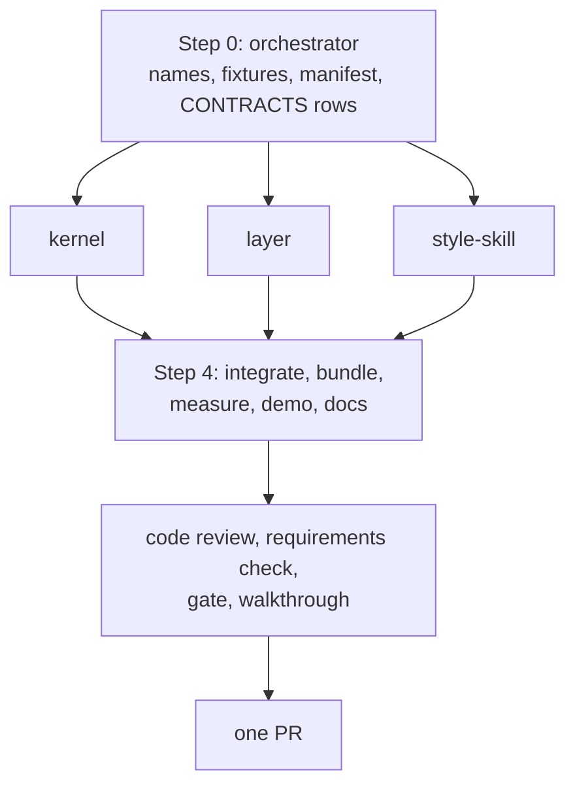

# Plan: Choice buttons on a document

## Summary

Three workstreams, run side by side on one feature branch, landing as one PR.

- **kernel** owns the record, the contract, the gesture, the merge rule, the drain line and the helper's two changes (the door check and the tag attribute). Nothing on screen changes.
- **layer** owns the browser half: arming groups, minting a press, the anchor rung, the hold in the outbox, painting state, the rail row and the chip.
- **style-skill** owns what agents and readers see: the component's CSS and catalog entry, the skill section (written with the skill-creator skill), and the brand word.

Step 0 writes the shared names into the kernel files first, so the three builders never edit the same line.

## Step 0: Orchestrator setup

Done by the orchestrator in the feature worktree before any builder starts, and committed to the feature branch.

- **The names, written once.** `record.KIND.CHOICE = "choice"`, `record.FIELD.CHOICE = "choice"`, `record.CHOICE_TOKEN` (the grammar: `^[a-z0-9][a-z0-9-]{0,31}$`), `gestures.GESTURE.PRESS_CHOICE`, `protocol.SCRIPT_ATTR.DOCUMENT = "data-lahe-document"`. Names only, no behavior. After Step 0 the kernel workstream owns these files.
- **CONTRACTS.md.** The record table gains the `choice` row (intent, by key) and the `kind` row names six kinds; the `lahe status` section gains the choice drain line from the architecture.
- **Manifest.** `src/layer/choices.js` added to `LAYER_FILES` after `sync.js` and before `replay.js`, with `planned: true`, so lint passes before the file exists.
- **Fixtures.** `test/fixtures/choice-doc.md`: a Markdown page with headings and four groups (one recommended, one with no recommendation, one with `data-chosen` already set, one whose question the agent will later rewrite). `test/fixtures/choice-broken.md`: a page with a nameless group, a bad name, a duplicate pair, a one-button group and a bad value. `test/fixtures/choice-doc.html`: an HTML page linking `.lahe-doc-style.css` with two groups and a `<form>` around one of them. `test/fixtures/choice-devserver.html`: the same groups on a page whose tag has no `data-lahe-document` and whose own script counts clicks.
- **Starting counts.** Record the helper count (`ps -axo command | grep -c "[l]ahe.js serve"`) for V21.

## Every builder's contract

Every packet carries this block, near the top:

- **Never remove a file.** No `rm`, no `git clean`, no deleting temp specs, screenshots, `.bak` files or `test-results/`. Put a rebuilt `dist/lahe-layer.js` back with `git checkout -- dist/lahe-layer.js`. List anything you would remove under "To delete at cleanup" in your progress file.
- Work in your own worktree on your own branch off the feature branch. Never commit `dist/`. Never edit `package.json` or `src/shared/manifest.js`; ask the orchestrator.
- Run `npm run gate:unit`. Run one named browser spec only when your change is browser behavior. Never the whole browser suite.
- Every process a test starts is stopped in teardown. Report the helper count before and after your test runs.
- Read first: your leaf, the brief requirements and architecture sections it names, `docs/CONTRACTS.md` (the record and the drain line), `CLAUDE.md`, and `docs/ongoing/STYLE_GUIDE.md` for anything drawn.
- Write `progress/phase6_workstream_<name>.md`: what you built, the tests, anything that differs from this plan, and screenshots for anything on screen, from fixture pages only.
- Hit a limit or find the plan wrong: ask the orchestrator in one line. Do not document around it.
- No em dashes anywhere. "Lahe", not "LAHE", in anything a reader sees.

## Step 1: kernel

::: xref
[Architecture: Data / State Changes](02_architecture_choice_buttons.html#data--state-changes), [The gesture](02_architecture_choice_buttons.html#the-gesture), [The script tag](02_architecture_choice_buttons.html#the-script-tag), [The drain line](02_architecture_choice_buttons.html#the-drain-line)
:::

### Task 1.1: the record and its checker

**Spec:** `newItem` accepts `kind: choice` with a `choice` field of `{group, answer}`. `validateItem` refuses a choice record missing either, with a value off `CHOICE_TOKEN`, with any other key inside `choice`, or carrying `before`, `after`, `new_blocks` or a stamp. `isReplayable`, `isOutstanding` and `isHandEdit` need no change; prove it. The helper's door (`log.js`) and the projection both run the checker on a choice record.
**Files:** `src/shared/record.js`, `src/service/log.js`, `src/service/projection.js`, `test/unit/record*.test.js`, `test/unit/projection*.test.js`.
**Acceptance:** V18, V13.

### Task 1.2: the contract, the format and the drain line

**Spec:** `PROJECTED_FIELD_CLASS` classes `choice.group` and `choice.answer` as intent. `projectItem` leaves `before`, `after_full`, html, `region_label`, `subject` and the region null for the kind. The contract array gains one paragraph: what a choice item is, that its intent is `choice.group` and `choice.answer`, how to answer it, and that handling includes writing `data-chosen="<answer>"` onto the group in the source, with a handled reply that leaves it out being incomplete. The drain line matches the architecture's example. The two restated copies (`test/unit/review_format.test.js`, `docs/CONTRACTS.md`) change in the same commit.
**Files:** `src/shared/review_format.js`, `src/cli/commands/status.js`, `test/unit/review_format.test.js`, `docs/CONTRACTS.md`, `test/unit/status*.test.js`.
**Acceptance:** V9, V15.

### Task 1.3: the gesture, the merge rule and the tag

**Spec:** `gestures.js` gains the `PRESS_CHOICE` row and the rule: a click on a `button` inside an armed `.choice`, on a document page, in browse, not in pick mode, no block open, window may write, not present; `preventDefault` true. `merge.js` lists `choice` among browser-owned content fields. `protocol.scriptTag` takes an opt-in that writes `data-lahe-document`; `page_routes.js` passes it on every response for a page the helper serves itself, including a file that already carries this review's tag (added to the served copy, never written to disk); `add.js` and `heal.js` never pass it.
**Files:** `src/shared/gestures.js`, `src/shared/merge.js`, `src/shared/protocol.js`, `src/service/page_routes.js`, their unit tests.
**Acceptance:** V1 (unit half), V8 (unit half), V19.

**Step test:** `npm run gate:unit` green; a hand-built events.jsonl with one choice record projects to a review.json whose drain line matches the architecture byte for byte.

## Step 2: layer

::: xref
[Architecture: The anchor engine's choice rung](02_architecture_choice_buttons.html#the-anchor-engines-choice-rung), [State on the page](02_architecture_choice_buttons.html#state-on-the-page), [Presses travel together](02_architecture_choice_buttons.html#presses-travel-together-and-what-bounds-the-wakes), [Key Flows](02_architecture_choice_buttons.html#key-flows)
:::

### Task 2.1: arming and minting

**Spec:** `src/layer/choices.js`: on boot and after every repaint, find `.choice` elements; when the tag carries `data-lahe-document`, validate each (name, uniqueness, two or more buttons, every value) and arm it or set `data-lahe-inert` and raise the rail chip with the reason, per the refusal flow. A `PRESS_CHOICE` gesture mints a `choice` record (draft then ready in one tick, `recordItem` with no immediate flush) with `context.quote` the question and `context.heading` the nearest heading, and no stamp. A press on a group with a `ready` record is a reword; after `not_handled` it reopens the same record; after `handled` it mints a new one.
**Files:** `src/layer/choices.js` (new), `src/layer/index.js` (boot wiring, the chip), `src/layer/overlay.js` only if the chip needs a style.
**Acceptance:** V2, V3, V4, V22.

### Task 2.2: the rung, the hold and the paint

**Spec:** `anchor.resolve` gains the choice rung keyed on the ref's kind: one match binds, zero or two refuse with their own reason, no text search. `splitForFloor` holds every event of a choice item until 3 seconds after the page's last press, capped at 10 seconds from the first held press; tab hide and page leave flush at once; Hold's gate stays. `replay.js` writes nothing for the kind and, after the rung binds, paints `data-lahe-pressed` and `data-lahe-choice-state` from the group's latest record by `created_at`, inside a write epoch.
**Files:** `src/layer/anchor.js`, `src/layer/sync.js`, `src/layer/replay.js`.
**Acceptance:** V5, V6, V7, V10, V20.

### Task 2.3: the card

**Spec:** `tab_active.js` draws a choice row: the question as the quote, the answer as a fixed reviewer turn (not editable), the state chip, Mark as done, and the ordinary reply box whose words go into `note` as a follow-up turn. The card follows the rail's scheme like every card.
**Files:** `src/layer/tab_active.js`.
**Acceptance:** V11, V23 (rail half).

**Step test:** `npx playwright test test/browser/choice_buttons.spec.js` green against the Step 0 fixtures, and the screenshots in `progress/` show pressed, open, done and inert groups, and the card light and dark.

## Step 3: style-skill

::: xref
[Architecture: The component, as the agent writes it](02_architecture_choice_buttons.html#the-component-as-the-agent-writes-it); brief R1, R2, R17, R18 and AI Behavior
:::

### Task 3.1: the component

**Spec:** `document.css` gains `.choice`, `.choice-q`, the button look (square corners, outlined, ink fill when pressed), the `data-recommended` badge (`badge--purple` look, the word "Recommended"), and one rule per state: `kept`, `open`, `question`, `not_handled`, `done`, `data-chosen` (same as done), `data-lahe-inert`, with a newer press drawn over `data-chosen`. No pills, no colored edges, no shadows. `COMPONENTS.md` gains the entry with the markup and the states.
**Files:** `vendor/stclair-doc-style/document.css`, `vendor/stclair-doc-style/COMPONENTS.md`.
**Acceptance:** V14, V23 (page half).

### Task 3.2: the skill and the brand word

**Spec:** With the skill-creator skill: the "Use the components" table gains "A question with a known set of answers the agent will act on: a choice group", the markup block gains the group, and a short section says when to use option cards versus a group, that a group needs no recommendation, how a press appears in the drain, how to answer it, and that handling includes writing `data-chosen` into the source. `BRAND.md`'s word list gains "choice" (a question with set answers the reviewer clicks). Run `npm run install-skills` and confirm the catalog copy ships.
**Files:** `skills/lahe/SKILL.md`, `docs/ongoing/BRAND.md`.
**Acceptance:** V15, V16.

**Step test:** the fixture pages render with the component in the house style, and a fresh agent given the installed skill writes a group that passes Task 2.1's validation (V16).

## Step 4: Integrate and prove

### Task 4.1: integrate

Merge the three branches into the feature branch, rebuild `dist/lahe-layer.js` once, run `npm run gate`, read "0 failed". Code review (`feature-dev:code-reviewer`) and an independent requirements check (a fresh `general-purpose` agent against R1 to R19) on the integrated diff; one fix round, each finding to the builder that owns the file.

### Task 4.2: measure

`measure_choice_queue.js` in this folder, after `measure_one_comment.js`: a nineteen-group fixture, presses at a reading pace (one every 8 seconds) against one comment per group; report drain characters, estimated tokens and the number of monitor wakes for each. Result on the progress page (V12).

### Task 4.3: the lesson queue, for Ken

Rebuild `~/Documents/workspace/personal/docs/features/20261012.01_forge_international_style/02_lesson_queue.md` with a choice group per lesson (promote, discard, merge; the recommendation marked), serve it on this session with main's bundle swapped for the integration build (the live-preview rule), screenshot it light, and link it from the progress page (V17). Nothing else in that document changes.

### Task 4.4: docs

`docs/ongoing/CHOICE_BUTTONS.md` (how it works now: the component, the record, the rung, the hold, the write-back), the three diagrams (`module_map.md`, `finding_the_region.md`, `item_lifecycle.md`), `docs/diagrams/README.md`, and the progress page brought current.

### Task 4.5: ship

`npm run gate` on the exact commit, counts in the PR body, open the PR, `gh pr checks`, merge, `npm run gate` on main. Then `npm run install-skills` and `lahe install` on Ken's machine so the helper and skill are current.

## Workstreams and PRs

| Workstream | Tasks | Agent and model | Reuses | Owns | Depends on | PR |
|---|---|---|---|---|---|---|
| kernel | 1.1 to 1.3 | new agent, Opus | none | `src/shared/record.js`, `review_format.js`, `merge.js`, `gestures.js`, `protocol.js`, `src/service/log.js`, `projection.js`, `page_routes.js`, `src/cli/commands/status.js`, `docs/CONTRACTS.md`, `test/unit/review_format.test.js`, their tests | Step 0 | 1 |
| layer | 2.1 to 2.3 | new agent, Opus | none | `src/layer/choices.js`, `anchor.js`, `sync.js`, `replay.js`, `tab_active.js`, `index.js`, `overlay.js`, `test/browser/choice_buttons.spec.js` | Step 0 names; kernel's gesture rule for the final run | 1 |
| style-skill | 3.1, 3.2 | new agent, Opus | none | `vendor/stclair-doc-style/document.css`, `COMPONENTS.md`, `skills/lahe/SKILL.md`, `docs/ongoing/BRAND.md` | Step 0 | 1 |

- **Models.** All three are Opus. kernel carries the contract text every agent reads and the checker at the door. layer carries the rung, the hold and replay, which are where this repo's hardest bugs have lived. style-skill carries the instructions Ken named as the user who matters most.
- **Agent reuse.** Fix rounds go back to the builder that owns the file. The kernel builder takes any later change to the record shape or the contract.
- **Token plan.** Three agents in parallel is worth it: they share no files after Step 0, and each packet is small. Packets carry the brief's requirements and the architecture sections named in each step, `docs/CONTRACTS.md`, and nothing from the crucible, the reviews or the alternatives leaf.
- **Packet sources.** kernel: brief R8, R12, R13 (the hold is layer's; the wake story is context), R14, R16, R18; architecture "The record", "The drain line", "The script tag", "The gesture", "Lifecycle", "Security & Privacy Notes". layer: brief R4 to R11, R14; architecture "The anchor engine's choice rung", "State on the page", "Presses travel together", "Key Flows", "Failure Modes". style-skill: brief R1, R2, R17, R18, AI Behavior, UX Notes; architecture "The component, as the agent writes it"; the style guide's "Choosing a component"; the skill-creator skill.
- **One PR.** The kernel alone is invisible, the style alone is inert, and the skill before the layer would teach agents to write buttons that do nothing. The three land together as one change that leaves the app working. Before opening: Task 4.1's reviews and `npm run gate` locally with "0 failed" in the PR body. After merge: `npm run gate` on main.

## Test List

::: callout-req
The one verification table. U is a unit test under `test/unit/`. B is a Playwright spec under `test/browser/` (Chromium in the builder's loop, three lanes at the checkpoint). M is measured or walked, with evidence on the progress page. Every process a test starts is stopped in teardown.

| Row | Requirement or failure | Behavior to prove | Kind |
|---|---|---|---|
| V1 | R3, R11 | A page with no `.choice` renders and behaves as before (existing specs stay green). The dev-server fixture (no `data-lahe-document`) never arms a group; its own click counter still counts; the gesture table returns the page's own outcome for the click | U and B |
| V2 | R4 | Each broken group in `choice-broken.md` is inert and the rail chip names it and the reason: no name, bad name, duplicate pair, one button, bad value. A valid group on the same page still arms | B |
| V3 | R5, R6 | A click mints a `choice` record that is `ready` in the same tick with `choice`, `context.quote` and `context.heading` set and no stamp; the group paints `pressed` and `kept`; a second press before any reply is rev 2 of the same item; the drain shows only the latest | B |
| V4 | R7 | After a `handled` reply a press mints a new item; after `not_handled` a press reopens the same item at the next revision; the Done tab keeps the earlier decision | U and B |
| V5 | R8 | A reload keeps the record and repaints the state; with the helper stopped a press is `kept` and the rail shows not-stored; restarting the helper sends it and the state goes `open` | B |
| V6 | R9, R13 | The five states paint from `ready` unacknowledged, `ready` acknowledged, a `question` reply, a `not_handled` reply, `handled` and Mark as done; `data-chosen` with no record draws as done; a newer press draws over `data-chosen`; a held press does not trip the rail's program-down warning | B |
| V7 | R10 | A rebuild that moves the group keeps its state; a rebuild that removes it marks the record lost and the card says the group is gone while the item stays on the drain; a handled record on a removed group paints nothing; a record never binds to a group with another name | B |
| V8 | R11 gate | In element-pick mode, with a block open for editing, in a read-only window and in present mode a click on an armed button is not a press; a button inside a `<form>` submits nothing | U and B |
| V9 | R12 | The drain line for a choice carries `choice` at the top level and only `path`, `quote` and `context.heading` under `page`; no `before`, `after_full`, html, `region` or `region_label` | U |
| V10 | R13 hold | `splitForFloor` holds every event of a choice item until 3 s after the last press, releases at 10 s from the first held press under steady pressing, releases at once on tab hide, and never holds a non-choice event; Hold's gate still applies | U (injected clock) |
| V11 | R14 | `handled`, `not_handled` and `question` replies fold onto the card; Mark as done closes it; words typed in the card's reply box post as a `note` follow-up on the same record and the choice is unchanged | B |
| V12 | R15 | `measure_choice_queue.js`: nineteen presses at a reading pace cost fewer drain characters than nineteen comments on the same groups, and the wake count is reported for both | M |
| V13 | R16 | `handled_check` never runs on a `choice`; a handled reply retires it with no page read | U |
| V14 | R17 | The fixture group carrying `data-chosen` renders as decided on a page served with no script tag | B |
| V15 | R18 | The contract array, its copy in `review_format.test.js` and `docs/CONTRACTS.md` agree (existing test); the skill's component table and markup carry the group; `npm run install-skills` ships `references/components.md` with the entry; lint is green with `choices.js` in the manifest | U and lint |
| V16 | R1 | A fresh Sonnet agent given only the installed skill and `references/components.md` writes a decision page with three groups; every group passes Task 2.1's validation on first try. Logged in `progress/` with the page it wrote | M |
| V17 | R19 | The lesson queue with a group per lesson, served on Ken's session with the integration bundle, screenshot light, before the PR | M |
| V18 | Door and projection | A posted choice record with prose in `answer`, a missing `group`, an extra key, or a `before` is refused at the door and reported, and the projection refuses the same record from a hand-edited log | U |
| V19 | Merge | An offline re-press (rev 2 in the browser, rev 1 handled in the store) merges to rev 2 ready; `choice` is carried as browser-owned content | U |
| V20 | Rung | The choice rung binds one match, refuses zero and two with their own reasons, never falls to the text search, and the empty-container rung and every existing anchor test are unchanged | U or B |
| V21 | Leaks | Helper count after the full run equals the Step 0 count | M |
| V22 | D3 | On `choice-devserver.html` a click reaches the page's own handler and no record is minted | B |
| V23 | R2, look | Screenshots from the built fixture page: a group at rest with the badge, pressed, open, done, inert; the card light and dark. Square corners, no colored edge, badge in purple | M |
:::

## Acceptance Criteria

::: callout-metric
**Standard (every feature inherits these; keep them verbatim):**

- [ ] Full test suite green, not just the new tests.
- [ ] Design and lint gates green (the project's gate command).
- [ ] Every requirement in the brief walked end to end in the browser, on the running app.
- [ ] Nothing punted: no TODOs, no stubbed tests, no "out of scope" that was in scope.
- [ ] Implementation matches brief and architecture; any deviation is deliberate and written down under Changes from plan on the progress page.
- [ ] **It looks like a staff designer built it.** The whole surface holds up at that level, and includes at least:
  - Clear visual hierarchy and information architecture. You know where to look, and the page's organization makes sense.
  - Consistency with the rest of the app. Buttons look like our other buttons, hover states follow the same convention, primary and secondary carry the same color meaning they carry elsewhere.
  - Honest feedback. Toasts and status messages report what actually happened. Never an optimistic "done" for something still in flight, or something that failed.
  - Micro-animations that mean something. Motion signals state or direction; it isn't decoration.
  - Copy in the brand voice (the project's brand or voice doc).
  - Existing components reused and the style guide followed. Nothing reads as a stock framework default.
- [ ] It reads as one feature, not several agents' work stitched together: consistent components, spacing, and interaction patterns across every surface it touches.

**This feature:**

- [ ] V1 to V23 green, with M rows evidenced on the progress page.
- [ ] A press never reaches the agent as anything but `choice.group` and `choice.answer` at the top level (V9, V18).
- [ ] No page outside the helper's own serving ever arms a group (V1, V22).
- [ ] The lesson queue works with real buttons on Ken's machine before the PR opens (V17).
- [ ] Human has reviewed and approved (single consolidated gate after Plan). Ken said to continue without him; the gate is the progress page he can comment on at any point.
:::

## Plan Review

Pending. Full prose will live in `03_plan_choice_buttons_reviews.md`.

| # | Finding | Disposition | Rationale |
|---|---------|-------------|-----------|
