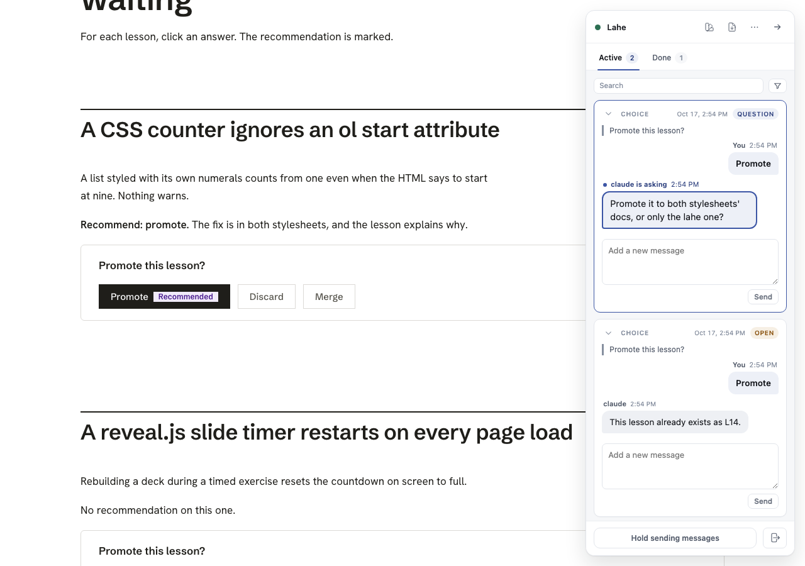
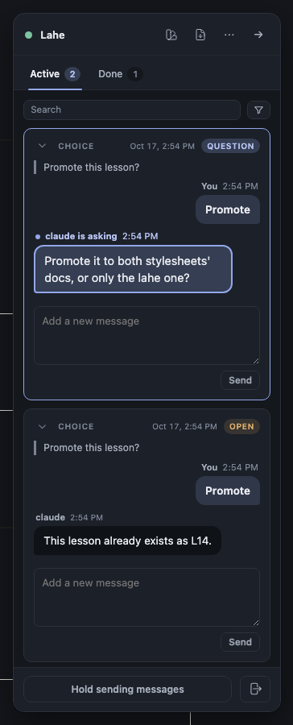
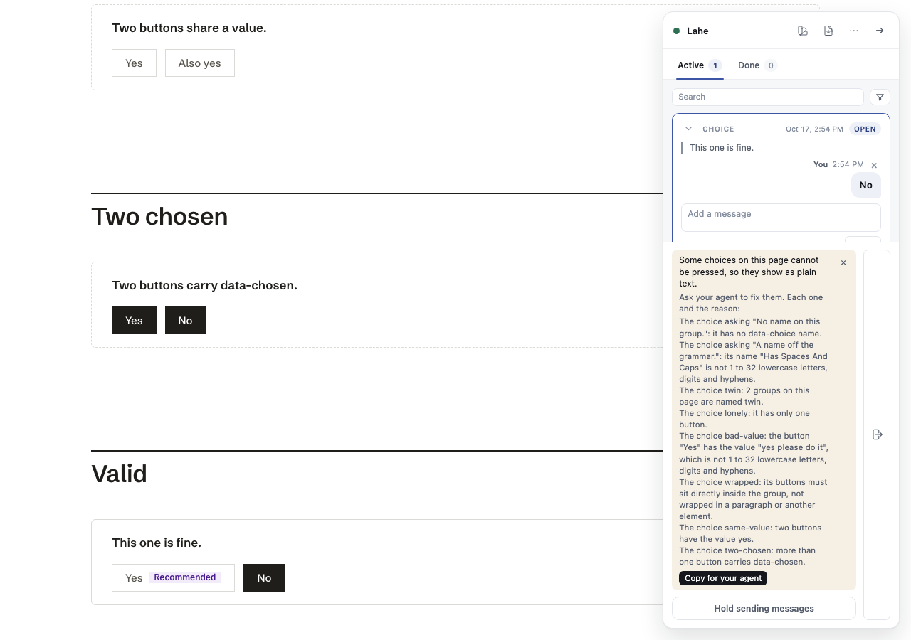

# Workstream core: progress

Updated 2026-10-17 14:55. Branch `feat/cb-core`, worktree `lahe-worktrees/cb-kernel`.

## Fix round 1 (code review and requirements check)

`feat/choice-buttons` merged in first (a fast-forward: main, the style work, the orchestrator's text fixes and the anchor guard).

- **Buttons must sit directly inside the group.** `choices.js` refuses a group whose buttons are wrapped in anything, reason "its buttons must sit directly inside the group, not wrapped in a paragraph or another element" (`data-lahe-inert="nested-buttons"`). The stylesheet draws `.choice > button` only, so a wrapped button would arm and then never show its decision.
- **V2 covers every refusal now.** `choice-broken.md` gains three groups: buttons wrapped in `
`, two buttons sharing a value, two buttons carrying `data-chosen`. The spec checks each one's inert reason, its line in the chip, and that a click on it mints nothing.
- **The form test proves something now.** `choice-doc.html`'s `inside-form` group gains "Rework", a button with no type (a submit button by default), and the page counts its form's own `submit` events. The test presses Rework and waits two rendered frames, then reads the count. It was red first: with `preventDefault` disabled the count was 1. It is 0 with the fix back in.
- **Screenshots only when asked.** The spec writes pictures only when `CHOICE_SHOTS=<folder>` is set, as `choice_style.spec.js` does, so a plain run never rewrites tracked files. Retaken once on the integrated build with the stylesheet present. The dark one is cropped to the rail, because a document is light only and darkening its body to turn the rail dark showed the page in a scheme it never has.
- **A press reads kept only while its own ready event is unstored.** `isKept` in `src/layer/index.js` is handed the record and looks for an `item.ready` event for that item at its current revision. A read mark queued by opening a card with the agent's question no longer makes a stored press read "kept". The spec queues a real read mark, repaints in the same tick, and checks the group still says question.
- **The dead guard** in `test/unit/choice_kernel.test.js` is gone; the test calls `status.excerpt` directly.

Round results: `npx playwright test test/browser/choice_buttons.spec.js` 10 passed, 0 failed. `npm run gate:unit` 3036 tests, 3027 pass, 2 fail. Both failures came with the merge and fail the same way with this round's changes stashed:

- `test/unit/markdown_render.test.js`, "the rendered empty file matches the empty-notes fixture": the fixture `test/fixtures/free_writing/empty_notes.html` inlines the document stylesheet, which the integration commit changed by 7 characters. The fixture needs regenerating.
- `test/unit/session_fixes.test.js`, "the skill carries the item and reply rules as a checklist": it still expects the skill's old sentence "The reviewer's words are `note` and `change`".

Neither file is this workstream's, so I left them for the orchestrator.

Seen in the retaken chip picture, for style-skill: an inert group whose two buttons both carry `data-chosen` still draws both ink-filled. The inert rule in `document.css` does not quiet the chosen look.

Helper counts this round (`ps -axo command | grep -c "[l]ahe.js serve"`): 2 before and 2 after every run (the red run, the green spec, the two screenshot runs, `gate:unit`). The second helper is not from this worktree; cb-kernel helpers were 0 throughout.

## Summary

- **Done:** Steps 1 and 2 (Tasks 1.1 to 2.3). The kernel and the browser half are built and committed.
- **Unit gate:** `npm run gate:unit` 3036 tests, 3029 pass, 0 fail (7 are skipped or todo from before).
- **Browser spec:** `npx playwright test test/browser/choice_buttons.spec.js` 10 passed, 0 failed.
- **Leaks:** none. Every run left the helper count where it started.
- **Not touched:** the contract array and its two copies (style-skill owns them), `package.json`, `src/shared/manifest.js`, `dist/`.

Commits: `6959f48b` (Step 1, the kernel), `94eda3cb` (Step 2, the layer), and this page.

## What was built

### Step 1: the kernel

- **The record and its checker** (`src/shared/record.js`). `newItem` keeps `choice` on a choice record and adds no key to any other record. `validateChoice` refuses a choice with a missing or off-grammar group or answer, any key besides those two, any `before`, `after`, html, history, run field or stamp, and a non-choice record carrying `choice`. `validateItem` runs it. Refusal code `CHOICE_REFUSED` (`src/shared/failures.js`).
- **The door and the projection** both run `validateChoice` before `validateRun` (`src/service/log.js`, `src/service/projection.js`). A forgery is refused at the door and reported; the same line in a hand-edited log is dropped and reported by the fold.
- **The drain line** (`src/shared/review_format.js`, not the contract array). `choice.group` and `choice.answer` are intent by key in `PROJECTED_FIELD_CLASS` (and in `record.FIELD_CLASS`). `projectItem` emits `choice` only on a choice item and leaves `before`, `after_full`, both html fields, `region_label`, `subject` and `region` null. The export text prints the question, the heading and the answer.
- **The human `lahe status` line** prints the press bare ("pressed promote in lesson-css-counter") and the question as labeled page text (`src/cli/commands/status.js`).
- **The merge rule** carries `choice` as an optional browser-owned content field (`src/shared/merge.js`).
- **The gesture** (`src/shared/gestures.js`). `PRESS_CHOICE` lives in `gestureFor` only, from opt-in descriptor fields, and has no hint row.
- **The tag** (`src/shared/protocol.js`, `src/service/page_routes.js`). `scriptTag({document: true})` writes `data-lahe-document="true"`. `page_routes` passes it on every page it serves, and `markServedAsDocument` adds it to a file that already carries this review's own tag, in the served copy only. `add.js` and `heal.js` never pass it.
- **Harness:** `test/browser/support/with_layer.js` and `test/fixtures/app/server.js` take the same opt-in. `test/fixtures/assets/harness-stub.js` knows six kinds.

### Step 2: the layer

- **`src/layer/choices.js`.** On a document page it judges every `.choice`, arms the good ones, writes `data-lahe-inert` on the rest, and raises one standing chip (`CHOICE_GROUP_INERT`) naming each group and why, one per line, with "Copy for your agent". Off a document page it does nothing at all. A press mints draft then ready in one tick with no immediate flush.
- **The hold** (`src/layer/sync.js`, constants in `protocol.FLUSH`). Every event of a choice item waits until 3 s after the last press, at most 10 s from the first held press. Hide and leave flush at once. Hold still gates.
- **The rung** (`src/layer/anchor.js`). Exactly one `.choice` with the name binds; none or two refuse with `CHOICE_GROUP_GONE` or `CHOICE_GROUP_TWICE` and their own sentence. No text search.
- **Replay** (`src/layer/replay.js`). A choice takes its own path in `applyRecord` (resolve, mark lost or clear lost, write nothing). `paintChoices` paints `data-lahe-pressed` on the button and `data-lahe-choice-state` on the group from the group's latest record, inside the write epoch, after every pass, after a post is stored, after a reply folds, and after Mark as done.
- **The rail.** `tab_active.js` draws the Choice row: the answer as the reviewer's fixed turn, the delete x, the ordinary box for more words (into `note`). `tab_done.js` says the decided answer. `overlay.js` labels the card "Choice" and its folded line shows the answer.
- **Boot** (`src/layer/index.js`) reads `data-lahe-document`, creates `choices`, and exposes `window.__lahe.choices` for the spec.

## Verification rows I own

| Row | What it proves | Test | Result |
| --- | --- | --- | --- |
| V1 (unit) | Off a document page the click is the page's; no hint row; hint list pinned at 11 lines, panel at 9 | `test/unit/choice_kernel.test.js` | pass |
| V1 (browser) | Dev-server page: nothing armed, own counter counts, no record | `choice_buttons.spec.js`, "a page from someone else's dev server" | pass |
| V2 | Each broken group inert with its reason; chip names each; the valid one arms and presses | spec, "groups an agent got wrong" | pass |
| V3 | Ready in one tick with choice, quote, heading, no stamp; pressed and kept; Enter and Space; second press is rev 2; drain lists it once with the latest answer | spec, "a press mints a ready choice..." and "Enter and Space..." | pass |
| V4 (unit) | Reword, follow-up and continuation keep a valid record | `choice_kernel.test.js` | pass |
| V4 (browser) | After handled a press is a new item; after not_handled it reopens the same item at rev+1; the Done card keeps the earlier answer | spec, "after handled a press is a new item..." | pass |
| V5 | Reload repaints; helper stopped means kept and the rail says not stored; restarted helper stores it and the group goes open | spec, "a newer press is drawn beside data-chosen..." and "with the helper stopped..." | pass |
| V6 | kept, open, question, not_handled, done, and Mark as done; `data-chosen` with no record is left alone; a newer press is drawn beside `data-chosen`; a held press is not the helper-down status | spec, "the five states..." and the V3 test | pass |
| V7 | A moved group keeps its state; a renamed group's press is lost, the card says so, the drain still lists it with `lost`; a handled press on a removed group paints nothing and is not lost | spec, "a rebuild that moves a group..." | pass |
| V8 (unit) | Pick, open edit, edit state, read-only, present and overlay all refuse | `choice_kernel.test.js` | pass |
| V8 (browser) | Pick, open edit, present and a second read-only window are not presses; the group in a form presses and nothing submits | spec, "pick mode, an open edit..." | pass |
| V9 | Drain line shape, field classes, projection nulls, export text, human status line | `choice_kernel.test.js` | pass |
| V10 | Hold 3 s, cap 10 s, hide sends at once, a comment is never held, Hold gates, a later press starts its own hold. Red without the change (5 of 7 failed) | `test/unit/choice_press_hold.test.js` | pass |
| V11 | question, not_handled and handled fold onto the cards; words in the box are a note follow-up on the same record and the answer is unchanged; Mark as done closes it | spec, "the five states..." | pass |
| V13 | `checkable` is false; `pageShows` returns null and never refreshes the page; a handled reply retires the press | `choice_kernel.test.js` | pass |
| V18 | Ten forgeries refused at the door with `CHOICE_REFUSED` and nothing stored; the fold drops the same ten and reports each | `choice_kernel.test.js` | pass |
| V19 | Offline re-press merges to rev 2 ready; `choice` is browser-owned content | `choice_kernel.test.js` | pass |
| V20 | Fake DOM with no `querySelectorAll`: one binds, zero and two refuse with their own reasons, no text fallback, container rung unchanged; existing anchor suites pass beside it | `test/unit/choice_anchor_rung.test.js` | pass |
| V22 | Dev-server click reaches the page's handler, no record, no chip, nothing written on the page | spec, dev-server test | pass |
| V23 (rail) | The card, light and dark; the chip | screenshots below | taken |

The Step 1 step test (a hand-built events.jsonl with one choice projecting to the architecture's drain line) is the test "a hand-built events.jsonl with one choice projects to the architecture's drain line through lahe status".

## Helper counts

The count is `ps -axo command | grep -c "[l]ahe.js serve"`. Ken's own helper is the 1. I also counted helpers from this worktree, which stayed at 0 every time.

| Run | Before | After | Note |
| --- | --- | --- | --- |
| Baseline `gate:unit` | 1 | 4 | The 3 extra were another worktree's run (`brand-rail-words`), none from cb-kernel |
| Step 1 `gate:unit` | 5 | 5 | Same: the other worktree's helpers, 0 from cb-kernel |
| Spec runs (5 runs while fixing) | 1 | 1 | Every run |
| Final `gate:unit` | 1 | 1 | |

## Changes from the plan

- **Off a document page nothing is written, not even `data-lahe-inert`.** The refusal flow says "inert, no chip". Writing an attribute onto a dev server's DOM would break D3 (browse is the page untouched), so "inert" there means "not armed", and the page is left exactly as it was.
- **Two more refusals:** two buttons sharing a value, and more than one `data-chosen` (the second is in the plan's Task 2.1; the first is new). A shared value would make the paint and the answer ambiguous.
- **The same answer pressed again changes nothing** while the press waits for the agent, or under a question (the reply box is how to answer a question in words). After not_handled the same answer still reopens it.
- **A reword is one ready write at the next revision,** not a ready, draft, ready sequence. The lifecycle table allows reviewer ready to ready, and a press has no typing for a draft to hold.
- **The drain line also carries `reviewer_last_changed_at`,** as every drain line does (spec 20260923.02, R1). The architecture's example leaves it out. Everything else matches it.
- **The gate is read at pointerdown, on the window's capture phase.** Leaving an open edit commits it on pointerdown and the pick handler closes pick mode on the same click, both before this listener runs. Without the snapshot, a click that left an edit or picked an element became a press. A click the library already claimed (`defaultPrevented`) is never a press either.
- **Files outside the plan's list:** `src/shared/failures.js` (four codes), `src/layer/listeners.js` (`GROUP.CHOICES`, bound once and never cleared by a remount), `test/unit/remount_contract.test.js` (the config shape now has `documentPage`, updated on purpose), and `docs/CONTRACTS.md` (a paragraph each under "The gestures" and "The script tag"; the contract copy is untouched).
- **New hooks:** sync's `onAcknowledged`, so a group moves from kept to open when a post is stored. The status line does not change on every post, so `onStatus` alone missed it.
- **The chip keeps line breaks** (`white-space:pre-line` on `.chip__remedy`). A one-line detail on any other chip looks the same.
- **`test/helpers/` has no tag builder.** The harness opt-in went into `with_layer.js` and the app fixture's server.
- **V6's look is the style-skill half.** This branch proves the attributes (`data-chosen` untouched with no record, `data-lahe-pressed` on the newer button beside it). How those draw is `document.css`, which merges from `feat/cb-style`.
- **V7 "removed while ready"** is proven with a renamed group, which the rung treats the same as a removed one (no group of that name). The removed group in that test carries a handled press, which proves the other half.
- **V1 "existing specs stay green"** needs the full browser suite, which only the orchestrator runs. The unit half and the two hint-count pins are green.

## Screenshots

From fixture pages, after the passing spec run that took them.

The Choice card with a question, light: [choice_card_light.png](choice_card_light.png)

The same, dark: [choice_card_dark.png](choice_card_dark.png)

The broken-group chip on `choice-broken.md`, with the one valid group pressed: [choice_inert_chip_light.png](choice_inert_chip_light.png)

The groups on the page are unstyled here because `document.css` is on `feat/cb-style`. The page half of V23 is taken after the merge.

## To delete at cleanup

- `test-results/` in the cb-kernel worktree (Playwright output from the spec runs).
- `.claude-commit202610171418-core`, `.claude-commit202610171445-core` and `.claude-commit202610171456-core` in the cb-kernel worktree root (gitignored commit message files).
