# Workstream style-skill: the choice group's look and every agent-facing word

Branch `feat/cb-style`. Tasks 3.1 and 3.2 are done. V14, V15 and V23 (the page half) pass.

## Needs the orchestrator

- **One unit test fails on this branch, and the cause predates this work.** `harness_stub_vocabulary.test.js` ("the stub's KIND values are the record module's") wants `CHOICE` in the browser stub's `KIND` block under `test/helpers/`. Step 0 added the kind to `record.js` but not to the stub. This workstream doesn't own the stub, so it is untouched.
- **The contract now has a small contradiction.** Two existing paragraphs still say the reviewer's intent is only `note` and `change`. The new choice paragraph says a choice item's intent is `choice.group` and `choice.answer`. The rest of `review_format.js` belongs to the kernel builder, so this branch leaves those two paragraphs alone. The kernel builder, or the integration step, should add "or, on a choice item, `choice`" to both.
- **BRAND.md may conflict at merge.** Another worktree, `brand-rail-words`, was running tests at the same time and may also edit the word table.

## What was built

### Task 3.1: the component

[document.css](../../../../vendor/stclair-doc-style/document.css) gains a choice group section after the option cards:

- **The box.** `.choice` is a hairline box. `.choice-q` is the question on its own line, and the buttons sit in a row below it.
- **The buttons.** They are square and outlined in ink, in the display face, and they wrap on a phone. The house focus ring is kept, with square corners to match the button.
- **The Recommended badge.** The stylesheet draws it from `data-recommended`, inside the button, in the `badge--purple` colors. A button that carries it is the same height as one that does not.
- **The answer.** A button with `data-chosen` or `data-lahe-pressed` is filled with ink. The other buttons in that group go quiet: a hairline border and softer text. When a group has both, the pressed button wins and the chosen one goes quiet.
- **The state word.** It sits at the end of the row and comes from `data-lahe-choice-state`:
  - `kept`: "Kept in this browser"
  - `open`: "Open"
  - `question`: "Question"
  - `not_handled`: "Not handled"
  - `done`: "Done"
- **Decided with no Lahe.** A group with a `data-chosen` button and no state painted shows "Done", which is what "the same as done" asks for.
- **Refused groups.** `data-lahe-inert` gives a dashed box and quiet buttons with no hover. A `data-chosen` decision still shows.
- **Print.** `.choice` keeps its colors when printed and doesn't split across pages.
- **House rules.** No pill, no shadow, no gradient, no single colored edge. Every state is a word, so color is never the only signal.

[COMPONENTS.md](../../../../vendor/stclair-doc-style/COMPONENTS.md) gains a "Choice group" entry. It has the markup, the rules for the group name and button values, the optional recommendation, the `data-chosen` write-back, and a table of what each state looks like. Its "Picking a component" line now names both components.

### Task 3.2: the agent-facing words

- **The contract.** It gains one paragraph, placed after the thread paragraph:
  - what a choice item is, and that its intent is `choice.group` and `choice.answer`
  - that `quote` and `context.heading` hold the question and the heading above it
  - how to answer: handled, not_handled with a reason, or question
  - that a handled reply that leaves out `data-chosen` is incomplete, in the same shape as the `data-lahe-id` rule
  - that a changed mind arrives as a new item, and that words typed on the thread arrive in `note`

  The same commit changes the copy in `review_format.test.js`, the paragraph count it checks (68 to 69), and the copy in `docs/CONTRACTS.md`.
- **The skill.** [SKILL.md](../../../../skills/lahe/SKILL.md) was edited with the skill-creator skill:
  - The components table splits "a choice" into two rows. Option cards are for alternatives the reader weighs. A choice group is for a question with set answers you will act on.
  - The markup block gains a group.
  - A new section, "Ask with a choice group", covers when to use cards and when to use a group, the naming rules, that a recommendation is optional, how a press looks on the drain, how to answer it, the write-back, a changed mind, and comments on a group. It also says never to press a button or write `data-lahe-*` attributes yourself.
  - Step 4's checklist gains one bullet that points to the new section.
  - The page check gains one line.
- **Brand.** [BRAND.md](../../BRAND.md) gains the word "choice".
- **Style guide.** [STYLE_GUIDE.md](../../STYLE_GUIDE.md) now names both components, says when each applies, and says a group needs no badge when there is no recommendation.

## Verification

| Row | Evidence |
| --- | --- |
| V14 | `test/browser/choice_style.spec.js` passes in Chromium (4 tests). It renders `choice-doc.md` with the helper's own renderer and serves it with no script tag. The `data-chosen` button's background is ink (`rgb(31, 30, 26)`). The other button is white with a 1px solid border. The group reads "Done". All of this holds again under `emulateMedia({media: "print"})`. |
| V15 | `npm run gate:unit` passes the three contract tests: the module matches its restated copy, the copy in CONTRACTS.md matches, and the paragraph count is right. Lint is green. `HOME=$(mktemp -d) npm run install-skills` wrote both skill copies. Both `references/components.md` files match the vendored catalog byte for byte, and each has the Choice group entry. The installer skipped the Stop hook because this is a worktree. |
| V23 (page half) | The same spec checks every button for square corners, no shadow, no gradient and one border color on all four sides. It checks that the badge is purple on purple-tint and reads "Recommended", and that a group with no recommendation has no badge. It paints each of the five states and checks the word. It checks that a newer press draws over `data-chosen`, and that a refused group is dashed and shows no word. The screenshots are below. |

`npm run gate:unit`: 2991 tests, 2983 passed, 1 failed (the stub test above), 5 skipped, 2 todo.

## Screenshots

These are light only, because documents are light only. They come from the built fixture page, taken by the spec's screenshot test. The state attributes were set by hand; painting them for real is the layer workstream's job. Run `CHOICE_SHOTS=<folder> npx playwright test test/browser/choice_style.spec.js` to take them again.

| Look | File |
| --- | --- |
| In its page, at rest | 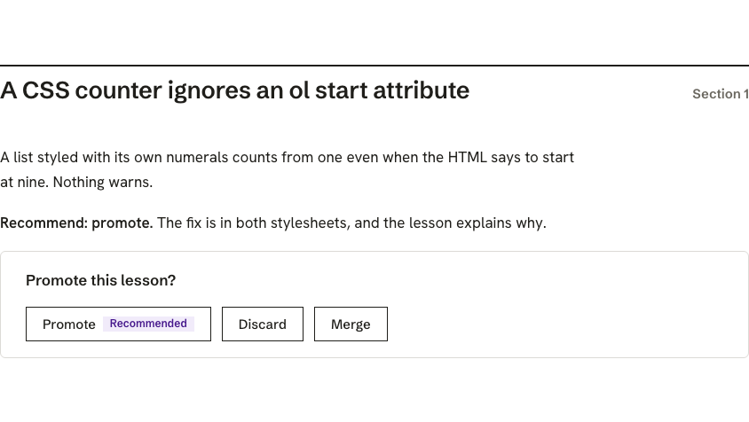 |
| At rest, with the badge | 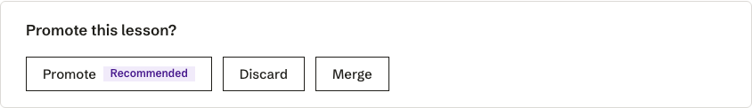 |
| At rest, no recommendation | 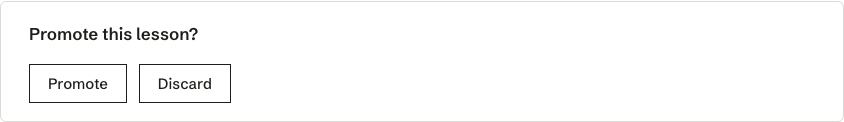 |
| Decided in the source, no Lahe | 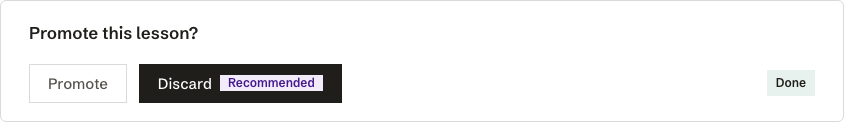 |
| Pressed, kept | 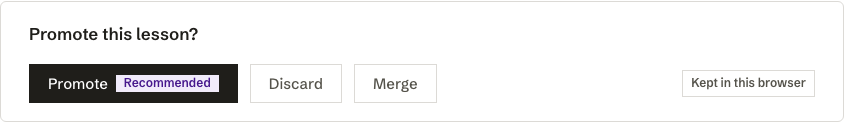 |
| Open | 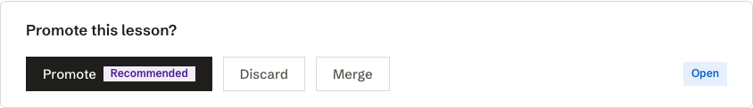 |
| Question | 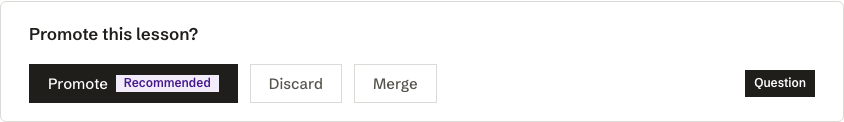 |
| Not handled | 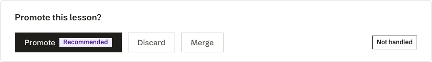 |
| Done | 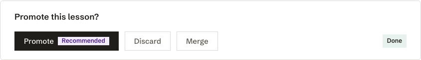 |
| A new press over `data-chosen` | 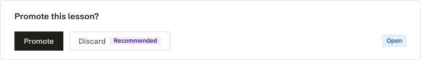 |
| Refused (inert) | 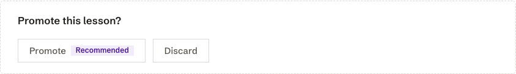 |

## Changes from the plan

- **The fixture's style block was refreshed.** `test/fixtures/free_writing/empty_notes.html` holds a copy of the stylesheet, and a unit test compares it exactly. Its style block now matches the new CSS. The last style change, `c7436834`, did the same. `md_render.html` was left as it was: it is an older snapshot that no test compares exactly.
- **The contract test's paragraph count went from 68 to 69.** It sits in the same test as the restated copy.
- **There is a new spec, `test/browser/choice_style.spec.js`.** The layer's `choice_buttons.spec.js` proves that Lahe paints the attributes. This spec proves that the stylesheet draws them, with no layer running. It starts no processes: the static server runs inside the test process and closes in `finally`.
- **The state word comes from the stylesheet.** It is CSS `content` keyed on `data-lahe-choice-state`, so the layer only has to set the attribute.

## Helper counts

The `lahe.js serve` count is machine-wide. During this work it included helpers from the `cb-kernel` and `brand-rail-words` worktrees, which were running their own tests at the same time.

| When | Total count | Helpers from this worktree |
| --- | --- | --- |
| Start of work | 1 (Ken's real helper) | 0 |
| Before and after `choice_style.spec.js` (both runs) | 1 | 0 |
| Before and after the second and third `gate:unit` runs | 4 to 8, from the other worktrees | 0 |

`no_stray_helpers` reported that no helper from any run was still running.

## To delete at cleanup

- `.claude-commit202610171413-style`, `-contract` and `-skill` in the worktree root. Git ignores them.
- The temporary `HOME` from the installer check, under `/var/folders/.../T/tmp.V8Zh2Vkrnh`. It is a system temp folder, so the OS clears it.
- Any `test-results/` folder the Playwright runs left in the worktree.
