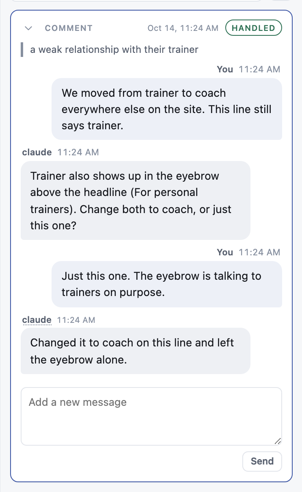
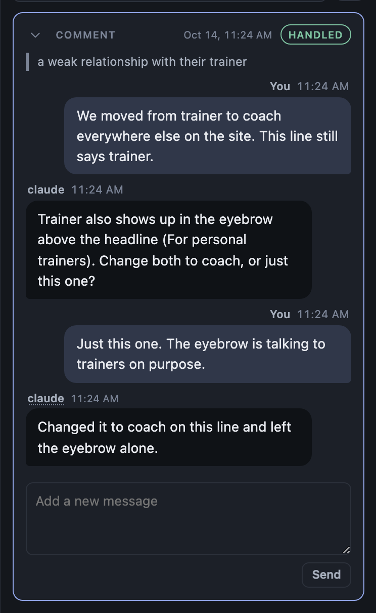

# Card edges: no curved left stripe, no green wash

**Summary.** Two rail card styles go. The blue stripe down a card's left edge, which bends round the rounded corner, is replaced by the card's own border turning blue. The green wash on handled cards is replaced by the plain white card; the green HANDLED chip still says done.

## Problem, user, and context

Ken, looking at the README hero screenshot: the blue left edge "that lightly curves around the border radius" reads as AI slop, and the green card background with grey text "kind of conflict". The straight blue bars inside a card (the quoted text, a run's blocks, a held run) are fine and stay.

The left edge is the unseen mark in `src/layer/tab_done.js`: an inset shadow on a card whose reply arrived while the reviewer was elsewhere. The green wash is the handled card rule in `src/layer/overlay.js`.

## Requirements

1. **No one-sided colored edge on a card.** An unseen card shows its mark as its border turning the accent color on all four sides. The `data-lahe-unseen` attribute, the "1 new" tag and the badge behave as before.
2. **Handled cards are plain.** A handled card has the paper background and the neutral line border, in light and dark. The HANDLED chip keeps its green.
3. **Straight inner bars stay.** The quote rule, run block rules and held-run rule are not changed.

## Approach

No design call. The rail already uses "the border carries the meaning, on all four sides" for held cards. The unused `--handled-wash` and `--handled-line` tokens are removed.

## Tasks

| Task | Proof | Failure it catches |
| --- | --- | --- |
| Replace the unseen inset shadow with an accent border | `test/browser/agent_replies.spec.js` and `card_collapse.spec.js` pass (they read the attribute, not the color) | the mark stops being set |
| Handled card to paper and line | screenshot, light and dark, below | a leftover wash |
| Rebuild `dist/lahe-layer.js` | `npm run gate` | stale bundle |
| Retake the README hero | `docs/images/hero-thread.jpg` | the old look stays on GitHub |

## Acceptance criteria

The rows above pass, and the screenshots below show no left stripe and no green wash. No analytics or flag: this is a style change.

## Screenshots

