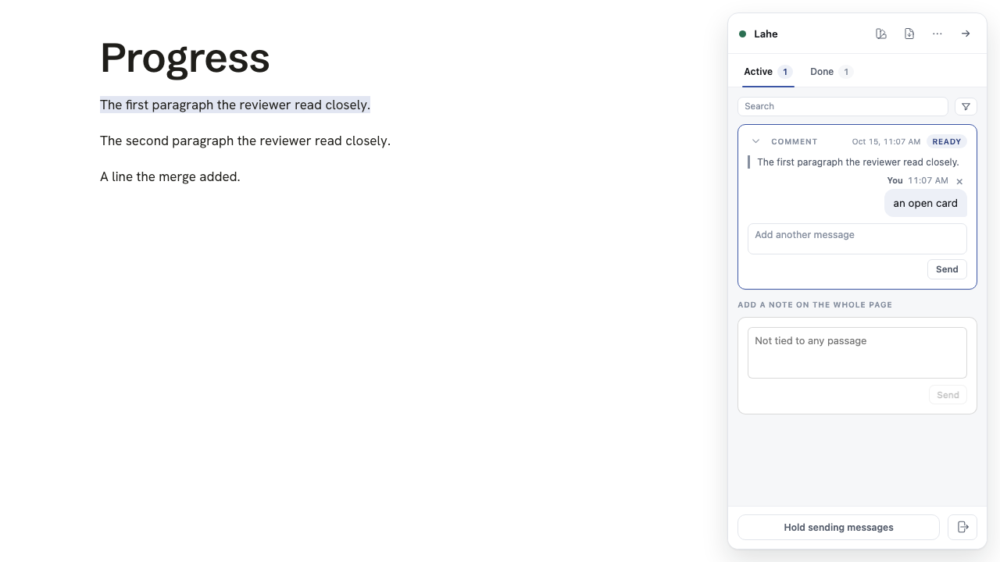
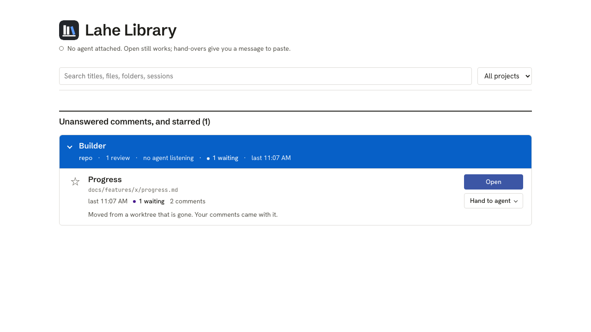
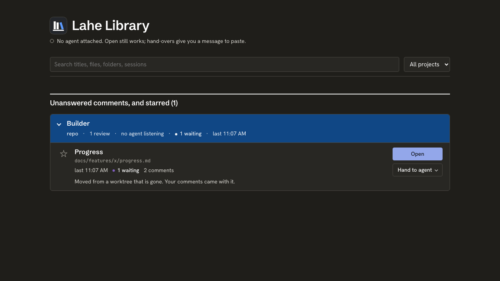

# Progress: a review follows its document out of a worktree

## Status

**Closed on October 17.** Merged as PR [#71](https://github.com/kenxle/live-agentic-html-editor/pull/71) on October 15 (`bc56c5a9`), at your word on the preview. Main's CI passed, and your real Lahe runs it: the menu bar progress page's old address forwards to the main checkout's copy, and its rail shows your earlier cards. Nothing is waiting on you. The spec is [01_spec_review_follows_document.md](01_spec_review_follows_document.md).

Your two calls went in as the defaults:

- **Q1, a security trade-off.** Library Open on a moved document gives the main copy an address and the old review's rail, with no agent involved. The limit: Open names a new site only inside the main checkout's copy of a folder Lahe already served from the worktree.
- **Q2.** When the main copy already has a newer review, the newest review that holds comments on the document gets the page. A newer review with no comments loses to the old one.

## What you will see

The main copy's page, after the worktree is removed: the earlier cards, one open and one done.

The Library row for the same document, marked as moved:

## Checks

- Final gate before the merge, on `d9f5c329` with main merged in: lint, bundle and `check:menubar` passed (app self-test 383); unit 2956 passed, 0 failed, 5 skipped; browser 890 passed, 0 failed, 7 skipped. PR check passed; main CI on `bc56c5a9` passed.

Earlier, on the branch:

- `npm run gate:unit`: 2929 passed, 0 failed, 5 skipped.
- `npx playwright test test/browser/review_follows_document.spec.js` (Chromium): 5 passed. Run against the old server code first: 5 failed.
- `test/browser/stable_addresses_sites.spec.js` and `test/browser/catalog_page.spec.js`: 37 passed, 1 skipped.
- The new unit tests (`test/unit/review_follows_document.test.js`, and the moved-row cases in `library_open_sites`, `menubar_summary` and `catalog_view_model`) were run against the old code first and failed.

## Cost (R14)

`node scripts/measure_moved_lookup.js [<tree>] --json`: a made-up state folder of 700 reviews, 30 worktree sites, 20 of them removed. Each load is a page plus its `records.read`, spaced 2 seconds apart, 15 loads. The helper runs in the script's process, so processor time includes the two small clients.

| Page | Code | Wall ms, median | Wall ms, p90 | Processor ms, median | Processor ms, p90 |
| --- | --- | --- | --- | --- | --- |
| Ordinary page | before | 92.00 | 116.91 | 86.19 | 132.63 |
| Ordinary page | after | 75.62 | 117.08 | 90.57 | 122.50 |
| Moved page | before (read-only, records refused) | 23.36 | 25.46 | 23.66 | 27.70 |
| Moved page | after (old review, 3 records shown) | 69.82 | 72.05 | 70.27 | 81.91 |

An ordinary page costs the same before and after. The moved page does more work after the change because it now carries a review, and it still costs less than an ordinary page. Not done: the lesson's 10-minute idle windows on a copy of the real state folder. This lookup runs on page loads, not a poll, and tests may not touch the real state folder.

## To delete at cleanup

Done on October 17 with your go: the worktree (with its `.claude-commit*` files, `test-results/` and `node_modules/`), its local branch, and the preview copy of your Lahe data in `~/Documents/lahe-rfd-preview/`. The remote branch was deleted when the PR closed.
