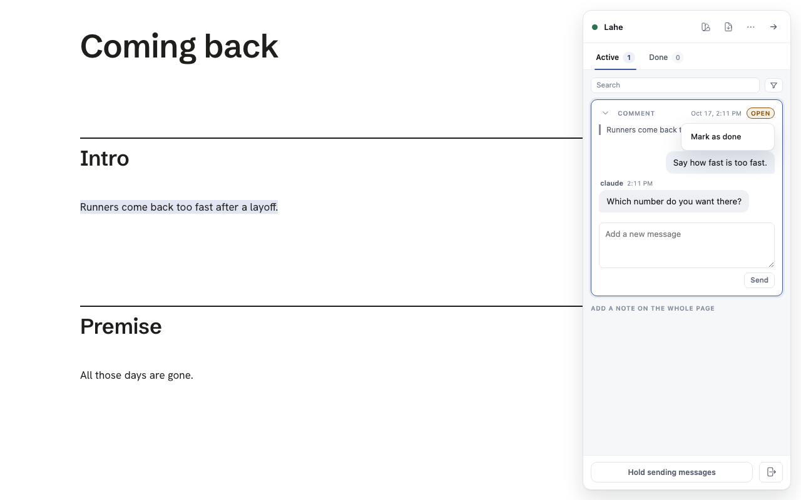
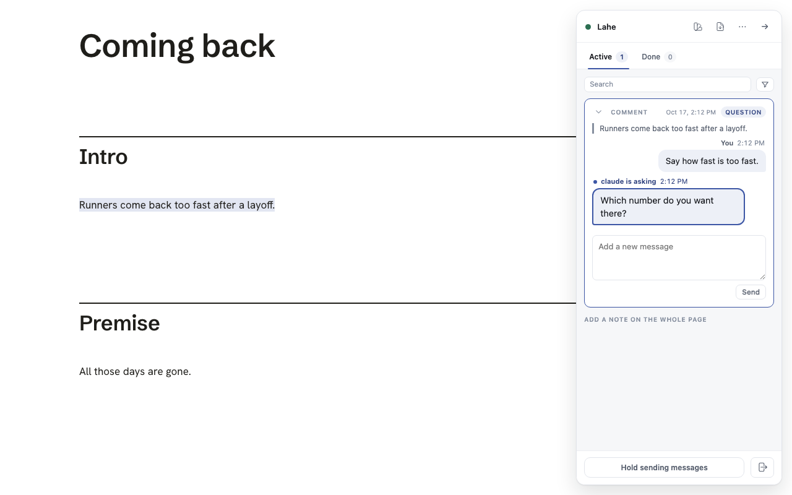

# Chat bar labels match the brand words

The chat bar now uses the words in [BRAND.md, Words we use](../../ongoing/BRAND.md#words-we-use).

## What changed on screen

| Before | Now |
| --- | --- |
| Ready (state chip) | Open |
| Not handled (state chip) | Open, still amber, with the agent's reason on the thread |
| A ready card with an agent question | Question |
| Handled (state chip) | Done |
| Not handled (reply toast label) | Not done |
| "claude handled this." (a reply with no words) | "claude did this." |
| Search the cards, Collapse all cards, Expand this card, card actions | threads |
| Hide rail, Collapse the rail, the rail already copies | chat bar |
| Both versions are on the card | Both versions are on the thread |
| 4 items are still waiting on an agent | 4 threads are still waiting on an agent |
| Nothing handled yet. | Nothing done yet. |

The "Filed in another review" list showed a raw state such as `not_handled`. It now shows the same label as the chip.

## What did not change

- Attribute names, CSS classes and the record's states (`ready`, `handled`, `not_handled`) stay as they are. Only the words a person reads changed.
- The agent contract in `review_format.js` still says item and card. It is text for agents, and the file is frozen.
- "Delete item" in the editing toolbar means a list item, so it stays.

## Screenshots

A refused thread, with its chip menu open:

An agent asking a question:

Both come from `test/browser/mark_done.spec.js`.
