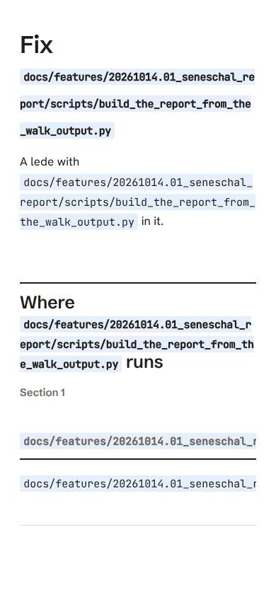

# Progress: Small board fixes, second batch

**Building.** Four board rows picked for overnight work on 2026-10-22, shipped as one whetstone change. Nothing is waiting on you.

## Needs your attention

Nothing is waiting on you.

## Spec

| Row | Change | Test |
|---|---|---|
| LAHE-handled-check-raw-markdown | When the site render of a Markdown page is not available, the handled check reads the review's own state-folder render (`markdown.artifactPath` for the review's session), but only when it is at least as new as the source. With neither, the verdict is "cannot tell" (null). The raw `.md` is never read as the page, since it has no blocks and a placed paragraph would always read as "not on the page". | `sites_mappers.test.js`: "with no site render, ... state-folder render" and "... older than the source is not evidence", "... cannot-tell, never its raw source" |
| LAHE-holder-tie-same-millisecond | Tiers 2 and 3 of `holderOfFile` use the tier-1 rule (`newer`): newest wins, and the higher review id breaks a tie. Before, a tie went to whichever review the folder listing named first, which differs by OS. | `holder_tie.test.js`, with the listing order reversed |
| LAHE-serve-restart-foreground | `lahe serve --restart` stops the old helper, starts the new one detached with the same arguments minus `--restart`, and returns once it answers (15 s limit). A child that exits first is reported at once. `--restart=<value>` is dropped from the child's arguments too. `--always-on --restart` stays in the foreground, since a service manager runs that one. With the login item installed, `--restart` already went through the item and is unchanged. | `helper_not_replaced.test.js`: "returns once the new helper answers, and the helper outlives the command" |
| LAHE-inline-code-forces-sideways-scroll | `code` gets `overflow-wrap:anywhere` in `document.css`, so a long path in a heading breaks instead of widening the page. Inside a table cell or header, code keeps `break-word`, so column sizing is what the cells already chose. The empty-notes fixture was regenerated (`LAHE_REGEN_FIXTURES=1`) since it inlines the style. | `markdown_render.spec.js`: "a long path in inline code wraps at phone width", 390px viewport |

**Scope.** Four fixes the rows already describe. No new product decision.

**Rollout.** Merge when the gate is green. Nothing to enable.

**Review owner.** One independent reviewer (whetstone size).

## Phases

| Step | Status | Changed |
|---|---|---|
| 0 Size it | done: four small rows, one PR | 2026-10-22 |
| 2 Spec | done, above | 2026-10-22 |
| 5 Build | done: each new test red on the old code, green on the new | 2026-10-22 |
| 6 Code review and verify | review done, fixes in; gate after the first batch merges | 2026-10-22 |
| 7 Ship and land | not started | |
| 8 Close out | not started | |

## The record

### Screenshot

The 390px page from the browser test that proves the change (`LAHE_SHOTS_DIR` set for that run). Before the fix the same page measured 830px wide. The table scrolls inside its own `.scrollx` box, as it did before. The document style is light only, so there is no dark shot.

### Review

One independent reviewer, no blockers. Fixed: `--restart=1` would have been passed to the child and restarted without end; a child that fails to start is reported at once rather than after 15 s; a state-folder render older than the source is not used; `th code` gets the same table rule as `td code`; the older duplicate row LAHE-serve-restart-detaches is closed with this one. Left as is: a source recorded through a symlinked path misses its state-folder render and the check says "cannot tell", which is the safe answer.

### Red before green

- Handled check: both new tests failed on the old code with `false` (the raw Markdown was read and the placed paragraph not found).
- Holder tie: the old code named the lower id (`rd2f...` over `rfe0...`) for two reviews stamped the same.
- Serve restart: on the old code the command never returned ("Timed out after 20000ms waiting for lahe serve --restart to return").
- Inline code: on the old style the page measured 830px in a 390px viewport.
