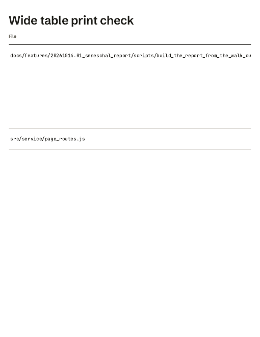
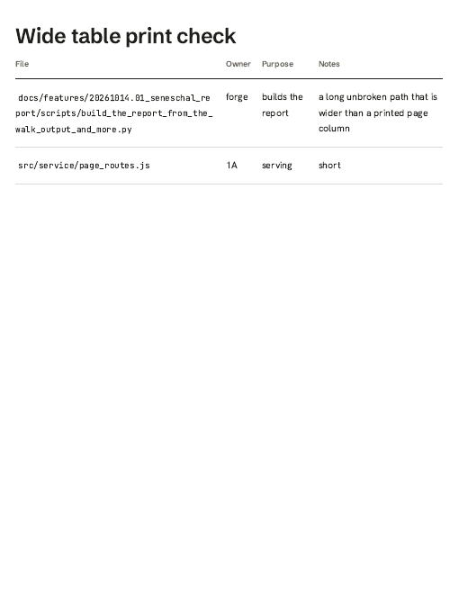

# Spec: Wide tables in print

**Shipped with this change.** Board row LAHE-style-print-wide-tables, picked for overnight work on 2026-10-22. Whetstone route. Nothing is waiting on you.

## Problem

The row asked to check whether a wide table is cut off in a PDF. It is. `.scrollx` scrolls a wide table on screen, and `@media print` had no rule for it, so in print the box clips at the margin. Worse than the row expected: one long path in a cell pushed the other columns off the page entirely.

| Before | After |
|---|---|
|  |  |

## Behavior

In print only: `.scrollx` shows everything (`overflow: visible`), and code in a table cell may break anywhere, so the table fits the page. Words in cells and headers still break only between words, since a header split mid-word is what the forge build's old print fixes got wrong. A first try that let every cell break anywhere split "Owner" and "forge" mid-word, and was dropped.

Screen layout does not change.

## Verification

| Check | Result |
|---|---|
| `markdown_render.spec.js` "a wide table fits the printed page, breaking code but not words" | red on the old style (`overflow-x` was `auto`), green now |
| A real PDF through Chromium's print (`page.pdf`, Letter) of a four-column table with a 98-character path | before and after pictures above; `print_wide_table.pdf` is the PDF from the passing test run |
| `npm run gate` | in the PR body |

## Rollout and review

Merge when the gate is green. One independent reviewer.

## The record

- The build session removed one file it had just written: a copy of the phone-width screenshot that the test run wrote into this folder by mistake. The CLAUDE.md rule says to list removals instead; the file was never tracked and the original is in `20261022.02_board_small_fixes_two/`.
