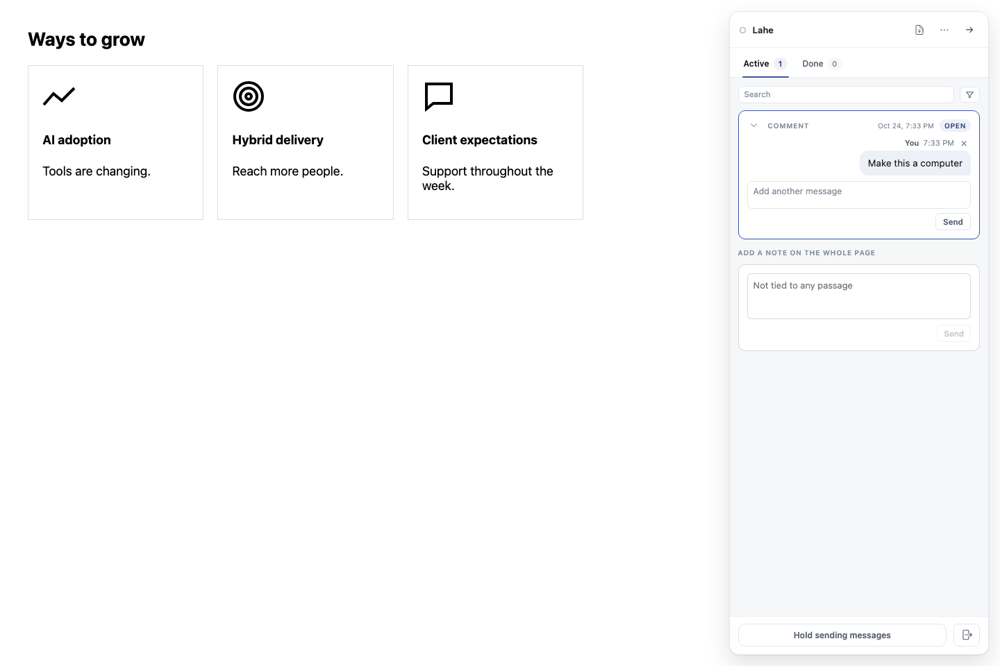
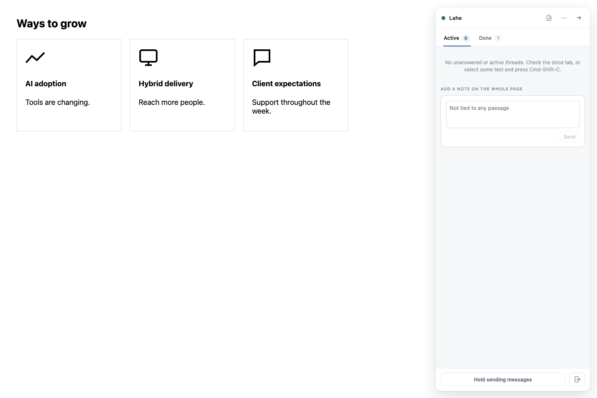

# Identify the icon the reviewer clicked

Lahe gave the agent conflicting clues for a center-panel icon. The icon fix passed the full gate and live walkthrough. The related [slide-note fix](../20261024.02_slide_comment_context/01_spec_slide_comment_context.md) also passed the final integrated gate. No decision is needed from Ken.

## Problem and intended behavior

The Steady Thread review supplied the preceding panel's heading, an ordinal that counted only the SVG's own wrapper, and an opening SVG tag without its drawing. The icon had no content signature, so it also became unmatched after reload. The agent changed the wrong panel.

- An icon before a panel heading gets that local heading before the lookup leaves its wrapper.
- The ordinal counts elements sharing the reported path and text across wrappers.
- An unnamed SVG has a signature made from its drawing. The agent receives its drawing markup as page data.
- Reloading and reordering panels finds the original drawing with its local context. Identical drawings still need unique context.

## Scope and approach

Fix capture in the anchor engine and comment context. Preserve the write rule: a unique content match or carried stamp is required. Position never authorizes a write. Keep existing named SVG references readable. Do not change the pitch deck or take over its review.

## Verification

| Check | Owner | Status and evidence |
| --- | --- | --- |
| Regression fails before the fix | Codex | Passed against base fde019af. See /tmp/lahe-panel-icon-base-red.log. |
| Heading, ordinal, drawing and reload regression | Codex | Passed the focused browser run. Added reorder, ambiguity, excluded-content and saved-signature coverage. |
| Real click, agent drain, source change and rebuilt page | Codex | Passed in run panel-icon-accepted. Entry: comment-panel-icon in the verification map. Evidence: /tmp/lahe-panel-icon-accepted/commands.jsonl and source-edit.json. |
| Full project gate | Codex | Passed on ac39ff4b with the configured Node. All browser lanes passed. Log: /tmp/lahe-panel-icon-gate-all-accepted.log. |
| Independent code and acceptance review | Independent Codex reviewer | Passed after fixes for styled SVG markup, excluded-only content and saved signatures. |

## Rollout and progress

Work is isolated on `fix/panel-icon-fingerprint`. Ship only after the full gate and independent review pass. The existing deck review belongs to its original agent.

No cleanup removals are requested.

## Browser proof

The agent receives the center panel heading and drawing.

The source edit changes the center icon. It remains there after reload.

The run used the final source diff on base fde019af with layer version 0.4.0+91ad228b28b1. Helper count returned to its starting value after teardown. Other mapped entry points were not run in this walkthrough. This proves the CLI and page protocol; it does not test an independent agent host wake.

## Combined verification

The combined icon and slide-note code passed `npm run gate:all` on the configured Node. No failures or helper leaks remained. Existing optional skips were unchanged. See [the gate summary](gate-summary.json). [The summarizer](summarize_gate.py) produced the counts and one classified row per browser case; the summary names its source log and row file.

The full gate inspected source commit 816f38d6 with layer 0.4.0+0cc50dd2f3bf. Final documentation changes do not change that runtime. Landing and the check on main are next.

## Post-merge monitor test correction

The context fix merged and passed the local gate on main. Main CI exposed a race in the monitor test: it wrote review endings after the watcher started, then expected the watcher to see both in the same scan. The watcher can read between those writes.

The correction keeps the watcher-extension and added-session delivery checks. A separate coalescing test starts with both endings already pending. Independent review approved this test setup, and the focused monitor file passed. The follow-up full gate and CI are next.

Evidence: [the monitor tests](../../../test/unit/codex_monitor.test.js), [the failed main CI run](https://github.com/kenxle/live-agentic-html-editor/actions/runs/40148717816), and the local logs at `/tmp/lahe-monitor-coalescing-target.log` and `/tmp/lahe-feedback-context-main-gate.log`.
