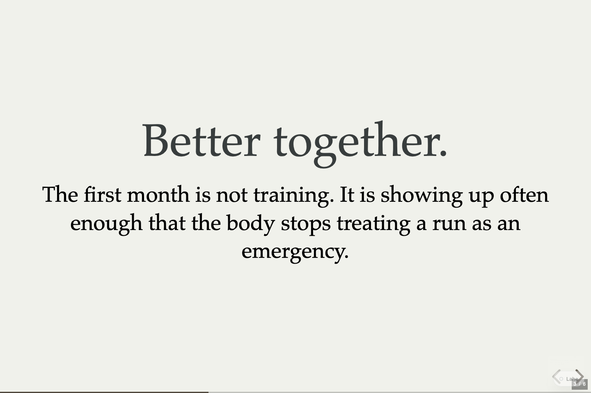

# Keep the slide with a deck note

Lahe currently sends page notes without the slide the reviewer was viewing. Capture, instructions, independent review and live proof pass. The final integrated gate passed. Landing and the check on main are next. Ken has no decision to make.

## Intended behavior

- A new note on a Reveal deck records the visible slide when the reviewer starts typing.
- The snapshot includes the slide's position, author id, heading and a short text excerpt. It stays with the note after navigation, sending and reload.
- The agent receives this context as page data in the drain and exports. An ordinary document note remains a page note without slide context.
- Slide instructions tell agents to use the captured slide when interpreting references such as this slide. They use its id and words when numbering changes. They do not guess an insertion point from the last comment.

## Scope and approach

Capture optional slide context at the first nonblank input, rather than when the always-open composer is created. Read the deck's active slide from its DOM. Keep notes unanchored, so a deck-wide request can still apply to the whole deck.

This is separate from [the icon fix](../20261024.01_panel_icon_fingerprint/01_spec_panel_icon_fingerprint.md). Work is isolated on `fix/slide-comment-context`, based on the icon fix. No browser runs overlap the icon fix's full gate.

## Verification

| Check | Owner | Status and evidence |
| --- | --- | --- |
| Projection and bounded page data | Codex | Passed [projection and export tests](../../../test/unit/review_format.test.js), including text export, bounded strings and uncounted slides. |
| Real Reveal note captures the slide at first input and survives navigation and reload | Codex | Passed in Chromium, Firefox and WebKit, including rewording a restored note. |
| Vertical slides and ordinary document notes | Codex | Passed in every supported browser. Whitespace-first input, uncounted slides and ambiguous multiple decks also passed. |
| Real note, CLI drain and agent response | Codex | Passed in slide-note-accepted using layer 0.4.0+0cc50dd2f3bf. Entry: comment-slide-note. Evidence: /tmp/lahe-slide-note-accepted/commands.jsonl and source-edit.json. |
| Independent code, acceptance and instruction review | Independent Codex reviewer | Approved after adding visible uncounted-slide support and the missing edge-case tests. |
| Full project gate | Codex | Passed npm run gate:all on source 816f38d6 with the configured Node. See [the combined gate summary](../20261024.01_panel_icon_fingerprint/gate-summary.json). |

## Progress

The page-note composer creates an empty record at page load and persists it at the first keystroke. It currently stores an empty context. The agent's slide runbook covers editing and building decks but does not tell it how to locate a page note's slide.

No cleanup removals are requested.

## Live proof

The reviewer began the note on The first month and navigated to What to measure before sending. The drain retained the original slide. See [the captured slide data](captured-slide.json).

The agent used that id to change the original slide title. The next slide kept its title, and the change survived reload. The image below shows the changed source artifact with the chat bar collapsed.

The portable fixture comes from [prepare_deck.py](prepare_deck.py). The main walkthrough and result-view runs were both torn down. The helper count returned to its starting value. This proves the CLI and page protocol; host wake behaviour was not tested in this walkthrough. Other mapped entry points were not run here.

The [icon fix record](../20261024.01_panel_icon_fingerprint/01_spec_panel_icon_fingerprint.md) records its earlier full gate. The combined full gate passed. No failures or helper leaks remained.
