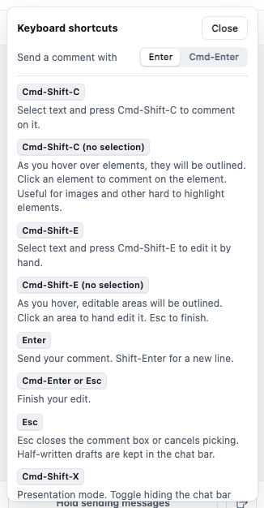
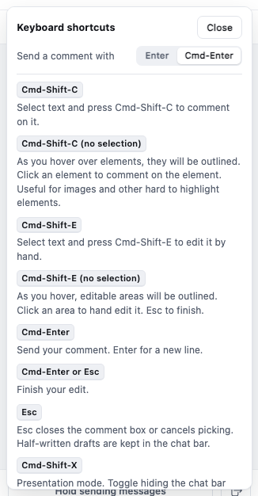
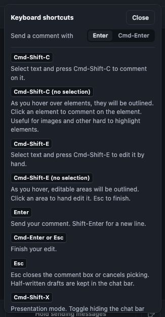
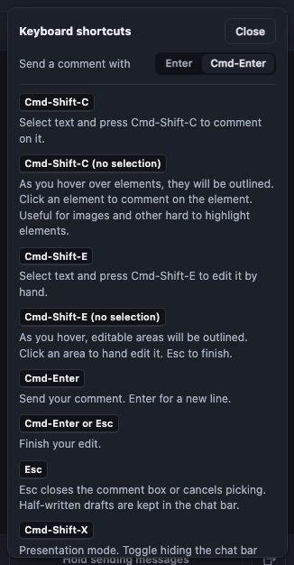

# Enter sends a comment

Shipped in [PR #101](https://github.com/kenxle/live-agentic-html-editor/pull/101), merged to main as `1362af77` on 2026-11-07, and live on the helper. Enter now sends a comment and Shift-Enter starts a new line. A switch in the rail menu's Keyboard shortcuts panel turns sending back to Cmd-Enter.

## Problem

Sending a comment took Cmd-Enter. Ken wants Enter, the way a chat box works, with a setting to switch back.

## Behavior

- **In a comment box, a card's own words, and the rail's message boxes** ("Add a new message" on a card, the Active pane's box):
  - Enter sends. Shift-Enter is a new line. Alt-Enter types whatever the box types.
  - Cmd-Enter (Ctrl-Enter elsewhere) also sends, so the old habit keeps working.
  - An Enter that finishes an input-method character (Japanese, Chinese) never sends.
- **With "Send a comment with: Cmd-Enter" chosen:** a bare Enter is a new line and Cmd-Enter sends.
- **Editing the page is unchanged.** Enter in a hand edit is a new paragraph; Cmd-Enter or Esc finishes the edit.
- **The words follow the setting:** the shortcuts panel's rows, every Send button's hover tip, and the comment box's screen-reader label.

| Enter selected (the default) | Cmd-Enter selected |
| --- | --- |
|  |  |
|  |  |

The screenshots come from the browser test that proves the switch, `test/browser/send_key.spec.js`, run with `LAHE_SEND_KEY_SHOTS=<folder>` (and `LAHE_SEND_KEY_SCHEME=dark` for the dark pair).

## Scope and approach

- `src/shared/gestures.js` owns the rule: `SEND_KEY`, `isSendPress` (over a descriptor), `isSendEvent` (over a real keydown), `sendKeyLabel`. `gestureFor` takes `sendKey` and `isComposing`. The table's hint and panel rows take the send key, so there is still one spelling of each.
- `src/layer/store.js` keeps the setting: `readSendKey` and `writeSendKey`, one browser-storage key `lahe.sendkey.v1`, not one per review. If storage refuses, the choice holds in memory while the page is open.
- `src/layer/overlay.js` draws the switch at the top of the Keyboard shortcuts panel and repaints the panel and the Send tips when it changes.
- Finishing an edit got its own row in the panel ("Cmd-Enter or Esc: Finish your edit."), because it used to share the Cmd-Enter row with sending.

### Choices made

- **Cmd-Enter sends under both settings.** Nothing is lost by it, and nobody's old habit breaks.
- **The setting lives in browser storage.** Each document has its own address, and browser storage is kept per address. So the choice holds for every page of one document or site, and a different document starts at Enter. A setting that follows the reviewer everywhere would need the helper to keep it, which means a new helper route and a security review. That is left as a follow-up below.

## Follow-up

- Keep the send key in the helper so one choice covers every document. Needs a route and a security review. On the board as `LAHE-send-key-everywhere`.

## Verification

| Check | Result | Evidence |
| --- | --- | --- |
| Gesture rules: Enter, Shift-Enter, Alt-Enter, Cmd-Enter, composition, the setting, Enter outside a box | pass | `test/unit/regions_gestures.test.js` |
| The setting is stored once, survives a reload, falls back when storage throws | pass | `test/unit/send_key.test.js` |
| Real keys into the real box: Enter sends, Shift-Enter makes a new line | pass | `test/browser/send_key.spec.js` |
| The switch, by a real click: rows change, Enter becomes a new line, Cmd-Enter sends, the choice survives a reload | pass | `test/browser/send_key.spec.js` |
| `npm run gate:unit` | pass | run by the builder before each push |
| `npm run gate` | pass | on `f1a6c375`: unit 3,184 passed, 0 failed, 5 skipped; browser 935 passed, 0 failed, 8 skipped; no stray helpers |
| Independent review | pass after one fix round | empty-box Enter, stale card labels, panel redraw, missing tests and stale docs, all fixed in `84c5ebad` |

## Rollout

Ships with the next bundle. Nothing to migrate: with nothing stored, the send key is Enter.
