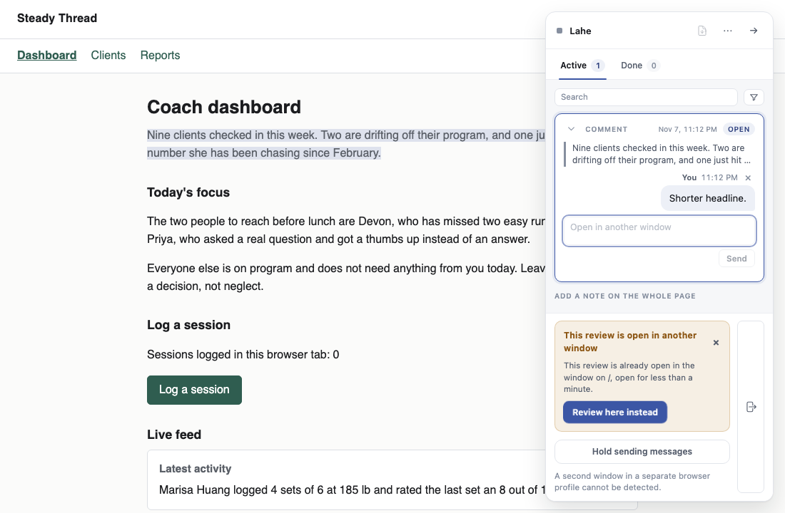
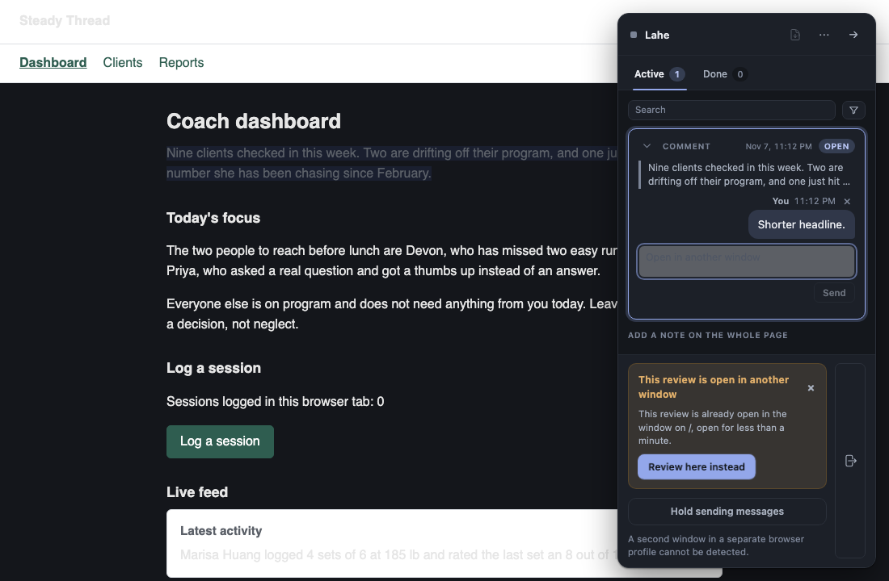
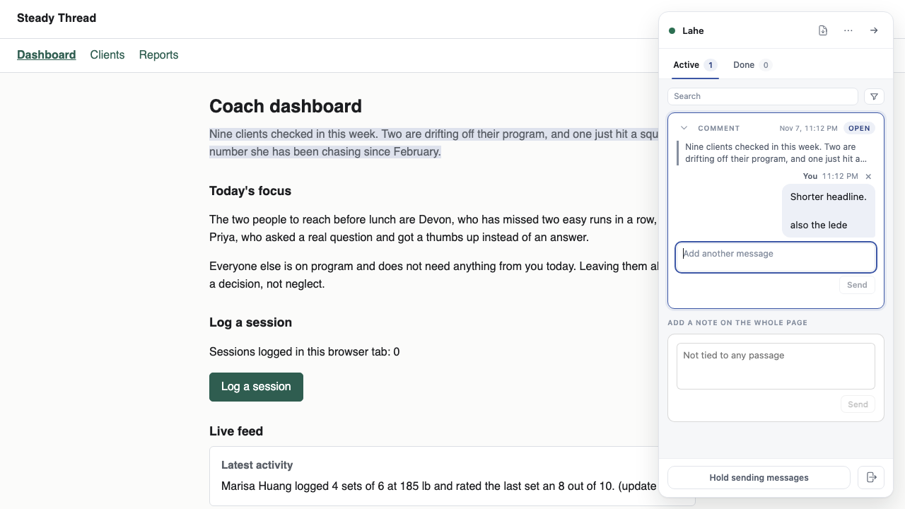
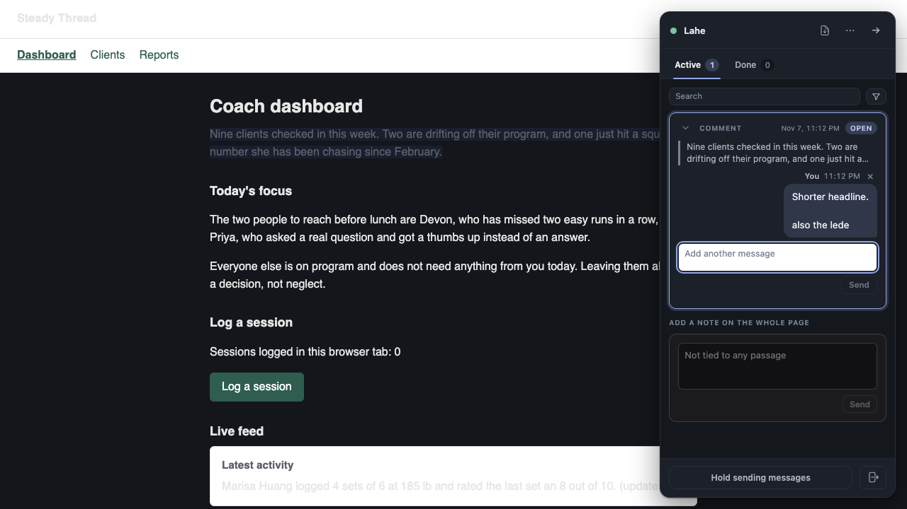

# Progress: Small board fixes, third batch

**Built.** Three board rows picked on 2026-11-07 while Ken was away, shipped as one whetstone change. Nothing is waiting on you.

## Needs your attention

Nothing is waiting on you. One choice to know about: a read-only window's boxes are now locked (read-only, greyed, placeholder "Open in another window") rather than disabled, so that a click on them can be answered. If you would rather the boxes vanish in a read-only window, say so on the PR.

## Spec

| Row | Change | Test |
|---|---|---|
| LAHE-held-release-waiting-clock | The helper stamps every accepted event with its own clock (`received_at`), the fold keeps it on the item, review.json carries `waiting_since` (the later of the reviewer's change and that stamp), and the rail's "nothing has come back" clock counts from it. A comment held for 45 minutes and then released waits from the release. The drain line leaves the new field off. A log line from an older helper has no stamp and behaves as before. | `held_release_clock.test.js`: six cases, ending with "replies.poll counts a held comment's wait from its release, not from its commit" |
| LAHE-send-disabled-when-empty | Send is off while its box is blank or whitespace only, in the Active tab's "Add another message" box and the Done tab's follow-up composer, and comes back on input, including a restored draft. Answered and read-only states sit on top as before. The send key over an empty box stays a no-op. | `board_fixes_three.spec.js`: one test per box, plus the restored draft |
| LAHE-readonly-click-feedback | In a window refused because the review is open in another window, the rail's boxes and their Send are locked (read-only, greyed, placeholder "Open in another window", a title saying where the review is) rather than disabled. A click, a tab into the box, a plain key, a press on Send, or the comment or edit chord on the page shows the refusal panel again if it was dismissed, opens the rail, scrolls the panel into view and pulses its "Review here instead" button. Taking the review over unlocks everything and puts the boxes' own placeholders back. | `board_fixes_three.spec.js`: "the boxes read as locked, and a click, a tab or a key brings the dismissed panel back and pulses it", "taking the review over unlocks the boxes", two screenshot tests |

**Scope.** Three fixes the rows already describe. No new product decision.

**Rollout.** Merge when the gate is green. Nothing to enable.

**Review owner.** One independent reviewer (whetstone size).

## Phases

| Step | Status | Changed |
|---|---|---|
| 0 Size it | done: three small rows, one PR | 2026-11-07 |
| 2 Spec | done, above | 2026-11-07 |
| 5 Build | done: each new test red on the old code, green on the new | 2026-11-07 |
| 6 Code review and verify | review done, fixes in (below); gate at the checkpoint | 2026-11-07 |
| 7 Ship and land | pending | |
| 8 Close out | pending | |

## The record

### Screenshots

The refused (second) window from the browser test, a moment after the reviewer tabbed into the locked "Add another message" box: the box says "Open in another window", its Send is greyed, and the refusal panel has come back with its button mid-pulse.

The holder window right after a message was sent from the "Add another message" box: the box is empty again and its Send is off, like the page note's Send below it.

### Review

One independent reviewer, two blockers, both confirmed with probes and both fixed:

- A same-revision repost that changes no words (replay's lost-stamp post, an edit's `existing: true` repost) took a fresh helper stamp and moved the waiting clock forward, making the alert quieter on every repaint. The fold now takes a fresh stamp only on a new revision or the move into ready. New unit test: "a same-revision repost that changes no words keeps the first stamp".
- After a send from the add box, Send stayed enabled over the empty box because the refresh painted it before the box was cleared. The box is repainted after the clear. The Active-tab test now sends and checks.

Also from the review: `lahe session list` dates the oldest unanswered item from `waiting_since` like the rail; a plain Tab, Escape or arrow in a locked box no longer pulses (only a key that would have typed or sent does, and focus alone never does); `record.newItem` no longer copies `received_at` from a browser record; the skill's feedback reference names `waiting_since`; Send-off screenshots added. Left as is: the screenshot tests rewrite the tracked PNGs on every gate run, which is the standing pattern (board row LAHE-gate-rewrites-doc-screenshots).

### Where the pieces live

- `src/shared/protocol.js`: `EVENT_FIELD.RECEIVED_AT`, the helper's stamp on a stored event.
- `src/service/log.js`: `append` writes the stamp from the helper's clock (`opts.now` in tests).
- `src/service/projection.js`: the fold keeps the stamp on the item and ignores one carried inside a record.
- `src/shared/review_format.js`: `waiting_since` on every projected item; `docs/CONTRACTS.md` says what it means.
- `src/service/routes.js`: `unansweredWork` dates the oldest unanswered item from `waiting_since`.
- `src/layer/highlight.js`: `setLocked`, `isLocked`, `paintSendForField` and the locked words.
- `src/layer/overlay.js`: `dismissRefusal` (the panel's × keeps the reason), `nudgeRefusal` and the pulse animation.
- `src/layer/tab_active.js` and `src/layer/tab_done.js`: the two boxes, their Send rule, their lock and their nudge.
- `src/layer/index.js`: passes read-only to the Active tab, repaints both tabs on the way in and out of read-only, and answers the comment and edit chords in a read-only window.

### Red before green

- Held clock: on the old code `replies.poll` reported the commit time (14:00) for comments released at 14:45; `received_at` and `waiting_since` were absent.
- Send when empty: on the old code `send.disabled` read `false` over an empty add box and an empty composer.
- Read-only feedback: on the old code the add box was neither locked nor read-only (`data-lahe-locked` absent, placeholder unchanged), and a tab into it changed nothing on the rail.

### Gate

Pending: the checkpoint run of `npm run gate` after the bundle rebuild.

## To delete at cleanup

- `.claude/worktrees/board-fixes-three` once this lands on main (the worktree, with `git worktree remove`).
- `test-results/` under that worktree, written by the spec runs.
