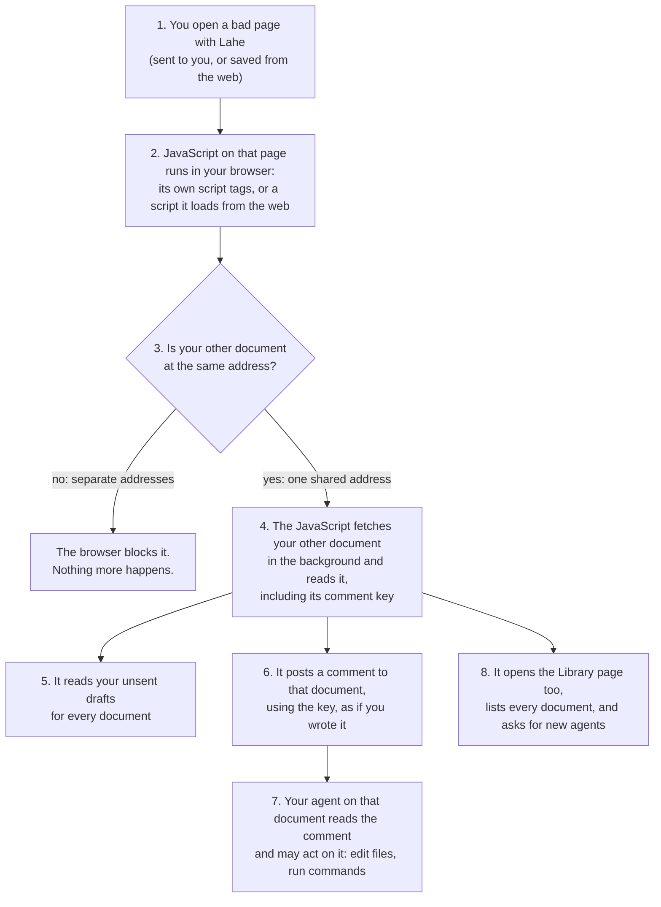

# Stable addresses for documents

## Summary

**Yes, documents should have addresses that keep working.** But a fixed port number alone would not fix what you are seeing. Lahe already tries to reuse a document's old port. Your history links fail mostly because nothing is running at that address anymore, not because the number changed.

The fix that works: the helper starts when you log in and stays up, and it keeps every document's address answering, so a history link loads the page with no agent involved. The best way to do that is one port for all documents, with a separate host name per document (option D).

**Settled in review:** option D. One port, a host name per document. Because each name is its own address to the browser, this also answers the security worry about pages reading each other.

Stable addresses were the last option on [the Library ideas page](DOCUMENT_INDEX_IDEAS.md), which we skipped then. It is a real feature (serving, sessions, and security all change), so it would go through feature-forge.

**Your rule for this:** the core stays a plain server that runs on Mac, Linux, and Windows. Anything Mac-only, like a menu-bar icon, is a separate companion app on top. What that means here:

- `.lahe.localhost` addresses are the default. Chrome and Firefox handle them the same way on every system, and your Mac handles them for Safari.
- A short `docname.lahe` ending is an optional extra per system. The one-time setup differs on Mac, Linux, and Windows.
- "Start at login" is a small setup step per system (macOS login item, a Linux user service, a Windows scheduled task). The server they start is the same code.

**Needs your answer:** the four questions at the bottom.

## Why your old links fail today

Four reasons, most common first:

- **The document's page server was stopped.** Each document is served by its own small process. The helper stops it two minutes after the last window on it closes, and closing an agent session stops all of its servers. After that, nothing listens at the address. The browser shows its own "can't connect" page, and Lahe gets no chance to help.
- **The helper itself stopped.** When the last session closes and nothing has been open for a couple of minutes, the helper exits. Then even the Library is gone.
- **The port changed.** When a server comes back, it asks for its old port first. It only gets a new one if something else took the old one. This is the rare case.
- **The file moved or was deleted.** A page served from a worktree or a temp folder is gone once that folder is removed.

So "persistent port" is really "something always answering at the document's address".

## Pros of stable addresses

- Dead tabs stop happening. A tab left open overnight just reloads, and so do browser history, bookmarks, and "reopen closed tabs". You stay in the browser.
- You can tell what a tab is from its address, if the address uses the document's name (see option D).
- Unsent drafts come back. The browser keeps drafts per address, and the port is part of the address. When a port changes, drafts saved under the old one are invisible on the new one.
- Links an agent pasted into chat or into another document keep working.
- Fewer trips to the Library, and fewer "find me that doc" requests to an agent.

## Cons and risks

- **The helper runs all the time.** It would start at login (a macOS login item). An idle Lahe process uses roughly 20 to 50 MB of memory going by the monitors running now, and almost no CPU when nothing is happening. Your battery trouble on 2026-10-07 was nearly two thousand leaked test helpers, not one idle one. Still worth measuring before and after. You are likely OK with this, since the helper has already been optimized.
- **One open door per document, if each keeps its own port.** With option A below, the helper keeps a door (port) open for every document: 682 doors. macOS limits a program started at login to 256 by default, so the limit would need raising. Option D below avoids this: one door for every document.
- **Port clashes with your other tools.** With option A, each document reserves a port, and any of them can clash with another tool; then that document moves, as it does today. With option D, only the one shared port can clash, and Lahe would pick it once, away from common dev-server ports.
- **Small security change: pages answer all the time.** Each page holds the key for posting comments to its review. Any program running on your Mac could load the page, take the key, and post fake comments to that review. Today that is only possible while the document is being served. With stable addresses it is possible whenever the helper runs. Websites you visit still cannot do it; Lahe already blocks them. And a program on your Mac can already read Lahe's files directly, so this adds little real risk. It is a note for the security review, not a reason to hold back.
- **Who owns the server changes.** Today each agent session owns the servers for its pages, and they stop when the session closes. With stable addresses, one always-on Lahe server owns every address, apart from any agent. Sessions only own their reviews. That touches the session docs, the diagrams, and several tests.

## How the always-on server would run

Your note suggested making it a separate thing, like its own program or a Mac app. That fits: the always-on server is separate from agents either way. Two ways to run it, simplest first:

- **A login item Lahe installs.** `npm run install-cli` would also tell macOS to start the server at login and restart it if it stops. No new code to build, and nothing visible on screen.
- **A small Mac companion app.** It sits on top of the same server and adds a menu-bar icon: it shows it is running, links to the Library, and has a Quit button. The server stays the existing Node code, but the icon needs a small piece of native Mac code, built once and shipped with Lahe. That bends the "runs from a git clone" rule a little, so it would be optional.

I'd start with the login item and add the menu-bar app later if you want to see it running.

Separately, either one could later ship as a single file that runs without Node installed. That is a packaging choice, open at any time, and only worth it if Lahe goes to people without Node.

## Why each document gets its own address today

**Short answer: it is not about agents.** Lahe's software already keeps agents apart and handles handoffs. Ports play no part in that.

The separate addresses protect documents from each other inside your browser:

- A page can run JavaScript, including scripts loaded from elsewhere, like a chart tool pulled from the internet.
- Your browser lets JavaScript on a page read anything else at the same address.
- So if two documents shared an address, JavaScript in one could read the other, and send comments to it as if they came from you.

Lahe cannot stop that itself, because that JavaScript runs in your browser, not in Lahe. Only the browser can, and the browser decides by address.

Your own pages never try to do this. The protection is for the rare bad page, which is what the security review assumed:

- someone sends you a page and you open it with Lahe;
- an agent saves a page from the web to review;
- a chart tool a page pulls from the internet gets hacked.

For you, the risk is low. Lahe is public, though, and other people use it in other ways. Option D keeps the protection, and you would never see the difference.

### The attack, step by step

This is what could happen if every document shared one address (option B). With separate addresses, step 3 fails and nothing after it happens.

Different names count as different addresses. `brief.lahe` and `plan.lahe` are separate to the browser, and so are `brief.lahe.localhost` and `plan.lahe.localhost`, even on the same port. (One note for the security review: names that share an ending can share cookies. Lahe does not use cookies for its keys, so that does not open this attack.)

The step that matters is 7. A fake comment is an instruction to an agent that can change files on your computer. Lahe already marks comments as page content rather than orders, which helps, but an agent following a comment is the whole point of Lahe.

### Other ways to stop it

You are right that there are other ways. Each one stops part of the attack:

- **A browser rule that boxes each page in.** Lahe can send a rule with each page telling the browser to treat it as if it had its own address. This stops steps 4 through 8. The catch: a boxed page cannot save anything in the browser, so Lahe would lose unsent drafts on reload and would need another place to keep them.
- **A browser rule limiting where a page can send requests.** Lahe can tell the browser that a page may only talk to its own document. This stops step 6, but not a page opening another document in a window and reading it, so on its own it is leaky.
- **Ask you before an agent acts on a comment from a page you did not write.** This guards step 7 directly, but it adds a step to every review of an outside page, and the agent has to know which pages those are.

Separate addresses stop all of it with one rule the browser already follows. Option D gets them on one port. So I still recommend D, but the boxing rule is a real alternative if separate host names cause trouble.

## The options

### D. One port, a host name per document (recommended)

- Each document gets an address built from its name, like `http://stable-addresses.lahe.localhost:7820/`. You can read what a tab is from the address alone. The name is fixed the first time the document is served, so it never changes after that.
- Two documents with the same name get a short tag to tell them apart, like `brief-personal.lahe.localhost`.
- Every document uses the same port. The helper keeps one door open and reads the host name to know which document you asked for.
- Each host name is its own garden, so documents stay walled off from each other, exactly as with separate ports.
- No port clashes after the first, no 256 limit, and nothing to reserve per document.
- I checked: your Mac already sends any `something.localhost` name to this computer, for every browser. The helper would need to listen on the newer loopback address (`::1`) as well as `127.0.0.1`, because that name is tried there first.
- The address is longer. You would mostly reach it from history or a bookmark, so that matters less.

### What about a name like `lahe.local`?

- **A name does not change port clashes.** A port belongs to the computer, not to a name. If another tool is on the port, no name gets Lahe onto it. Option D already cuts clashes down to the one shared port.
- **`.local` is a poor fit on a Mac.** macOS uses `.local` for finding devices on your network, so lookups are slow, and the name only works after an admin edit to a system file. That file cannot say "every name ending in `.lahe.local`", so each document would need its own line.
- **`.localhost` gives the same look with no setup.** `stable-addresses.lahe.localhost` works today on your Mac, in every browser. I checked.
- **A shorter name like `docname.lahe`** is doable. The catch is the hosts file (`/etc/hosts`): it has no "anything ending in `.lahe`" line, so every new document would need its own line, and every edit asks for your admin password. Two ways around that:
  - a one-time admin step that tells your Mac to ask Lahe about any `.lahe` name, plus a tiny name server inside Lahe that always answers "this computer". One password, ever, then every document just works.
  - or Lahe adds hosts lines in batches, asking for the password each time new documents appear. Simpler to build, more annoying to live with.

  `.lahe` becoming a real internet ending is unlikely, and we can deal with it then. Clicking a link from history works either way; only typing `docname.lahe` by hand may get treated as a search, so type it with `http://` in front.
- **Dropping the port from the address** (so it reads `http://stable-addresses.lahe.localhost/`) needs port 80. macOS refused that for a normal program when I tried. It would take a one-time admin setting at install. Possible, but optional.

### A. Each document keeps its own port, and the helper answers on it

- The first time a document is served, it gets a port from Lahe's range, and that port is recorded as the document's own.
- The helper holds that port open even when no agent is working on the document. When you visit, it serves the page.
- Comments you leave go into the store and wait for an agent, as they do with the Library's Open today. (Same for D.)
- Works, but needs the 256 limit raised, and each port can clash with another tool.

### B. One address for everything, like `127.0.0.1:7817/r/<review>/`

- Shortest and simplest addresses.
- But every document would share one garden with the helper and the Library page. Any document's page could read every other document's key and drafts, and could reach the Library's controls. Not recommended.

### C. Keep things as they are, with a nicer dead-link page

- Not possible. When nothing listens on a port, the browser shows its own error page, and Lahe never sees the request.

## Side finding

While checking this, I found 63 page-server processes left running from test runs. 60 of them are from the idle-server tests (state folders named `lahe-idle-state-*`). That is a test leak of the kind CLAUDE.md's "Tests leave nothing running" rule forbids, and it costs battery. It should go on the bulletin as its own fix.

## Questions for you

1. ~~Are you OK with the Lahe helper starting at login and staying up?~~ Settled: yes.
2. ~~Option D or option A?~~ Settled: option D. Still open: the default `docname.lahe.localhost`, with the short `docname.lahe` as an optional extra, or `.lahe` from the start?
3. Login item first, or go straight to a menu-bar app? From your notes: the login item sounds reasonable, and you like the app for one-click access to the Library. One path: ship the login item with this feature, then the menu-bar app as its own follow-up.
4. Ready for this to become a feature-forge feature, starting with the brief?
