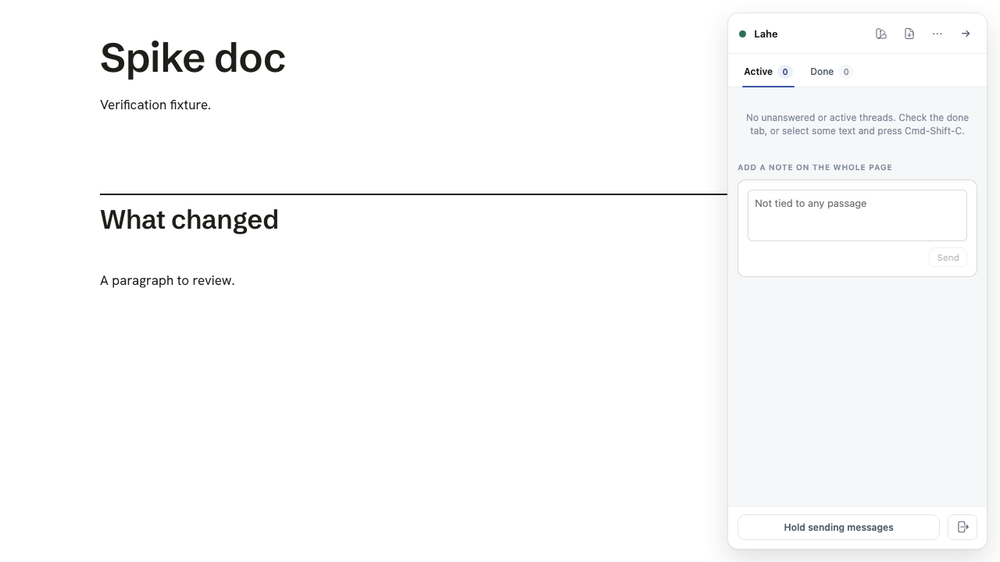

# Verification for future cloud agents

The verification skill and starting feature map are written and the live seed
journey passed. This page tracks proof and the work remaining before a cloud
agent can safely pick up bulletin-board tasks. No decision is needed now.

Updated: 2026-10-18T21:16:26-04:00

## What this adds

- [Verify Lahe](../../skills/verify-lahe/SKILL.md): exact setup, isolation,
  readiness checks, user-path proof, evidence and cleanup.
- [Feature map](../../skills/verify-lahe/features/README.md): routes from a
  user action to existing browser journeys and observable outcomes.
- [Maintenance skill](../../skills/maintain-verification-skill/SKILL.md):
  compare source and live behavior, repair drift, and distinguish product bugs.
- Project-local discovery links for Claude Code and Codex point to the same
  canonical files under skills. No separate installed copies to drift.

## Verification record

The generated bundle matches source. The Markdown placement journey passed in
Chromium, including source placement, automatic page rebuild, handled state and
reload. Its trace survives teardown at:

`/tmp/lahe-verification-seed-proof/free_writing_seams-free-wr-ec216--tags-and-bold-not-reopened-chromium/trace.zip`

The exact command is in [Verify Lahe](../../skills/verify-lahe/SKILL.md). Product
code was unchanged from `6cedb552`. This was a local macOS run with an already
installed browser, not a clean Linux cloud runner. Fresh-runner browser and
system-package installation remain unverified. Dependency installation with
`npm ci` succeeded in the worktree.

The readiness recipe was exercised separately against a fresh CLI-created
review. Its first attempts caught incorrect assumptions about the empty review
file and health route; both were corrected and the recipe passed. The screenshot
below survives closing its browser and helper.

Both skills pass the skill validator. Local document links, named specs and
Claude/Codex discovery links resolve. Under Node 20.19.0, `npm run gate:unit`
passed: 3042 passed, no failures, 5 skipped and 2 todo. The helper leak guard
passed. Results are in `/tmp/lahe-verification-unit-node20.log`.
An earlier attempt used a different Node through npm and failed before executing
the suite; its log remains at `/tmp/lahe-verification-unit.log`.

Only the Markdown placement journey and readiness recipe were driven for this
generation proof. Other mapped paths remain source-grounded recipes, not passed
coverage. Full browser gates were not run for this documentation change.

The files are on `docs/verification-skill` in the isolated verification-skill
worktree, not on main. This branch is ready for review; cloud scheduling remains
follow-up work.

## Cloud readiness

The browser harness already starts disposable reviews and checks process
cleanup. [The runner contract](../../skills/verify-lahe/references/cloud.md)
spells out setup and evidence retention. The local seed proves its user path,
not that Claude Code cloud has the required browser dependencies or host queue.

GitHub CI currently runs lint, the bundle check and unit tests. Its browser
suite remains local by project policy. The Mac menu bar needs a Mac; actual
agent wakes need the intended host. Both remain separate from browser proof.

## Next work

- Validate the seed on the chosen cloud runner and retain its artifacts.
- Broaden live coverage beyond the seed and map the remaining user surfaces.
- Define board eligibility, claiming and collision handling before unattended
  task pickup. Preserve the current human decision and PR boundaries.

These follow-ups belong on [the bulletin board](../BULLETIN.md).

## Source

This follows Lauren Tan's upstream pstack
[create-verification-skill](https://github.com/cursor/plugins/blob/main/pstack/skills/create-verification-skill/SKILL.md)
and [maintain-verification-skill](https://github.com/cursor/plugins/blob/main/pstack/skills/maintain-verification-skill/SKILL.md).
The [linked X article](https://x.com/poteto/article/2094457600259842065?lang=en)
was inaccessible directly, so the implementation uses the upstream skills.
