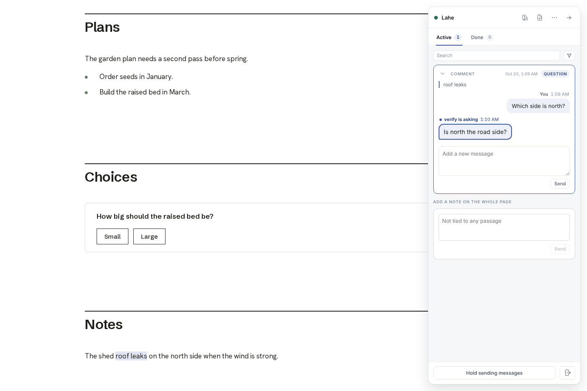
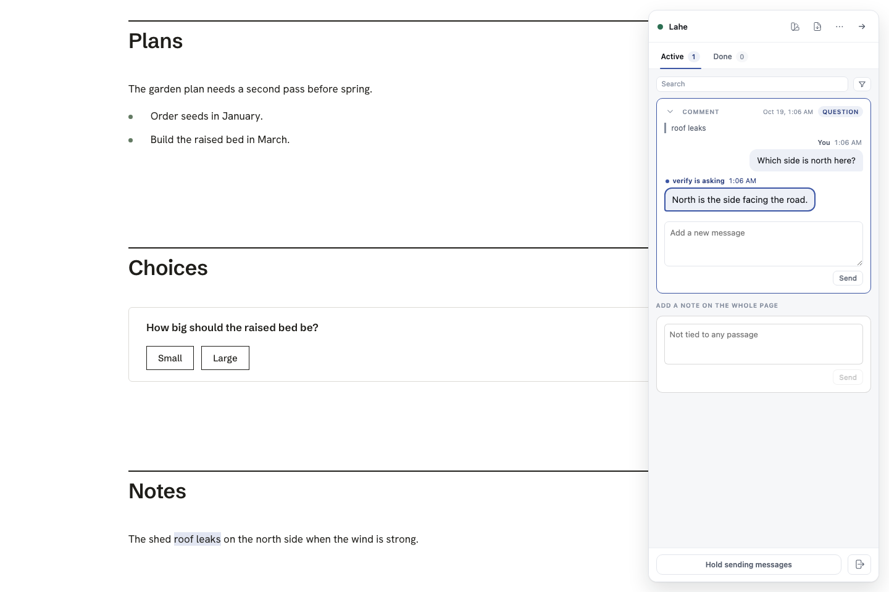
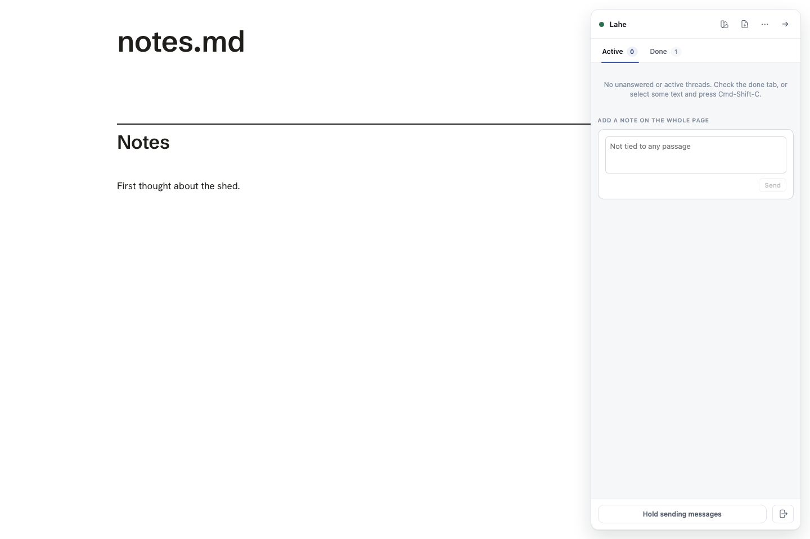

# Verification skill for Lahe

Updated: 2026-10-19T21:46-04:00

## Latest

- **[PR #84 (verification skill)](https://github.com/kenxle/live-agentic-html-editor/pull/84) is merged** into main as `41c25211`. On the merged main,
  `npm run gate:unit` passed: 3126 passed, 0 failed, no helper left running.
  The full browser suite was not run, since nothing under `src/` changed.
- **The cloud proof passed.** After you allowed `cdn.playwright.dev`, the
  second run did the whole comment journey on a fresh cloud Linux machine: a
  comment, the agent's question back, and the reviewer's follow-up in the same thread.
  `doctor` passed all 12 checks twice, and `down` left nothing running.
  [The report](https://github.com/kenxle/live-agentic-html-editor/blob/claude/verify-cloud-proof-20261020-2/verification-evidence/cloud-proof-20261020-2/REPORT.md) and its screenshots are on the branch
  `claude/verify-cloud-proof-20261020-2`. The first run, blocked at the
  Chromium download, is kept on `claude/verify-cloud-proof-20261020`.

  

- **The weekly map check is set up.**
  - [The routine](https://claude.ai/code/routines/trig_01258YbvbKURmHoiNX7DGZzh)
    first runs Monday at 04:00 UTC (12am Eastern on October 26, then 11pm
    Sunday from November 1). It reads the skill from main, which now has it.
  - It runs on Sonnet with no connectors attached (no Gmail, Drive or
    Calendar), in the Lahe environment the proof just passed in.

## What it is

An agent can now start a
throwaway Lahe review, use it the way you do (select, comment, edit, press
choices, use the rail and the Library), answer as the agent through the real
CLI, and keep screenshots and a command log as proof. Eight features are mapped
with recipes that were run end to end. Nothing here changes Lahe itself.

The branch was brought up to date with main first. `npm run gate:unit` on that
merge: 3087 passed, 0 failed, and no helper left running.

## Needs your call

Nothing right now.

## What changed since the first draft

Codex wrote the first version last night from the upstream pstack skill. It
mapped five features to existing browser specs and ran one of them. This pass
follows the upstream `/create-verification-skill` steps directly. It added the
pieces that version was missing:

- **A control tool, [`lahe-verify`](../../skills/verify-lahe/bin/lahe-verify).**
  `up` starts a review from the checkout in its own temp state folder (never
  your real helper) and opens it in a headless Chromium. `page`, `agent` and
  `cli` commands then act one step at a time. `doctor` checks the run is
  healthy and owned by this run. `down` stops only what the run started and
  keeps the evidence.
- **Recipes an agent can follow cold.** Each [feature file](../../skills/verify-lahe/features/README.md)
  now has the upstream shape: sub-feature ids, how a user gets there, then
  "do this, run this, see this" steps with real labels and selectors.
- **Every recipe was run.** Earlier, only one spec had been run.

## What was proven

Each line was driven with `lahe-verify` on commit `47e786b6` (macOS, Node
20.19.0, Chromium from Playwright 1.62):

- **Comments:** select words, Cmd-Shift-C, Cmd-Enter; the agent drains it, asks a question, the card shows it; the reviewer answers in the thread (revision 2); a page note; delete.
- **Editing:** edit a paragraph; the agent changes the file and replies handled; the page shows it once, after a reload too.
- **Notes page:** `lahe write` opens ready to type; a heading and a paragraph reach the agent as new blocks; placed once in the file and on the page.
- **Choices:** a press, a changed answer (same item, revision 2), a keyboard press (revision 3).
- **Rail controls:** mark as done (leaves the drain, shows in Done), hold sending (nothing reaches the agent until released), end review (shows in the agent's status).
- **Style and PDF:** preview a made-up style, ask the agent to use it, ask for a PDF; both requests reach the agent.
- **Library:** the run's review is listed; "Pick this up" with no agent listening shows the paste-in hand-off message.
- **Agent loop:** `lahe monitor` exits 0 with work waiting and 5 after the session closes.

After every run, `down` printed `left running: nothing`. The Lahe helper count
matched before and after (1, your own helper).

## Found along the way

- **Focus.** Chromium blurs the page each time a DevTools client disconnects,
  and a blur ends an open edit. The first version of the tool reconnected per
  command, so a blank notes page closed itself before anyone could type. The
  tool now keeps one process holding the browser for the whole run. This is a
  harness fact, not a Lahe bug: the real browser suite passes the same journey.
- **Library from a test helper.** `lahe library` looks for the real helper on
  7817 unless given `--port`. The recipe passes the run's own port.
- No Lahe bugs turned up.

## Not covered yet

Listed in the map's "Not yet mapped" section: conflicts between a reviewer edit
and an agent change, the Edits tab and undo, two windows on one review, linked
documents, present mode and zoom, helper restarts, install and upgrade, the
menu bar, and a real Claude or Codex host waking up. The Library's queued
hand-off and `lahe session takeover` also still need a live run.

## Next steps (from the bulletin board)

- **Prove a cloud run.** Follow [cloud.md](../../skills/verify-lahe/references/cloud.md):
  one `lahe-verify` journey on a fresh Linux runner, evidence uploaded.
  Approved. Planned as a one-time routine on the `docs/verification-skill`
  branch: `up`, `doctor`, the comment recipe, `down`, then push the evidence
  folder to its own `claude/` branch (a cloud run has no other place to keep
  files). Done: [passed on the second run](https://github.com/kenxle/live-agentic-html-editor/blob/claude/verify-cloud-proof-20261020-2/verification-evidence/cloud-proof-20261020-2/REPORT.md).
- **Keep the map current.** Run [maintain-verification-skill](../../skills/maintain-verification-skill/SKILL.md)
  after user-facing changes, and turn the "not yet mapped" list into recipes.
  Approved as a weekly routine, Sunday at 11pm Eastern, on `main`. It opens a
  PR only for proven fixes to the map, never merges, and never claims board
  rows. Routine times are set in UTC, so it will be `0 4 * * 1` (Monday 04:00
  UTC). That is 11pm from November 1, when clocks change, and midnight on
  October 25. Created, and the skill is on `main` now.
- **Pilot a board task** with this as the proof step, stopping at a PR.

## Source

Follows Lauren Tan's pstack
[create-verification-skill](https://github.com/cursor/plugins/blob/main/pstack/skills/create-verification-skill/SKILL.md)
and [maintain-verification-skill](https://github.com/cursor/plugins/blob/main/pstack/skills/maintain-verification-skill/SKILL.md).
